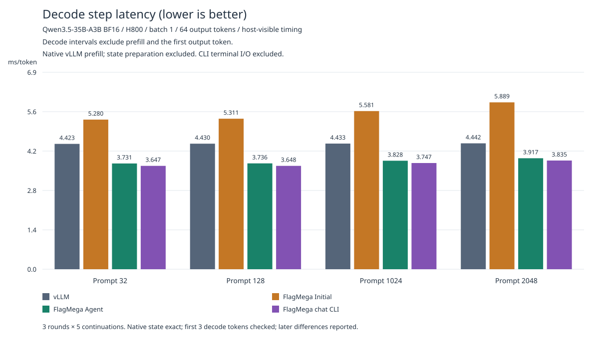
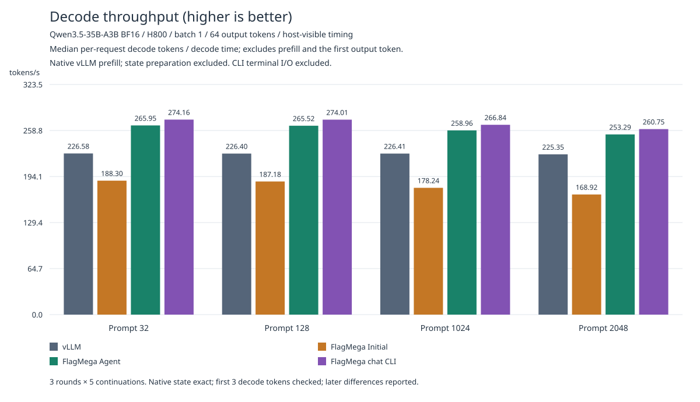

# Qwen3.5-35B-A3B BF16 / H800

Batch-one decode of the complete 40-layer model on one H800: 30 Gated DeltaNet
layers, 10 attention layers, routed/shared experts and greedy sampling.
Native vLLM supplies prefill for prompts of 32/128/1024/2048 tokens. The figures
measure the following 63 decode intervals in a 64-token output, including
host delivery. The prompt lengths, output count and sampling plan follow tutorial 01.

## Results

Measured on October 24, 2026. All four series ran sequentially on the same
H800, with three rotated rounds of five independent requests and two warmups
per prompt. Each table entry is the pooled median of 945 host-visible decode
intervals from 15 requests. Decode throughput is the median per-request
`63 / decode_seconds`, rather than the inverse median latency.

All series use PyTorch 2.11.0+cu130 from the [pinned environment](requirements-reference.txt).
Native vLLM uses Inductor mode three, `custom_ops=['none']` and a size-one
CUDA graph; FlagMega captures its complete decode forward in its own CUDA
graph. Scheduler, sampling and output delivery are timed in the vLLM series.
The standalone chat CLI includes sampling and text decoding; terminal I/O is excluded.

| Prompt tokens | vLLM ms/token | Initial ms/token | Agent ms/token | chat CLI ms/token |
| --- | ---: | ---: | ---: | ---: |
| 32 | 4.423 | 5.280 | 3.731 | 3.647 |
| 128 | 4.430 | 5.311 | 3.736 | 3.648 |
| 1024 | 4.433 | 5.581 | 3.828 | 3.747 |
| 2048 | 4.442 | 5.889 | 3.917 | 3.835 |

Agent's median decode speedup is 1.13–1.19× over vLLM and
1.42–1.50× over Initial. The standalone chat CLI is
1.16–1.21× faster than vLLM.

The long-context policy reduces Agent latency from 3.883 to 3.828 ms/token
at 1024 tokens (1.4%) and from 4.048 to 3.917 at 2048 (3.2%). Short-context
latency changes by less than 0.5%. [Before/after evidence](figures/long_context_comparison.json)
links both complete three-round measurement sets; the
[isolated attention diagnostic](figures/attention_diagnostic.json) is separate from these figures.




Both artifacts prepare with zero spill bytes. Every native prefill snapshot
covers all 40 layers and round-trips exactly through the compiled state ABI.
The first three independently generated decode tokens match native in every
scenario. Agent and chat CLI match all 64 native outputs in every scenario.
Initial first differs at output token 30 for the 32-token prompt; its other
three scenarios match all 64 outputs. Complete native token equality is recorded
rather than required.

Compilation, native prefill, snapshot conversion/restoration and idle gaps
between requests are excluded from timing. Measurements, resource reports
and source fingerprints are in [summary.json](figures/summary.json), with all
12 original round reports in [figures/raw](figures/raw).

## Reproduce

Run from the repository root with a TLE-enabled FlagTree build. Rebuild the
compiler after source changes. Use a fresh trial directory and an idle H800;
the checkpoint and packed weights each require about 70 GB of disk space.

```sh
conda activate flagtree
export TUTORIAL="$PWD/python/tutorials/flagmega/02-qwen3.5-35b-a3b-bf16/nvidia-h800"
export BENCH_WORK="$HOME/flagmega-qwen35-native-prefill"
export CHECKPOINT="$BENCH_WORK/checkpoint"
export CUDA_VISIBLE_DEVICES=0
export OMP_NUM_THREADS=1 MKL_NUM_THREADS=1
export PYTHONPATH="$PWD/python:$TUTORIAL"
mkdir -p "$BENCH_WORK"

python "$TUTORIAL/prepare_checkpoint.py" --output "$CHECKPOINT"
python -m triton.flagmega compile --model "$CHECKPOINT" --full-model \
  --mode decode-1 --num-tokens 1 --numerical-profile nncase \
  --revision 59d61f3ce65a6d9863b86d2e96597125219dc754 --emit-executable \
  --bufferize-opt-level optimized --output "$BENCH_WORK/initial/artifact" \
  --rdata-cache-dir "$BENCH_WORK/rdata-cache"
python "$TUTORIAL/optimize_agent.py" --checkpoint "$CHECKPOINT" \
  --numerical-profile nncase --trial "$BENCH_WORK/agent" \
  --rdata-cache-dir "$BENCH_WORK/rdata-cache"

python3.10 -m venv "$BENCH_WORK/vllm-env"
env -u PYTHONPATH "$BENCH_WORK/vllm-env/bin/python" -m pip install \
  -r "$TUTORIAL/requirements-reference.txt"
env PYTHONPATH="$TUTORIAL" "$BENCH_WORK/vllm-env/bin/python" \
  "$TUTORIAL/prepare_reference.py" --checkpoint "$CHECKPOINT" \
  --trial "$BENCH_WORK/reference" --contexts 32 128 1024 2048 --steps 63

# Import the FlagTree compiler while retaining the reference environment's Torch.
mkdir -p "$BENCH_WORK/flagtree-runtime"
ln -s "$PWD/python/triton" "$BENCH_WORK/flagtree-runtime/triton"
export TRITON_PTXAS_PATH="$BENCH_WORK/vllm-env/lib/python3.10/site-packages/nvidia/cu13/bin/ptxas"
mkdir -p "$BENCH_WORK/results"

for label in native baseline agent chat_cli; do
  runtime=vllm
  set --
  if [ "$label" = native ]; then
    export PYTHONPATH="$TUTORIAL"
  else
    export PYTHONPATH="$BENCH_WORK/flagtree-runtime:$TUTORIAL"
    variant=agent
    if [ "$label" = baseline ]; then variant=initial; fi
    set -- --artifact "$BENCH_WORK/$variant/artifact"
  fi
  if [ "$label" = chat_cli ]; then runtime=chat_cli; fi
  taskset -c 20-23 "$BENCH_WORK/vllm-env/bin/python" "$TUTORIAL/benchmark_requests.py" \
    --checkpoint "$CHECKPOINT" --native-prefill-reference "$BENCH_WORK/reference/report.json" \
    --runtime "$runtime" --label "$label" --prompt-lengths 32 128 1024 2048 \
    --decode-tokens 64 --rounds 3 --repeats 5 --warmups 2 \
    --inter-request-pause 0.5 --output "$BENCH_WORK/results/$label.json" "$@"
done

python "$TUTORIAL/render_results.py" --native-prefill-results "$BENCH_WORK/results" \
  --output "$BENCH_WORK/figures"
```

The benchmark records NVML thermal counters around each request and rejects
new thermal slowdown events. Requests begin at 65 C or below, with at least
0.5 seconds of idle time between them; these gaps are outside decode timing.

## Implementation

**Initial** uses the standard compiler and target. **Agent** applies the
passes and kernel choices in [agent_optimizations](agent_optimizations), through
[optimize_agent.py](optimize_agent.py). Both use the same source BF16 (`nncase`)
import contract. Native vLLM supplies the initial GDN/KV state for every series.

Agent keeps the original 32-token attention tile when each context owner has
at most 32 tokens. Longer contexts use 64-token tiles with QK reductions inside
each warp, reducing repeated shared-memory synchronization while fitting the
persistent program's register budget. The native ordered online-BF16 path
keeps its arithmetic contract. [benchmark_attention.py](benchmark_attention.py)
reproduces the isolated kernel comparison; its CUDA-event timings are excluded
from the request figures.

After setting up the environment above, run the small attention reproducer with:

```sh
env PYTHONPATH="$BENCH_WORK/flagtree-runtime:$TUTORIAL" \
  "$BENCH_WORK/vllm-env/bin/python" "$TUTORIAL/benchmark_attention.py" \
  --trial "$BENCH_WORK/attention-diagnostic"
```

[vllm_adapter.py](vllm_adapter.py) places Initial and Agent inside the native
scheduler and sampler. The standalone chat CLI uses the same Agent artifact
with its own generation loop, GPU sampling and text decoding; its process
never imports vLLM. [generated_kernels.py](generated_kernels.py) is the measured
Agent's generated source snapshot; execution also needs its IR, manifest and
packed weights. Compiler root causes and regression evidence are recorded in
[correctness_alignment.md](correctness_alignment.md).
