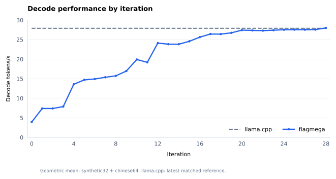

# Qwen3.8-27B IQ4 × decode-1 × RTX 5060 Ti CPP optimization trace

最新原条件严格比较：[t27两次公开重建原8复现](.local/results/matched-t27-public-r1/README.md)。Synthetic32 35.6919901460 vs35.8951393229 ms/token（−0.5659517716%），Chinese64 35.7558040729 vs35.8314655547（−0.2111593277%）；两新build、原NUM/资源/参考/隔离及1152样本均独立通过，reproduction_accepted=true。当前及历史微剖析义务保留，full_microprofile/performance_accepted=false、accepted_best=null；沿用迭代28，不新增迭代。

## Contract and current status

| Field | Value |
| --- | --- |
| Run / task | 20261105T031000Z-cpp-decode; 从原始 GGUF 建立 CPP backend 并优化到超过 llama.cpp |
| Input / numerical contract | qwen3.8-27b-IQ4_XS-pure.gguf; SHA256 ea5a3c45d407f9b9e5d2c0d647f0ea600f486f6b86b92b56d0823ba073dae675; nncase BF16 中间值，F32 state/logits；完整 64 层；Chinese64 + Synthetic32 独立 greedy 首 8 token |
| Hardware / backend / reference | RTX 5060 Ti 16GB, CUDA 13.1, FlagMega cpp, official llama.cpp 5ce06fc71f5e938301f7dc51697a59ae308bd6b7；CUDA graphs, flash attention, BF16 KV, GPU greedy |
| Primary metric / acceptance | host ms/decode，包含 GPU greedy 和 token 回传；双方各 2 进程 × 3 轮，两个场景均须严格更快并满足数值、资源、结构和复现门槛 |
| Iteration qualification / counters | 当前迭代28 / 尝试35；两次公开重建与原8复现通过，不新增迭代；reference仅关联比较28，旧失败/未启动保留 |
| Current baseline / candidate / accepted best | t27/r0001 keep_provisional；公开GGUF重建与严格matched复现通过；accepted_best=null，完整微剖析及历史义务开放 |
| Current status / unmet gates | e52冻结1509行，506条/72组。t27原NUM/P1、两侧普通NCU、两份D库clock、两次公开重建与原8均通过；当前诊断NUM/WG硬件/扰动及历史范围仍待。见[Dashboard](dashboard.html) |
| Public data / iteration figure | [e0052：506记录/72组](.local/results/e0052/summary.json)；[累计图](figures/performance-vs-iteration.svg)；[本次公开复现](.local/results/matched-t27-public-r1/summary.json)；[最新算子图仍t26](.local/figures/operator-latency-candidate.svg) |

## Iteration index

| Entry ID | Attempt | Iteration | Kind | Baseline / trial / revision | Status | Primary result |
| --- | --- | --- | --- | --- | --- | --- |
| [e0001](#e0001) | not_applicable: 环境和构建准备 | not_assigned: 没有完整数值 receipt | environment | b0001 / not_applicable: 无候选 / not_applicable: 无候选 / cpp-nncase-5ce06fc | continuing; 尚无接受的性能结果 | not_run: 正在构建新基线 |
| [p0002](#p0002) | 1 | 0 | baseline | b0001 / none / none / cpp-nncase-5ce06fc | numerically_qualified; not_final_accepted | 64 samples; mean 254.2537 ms; 3.9331 token/s |
| [p0003](#p0003) | 2 | 1 | trial | b0001 / t0001-mmvq / r0001 / cpp-nncase-5ce06fc | numerically_qualified; gap_remaining | 64 samples; mean 135.3412 ms; 7.3887 token/s |
| [p0004](#p0004) | not_applicable: external reference | not_assigned: reference | reference | b0001 / none / none / cpp-nncase-5ce06fc | reference_partial; no_final_win | 96 samples; mean 36.2979 ms; 27.5498 token/s |
| [p0005](#p0005) | not_applicable: core repair | not_assigned: not model iteration | repair | b0001 / none / none / next_cohort_pending | repair_in_progress | null: metadata/profile repair, no runtime measurement |
| [p0006](#p0006) | 3 | 0 | baseline | b0002 / none / none / cpp-nncase-provenance-profile-v2 | numerically_qualified; not_final_accepted | 64 samples; mean 254.5549 ms; 3.9284 token/s |
| [p0007](#p0007) | 4 | 2 | trial | b0002 / t0001-mmvq / r0002 / cpp-nncase-provenance-profile-v2 | numerically_qualified; not_final_accepted | 64 samples; mean 135.2728 ms; 7.3925 token/s |
| [p0008](#p0008) | 5 | 3 | trial | b0002 / t0002-head-cache / r0001 / cpp-nncase-provenance-profile-v2 | numerically_qualified; not_final_accepted | 64 samples; mean 127.0949 ms; 7.8681 token/s |
| [p0009](#p0009) | 6 | 4 | trial | b0002 / t0003-placement96 / r0001 / cpp-nncase-provenance-profile-v2 | numerically_qualified; not_final_accepted | 64 samples; mean 73.7627 ms; 13.5570 token/s |
| [p0010](#p0010) | 7 | 5 | trial | b0002 / t0004-interleaved / r0001 / cpp-nncase-provenance-profile-v2 | numerically_qualified; not_final_accepted | 64 samples; mean 68.0823 ms; 14.6881 token/s |
| [p0011](#p0011) | 8 | 6 | trial | b0002 / t0005-head-dequant / r0001 / cpp-nncase-provenance-profile-v2 | numerically_qualified; not_final_accepted | 64 samples; mean 67.1854 ms; 14.8842 token/s |
| [p0012](#p0012) | 9 | 7 | trial | b0002 / t0006-async-r16 / r0001 / cpp-nncase-provenance-profile-v2 | numerically_qualified; not_final_accepted | 32 samples; mean 64.9727 ms; 15.3911 token/s |
| [p0013](#p0013) | 10 | 8 | trial | b0002 / t0007-async-gdn-warp / r0001 / cpp-nncase-provenance-profile-v2 | numerically_qualified; not_final_accepted | 32 samples; mean 63.5079 ms; 15.7461 token/s |
| [p0014](#p0014) | not_applicable: profiling infrastructure | not_assigned: diagnostics | repair | b0002 / t0006+t0007 / r0001 / wg-microtrace-pm-v1 | partial_evidence; joint_capture_repair | 无正常计时点；m38为23856采样点、m39为23354点 |
| [p0015](#p0015) | not_applicable: profiling infrastructure | not_assigned: diagnostics | repair | b0002 / t0006+t0007 / r0001 / wg-microtrace-pm-v1 | passed_captured_layer0_diagnostics; overhead_pending | m47/m48同次采样与130张SVG通过；无正常计时点 |
| [p0016](#p0016) | 9,10,11 | not_assigned: diagnostics | repair | b0002 / t0006+t0007+t0008 / r0001 / instrumentation-overhead-v1 | overhead_measured; row8_prototype_resources_passed | 两版本开启记录均增加约27.3ms；row8原型可驻留3CTA/SM |
| [p0017](#p0017) | 11 | 9 | trial | b0002 / t0008-async-r8 / r0001 / cpp-nncase-provenance-profile-v2 | numerically_qualified; microprofile_pending; not_final_accepted | Synthetic32 58.9009ms；Chinese64 59.0512ms；96普通样本 |
| [p0018](#p0018) | 11 | not_assigned: diagnostic only | repair | b0002 / t0008-async-r8 / r0001 / t8-WG-NUM-clock-and-PM | partial_diagnostics_passed; paused_ncu_error | 四scope NUM/clock通过；m69 scope0联合图通过；m70入口超容差，无普通性能点 |
| [p0019](#p0019) | 11 | not_assigned: diagnostic only | repair | b0002 / t0008-async-r8 / r0001 / t8-WG-entry-joint-PM-v1 | four_scope_joint_data_figures_overlap_passed; matched perturbation pending; normal performance not accepted | 提前读取入口时间戳；新native四scope全部8门通过；无普通性能点 |
| [p0020](#p0020) | 12 | 10 | trial | b0002 / t0009-head-dualq8-96 / r0001 / cpp-nncase-provenance-profile-v2 | numerically_qualified; screening_valid; current_microprofile_witness_operator_formal_reconstruction_pending; not_final_accepted | Synthetic32 50.2117 ms；Chinese64 50.2721 ms；288 samples，均为1进程×3轮筛选 |
| [p0021](#p0021) | 14 | 11 | trial | b0002 / t0010-direct-r2 / r0002 / cpp-nncase-provenance-profile-v2 | numerically_qualified; unselected_regression; parent_chinese_incomplete; final_profile_reconstruction_pending | Synthetic52.108ms vs parent50.137ms (+3.93%); Chinese parent cohort incomplete; R2 unselected |
| [p0022](#p0022) | 12 | not_assigned: diagnostic only | repair | b0002 / t0009-head-dualq8-96 / r0001 / cta-globaltimer-v2 | current_operator_diagnostic_passed; complete_diagnostic_NUM_and_perturbation_pending; no_performance_acceptance | m0102 全44站点/32token/96CTA诊断与独立导出通过；无普通计时点 |
| [p0023](#p0023) | 12 | not_assigned: diagnostic only | repair | b0002 / t0009-head-dualq8-96 / r0001 / WG-PM-head-v1 | scoped_portable_swimlanes_passed; perturbation_pending; no_performance_acceptance | m0093 的 GDN head 窗口12页轻量导出；无普通计时点 |
| [p0024](#p0024) | 16 | 12 | trial | b0002 / t0011-u4-l / r0002 / cpp-nncase-provenance-profile-v2 | numerically_qualified; provisional_screening_valid; current_U4_profile_matched_win_reconstruction_pending; not_final_accepted | Synthetic41.4270 / Chinese41.5101ms; NUM and6screeningroundspassed; finalpending |
| [p0025](#p0025) | 16 | not_assigned: diagnostic only | repair | b0002 / t0011-u4-l / r0002 / ordinary-program-events-v1 | operator_export_passed; WG_hardware_and_perturbation_pending; no_performance_acceptance | m129 all949 kernel intervals/36 groups; sum44.536192ms; no host timing point |
| [p0026](#p0026) | 16 | not_assigned: diagnostic only | repair | b0002 / t0011-u4-l / r0002 / WG-PM-entry11-v1 | scoped_instrumented_join_and_portable_figures_passed; final_performance_acceptance_open | m137 all69632warp census,12×924PM; CTA0–7 compact detail; no ordinary timing point |
| [p0027](#p0027) | 17 | 13 | trial | b0002 / t0012-glu-rows2 / r0001 / cpp-nncase-provenance-profile-v2 | numerically_qualified; fixed_rows2_rejected_by_local_falsifier; profile_completion_pending; not_final_accepted | Synthetic41.9347/Chinese42.0061ms;288samples; no verified gain |
| [p0028](#p0028) | 17 | 13 | export | b0002 / t0012-glu-rows2 / r0001 / ordinary-NCU-PM | ordinary_NCU_PM_scope_passed; fixed_rows2_rejected; current_diagnostic_device_checks_and_declared_microprofile_pending | m145/m146:12×208/153PM,3.008µs; no ordinary timing point |
| [p0029](#p0029) | 17 | 13 | export | b0002 / t0012-glu-rows2 / r0001 / current-rows2-first-scope | first_scope_scoped_pass; 1_of_13_complete; fixed_rows2_rejected; final_performance_not_accepted | m147–156诊断；当前2SVG+2PNG；普通曲线不变 |
| [p0030](#p0030) | 17 | 13 | export | b0002 / t0012-glu-rows2 / r0001 / current-rows2-ordinary-operator | operator_figure_published; fixed_rows2_rejected; final_performance_not_accepted | m144 all949 /36组当前图；sum45.266688ms；无新增测量 |
| [p0031](#p0031) | 17 | 13 | export | b0002 / t0012-glu-rows2 / r0001 / current-rows2-layer0 | layer0_scoped_pass;2_of_13_complete;fixed_rows2_rejected;final_performance_not_accepted | m157–169诊断；当前layer0全15action、30SVG/30PNG；普通曲线不变 |
| [p0032](#p0032) | 17 | 13 | export | b0002 / t0012-glu-rows2 / r0001 / current-rows2-layer3 | layer3_scoped_pass;3_of_13_complete;fixed_rows2_rejected;final_performance_not_accepted | 当前layer3全17action，34SVG/34PNG；没有新measurement，累计数据仍e0023 |
| [p0033](#p0033) | 17 | 13 | export | b0002 / t0012-glu-rows2 / r0001 / current-rows2-layer63 | layer63_scoped_pass;4_of_13_complete;fixed_rows2_rejected;final_performance_not_accepted | 当前layer63全17action，34SVG/34PNG；m170–m178九次诊断补充，普通曲线不变 |
| [p0034](#p0034) | 17 | 13 | export | b0002 / t0012-glu-rows2 / r0001 / current-rows2-head-coarse | head_coarse_scoped_pass;5_of_13_complete;fixed_rows2_rejected;final_performance_not_accepted | 当前head-coarse四action，8SVG/8PNG；m179–184六次诊断，普通曲线不变 |
| [p0035](#p0035) | 17 | 13 | export | b0002 / t0012-glu-rows2 / r0001 / current-rows2-head-i0-j0 | head_i0_j0_scoped_pass;6_of_13_complete;fixed_rows2_rejected;final_performance_not_accepted | 当前head-i0-j0四action矩阵细节，8SVG/8PNG；m185–190六次诊断，普通曲线不变 |
| [p0036](#p0036) | 18 | 14 | export | b0002 / t0013-glu-q8-align16 / r0001 / cpp-nncase-provenance-profile-v2 | complete_NUM_qualified; fixed_candidate_rejected_by_predeclared_local_O; current_microprofile_pending; not_final_accepted | Synthetic41.954072/Chinese42.005093ms; combined128+5.0603%; 193records/32groups |
| [p0037](#p0037) | 17 | 13 | export | b0002 / t0012-glu-rows2 / r0001 / current-rows2-head-i0-j1 | head_i0_j1_scoped_pass;7_of_13_complete;fixed_rows2_rejected;final_performance_not_accepted | 四action实际word1，8SVG/8PNG；六条诊断；e28 ordinary不变 |
| [p0038](#p0038) | 17 | 13 | export | b0002 / t0012-glu-rows2 / r0001 / current-rows2-head-i0-j2 | head_i0_j2_scoped_pass;8_of_13_complete;fixed_candidates_rejected;final_performance_not_accepted | 4action word2，8SVG/8PNG；9条诊断；普通e28不变 |
| [p0039](#p0039) | 17 | 13 | export | b0002 / t0012-glu-rows2 / r0001 / current-rows2-head-i0-j3 | head_i0_j3_scoped_pass;9_of_13_complete;m214_invalid_retained;fixed_candidates_rejected;final_performance_not_accepted | 4action word3，8SVG/8PNG；9诊断含m214无效；普通e28不变 |
| [p0040](#p0040) | 19 | 15 | export | b0002 / t0014-glu-warp-private-row4 / r0001 / cpp-nncase-provenance-profile-v2 | complete_NUM_qualified; keep_provisional; current_full_microprofile_pending; not_final_accepted | Synthetic40.684712/Chinese40.739749ms; GLU64−2.772342%; all949−0.493512%;225records/34groups |
| [p0041](#p0041) | 19 | 15 | export | b0002 / t0014-glu-warp-private-row4 / r0001 / current-row4-diagnostic | entry11_scoped_pass; current_t14_1_of_13; keep_provisional; not_final_accepted | m227–240十四条诊断；t14首范围1/13，CTA0四warp与同次GPU采样；普通e32不变 |
| [p0042](#p0042) | 20 | 16 | export | b0002 / t0015-convolution-channel128 / r0001 / cpp-nncase-provenance-profile-v2 | complete_NUM_and_state_qualified;keep_provisional;full_microprofile_and_matched_reconstruction_pending;not_final_accepted | Synthetic38.981281/Chinese39.046647ms; convolution48−83.8356%; all949−4.0678%;268records/36groups |
| [p0043](#p0043) | 21 | 17 | export | b0002 / t0016-gdn-global-dualq8-fixed96 / r0001 / cpp-nncase-provenance-profile-v2 | complete_NUM_and_O_qualified;keep_provisional;full_microprofile_and_matched_reconstruction_pending;not_final_accepted | Synthetic37.823453/Chinese37.889339ms; GDN48−38.4847%; all949−2.5903%;275records/38groups |
| [p0044](#p0044) | 17 | 13 | export | b0002 / t0012-glu-rows2 / r0001 / retained-head-i1-j0-diagnostic | scoped_publication_passed;10_of_13;fixed_rows2_rejected;not_final_accepted | 四action八图；994208warp；无新测量或普通样本 |
| [p0045](#p0045) | 22 | 18 | trial | b0002 / t0017-iq4-pair-interleave36 / r0001 / original-screening-and-full949-O | rejected_fixed_falsifier;not_accepted | 受影响256调用23.202432→23.278336 ms（+0.3271%）；编码器+8.845%，矩阵+0.1039%；全部949调用40.889024→41.057344 ms（+0.4117%）。 |
| [p0046](#p0046) | 23 | 19 | trial | b0002 / t0018-gdn-qk-register-hoist / r0001 / original-screening-and-full949-O | keep_provisional;not_final_accepted | GDN48 1.826656→1.422400 ms（−22.1309%）；全部949调用40.987200→40.492768 ms（−1.2063%）；其余901调用−0.2303%。 |
| [p0047](#p0047) | 17 | 13 | export | b0002 / t0012-glu-rows2 / r0001 / retained-head-i1-j1-j3-diagnostic | scoped_publication_passed;12_of_13;fixed_rows2_rejected;not_final_accepted | 两范围16SVG/16PNG，无新测量、普通样本或迭代 |
| [p0048](#p0048) | 23，当前 t18；21，保留 t16；本导出新增 0 | not_assigned: 诊断导出无新迭代，原 t18 19、t16 17 保持 | export | b0002 / t0018-gdn-qk-register-hoist/r0001；t16 候选及父级按原捕获身份保留 / t18-candidate、t16-candidate、t16-parent 三个独立轴 cohort | scoped_publication_passed；展示 3/3 cohort、144/144 action 通过；非全候选/全微剖析/普通性能接受 | 3 cohorts×48/48;147SVG/147PNG;144event pages;no new ordinary samples or iteration |
| [p0049](#p0049) | 26 | 20 | trial | b0002 / t0019-input-norm-q8-fusion / r0003 / original-screening-and-full949to885-O | keep_provisional;not_final_accepted | 64层归一化/Q8融合；完整NUM通过；input−64.56%、全调用−2.07%；e0040已发布 |
| [p0050](#p0050) | 27 | 21 | trial | b0002 / t0020-down-warp-private-row4 / r0001 / original-screening-and-full885-O | rejected; not_final_accepted | 完整NUM/O有效；down64 +1.0018%、full885 +0.4829%，固定A52失败；e0041 |
| [p0051](#p0051) | 26 | 20 | export | b0002 / t0019-input-norm-q8-fusion / r0003 / full64-norm-q8-joint-diagnostics | published_diagnostics; not_final_accepted | 192 action全warp/采样硬件与呈现通过，3008 SVG；零新ordinary点；e0042 |
| [p0052](#p0052) | 28 | 22 | trial | b0002 / t0021-residual-postnorm-q8-fusion / r0001 / cpp-nncase-provenance-profile-v2 | rejected_fixed_A53_falsifier_failed; not_final_accepted | 完整NUM/O有效；post_attention+11.236%、all+0.20564%；e0043 |
| [p0053](#p0053) | 29 | 23 | trial | b0002 / t0022-glu-iq4-packet64 / r0001 / cpp-nncase-provenance-profile-v2 | rejected_fixed_A54_performance_condition; not_final_accepted | NUM/O有效；GLU+0.166238%、whole−0.523899%；固定条件拒绝，e0044 |
| [p0054](#p0054) | 31 | 24 | trial | b0002 / t0023-gdn-fullhead48-shared-rms / r0002 / cpp-nncase-provenance-profile-v2 | keep_provisional_fixed_A55_performance_condition_passed; not_final_accepted | GDN−10.187840%、whole−0.310985%；暂时保留；e0045 |
| [p0055](#p0055) | 31 | 24 | export | t19/r0003 parent / t23/r0002 candidate / retained-diagnostic-events | all96_GDN_diagnostic_scope_qualified; ordinary_keep_provisional; not_final_accepted | 全96GDN限定诊断通过；408记录/52组/0新普通点；e0046 |
| [p0056](#p0056) | 32 | 25 | trial | b0002 / t0024-input-norm-common-q8 / r0001 / cpp-nncase-provenance-profile-v2 | keep_provisional_fixed_A56_performance_condition_passed; not_final_accepted | affected−6.291839%、whole−0.362749%；暂时保留；e0047 |
| [p0057](#p0057) | 33 | 26 | trial | b0002 / t0025-glu-iq4-reader-reuse / r0001 / cpp-nncase-provenance-profile-v2 | rejected_fixed_A58_dual_decrease_failed; complete_NUM_O_valid; not_final_accepted | GLU64+0.043453%，A58失败；t25拒绝，e0048 |
| [p0058](#p0058) | 34 | 27 | trial | b0002 / t0026-output-norm-owner / r0001 / cpp-nncase-provenance-profile-v2 | keep_provisional_fixed_A59_passed; complete_NUM_O_valid; not_final_accepted | NormStats64−2.813344%，all869−0.189695%；t26暂时保留，e0049 |
| [p0059](#p0059) | 35 | 28 | trial | b0003 / t0027-counter-epoch-reset49 / r0001 / cpp-b0003-same-core-full-forward-P1; baseline plot0 only within this new cohort | keep_provisional; complete_NUM_fixed_P1_passed; final_performance_not_accepted | 原固定P1两场景−1.625%/−1.641%，e0050 |
| [p0060](#p0060) | 35 | 28 | trial | 原reference / t0027-counter-epoch-reset49 / r0001 / matched-t27-r1 | strict_matched_win; original_cohort_qualified; final_profile_GGUF_pending | 原matched两场景−0.531833%/−0.179368%，e0051 |
| [p0061](#p0061) | 35 | 28 | trial | 原reference / t0027-counter-epoch-reset49 / r0001 / matched-t27-public-r1 | public_reproduction_strict_win; full_microprofile_pending; not_final_accepted | 两次公开重建原8复现−0.565952%/−0.211159%；e0052 |
| [p0062](#p0062) | 17 | 13 | export | b0002 / t0012-glu-rows2 / r0001 / retained-head-i1-j2 | scoped_presentation_published;13_of_13;fixed_rows2_rejected;not_final_accepted | t12最后head-i1-j2已发布，声明范围13/13；无新普通点，e0053 scoped |
| [p0063](#p0063) | 18 | 14 | export | b0002 / t0013-glu-q8-align16 / r0001 / retained-layer0 | scoped_layer0_presentation_published;other_scopes_TMA_pending;not_final_accepted | t13 layer0 30SVG/30PNG与256等待相交；TMA/其他scope待；无新普通点，e0054 scoped |
| [p0064](#p0064) | 19 | 15 | export | b0002 / t0014-glu-warp-private-row4 / r0001 / retained-layer0 | scoped_layer0_presentation_published;other_scopes_TMA_pending;not_final_accepted | t14 layer0 30SVG/30PNG与224等待相交；TMA/其他scope待；无新普通点，e0055 scoped |
| [p0065](#p0065) | 35 | 28 | export | b0002 / t0027-counter-epoch-reset49 / r0001 / current-D-NUM | current_D_NUM_independently_qualified;WG_performance_full_microprofile_pending | 四个当前D完整NUM通过；保留失败/clock；无新普通点，e0056诊断补充 |


## Entries

<a id="e0001"></a>

### e0001 — 新建 CPP 工作区并核实环境与参考版本

| Field | Value |
| --- | --- |
| Entry / run / UTC | e0001 / 20261105T031000Z-cpp-decode / 2026-11-05T03:10:00Z |
| Attempt | not_applicable: 环境和构建准备 |
| Iteration / kind | not_assigned: 没有完整数值 receipt / environment |
| Numerical qualification | not_qualified: 尚未完整执行两场景 |
| Baseline / trial / revision / cohort | b0001 / not_applicable: 无候选 / not_applicable: 无候选 / cpp-nncase-5ce06fc |
| Owners / assignments | root Orchestrator; architect/a001; harness/a001; kernel_optimizer/a001 |
| Status | continuing; 尚无接受的性能结果 |

#### 1. Problem and evidence

用户指定的新目录不存在。保留所有现有 core 修改；新工作区从原始 GGUF 导入。GPU 查询为 RTX 5060 Ti 16GB 且初始空闲。历史 sibling 为 Triton，旧外部 CPP run 只用于排查失败机制，性能不沿用。

#### 2. Plan and conditional benefit

当前 CPP IQ4 dot 每线程串行遍历 K，初步假设是主要性能瓶颈。先建立正常 CPP 编译和完整模型基线，再逐段移植当前 llama.cpp MMVQ/DP4A 映射。此条为环境准备，not_applicable：无性能提升测量。

#### 3. Changes and execution identities

新建独立 run，保存初始 Git 状态和 diff；新增 CPP compile.py，强制 --codegen-backend cpp，从原始 GGUF 导入并正常 verify/inspect/compile/artifact verify。构建固定 upstream 5ce06fc。环境为 Python 3.10.19，torch 2.8.0+cu128，Triton 3.6.0，NVCC 13.1.115。源码哈希随 build.json 保存。

#### 4. Review and validation

| Gate | Criterion / scope | Actual result / exit | Evidence |
| --- | --- | --- | --- |
| environment | 真实 GPU、编译器和解释器依赖 | passed: 导入成功，NVCC 与 GPU 可用 | optional private archive: run workspace.json 和 probes/layer0 |
| build | 单层正常 CPP 编译和 artifact verify | passed: exit 0 | optional private archive: probes/layer0/build.json |
| numerical | 两场景完整独立生成 | not_run: 正在构建完整模型 | pending b0001 |
| review | 独立实现审查 | not_run: 实现准备中 | pending independent reviewer |
| reproduction | 全模型从原 GGUF 重建并复验 | not_run: 尚无候选 | pending root |

#### 5. Performance records

| Measurement ID / attempt / iteration / cohort | Variant / scenario / kind / boundary | Samples / mean / median / p95 / throughput | Comparison / validity | Evidence |
| --- | --- | --- | --- | --- |
| none / not_applicable / not_assigned / cpp-nncase-5ce06fc | environment / both / preparation / no timing | null: 尚无性能执行 | not_applicable: 无性能声称 | pending measurement ledger |

#### 6. Decision and next action

继续构建完整 CPP 基线与最新 llama.cpp。KernelOptimizer 实现可追溯 MMVQ 移植；独立审查后数值及性能评估。目标未达到。

#### 7. Published data and figures

not_run：尚无完整模型执行验证或合格迭代；首次验证由 Verifier 提交算子图与累计迭代图，root 同步公共数据与 README。所有 runtime gate 仍开放。

<a id="p0002"></a>

### p0002 — 完整 CPP 基线通过数值合同；保留并重测受竞争影响的计时

| Field | Value |
| --- | --- |
| Entry / run / UTC | p0002 / 20261105T031000Z-cpp-decode / 2026-11-05 |
| Attempt | 1 |
| Iteration / kind | 0 / baseline |
| Numerical qualification | passed: [完整基线数值 receipt](.local/results/e0001/qualification-b0001.json)；[iteration allocation](.local/results/e0001/allocation-b0001.json) |
| Baseline / trial / revision / cohort | b0001 / none / none / cpp-nncase-5ce06fc |
| Owners / assignments | root Orchestrator; architect/a001; kernel_optimizer/a001; reviewer/a001-a003 |
| Status | numerically_qualified; not_final_accepted |

#### 1. Problem and evidence

原始模型全部 64 层已正常导入/编译。首次 Chinese64 计时观察到 PID 1686184 短暂 CUDA context，性能排除；完整数值检查通过，随后重新计时。

#### 2. Plan and conditional benefit

建立真实当前 CPP baseline；本条不声称性能优化。按相同 graph + greedy + CPU token 返回边界测量。

#### 3. Changes and execution identities

普通 CPP 编译，无本地 recipe。完整源码、IR、库和命令身份在公开 receipt 中固定；原始 GGUF SHA256 已校验。

#### 4. Review and validation

| Gate | Criterion / scope | Actual result / exit | Evidence |
| --- | --- | --- | --- |
| IR / source review | 三函数、48 GDN + 16 attention，全部 compute adapters 各0 | passed | reviewer/a001；完整类型清单保留私有 archive |
| numerical / state | 两场景、独立首8、finite、eager/graph、自身轨迹与reset | passed / exit0 | [qualification](.local/results/e0001/qualification-b0001.json) |
| isolation | 实际全child CPU/GPU观察 | m4 GPU failure excluded; m5,m10 clear | [public records](.local/results/e0001/summary.json) |
| profile / final acceptance | 实际32CTA算子计时、最终复现 | pending: 尚未完成v2诊断构建及最终复现 | v2 repair；本条非最终接受 |

#### 5. Performance records

| Measurement ID / attempt / iteration / cohort | Variant / scenario / kind / boundary | Samples / mean / median / p95 / throughput | Comparison / validity | Evidence |
| --- | --- | --- | --- | --- |
| m0010-baseline-chinese64-repeat / 1 / 0 / cpp-nncase-5ce06fc | baseline / chinese64 / screening / host graph decode+GPUgreedy+one CPU token return; setup/reset/prompt injection/logit diagnostics/warmup excluded | 64 samples; mean 254.2537 ms; 3.9331 token/s | 有效重测；首次 m4 计时排除并保留 | [public raw samples + median/p95](.local/results/e0001/summary.json) |
| m0005-b1-synthetic32 / 1 / 0 / cpp-nncase-5ce06fc | baseline / synthetic32 / screening / host graph decode+GPUgreedy+one CPU token return; setup/reset/prompt injection/logit diagnostics/warmup excluded | 32 samples; mean 253.8922 ms; 3.9387 token/s | 有效筛选；1测量轮 | [public raw samples + median/p95](.local/results/e0001/summary.json) |
| m0004-b1-chinese64 / 1 / 0 / cpp-nncase-5ce06fc | baseline / chinese64 / screening / host graph decode+GPUgreedy+one CPU token return; setup/reset/prompt injection/logit diagnostics/warmup excluded | 64 samples; mean 253.6756 ms; 3.9420 token/s | 无效性能：GPU context overlap；数值合格 | [public raw samples + median/p95](.local/results/e0001/summary.json) |

#### 6. Decision and next action

基线数值合格，分配 iteration0；继续采用同模型可追溯 MMVQ 移植优化。

#### 7. Published data and figures

[累计迭代图](figures/performance-vs-iteration.svg) 与 [全部样本、接受状态和来源](.local/results/e0001/summary.json) 覆盖 iteration 0–1；所有失败或不合格测量仍保留。算子延迟 SVG pending：现有 v1 仅支持 96 CTA，正在审查支持实际 32 CTA 的 v2；没有用总时间分摊伪造算子数据。


<a id="p0003"></a>

### p0003 — warp 协作 IQ4/DP4A 与双 Q8 GLU：首次合格优化迭代

| Field | Value |
| --- | --- |
| Entry / run / UTC | p0003 / 20261105T031000Z-cpp-decode / 2026-11-05 |
| Attempt | 2 |
| Iteration / kind | 1 / trial |
| Numerical qualification | passed: [完整候选数值 receipt](.local/results/e0001/qualification-t0001-r0001.json)；[allocation](.local/results/e0001/allocation-t0001-r0001.json) |
| Baseline / trial / revision / cohort | b0001 / t0001-mmvq / r0001 / cpp-nncase-5ce06fc |
| Owners / assignments | root Orchestrator; architect/a001; kernel_optimizer/a001; reviewer/a001-a003 |
| Status | numerically_qualified; gap_remaining |

#### 1. Problem and evidence

基线每线程串行计算完整 K。替换 11 个矩阵站点后，两场景均约135ms，相比有效基线约1.88倍提速。

#### 2. Plan and conditional benefit

逐段移植官方 llama.cpp IQ4 MMVQ/Q8 量化/PRMT/DP4A；每 warp 负责一行，CTA 共享一次激活量化，GLU 使用 Q8 高值与残差双分量以满足既定首8生成合同。并行 K 与消除重复解码预计降延迟；量化额外误差和资源占用须实测。

#### 3. Changes and execution identities

仅 local_optimizations；正常代码生成，未补丁修改生成源。上游5ce06fc与MIT许可证/符号映射见 [upstream lineage](local_optimizations/upstream.md)。typed final IR 与 b0001 字节相同。当前 CUDA 属性：156 registers/thread、21372B shared、16B local、3 resident blocks/SM，32 CTA合作启动通过。

#### 4. Review and validation

| Gate | Criterion / scope | Actual result / exit | Evidence |
| --- | --- | --- | --- |
| independent source / ABI | 11站点、全warp参与、lane0 store、CTA发布与scratch复用 | passed diagnostic-safe | reviewer/a002；源码重新生成哈希相同 |
| device helper self-check | 24组长短K/对齐/zero/rowguard | passed; non-acceptance self-check | private kernel_optimizer/a001/device-check.json |
| numerical / state | 完整两场景 first8 和自身全部轨迹 | passed / exit0 | [qualification](.local/results/e0001/qualification-t0001-r0001.json) |
| performance / reproduction | 两个场景严格超llama、2进程×3轮、fresh重建 | not_met / pending | 初测仍明显落后；独立profile和最终复现待完成 |

#### 5. Performance records

| Measurement ID / attempt / iteration / cohort | Variant / scenario / kind / boundary | Samples / mean / median / p95 / throughput | Comparison / validity | Evidence |
| --- | --- | --- | --- | --- |
| m0006-candidate-chinese64 / 2 / 1 / cpp-nncase-5ce06fc | candidate / chinese64 / screening / host graph decode+GPUgreedy+one CPU token return; setup/reset/prompt injection/logit diagnostics/warmup excluded | 64 samples; mean 135.3412 ms; 7.3887 token/s | 有效筛选；非正式最终2进程结果 | [public raw samples + median/p95](.local/results/e0001/summary.json) |
| m0007-candidate-synthetic32 / 2 / 1 / cpp-nncase-5ce06fc | candidate / synthetic32 / screening / host graph decode+GPUgreedy+one CPU token return; setup/reset/prompt injection/logit diagnostics/warmup excluded | 32 samples; mean 135.1221 ms; 7.4007 token/s | 有效筛选；比同边界llama约3.72倍慢 | [public raw samples + median/p95](.local/results/e0001/summary.json) |

#### 6. Decision and next action

保留作为数值合格 iteration1，不能接受为目标完成。下一步通过实际 profile 定位 GDN 重复 A/B 投影，并评估多CTA/SM并行度。

#### 7. Published data and figures

[累计迭代图](figures/performance-vs-iteration.svg) 与 [全部样本、接受状态和来源](.local/results/e0001/summary.json) 覆盖 iteration 0–1；所有失败或不合格测量仍保留。算子延迟 SVG pending：现有 v1 仅支持 96 CTA，正在审查支持实际 32 CTA 的 v2；没有用总时间分摊伪造算子数据。


<a id="p0004"></a>

### p0004 — 最新官方 llama.cpp 同边界基准与竞争排除

| Field | Value |
| --- | --- |
| Entry / run / UTC | p0004 / 20261105T031000Z-cpp-decode / 2026-11-05 |
| Attempt | not_applicable: external reference |
| Iteration / kind | not_assigned: reference / reference |
| Numerical qualification | not_applicable: reference does not qualify a candidate |
| Baseline / trial / revision / cohort | b0001 / none / none / cpp-nncase-5ce06fc |
| Owners / assignments | root Orchestrator; architect/a001; kernel_optimizer/a001; reviewer/a001-a003 |
| Status | reference_partial; no_final_win |

#### 1. Problem and evidence

历史参考数字不能用于新 CPP 结论；从本次最新官方5ce06fc源码完整 CUDA 构建并运行。Chinese64 reference child 期间存在无关 RISC-V cc1plus，当前仅作为无效诊断保留。

#### 2. Plan and conditional benefit

保持原始GGUF、CUDA graph、flash attention、BF16 KV、GPU greedy、CPU token return，与候选相同计时边界。外部SOTA比较本地重现，非引用发布数字。

#### 3. Changes and execution identities

新增 reference_identity.py/build_reference.py：校验干净 tracked 源码、CMake配置、实际库和ldd解析，执行前后检查。手动fresh构建有完整工具/编译日志，采用明确标注的adoption；未伪造预构建源码字节快照。

#### 4. Review and validation

| Gate | Criterion / scope | Actual result / exit | Evidence |
| --- | --- | --- | --- |
| source / libraries | clean commit、精确工具链/CMake/lib/runner linkage | passed | [reference records](.local/results/e0001/summary.json)；reviewer/a002 |
| golden | 两场景完整logits供数值诊断 | passed / exit0 | m2,m3；边界不同，不用于性能 |
| timing isolation | CPU/GPU全child监控 | m8 CPU failed/excluded；m9 clear | [public records](.local/results/e0001/summary.json) |

#### 5. Performance records

| Measurement ID / attempt / iteration / cohort | Variant / scenario / kind / boundary | Samples / mean / median / p95 / throughput | Comparison / validity | Evidence |
| --- | --- | --- | --- | --- |
| m0009-reference-synthetic32 / not_applicable / not_assigned / cpp-nncase-5ce06fc | reference / synthetic32 / formal / host graph decode+GPUgreedy+one CPU token return; setup/reset/prompt injection/logit diagnostics/warmup excluded | 96 samples; mean 36.2979 ms; 27.5498 token/s | 有效3轮单进程；仍缺第二进程 | [public raw samples + median/p95](.local/results/e0001/summary.json) |
| m0008-reference-chinese64 / not_applicable / not_assigned / cpp-nncase-5ce06fc | reference / chinese64 / formal / host graph decode+GPUgreedy+one CPU token return; setup/reset/prompt injection/logit diagnostics/warmup excluded | 192 samples; mean 36.0950 ms; 27.7047 token/s | 无效性能：外部CPU compilation；GPU观察clear | [public raw samples + median/p95](.local/results/e0001/summary.json) |

#### 6. Decision and next action

Synthetic32参考为36.2979ms/token，候选135.1221ms/token，目标未达到。继续优化，并在正式比较中重新测量双场景、双进程轮转。

#### 7. Published data and figures

[累计迭代图](figures/performance-vs-iteration.svg) 与 [全部样本、接受状态和来源](.local/results/e0001/summary.json) 覆盖 iteration 0–1；所有失败或不合格测量仍保留。算子延迟 SVG pending：现有 v1 仅支持 96 CTA，正在审查支持实际 32 CTA 的 v2；没有用总时间分摊伪造算子数据。


<a id="p0005"></a>

### p0005 — 构建证据与算子 profiler 修复，准备下一 core cohort

| Field | Value |
| --- | --- |
| Entry / run / UTC | p0005 / 20261105T031000Z-cpp-decode / 2026-11-05 |
| Attempt | not_applicable: core repair |
| Iteration / kind | not_assigned: not model iteration / repair |
| Numerical qualification | not_applicable: infrastructure repair has no new model numerical qualification |
| Baseline / trial / revision / cohort | b0001 / none / none / next_cohort_pending |
| Owners / assignments | root Orchestrator; architect/a001; kernel_optimizer/a001; reviewer/a001-a003 |
| Status | repair_in_progress |

#### 1. Problem and evidence

独立审查发现默认无寄存器限制的 CPP 构建未保存实际 NVCC argv/version/hash；旧 profile 仅容许固定96CTA，无法测实际32CTA。

#### 2. Plan and conditional benefit

记录默认构建的真实编译器证据；添加严格版本化 v2 静态schedule profiler，动态推导网格和event/site次数。此修复不声称模型runtime提速；正常模型指令应保持不变。

#### 3. Changes and execution identities

已修复默认 CPP build provenance，真实NVCC回归先失败 KeyError(build_options)，修复后17项通过。profile-v2初版的隐式barrier规范化和clock身份绑定问题已由独立审查发现，正在私有新revision修复；尚未应用未通过审查的profile补丁。

#### 4. Review and validation

| Gate | Criterion / scope | Actual result / exit | Evidence |
| --- | --- | --- | --- |
| core provenance | 真实无cap与cap168构建命令/哈希和拒绝条件 | 17 passed；before failure retained | private agents/root/provenance-fix |
| independent review | 默认provenance与v2安全/身份 | provenance source passed；v2 changes_requested | profile_reviewer/a001 PRF-001/002 |
| baseline coherence | 核心修复后重建两侧 | pending: 等待v2补丁审查后统一重建 | 下一baseline cohort；旧结果保持原身份 |

#### 5. Performance records

| Measurement ID / attempt / iteration / cohort | Variant / scenario / kind / boundary | Samples / mean / median / p95 / throughput | Comparison / validity | Evidence |
| --- | --- | --- | --- | --- |
| not_applicable / none / none / next_cohort_pending | infrastructure / no timed model run | null: metadata/profile repair, no runtime measurement | not_applicable: no speed claim | [existing history](.local/results/e0001/summary.json) |

#### 6. Decision and next action

修复评审问题、运行回归，重建baseline与候选并补齐真实算子SVG。已建立同文件系统 CoW readonly cache 缩短重复打包，不能计作decode优化。

#### 7. Published data and figures

[累计迭代图](figures/performance-vs-iteration.svg) 与 [全部样本、接受状态和来源](.local/results/e0001/summary.json) 覆盖 iteration 0–1；所有失败或不合格测量仍保留。算子延迟 SVG pending：现有 v1 仅支持 96 CTA，正在审查支持实际 32 CTA 的 v2；没有用总时间分摊伪造算子数据。

<a id="p0006"></a>

### p0006 — 修复后的当前 core 基线与完整算子计时

| Field | Value |
| --- | --- |
| Entry / run / UTC | p0006 / 20261105T031000Z-cpp-decode / 2026-11-05 |
| Attempt | 3 |
| Iteration / kind | 0 / baseline |
| Numerical qualification | passed: [qualification](.local/results/e0002/qualification-b0002.json)；[allocation](.local/results/e0002/allocation-b0002.json) |
| Baseline / trial / revision / cohort | b0002 / none / none / cpp-nncase-provenance-profile-v2 |
| Owners / assignments | root Orchestrator; kernel_optimizer/a003; profile_reviewer/a002-a003; harness/a003; reviewer/a005 |
| Status | numerically_qualified; not_final_accepted |

#### 1. Problem and evidence

默认无寄存器限制的构建证据缺失、v1固定96CTA限制已修复。独立复审关闭隐式barrier规范化和clock设备/库身份绑定问题；以新cohort重建两侧，旧cohort记录不改写。

#### 2. Plan and conditional benefit

这次基础设施修复不预期改变普通模型指令或decode速度。v2对静态uniform调用图直接记录全部叶调用和同步事件，用于定位下一优化，而不分摊总时间。

#### 3. Changes and execution identities

正常NVCC编译、artifact验证及完整来源快照已保存；该普通版本生成C++与对应旧版本逐字节相同。共同source identity为a5182a2cc158643a42886d97abd9c6679d31577f1494e03f3861c9b9fd13b5c2。profile为单独构建的32CTA诊断库；剥离已审查插桩后模型代码与普通版本相同。

#### 4. Review and validation

| Gate | Criterion / scope | Actual result / exit | Evidence |
| --- | --- | --- | --- |
| core regression / review | 真实NVCC默认/168cap证据与v2全部身份/事件校验 | passed: 17 NVCC-related +64 core +33 archive CPU checks | 独立profile_reviewer/a002；修复前失败证据保留 |
| numerical / state / resources | 完整Chinese64、Synthetic32；finite、独立首8、eager/graph、state/reset、实际CUDA合作资源 | passed / exit0 | [qualification](.local/results/e0002/qualification-b0002.json) |
| profile / raw audit | 全部44站点、1062叶调用+980同步/CTA、33帧、clock和实际加载身份 | passed / exit0；每token32CTA；1 ns/tick | [独立完整raw导出receipt](.local/results/e0002/operator-m0011-export-verification.json) |
| timing isolation | 全部child期间抽样GPU/CPU编译进程 | passed: 两场景和对应profile均clear | [全部16条历史记录](.local/results/e0002/summary.json) |
| strict win / reproduction | 两个场景更快、2进程×3轮轮转、最终原GGUF重建 | not_met: 仍约135ms候选对36.30ms参考；最终重建pending | 保留筛选身份，无accepted best |

#### 5. Performance records

| Measurement ID / attempt / iteration / cohort | Variant / scenario / kind / boundary | Samples / mean / median / p95 / throughput | Comparison / validity | Evidence |
| --- | --- | --- | --- | --- |
| m0015-b0002-chinese64 / 3 / 0 / cpp-nncase-provenance-profile-v2 | baseline / chinese64 / screening / host graph replay + GPU greedy + slot/token feedback + one CPU token; setup/reset/prompt/diagnostics/warmup excluded | 64 samples; mean 254.5549 ms; 3.9284 token/s | 有效筛选；完整两场景数值合格；非最终2进程×3轮 | [public raw samples + median/p95](.local/results/e0002/summary.json) |
| m0013-b0002-synthetic32 / 3 / 0 / cpp-nncase-provenance-profile-v2 | baseline / synthetic32 / screening / host graph replay + GPU greedy + slot/token feedback + one CPU token; setup/reset/prompt/diagnostics/warmup excluded | 32 samples; mean 253.8137 ms; 3.9399 token/s | 有效筛选；完整两场景数值合格；非最终2进程×3轮 | [public raw samples + median/p95](.local/results/e0002/summary.json) |
| m0011 / 3 / not_assigned: separately instrumented diagnostic / cpp-nncase-provenance-profile-v2 | baseline / synthetic32 / profiling / 每token按CTA取均值并累计相同站点 | 33 raw frames; 32 samples/site; 44 sites; 2042 events/CTA | 完整raw审计通过；不作为端到端验收时间 | [完整站点样本与来源](.local/results/e0002/operator-m0011.json) |

#### 6. Decision and next action

保留新cohort baseline0，作为后续候选的同core数值与性能对照。

#### 7. Published data and figures

[累计迭代0–2图](figures/performance-vs-iteration.svg) 与 [完整历史](.local/results/e0002/summary.json) 保留全部16条测量。该验证的[全部44站点算子SVG](.local/figures/operator-latency-baseline.svg)、[自包含样本](.local/results/e0002/operator-m0011.json)和[独立raw审计导出收据](.local/results/e0002/operator-m0011-export-verification.json) 可由公开render_operator_profile.py重画。CTA均值包含内部等待，不能解释为端到端关键路径。


<a id="p0007"></a>

### p0007 — 同 MMVQ 在新 core cohort 重新数值合格

| Field | Value |
| --- | --- |
| Entry / run / UTC | p0007 / 20261105T031000Z-cpp-decode / 2026-11-05 |
| Attempt | 4 |
| Iteration / kind | 2 / trial |
| Numerical qualification | passed: [qualification](.local/results/e0002/qualification-t0001-r0002.json)；[allocation](.local/results/e0002/allocation-t0001-r0002.json) |
| Baseline / trial / revision / cohort | b0002 / t0001-mmvq / r0002 / cpp-nncase-provenance-profile-v2 |
| Owners / assignments | root Orchestrator; kernel_optimizer/a003; profile_reviewer/a002-a003; harness/a003; reviewer/a005 |
| Status | numerically_qualified; not_final_accepted |

#### 1. Problem and evidence

默认无寄存器限制的构建证据缺失、v1固定96CTA限制已修复。独立复审关闭隐式barrier规范化和clock设备/库身份绑定问题；以新cohort重建两侧，旧cohort记录不改写。

#### 2. Plan and conditional benefit

这次基础设施修复不预期改变普通模型指令或decode速度。v2对静态uniform调用图直接记录全部叶调用和同步事件，用于定位下一优化，而不分摊总时间。

#### 3. Changes and execution identities

正常NVCC编译、artifact验证及完整来源快照已保存；该普通版本生成C++与对应旧版本逐字节相同。共同source identity为a5182a2cc158643a42886d97abd9c6679d31577f1494e03f3861c9b9fd13b5c2。profile为单独构建的32CTA诊断库；剥离已审查插桩后模型代码与普通版本相同。

#### 4. Review and validation

| Gate | Criterion / scope | Actual result / exit | Evidence |
| --- | --- | --- | --- |
| core regression / review | 真实NVCC默认/168cap证据与v2全部身份/事件校验 | passed: 17 NVCC-related +64 core +33 archive CPU checks | 独立profile_reviewer/a002；修复前失败证据保留 |
| numerical / state / resources | 完整Chinese64、Synthetic32；finite、独立首8、eager/graph、state/reset、实际CUDA合作资源 | passed / exit0 | [qualification](.local/results/e0002/qualification-t0001-r0002.json) |
| profile / raw audit | 全部44站点、1062叶调用+980同步/CTA、33帧、clock和实际加载身份 | passed / exit0；每token32CTA；1 ns/tick | [独立完整raw导出receipt](.local/results/e0002/operator-m0012-export-verification.json) |
| timing isolation | 全部child期间抽样GPU/CPU编译进程 | passed: 两场景和对应profile均clear | [全部16条历史记录](.local/results/e0002/summary.json) |
| strict win / reproduction | 两个场景更快、2进程×3轮轮转、最终原GGUF重建 | not_met: 仍约135ms候选对36.30ms参考；最终重建pending | 保留筛选身份，无accepted best |

#### 5. Performance records

| Measurement ID / attempt / iteration / cohort | Variant / scenario / kind / boundary | Samples / mean / median / p95 / throughput | Comparison / validity | Evidence |
| --- | --- | --- | --- | --- |
| m0016-t0001-r0002-chinese64 / 4 / 2 / cpp-nncase-provenance-profile-v2 | candidate / chinese64 / screening / host graph replay + GPU greedy + slot/token feedback + one CPU token; setup/reset/prompt/diagnostics/warmup excluded | 64 samples; mean 135.2728 ms; 7.3925 token/s | 有效筛选；完整两场景数值合格；非最终2进程×3轮 | [public raw samples + median/p95](.local/results/e0002/summary.json) |
| m0014-t0001-r0002-synthetic32 / 4 / 2 / cpp-nncase-provenance-profile-v2 | candidate / synthetic32 / screening / host graph replay + GPU greedy + slot/token feedback + one CPU token; setup/reset/prompt/diagnostics/warmup excluded | 32 samples; mean 135.3086 ms; 7.3905 token/s | 有效筛选；完整两场景数值合格；非最终2进程×3轮 | [public raw samples + median/p95](.local/results/e0002/summary.json) |
| m0012 / 4 / not_assigned: separately instrumented diagnostic / cpp-nncase-provenance-profile-v2 | candidate / synthetic32 / profiling / 每token按CTA取均值并累计相同站点 | 33 raw frames; 32 samples/site; 44 sites; 2042 events/CTA | 完整raw审计通过；不作为端到端验收时间 | [完整站点样本与来源](.local/results/e0002/operator-m0012.json) |

#### 6. Decision and next action

继续测试独立的head门控复用和4×24布局；不把此元数据修复计作性能收益。

#### 7. Published data and figures

[累计迭代0–2图](figures/performance-vs-iteration.svg) 与 [完整历史](.local/results/e0002/summary.json) 保留全部16条测量。该验证的[全部44站点算子SVG](.local/figures/operator-latency-candidate.svg)、[自包含样本](.local/results/e0002/operator-m0012.json)和[独立raw审计导出收据](.local/results/e0002/operator-m0012-export-verification.json) 可由公开render_operator_profile.py重画。CTA均值包含内部等待，不能解释为端到端关键路径。

<a id="p0008"></a>

### p0008 — 复用每个head的门控，保留有竞争的首轮

| Field | Value |
| --- | --- |
| Entry / run / UTC | p0008 / 20261105T031000Z-cpp-decode / 2026-11-05 |
| Attempt | 5 |
| Iteration / kind | 3 / trial |
| Numerical qualification | passed: [qualification](.local/results/e0003/qualification-t0002-r0001.json)；[allocation](.local/results/e0003/allocation-t0002-r0001.json) |
| Baseline / trial / revision / cohort | b0002 / t0002-head-cache / r0001 / cpp-nncase-provenance-profile-v2 |
| Owners / assignments | root Orchestrator; architect/a002; reviewer/a004,a006,a008 |
| Status | numerically_qualified; not_final_accepted |

#### 1. Problem and evidence

MMVQ的实际GDN区间约23.07ms/token；同head的value通道重复计算相同A/B投影。

#### 2. Plan and conditional benefit

只选择原有scalar-ordered head cache，在同一CTA内共享门控值；不改变投影累加顺序或BF16/F32边界。重复标量工作减少不等于等比例延迟改善。

#### 3. Changes and execution identities

local_optimizations新增显式head_gate_cache选项，原provider先通过能力和owner检查；32CTA布局不变。正常库实际156寄存器、21388B shared、3 blocks/SM。GDN诊断区间降到14.6291ms/token。

#### 4. Review and validation

| Gate | Criterion / scope | Actual result / exit | Evidence |
| --- | --- | --- | --- |
| source / ABI / ownership | 真实完整IR、tensor/storage、唯一writer、tail、共享内存发布 | passed；重新生成源和冻结版本一致 | reviewer/a004,a006；[qualification](.local/results/e0003/qualification-t0002-r0001.json) |
| numerical / state | 完整Chinese64与Synthetic32、独立首8、finite/eager/graph/state/reset | passed / exit0；未放宽首8合同 | [qualification](.local/results/e0003/qualification-t0002-r0001.json) |
| profile | 完整frame、clock、库/设备/源码身份与所有站点聚合 | passed / exit0；与普通库分开建造 | [独立raw导出收据](.local/results/e0003/operator-m0019-export-verification.json) |
| performance / reproduction | 两个场景超过llama、2进程×3轮、原GGUF最终重建 | not_met：仍慢于约36.30ms参考；正式测量及最终重建pending | [所有测量与接受状态](.local/results/e0003/summary.json) |

#### 5. Performance records

| Measurement ID / attempt / iteration / cohort | Variant / scenario / kind / boundary | Samples / mean / median / p95 / throughput | Comparison / validity | Evidence |
| --- | --- | --- | --- | --- |
| m0018-t0002-r0001-chinese64 / 5 / 3 / cpp-nncase-provenance-profile-v2 | candidate / chinese64 / screening / host graph replay + GPU greedy + slot/token feedback + one CPU token; setup/reset/prompt/diagnostics/warmup excluded | 64 samples; mean 127.0949 ms; 7.8681 token/s | 完整数值通过，CPU/GPU监测clear；单轮筛选，尚非最终性能验收 | [public raw samples + median/p95](.local/results/e0003/summary.json) |
| m0023-t0002-r0001-synthetic32-repeat / 5 / 3 / cpp-nncase-provenance-profile-v2 | candidate / synthetic32 / screening / host graph replay + GPU greedy + slot/token feedback + one CPU token; setup/reset/prompt/diagnostics/warmup excluded | 32 samples; mean 126.8811 ms; 7.8814 token/s | 完整数值通过，CPU/GPU监测clear；单轮筛选，尚非最终性能验收 | [public raw samples + median/p95](.local/results/e0003/summary.json) |
| m0017-t0002-r0001-synthetic32 / 5 / 3 / cpp-nncase-provenance-profile-v2 | candidate / synthetic32 / screening / host graph replay + GPU greedy + slot/token feedback + one CPU token; setup/reset/prompt/diagnostics/warmup excluded | 32 samples; mean 127.1495 ms; 7.8648 token/s | 性能排除：启动阶段外部CPU编译；数值通过，干净复测m23保留独立记录 | [public raw samples + median/p95](.local/results/e0003/summary.json) |
| m0019 / 5 / not_assigned: separate diagnostic / cpp-nncase-provenance-profile-v2 | candidate / synthetic32 / profiling / instrumented eager CTA mean | 44 sites;32 samples/site;33 rawframes | 独立完整raw审计通过；cap168仅用于m24诊断 | [自包含算子数据](.local/results/e0003/operator-m0019.json) |

#### 6. Decision and next action

保存为完整数值合格迭代；继续交错投影、GDN有序分块解码和异步权重预取。

#### 7. Published data and figures

[累计0–4图](figures/performance-vs-iteration.svg)保留全部24条测量、12个有效合格曲线点和全部排除项。该验证的[44站点算子图](.local/results/e0003/operator-m0019.svg)、[样本](.local/results/e0003/operator-m0019.json)与[独立审计导出收据](.local/results/e0003/operator-m0019-export-verification.json)可不依赖.local重画。m24使用寄存器cap168，仅为诊断；包含内部等待，不是普通版本关键路径。


<a id="p0009"></a>

### p0009 — 4×24布局提升并行度，独立修复插桩资源限制

| Field | Value |
| --- | --- |
| Entry / run / UTC | p0009 / 20261105T031000Z-cpp-decode / 2026-11-05 |
| Attempt | 6 |
| Iteration / kind | 4 / trial |
| Numerical qualification | passed: [qualification](.local/results/e0003/qualification-t0003-r0001.json)；[allocation](.local/results/e0003/allocation-t0003-r0001.json) |
| Baseline / trial / revision / cohort | b0002 / t0003-placement96 / r0001 / cpp-nncase-provenance-profile-v2 |
| Owners / assignments | root Orchestrator; architect/a002; reviewer/a004,a006,a008 |
| Status | numerically_qualified; not_final_accepted |

#### 1. Problem and evidence

32CTA head-cache候选约127ms/token，矩阵部分仍占多数。默认12×8会令attention拆分到8份；4×24能保持4份并把24个query heads分到x轴。

#### 2. Plan and conditional benefit

从原始导入IR重新执行分布和下游计划，采用yx=4x24/bb；内存与owner合同重新验证。96CTA是否可合作启动由实际占用决定。

#### 3. Changes and execution identities

正常库实际158寄存器、21388B shared、3 blocks/SM，96CTA资源准入及两场景检查通过。未限寄存器的profile为176寄存器，CUDA720拒绝启动；保留m22。新cap168诊断库实际168寄存器、32B local，成功采集1994events/CTA，1062算子+932同步。

#### 4. Review and validation

| Gate | Criterion / scope | Actual result / exit | Evidence |
| --- | --- | --- | --- |
| source / ABI / ownership | 真实完整IR、tensor/storage、唯一writer、tail、共享内存发布 | passed；重新生成源和冻结版本一致 | reviewer/a004,a006；[qualification](.local/results/e0003/qualification-t0003-r0001.json) |
| numerical / state | 完整Chinese64与Synthetic32、独立首8、finite/eager/graph/state/reset | passed / exit0；未放宽首8合同 | [qualification](.local/results/e0003/qualification-t0003-r0001.json) |
| profile | 完整frame、clock、库/设备/源码身份与所有站点聚合 | passed / exit0；与普通库分开建造 | [独立raw导出收据](.local/results/e0003/operator-m0024-export-verification.json) |
| performance / reproduction | 两个场景超过llama、2进程×3轮、原GGUF最终重建 | not_met：仍慢于约36.30ms参考；正式测量及最终重建pending | [所有测量与接受状态](.local/results/e0003/summary.json) |

#### 5. Performance records

| Measurement ID / attempt / iteration / cohort | Variant / scenario / kind / boundary | Samples / mean / median / p95 / throughput | Comparison / validity | Evidence |
| --- | --- | --- | --- | --- |
| m0021-t0003-r0001-chinese64 / 6 / 4 / cpp-nncase-provenance-profile-v2 | candidate / chinese64 / screening / host graph replay + GPU greedy + slot/token feedback + one CPU token; setup/reset/prompt/diagnostics/warmup excluded | 64 samples; mean 73.7627 ms; 13.5570 token/s | 完整数值通过，CPU/GPU监测clear；单轮筛选，尚非最终性能验收 | [public raw samples + median/p95](.local/results/e0003/summary.json) |
| m0020-t0003-r0001-synthetic32 / 6 / 4 / cpp-nncase-provenance-profile-v2 | candidate / synthetic32 / screening / host graph replay + GPU greedy + slot/token feedback + one CPU token; setup/reset/prompt/diagnostics/warmup excluded | 32 samples; mean 73.5004 ms; 13.6054 token/s | 完整数值通过，CPU/GPU监测clear；单轮筛选，尚非最终性能验收 | [public raw samples + median/p95](.local/results/e0003/summary.json) |
| m0022-t0003-r0001-synthetic32-profile / 6 / not_assigned: failed diagnostic / cpp-nncase-provenance-profile-v2 | candidate / synthetic32 / profiling / no kernel launch | null: CUDA720 beforelaunch, no frames | 无效诊断，未赋予算子耗时；原始exit/stderr保留 | [完整历史](.local/results/e0003/summary.json) |
| m0024 / 6 / not_assigned: separate diagnostic / cpp-nncase-provenance-profile-v2 | candidate / synthetic32 / profiling / instrumented eager CTA mean | 44 sites;32 samples/site;33 rawframes | 独立完整raw审计通过；cap168仅用于m24诊断 | [自包含算子数据](.local/results/e0003/operator-m0024.json) |

#### 6. Decision and next action

保存为完整数值合格迭代；继续交错投影、GDN有序分块解码和异步权重预取。

#### 7. Published data and figures

[累计0–4图](figures/performance-vs-iteration.svg)保留全部24条测量、12个有效合格曲线点和全部排除项。该验证的[44站点算子图](.local/results/e0003/operator-m0024.svg)、[样本](.local/results/e0003/operator-m0024.json)与[独立审计导出收据](.local/results/e0003/operator-m0024-export-verification.json)可不依赖.local重画。m24使用寄存器cap168，仅为诊断；包含内部等待，不是普通版本关键路径。

<a id="p0010"></a>

### p0010 — 交错投影采用双Q8 warp协作

| Field | Value |
| --- | --- |
| Entry / run / UTC | p0010 / 20261105T031000Z-cpp-decode / 2026-11-05 |
| Attempt | 7 |
| Iteration / kind | 5 / trial |
| Numerical qualification | passed: [qualification](.local/results/e0004/qualification-t0004-r0001.json)；[allocation](.local/results/e0004/allocation-t0004-r0001.json) |
| Baseline / trial / revision / cohort | b0002 / t0004-interleaved / r0001 / cpp-nncase-provenance-profile-v2 |
| Owners / assignments | root Orchestrator; kernel_optimizer/a004-a005; reviewer/a007,a010 |
| Status | numerically_qualified; not_final_accepted |

#### 1. Problem and evidence

迭代4实际profile的交错投影CTA均值累计约9.85ms/token，仍使用串行IQ4解码。

#### 2. Plan and conditional benefit

将已有warp-per-row双Q8/DP4A方法用于交错投影；保持真实weight/output索引、lane0 store与4份y轴复制。共享激活量化减少重复工作，数值和资源须独立验证。

#### 3. Changes and execution identities

正常CPP renderer产生新交错投影，旧矩阵helper与head cache未改动；使用4×24布局。普通库实际160 registers、21388B shared、16B local、3 resident blocks/SM。profile另建cap168库，实际168 registers、64B local，不能继承普通库性能。

#### 4. Review and validation

| Gate | Criterion / scope | Actual result / exit | Evidence |
| --- | --- | --- | --- |
| source / ABI / ownership | 完整IR、交错索引、warp参与、writer/tail、shared发布、冻结源与编译器 | passed；reviewer/a007 source admission和a010构建复核 | [qualification](.local/results/e0004/qualification-t0004-r0001.json) |
| numerical / state | 完整Chinese64与Synthetic32；独立首8、finite/eager/graph/state/reset | passed / exit0；本版全部32/64 token也与golden一致，合同仍为首8 | [qualification](.local/results/e0004/qualification-t0004-r0001.json) |
| profile | 6316992原始cells、clock、加载库/设备身份、44站点聚合 | passed；诊断交错投影均值约5.057ms，GDN约14.671ms | [独立raw导出收据](.local/results/e0004/operator-m0027-export-verification.json) |
| performance / reproduction | 两个场景超过llama，2进程×3轮，原GGUF最终重建 | not_met：约68ms仍慢于约36.30ms参考；最终比较及重建pending | [完整历史](.local/results/e0004/summary.json) |

#### 5. Performance records

| Measurement ID / attempt / iteration / cohort | Variant / scenario / kind / boundary | Samples / mean / median / p95 / throughput | Comparison / validity | Evidence |
| --- | --- | --- | --- | --- |
| m0026-t0004-r0001-chinese64 / 7 / 5 / cpp-nncase-provenance-profile-v2 | candidate / chinese64 / screening / host graph replay + GPU greedy + slot/token feedback + one CPU token; setup/reset/prompt/diagnostics/warmup excluded | 64 samples; mean 68.0823 ms; 14.6881 token/s | 完整数值通过，CPU/GPU监测clear；单轮筛选，尚非最终性能验收 | [public raw samples + median/p95](.local/results/e0004/summary.json) |
| m0025-t0004-r0001-synthetic32 / 7 / 5 / cpp-nncase-provenance-profile-v2 | candidate / synthetic32 / screening / host graph replay + GPU greedy + slot/token feedback + one CPU token; setup/reset/prompt/diagnostics/warmup excluded | 32 samples; mean 67.9750 ms; 14.7113 token/s | 完整数值通过，CPU/GPU监测clear；单轮筛选，尚非最终性能验收 | [public raw samples + median/p95](.local/results/e0004/summary.json) |
| m0027-t0004-r0001-synthetic32-profile-cap168 / 7 / not_assigned: separate diagnostic / cpp-nncase-provenance-profile-v2 | candidate / synthetic32 / profiling / instrumented eager CTA mean | 44 sites; 32 samples/site; 33 raw frames; 1994 events/CTA | 独立完整raw审计通过；cap168诊断专用 | [自包含算子数据](.local/results/e0004/operator-m0027.json) |

#### 6. Decision and next action

保留为完整数值合格迭代5；继续GDN有序分块解码和权重异步预取。m24与m27的后续token历史、插桩local内存不同，算子均值差不能作为纯粹因果归因。

#### 7. Published data and figures

[累计0–5图](figures/performance-vs-iteration.svg)保留全部27条测量、14个有效合格曲线点及排除项。[44站点算子图](.local/results/e0004/operator-m0027.svg)、[样本](.local/results/e0004/operator-m0027.json)与[独立导出收据](.local/results/e0004/operator-m0027-export-verification.json)可不依赖.local重画。算子图来自单独cap168插桩版本，包含内部等待。

<a id="p0011"></a>

### p0011 — 有序GDN反量化分块获得小幅收益

| Field | Value |
| --- | --- |
| Entry / run / UTC | p0011 / 20261105T031000Z-cpp-decode / 2026-11-05 |
| Attempt | 8 |
| Iteration / kind | 6 / trial |
| Numerical qualification | passed: [qualification](.local/results/e0005/qualification-t0005-r0001.json)；[allocation](.local/results/e0005/allocation-t0005-r0001.json) |
| Baseline / trial / revision / cohort | b0002 / t0005-head-dequant / r0001 / cpp-nncase-provenance-profile-v2 |
| Owners / assignments | root Orchestrator; architect/a003-a004; profile_reviewer/a004-a005; reviewer/a009,a012 |
| Status | numerically_qualified; not_final_accepted |

#### 1. Problem and evidence

迭代5的GDN插桩CTA均值约14.67ms/token；每head的有序投影仍由leader串行反量化。

#### 2. Plan and conditional benefit

CTA合作解码256个IQ4权重到typed Shared，leader按原顺序执行F32累加；目标是减少标量解码等待，数值和实际收益分别验证。

#### 3. Changes and execution identities

新增显式head_gate_chunk与独立candidate身份；F32[2,2]门控16B和F32[2,2,256]反量化4096B具有不同已规划偏移。41个CTA屏障发布/复用数据。保留交错双Q8与4×24布局，从原始导入IR重跑完整编译。普通库实际REG158/shared25484/local16/3 blocks每SM；另建cap168 profile实际REG168/local192。

#### 4. Review and validation

| Gate | Criterion / scope | Actual result / exit | Evidence |
| --- | --- | --- | --- |
| source / ABI / ownership | 真实完整IR、typed workspace、顺序累加、唯一writer和内存边界 | passed；architect/a004组合，reviewer/a009独立source admission | [qualification](.local/results/e0005/qualification-t0005-r0001.json) |
| native leaf diagnostic | 实际原版/分块独立CUDA入口及仅观察stores的tapped入口；16 cases/64 launches | passed；原始AB、舍入门控、非零双bank state/core/output逐位断言；profile_reviewer/a005审查执行证据 | [独立证据链接与pins](.local/results/e0005/qualification-t0005-r0001.json) |
| numerical / state | Chinese64与Synthetic32完整finite/eager/graph/state/reset；独立首8 | passed / exit0；完整模型独立资格与leaf诊断分开 | [qualification](.local/results/e0005/qualification-t0005-r0001.json) |
| profile | 6316992 rawcells、clock、库/设备身份及44站点聚合 | passed；GDN诊断约13.115ms，插桩kernel-event约69.894ms，均非正常延迟 | [独立raw导出收据](.local/results/e0005/operator-m0030-export-verification.json) |
| performance / reproduction | 两个场景超过llama，2进程×3轮，原GGUF最终重建 | not_met：66.81/67.19ms，仍慢于约36.30ms参考；最终比较及重建pending | [完整历史](.local/results/e0005/summary.json) |

#### 5. Performance records

| Measurement ID / attempt / iteration / cohort | Variant / scenario / kind / boundary | Samples / mean / median / p95 / throughput | Comparison / validity | Evidence |
| --- | --- | --- | --- | --- |
| m0029-t0005-r0001-chinese64 / 8 / 6 / cpp-nncase-provenance-profile-v2 | candidate / chinese64 / screening / host graph replay + GPU greedy + slot/token feedback + one CPU token; setup/reset/prompt/diagnostics/warmup excluded | 64 samples; mean 67.1854 ms; 14.8842 token/s | 完整数值通过，CPU/GPU监测clear；单轮筛选，尚非最终性能验收 | [public raw samples + median/p95](.local/results/e0005/summary.json) |
| m0028-t0005-r0001-synthetic32 / 8 / 6 / cpp-nncase-provenance-profile-v2 | candidate / synthetic32 / screening / host graph replay + GPU greedy + slot/token feedback + one CPU token; setup/reset/prompt/diagnostics/warmup excluded | 32 samples; mean 66.8149 ms; 14.9667 token/s | 完整数值通过，CPU/GPU监测clear；单轮筛选，尚非最终性能验收 | [public raw samples + median/p95](.local/results/e0005/summary.json) |
| m0030-t0005-r0001-synthetic32-profile-cap168 / 8 / not_assigned: separate diagnostic / cpp-nncase-provenance-profile-v2 | candidate / synthetic32 / profiling / instrumented eager CTA mean | 44 sites;32 samples/site;33 rawframes;6316992 cells | 独立完整raw审计通过；cap168/local192诊断专用 | [自包含算子数据](.local/results/e0005/operator-m0030.json) |

#### 6. Decision and next action

保存为完整数值合格迭代6；收益有限，继续矩阵异步预取与GDN协作计算。另有两个诊断事实：32行预取原型的81152B静态Shared被实际ptxas拒绝，限制为49152B，正在建立独立16行版本；NCU读取硬件counter被ERR_NVGPUCTRPERM拒绝，没有counter结果。这两项不是已测模型迭代，不能产生性能点。

#### 7. Published data and figures

[累计0–6图](figures/performance-vs-iteration.svg)保留全部30条测量、16个有效合格曲线点及排除项。[44站点算子图](.local/results/e0005/operator-m0030.svg)、[样本](.local/results/e0005/operator-m0030.json)与[独立导出收据](.local/results/e0005/operator-m0030-export-verification.json)可不依赖.local重画。插桩库使用cap168且local内存明显增加，图中区间包含内部等待，不能当作普通版本的关键路径。

<a id="p0012"></a>

### p0012 — 16行异步权重预取通过完整数值验证

| Field | Value |
| --- | --- |
| Entry / run / UTC | p0012 / 20261105T031000Z-cpp-decode / 2026-11-05 |
| Attempt | 9 |
| Iteration / kind | 7 / trial |
| Numerical qualification | passed: [qualification](.local/results/e0007/qualification-t0006-r0001.json)；[allocation](.local/results/e0007/allocation-t0006-r0001.json) |
| Baseline / trial / revision / cohort | b0002 / t0006-async-r16 / r0001 / cpp-nncase-provenance-profile-v2 |
| Owners / assignments | root Orchestrator; KernelOptimizer; reviewer/a014; profile_reviewer/a007-a008 |
| Status | numerically_qualified; not_final_accepted |

#### 1. Problem and evidence

此前4×24分布仍约67ms/token；矩阵权重加载和计算之间需要实际流水证据。32行预取原型超过静态Shared限制，保留为编译失败诊断。

#### 2. Plan and conditional benefit

使用16行、128线程合作搬运和双缓冲cp.async，并保持显式typed workspace与原数值边界；预期减少权重等待，收益以正常库实测判定。

#### 3. Changes and execution identities

12个矩阵站点采用显式async选择；普通32CTA×128threads，实际REG181/shared48140/local16、2 resident blocks/SM。完整正常流水线重建，非补丁修改生成文件。

#### 4. Review and validation

| Gate | Criterion / scope | Actual result / exit | Evidence |
| --- | --- | --- | --- |
| source / ABI / resources | 完整IR、共享区生命周期、线程ownership和原生启动 | passed；实际32CTA合作启动 | [qualification](.local/results/e0007/qualification-t0006-r0001.json) |
| numerical | Chinese64与Synthetic32完整finite/state/eager/graph/reset及独立首8 | passed；iteration7 | [qualification](.local/results/e0007/qualification-t0006-r0001.json) |
| operator profile | 2156352 raw cells；44站点×32 token；独立clock与聚合 | passed；诊断库REG189，不能继承正常计时 | [compact](.local/results/e0007/operator-m0033.json) |
| performance / reproduction | 双情景2进程×3轮严格胜出及原GGUF公开重建 | not_met；当前64.97/65.17ms，最终重建pending | [history](.local/results/e0007/summary.json) |

#### 5. Performance records

| Measurement ID / attempt / iteration / cohort | Variant / scenario / kind / boundary | Samples / mean / median / p95 / throughput | Comparison / validity | Evidence |
| --- | --- | --- | --- | --- |
| m0031-t0006-r0001-synthetic32 / 9 / 7 / cpp-nncase-provenance-profile-v2 | candidate / synthetic32 / screening / host graph replay + GPU greedy + slot/token feedback + one CPU token; setup/reset/prompt/diagnostics/warmup excluded | 32 samples; mean 64.9727 ms; 15.3911 token/s | 完整数值通过；单轮正常库筛选 | [public raw samples + median/p95](.local/results/e0007/summary.json) |
| m0032-t0006-r0001-chinese64 / 9 / 7 / cpp-nncase-provenance-profile-v2 | candidate / chinese64 / screening / host graph replay + GPU greedy + slot/token feedback + one CPU token; setup/reset/prompt/diagnostics/warmup excluded | 64 samples; mean 65.1700 ms; 15.3445 token/s | 完整数值通过；单轮正常库筛选 | [public raw samples + median/p95](.local/results/e0007/summary.json) |

#### 6. Decision and next action

保存为数值合格迭代7。继续拆分GDN头投影、状态计算和同步等待，并补齐微观采样与真实WG流水证据。

#### 7. Published data and figures

[累计0–8图](figures/performance-vs-iteration.svg)与[44条记录](.local/results/e0007/summary.json)包含迭代7。其[算子样本](.local/results/e0007/operator-m0033.json)和[独立导出收据](.local/results/e0007/operator-m0033-export-verification.json)保留插桩身份。


<a id="p0013"></a>

### p0013 — GDN按warp处理状态，迭代8降至约63.5ms

| Field | Value |
| --- | --- |
| Entry / run / UTC | p0013 / 20261105T031000Z-cpp-decode / 2026-11-05 |
| Attempt | 10 |
| Iteration / kind | 8 / trial |
| Numerical qualification | passed: [qualification](.local/results/e0007/qualification-t0007-r0001.json)；[allocation](.local/results/e0007/allocation-t0007-r0001.json) |
| Baseline / trial / revision / cohort | b0002 / t0007-async-gdn-warp / r0001 / cpp-nncase-provenance-profile-v2 |
| Owners / assignments | root Orchestrator; KernelOptimizer; reviewer/a013,a015,a017; profile_reviewer/a013-a014 |
| Status | numerically_qualified; not_final_accepted |

#### 1. Problem and evidence

迭代7的GDN算子诊断约15.21ms/token；状态访问仍有改进空间，头部投影与状态计算需分别归因。

#### 2. Plan and conditional benefit

保留32CTA异步矩阵路径，把GDN状态更新改为warp-per-value访问并采用32B门控缓存；F32归约重结合必须通过既定全模型数值合同。

#### 3. Changes and execution identities

使用dual_glu_interleaved_dual_gdn_warp_state_async128_all recipe。独立源码审查覆盖数值顺序、所有权和typed workspace；普通库REG181/shared48156/local16、2 blocks/SM。

#### 4. Review and validation

| Gate | Criterion / scope | Actual result / exit | Evidence |
| --- | --- | --- | --- |
| source / numerical | 独立源码准入、两场景完整NUM、exact source/native/recipe | passed；root分配iteration8 | [qualification](.local/results/e0007/qualification-t0007-r0001.json) |
| timing isolation | 预先冻结v2策略，实际v3 monitor与每轮sidecar重算 | 两场景sampled_clear；仅各1进程×1轮 | [verification](.local/results/e0007/verification-t0007-r0001.json) |
| operator profile | 2156352 raw cells，44站点×32 token | passed；GDN约13.403ms，GLU12.774ms，down8.662ms；均为插桩诊断 | [compact](.local/results/e0007/operator-m0044.json) |
| reference / final | 新native harness实际链路及正式胜出规则 | 参考Synthetic32三轮36.4496ms；最终双场景比较及重建未满足 | [history](.local/results/e0007/summary.json) |

#### 5. Performance records

| Measurement ID / attempt / iteration / cohort | Variant / scenario / kind / boundary | Samples / mean / median / p95 / throughput | Comparison / validity | Evidence |
| --- | --- | --- | --- | --- |
| m0041-t7-v2-synthetic32 / 10 / 8 / cpp-nncase-provenance-profile-v2 | candidate / synthetic32 / screening / host graph replay + GPU greedy + slot/token feedback + one CPU token; setup/reset/prompt/diagnostics/warmup excluded | 32 samples; mean 63.5079 ms; 15.7461 token/s | 完整数值及采样隔离通过；非最终接受 | [public raw samples + median/p95](.local/results/e0007/summary.json) |
| m0042-t7-v2-chinese64 / 10 / 8 / cpp-nncase-provenance-profile-v2 | candidate / chinese64 / screening / host graph replay + GPU greedy + slot/token feedback + one CPU token; setup/reset/prompt/diagnostics/warmup excluded | 64 samples; mean 63.6531 ms; 15.7101 token/s | 完整数值及采样隔离通过；非最终接受 | [public raw samples + median/p95](.local/results/e0007/summary.json) |
| m0040-reference-v2-synthetic32 / not_applicable / not_assigned / cpp-nncase-provenance-profile-v2 | reference / synthetic32 / screening / host decode+GPU greedy+CPU token; setup/reset/warmup excluded; future round-isolation v2/v3 classification required | 96 samples; mean 36.4496 ms; 27.4351 token/s | 1进程3轮；新策略仅用于新测量，历史污染排除保持 | [public raw samples + median/p95](.local/results/e0007/summary.json) |

#### 6. Decision and next action

当前63.5079/63.6531ms仍慢于参考，目标保持开放。微观trace将验证GDN producer依赖与剩余状态尾部等待；尚未开始最终性能接受。

#### 7. Published data and figures

[累计性能图](figures/performance-vs-iteration.svg)包含20个资格点，保留全部44条测量及排除项。[当前44站点算子图](.local/figures/operator-latency-candidate.svg)、[compact](.local/results/e0007/operator-m0044.json)及[独立收据](.local/results/e0007/operator-m0044-export-verification.json)可由公开数据重画。


<a id="p0014"></a>

### p0014 — 真实WG流水与硬件采样分开验证，并提供可打开的SVG

| Field | Value |
| --- | --- |
| Entry / run / UTC | p0014 / 20261105T031000Z-cpp-decode / 2026-11-05 |
| Attempt | not_applicable: profiling infrastructure |
| Iteration / kind | not_assigned: diagnostics / repair |
| Numerical qualification | not_applicable: microprofile does not create a new model iteration |
| Baseline / trial / revision / cohort | b0002 / t0006+t0007 / r0001 / wg-microtrace-pm-v1 |
| Owners / assignments | root Orchestrator; KernelOptimizer/a010; architect/a007-a008; reviewer/a018-a020; profile_reviewer/a012-a014 |
| Status | partial_evidence; joint_capture_repair |

#### 1. Problem and evidence

单独的算子时间无法说明producer/consumer overlap；第一次WG总图约95MB，浏览器难以渲染。硬件采样也必须检查实际replay组和完整首尾覆盖。

#### 2. Plan and conditional benefit

ncu采集硬件活动；同库device instrumentation记录每个warp及producer观察流。使用小总览、按CTA拆分阶段的SVG，并在同次执行和时钟证据通过后才关联硬件活动。

#### 3. Changes and execution identities

m34保留锁打开失败，m35在已授权sudo下成功。m36的10个独立采样组不能拼接；m37默认buffer只覆盖部分kernel，保持排除。m38/m39扩大buffer后12指标同组、全窗口覆盖。m43记录192个观察流；r3修复由静态lowering推导完整事件census及真实monitor祖先检查。

#### 4. Review and validation

| Gate | Criterion / scope | Actual result / exit | Evidence |
| --- | --- | --- | --- |
| ncu / sampled hardware | 原生报告、PID/source、同PM组、首尾覆盖、逐点重导出 | m38/m39独立通过；实际间隔3008/3040ns，GPU aggregate | [review](.local/results/kernel-pm-m0038-m0039-v1/review.json) |
| WG / display | 原始trace派生完整性、真实时间戳、SVG可渲染 | m43轻量子集和65 SVG独立通过；0.95MB总览、详细图≤29KB | [preview admission](.local/results/wg-m0043-preview-v1/independent-export-admission.json) |
| overlap semantics | 区分source span、在途包络和sampled hardware | 硬件与m43属于不同执行，未拼接；图不证明连续busy | [WG index](.local/results/wg-m0043-preview-v1/index.html) |
| current joint capture | 新NCU调用的单位校准和同次零offset门 | m46在target前校准失败，已暂停优化派发并仅修复采集；既有sudo有效 | 失败raw在私有m46目录，待后续导出；无新性能点 |

#### 5. Performance records

| Measurement ID / attempt / iteration / cohort | Variant / scenario / kind / boundary | Samples / mean / median / p95 / throughput | Comparison / validity | Evidence |
| --- | --- | --- | --- | --- |
| m0034–m0039 / 9,10 / not_assigned / diagnostic | ncu / first eager reset full model / profiling | 无正常计时点；m38为23856采样点、m39为23354点 | 仅同组sampled硬件证据；失败或部分覆盖保留 | [44条历史](.local/results/e0007/summary.json) |
| m0043 / 9 / not_assigned / wg-microtrace-v1 | t6 / layer0 / instrumented software trace | 675840 events；192观察流；65轻量SVG | 逐位单步诊断一致；不能代替完整NUM或性能 | [索引和数据](.local/results/wg-m0043-preview-v1/index.html) |

#### 6. Decision and next action

已解决大SVG无法打开的问题。m43完整census与21033个barrier已在后续独立复核中通过；原预览保留生成时标签。m45的t7 raw成功，m46的联合采集校准失败，二者在e0007的m1–m44快照之后，待下一导出。仅在新的ncu报告成功并检查后恢复优化派发。

#### 7. Published data and figures

[WG索引](.local/results/wg-m0043-preview-v1/index.html)提供所有CTA的轻量图；[t6硬件采样](.local/figures/kernel-hardware-sampled-t6.svg)与[t7硬件采样](.local/figures/kernel-hardware-sampled-t7.svg)保持独立时间轴。所有图的公开数据和renderer已保存；完整联合微观门及开销评估仍未关闭。

<a id="p0015"></a>

### p0015 — 同次WG与硬件采样关联，并发布130张可渲染泳道图

| Field | Value |
| --- | --- |
| Entry / run / UTC | p0015 / 20261105T031000Z-cpp-decode / 2026-11-05 |
| Attempt | not_applicable: profiling infrastructure |
| Iteration / kind | not_assigned: diagnostics / repair |
| Numerical qualification | not_applicable: trace-only captures do not create a new iteration |
| Baseline / trial / revision / cohort | b0002 / t0006+t0007 / r0001 / wg-microtrace-pm-v1 |
| Owners / assignments | root Orchestrator; KernelOptimizer/a010-r4; architect/a008; reviewer/a022 |
| Status | passed_captured_layer0_diagnostics; overhead_pending |

#### 1. Problem and evidence

独立执行的WG图与硬件采样不能拼接。原始全事件SVG约95MB，无法作为日常查看入口。

#### 2. Plan and conditional benefit

同次执行采集WG事件与12项ncu PM指标，用原始零offset时间轴、冻结外包络预算及完整覆盖验证关联。按CTA拆分细节，所有raw留档。

#### 3. Changes and execution identities

r4仅复用经验证的globaltimer时间单位，不复用旧epoch或偏移；m46失败记录和校准阈值保持。m47/m48分别采集t6/t7的同一正常生成诊断库，单次目标kernel、1 profiler pass、0 warmup。公共renderer只依赖公开compact数据。

#### 4. Review and validation

| Gate | Criterion / scope | Actual result / exit | Evidence |
| --- | --- | --- | --- |
| raw / ncu | 全192观察流、21033 barrier、同目标/同PM组/完整覆盖 | m47/m48 exit0，独立raw/单位/lease/source/helper通过 | [raw admission](.local/results/kernel-joint-m0047-m0048-v1/review/raw-capture-admission.json) |
| sampled axis | offset0、外包络≤3008ns、跨度差≤6016ns；公开完整残差范围 | t6外包络2336/320ns；t7为2528/320ns；并非所有入口≤1bin | [说明](.local/results/kernel-joint-m0047-m0048-v1/readme.md) |
| SVG / data | 130图逐坐标、PM聚合、byte再生、公开CLI与实际raster | passed，单图≤2.16MB，最慢约0.23s | [export admission](.local/results/kernel-joint-m0047-m0048-v1/review/export-admission.json) |
| overhead / final | 受插桩影响的执行不能代替普通性能 | overhead控制实验pending，NUM/性能资格不继承 | [范围与限制](.local/results/kernel-joint-m0047-m0048-v1/readme.md) |

#### 5. Performance records

| Measurement ID / attempt / iteration / cohort | Variant / scenario / kind / boundary | Samples / mean / median / p95 / throughput | Comparison / validity | Evidence |
| --- | --- | --- | --- | --- |
| m0047-wg-t6-layer0-pm-r4 / 9 / not_assigned / wg-microtrace-pm-v1 | t6 / reset full64-layer one-token, layer0 trace / profiling | 36051 PM samples/metric; 12 metrics; no performance point | 实际raw/联合采样轴通过；非正式性能 | [capture](.local/results/kernel-joint-m0047-m0048-v1/t6/capture-inspection.json) |
| m0048-wg-t7-layer0-pm-r4 / 10 / not_assigned / wg-microtrace-pm-v1 | t7 / reset full64-layer one-token, layer0 trace / profiling | 35597 PM samples/metric; 12 metrics; no performance point | 实际raw/联合采样轴通过；非正式性能 | [capture](.local/results/kernel-joint-m0047-m0048-v1/t7/capture-inspection.json) |

#### 6. Decision and next action

GDN head/source区间与consumer同步等待相对应；异步包络交集不能称为硬件busy重叠。下一步测量插桩开销，再评估已准备row8/96CTA候选；当前63.5ms/token仍未超过llama.cpp。

#### 7. Published data and figures

[全部图索引](.local/results/kernel-joint-m0047-m0048-v1/index.html)及[独立逐CTA/warp分析](.local/results/kernel-joint-m0047-m0048-v1/review/current-interpretation.json)公开。最新t6/t7 SVG位于figures；历史数据与完整采集归档保持，累计性能图仍截止e0007的44条记录。

<a id="p0016"></a>

### p0016 — 控制插桩开销实验通过，并查询row8原型的实际驻留资源

| Field | Value |
| --- | --- |
| Entry / run / UTC | p0016 / 20261105T031000Z-cpp-decode / 2026-11-05 |
| Attempt | 9,10,11 |
| Iteration / kind | not_assigned: diagnostics / repair |
| Numerical qualification | not_applicable: reset单步开销诊断和资源查询不产生新迭代 |
| Baseline / trial / revision / cohort | b0002 / t0006+t0007+t0008 / r0001 / instrumentation-overhead-v1 |
| Owners / assignments | root Orchestrator; KernelOptimizer/a011; reviewer/a023-a025 |
| Status | overhead_measured; row8_prototype_resources_passed |

#### 1. Problem and evidence

联合泳道是插桩和ncu下的真实执行，仍需量化其代码/记录扰动；row8原型的静态寄存器数也不能代替96CTA协作驻留检查。

#### 2. Plan and conditional benefit

固定ordinary/disabled/enabled三模式、3轮交错加载、每模式9个CUDA event样本，明确计时包含正常launcher的36B scratch清零。新原型只查资源，不启动模型。

#### 3. Changes and execution identities

a011仅增加host诊断，使用既有t6/t7普通与微观插桩库；未改变生产源码。相同模型、reset token1、layer0/cap8192，配置/读回/NUM均在计时窗口外。m51调用既有a009裸库的resource_info，尚无新完整artifact。

#### 4. Review and validation

| Gate | Criterion / scope | Actual result / exit | Evidence |
| --- | --- | --- | --- |
| overhead raw / isolation | 两变体54计时、90event raw值、1125原始监控 | m49/m50 exit0，独立全部通过，全部样本保留 | [validation](.local/results/kernel-overhead-m0049-m0050-v1/validation.json) |
| single-step NUM / trace | 18每块NUM收据、首份ordinary原始buffer、24份完整trace | 单步byte比较和504792 barrier实例通过；非完整32/64资格 | [scope](.local/results/kernel-overhead-m0049-m0050-v1/readme.md) |
| resources | 原型实际CUDA属性、cooperative96容量 | m51 exit0；36SM、REG149、Shared30748、local16、3CTA/SM；最大容量108 | [prototype query](.local/results/row8-prototype-m0051.json) |
| full candidate / final | 普通完整artifact、独立32/64 NUM、新候选微观profile和正式性能 | row8未构建/未启动模型，整体胜出未达到 | [current status](readme.md) |

#### 5. Performance records

| Measurement ID / attempt / iteration / cohort | Variant / scenario / kind / boundary | Samples / mean / median / p95 / throughput | Comparison / validity | Evidence |
| --- | --- | --- | --- | --- |
| m0049-overhead-t6-eager-r1 / 9 / not_assigned / instrumentation-overhead-v1 | t6 / reset token1 / profiling / outsideNCU正常eager launcher含36B reset | 每模式9样本；ordinary64.9963、disabled79.3677、enabled92.2967ms；无吞吐点 | 开启−普通27.3004ms；诊断有效，非正式性能 | [全部样本/median/p95](.local/results/kernel-overhead-m0049-m0050-v1/overhead-compact.json) |
| m0050-overhead-t7-eager-r1 / 10 / not_assigned / instrumentation-overhead-v1 | t7 / reset token1 / profiling / 同上 | 每模式9样本；ordinary63.8909、disabled77.9725、enabled91.2350ms；无吞吐点 | 开启−普通27.3441ms；较大样本未剔除 | [全部样本/median/p95](.local/results/kernel-overhead-m0049-m0050-v1/overhead-compact.json) |
| m0051-row8-prototype-resources / 11 / not_assigned / row8-resource-query-v1 | row8 prototype / resource only / profiling / 0 model kernels | no timing samples; actual resident3×36SM | 仅原型资源；完整artifact需重新查询 | [resource values](.local/results/row8-prototype-m0051.json) |

#### 6. Decision and next action

插桩总扰动约27.3ms，不能按该差值或比例还原WG时间线。保留真实采样图的受扰动语义。下一步完成row8源码审查、normal compile.py完整构建、独立device witness与原始Synthetic32/Chinese64合同，再采集其新WG/ncu并比较普通性能。

#### 7. Published data and figures

[开销数据与说明](.local/results/kernel-overhead-m0049-m0050-v1/readme.md)、[真实联合SVG索引](.local/results/kernel-joint-m0047-m0048-v1/index.html)均公开。没有新增数值合格迭代或累计性能点；先前e0007性能曲线保持。

<a id="p0017"></a>

### p0017 — row8与96CTA通过完整数值验证，新增算子和硬件诊断

| Field | Value |
| --- | --- |
| Entry / run / UTC | p0017 / 20261105T031000Z-cpp-decode / 2026-11-06 |
| Attempt | 11 |
| Iteration / kind | 9 / trial |
| Numerical qualification | passed: 两场景完整合同，独立a029及iteration allocation；所有32/64 token均匹配 |
| Baseline / trial / revision / cohort | b0002 / t0008-async-r8 / r0001 / cpp-nncase-provenance-profile-v2 |
| Owners / assignments | root Orchestrator; KernelOptimizer/a009,a012-a014; Architect/a010-a011; reviewer/a024,a027-a032 |
| Status | numerically_qualified; microprofile_pending; not_final_accepted |

#### 1. Problem and evidence

上一版row16/32CTA的普通执行仍约63.5ms/token。既有row8原型可以降低共享资源并容纳96CTA，但原型查询不能证明新完整artifact的实际资源、数值或性能。

#### 2. Plan and conditional benefit

保持既有12个异步矩阵站点和warp GDN实现，将矩阵tile改为row8、正常分布改为4×24。假设更多CTA可改善并行度，代价是每CTA有效工作和同步分配变化。必须以新普通库实测检验；诊断插桩不作为性能点。

#### 3. Changes and execution identities

普通CPP路径构建完整64层，recipe为 `dual_glu_interleaved_dual_gdn_warp_state_async128_r8_all.json`。generated CPP SHA256为d020be2d1e4c6bd1a3f168ad5f1e098ad782d287f2d69967e5d623d2aa5ffb25，库为ae2b16e8160fe15b4226b14d2f599cbc973215bbbf65fe724501a3b82800fdcc。实际96×128 cooperative launch、100B scratch；没有沿用旧36B计时边界。

#### 4. Review and validation

| Gate | Criterion / scope | Actual result / exit | Evidence |
| --- | --- | --- | --- |
| source / IR / ABI | 新完整普通artifact、实际实现及结构 | 独立a024/a027通过 | [source](.local/results/e0008/source-admission-t0008-r0001.json) |
| resources / differential witness | 实际CUDA属性和228device案例、14拒绝案例 | m52/m53 exit0；REG149/shared30748/local16/resident3；独立a028通过 | [resources](.local/results/e0008/resource-m0052.json)、[witness](.local/results/e0008/device-witness-m0053.json) |
| full NUM / sampled timing isolation | Synthetic32/Chinese64，首8合同、finite/state/eager/graph/reset及完整计时轨迹 | m54/m55 exit0；独立a029通过，96普通样本保留 | [qualification](.local/results/e0008/qualification-t0008-r0001.json)、[samples](.local/results/e0008/screening-t0008-r0001.json) |
| operator profile | 33frames、6316992cells、44站点、clock和NUM诊断 | m57 exit0；独立a030通过；非新完整数值资格 | [operator](.local/results/e0008/operator-m0057.json)、[receipt](.local/results/e0008/operator-m0057-export-verification.json) |
| ncu hardware / counters | m56同组12采样指标；m58六section/785metrics/66357instances | 采集均exit0，独立a010/a031核验；m58采样跨度超1s，隔离覆盖不足保留 | [PM](.local/results/kernel-pm-m0056-v1/readme.md)、[counters](.local/results/e0008/ncu-m0058-analysis.md) |
| WG / final acceptance | 新576observer逐scope时钟/联合图/开销，正式性能胜出与原GGUF复现 | pending；未接受性能目标 | [current status](readme.md) |

#### 5. Performance records

| Measurement ID / attempt / iteration / cohort | Variant / scenario / kind / boundary | Samples / mean / median / p95 / throughput | Comparison / validity | Evidence |
| --- | --- | --- | --- | --- |
| m0052-row8-normal-resources / 11 / not_assigned / row8-normal-resource-v1 | t8 / resource query / profiling / 无模型launch | 无计时；96CTA容量108 | 实际完整普通库查询通过 | [resource](.local/results/e0008/resource-m0052.json) |
| m0053-row8-device-witness / 11 / not_assigned / row8-device-witness-v1 | t8 / bounded fixture / numerical_diagnostic / 独立leaf和callback | 228案例+14拒绝；无普通性能点 | 独立验证通过；不是完整模型资格 | [witness](.local/results/e0008/device-witness-m0053.json) |
| m0054-t0008-r0001-synthetic32 / 11 / 9 / cpp-nncase-provenance-profile-v2 | t8 / Synthetic32 / screening / host graph+greedy+CPU token | 32样本；mean58.900915ms；median/p95及全部样本见数据；16.9777token/s | 有效筛选；单进程单轮；非最终接受 | [samples](.local/results/e0008/summary.json) |
| m0055-t0008-r0001-chinese64 / 11 / 9 / cpp-nncase-provenance-profile-v2 | t8 / Chinese64 / screening / 同上 | 64样本；mean59.051150ms；median/p95及全部样本见数据；16.9345token/s | 有效筛选；单进程单轮；非最终接受 | [samples](.local/results/e0008/summary.json) |
| m0056-t8-ncu-grouped-256m / 11 / not_assigned / kernel-microprofile-ncu-grouped-v1 | t8 / 首次reset decode / profiling / NCU kernel replay | 21190采样点；12指标同组；无普通性能点 | 原始间隔3.008–3.040µs，设备聚合，无WG归因 | [PM图](.local/results/kernel-pm-m0056-v1/m0056-sampled-modules.svg) |
| m0057-t8-v2-synthetic32-profile / 11 / not_assigned / cpp-nncase-provenance-profile-v2 | t8 / Synthetic32 / operator_diagnostic / 插桩eager kernel-only | 32样本；mean58.862628ms；完整统计见handoff；不报告普通吞吐 | 诊断有效，关联普通iteration9，边界不同 | [operator handoff](.local/results/e0008/operator-m0057-handoff.json) |
| m0058-t8-ncu-microarchitecture / 11 / not_assigned / kernel-microprofile-ncu-aggregate-v1 | t8 / 首次reset decode / profiling / 19pass标量计数 | 785metrics/66357instances；无普通计时点 | 原报告可用；CPU span1.220849846s超过1s，eligible_isolation=false | [receipt](.local/results/e0008/ncu-m0058-receipt.json) |

#### 6. Decision and next action

分配iteration9，保留全部普通样本，性能仍落后于参考。m58的低eligible/issue及scoreboard/barrier比值支持进一步检查依赖等待，但不能归因到某个WG或算子。固定96CTA网格的平均warp上限约22.222%，接近实际occupancy；不能仅据低occupancy声称寄存器减少即可改善。下一步完成新四scope的WG/硬件联合trace和开销，定位可改善的流水等待后再修改内核。

#### 7. Published data and figures

[累计e0008数据](.local/results/e0008/summary.json)包含m1–m58全部记录及22个资格点；[累计图](figures/performance-vs-iteration.svg)覆盖迭代0–9。[当前算子图](.local/figures/operator-latency-candidate.svg)和[t8硬件采样图](.local/figures/kernel-hardware-sampled-t8.svg)可用公开数据重画，均实际渲染。旧m46失败与m58隔离限制保留。新t8联合WG图仍待采集，不由旧t6/t7图替代。

<a id="p0018"></a>

### p0018 — t8四scope软件trace与scope0联合泳道完成，修复入口观察延迟

| Field | Value |
| --- | --- |
| Entry / run / UTC | p0018 / 20261105T031000Z-cpp-decode / 2026-11-06 |
| Attempt | 11 |
| Iteration / kind | not_assigned: diagnostic only / repair |
| Numerical qualification | not_qualified: 本条仅单次reset/token1诊断，不分配新模型迭代；普通t8仍为iteration9 |
| Baseline / trial / revision / cohort | b0002 / t0008-async-r8 / r0001 / t8-WG-NUM-clock-and-PM |
| Owners / assignments | root Orchestrator; KernelOptimizer/a013-a023; Architect/a011-a016; reviewer/a033-a038 |
| Status | partial_diagnostics_passed; paused_ncu_error |

#### 1. Problem and evidence

t8的96CTA需要新576观察流记录器。原大SVG不适于查看；PM buffer不足会使报告尾段缺失，即使merged samples为0。m70的完整PM报告仍不能通过入口观察容差，因此不能将其与WG强行合轴。

#### 2. Plan and conditional benefit

完整保留每CTA四个warp leader和warp0内两个线程观察者。先对scope0/3/63/head64验证数值、census与时钟，再做同次NCU联合采集。图形按CTA、阶段、tile分页；保留原始整数时间和采样证据。入口观察移到trace记账前是因果修复假设，须经实际SASS和新采集验证；不预先声称性能改善。

#### 3. Changes and execution identities

旧诊断native的88B records/24B states、576streams及96×128网格固定；库SHA256 f2426acad8fad893b4d1f02ebcecb70a93c261be341c446be1fb50a1b6167c43。修复lease身份比较、target后归档释放缓冲区再做NUM，以及外部单位配置绑定和PM buffer128→192MiB。m69的新分页器生成2417张SVG，数据和图形经独立审查。a022已在源模板实现早期完整64bit计时对；它是新的诊断身份，不能继承旧校准与图形验收。

#### 4. Review and validation

| Gate | Criterion / scope | Actual result / exit | Evidence |
| --- | --- | --- | --- |
| resources | 新诊断库真实CUDA属性及全部四scope空分配 | m60 exit0，独立通过；REG156/shared30748/local16/resident3；m59失败保留 | [diagnostic gates](.local/results/e0009/diagnostic-reviews.json) |
| four-scope NUM / clock / census | 全576流、全部原始事件、单步全部buffer torch.equal、原clock标准及采样隔离 | m64/m62/m65/m67通过；不比较signed-zero bit模式，不提供新32/64模型资格；m61/m63/m66失败保留 | [diagnostic gates](.local/results/e0009/diagnostic-reviews.json) |
| same-invocation PM axis | 12指标同组、完整覆盖、固定时间单位、零额外偏移与入口/出口标准 | m68缺尾段且入口超限；m69全部8门通过；m70仅入口门失败 | [diagnostic gates](.local/results/e0009/diagnostic-reviews.json) |
| actual SVG / reproduction | 全选中WG区间、PM展示格、实际CPU渲染和独立重画 | 2417图实际渲染；最大763791B；独立a014通过；仅m69 scope0旧native | [review](.local/results/kernel-joint-m0069-v1/review.json) |
| final performance / new recorder | 新native NUM/clock/NCU、四scope硬件、开销和最终普通胜出 | pending；m70 pause保留，没有新普通样本 | [current status](readme.md) |

#### 5. Performance records

| Measurement ID / attempt / iteration / cohort | Variant / scenario / kind / boundary | Samples / mean / median / p95 / throughput | Comparison / validity | Evidence |
| --- | --- | --- | --- | --- |
| m0059-t8-wg-resources-memory / 11 / not_assigned / t8-WG-resource-memory-v1 | t8 diagnostic / resource_memory_only / profiling / 资源或单步eager诊断 | 无普通计时样本；mean/median/p95/吞吐不适用 | exit1；diagnostic_valid=false；失败保留；不是模型性能点 | [记录与独立gate](.local/results/e0009/summary.json) |
| m0060-t8-wg-resources-memory-r2 / 11 / not_assigned / t8-WG-resource-memory-v1 | t8 diagnostic / resource_memory_only / profiling / 资源或单步eager诊断 | 无普通计时样本；mean/median/p95/吞吐不适用 | exit0；diagnostic_valid=true；不是模型性能点 | [记录与独立gate](.local/results/e0009/summary.json) |
| m0061-t8-wg-scope0-numclock / 11 / not_assigned / t8-WG-NUM-clock-v1 | t8 diagnostic / reset1_scope0 / numerical_diagnostic / 资源或单步eager诊断 | 无普通计时样本；mean/median/p95/吞吐不适用 | exit0；diagnostic_valid=false；失败保留；不是模型性能点 | [记录与独立gate](.local/results/e0009/summary.json) |
| m0062-t8-wg-scope3-numclock / 11 / not_assigned / t8-WG-NUM-clock-v1 | t8 diagnostic / reset1_scope3 / numerical_diagnostic / 资源或单步eager诊断 | 无普通计时样本；mean/median/p95/吞吐不适用 | exit0；diagnostic_valid=true；不是模型性能点 | [记录与独立gate](.local/results/e0009/summary.json) |
| m0063-t8-wg-scope63-numclock / 11 / not_assigned / t8-WG-NUM-clock-v1 | t8 diagnostic / reset1_scope63 / numerical_diagnostic / 资源或单步eager诊断 | 无普通计时样本；mean/median/p95/吞吐不适用 | exit1；diagnostic_valid=false；失败保留；不是模型性能点 | [记录与独立gate](.local/results/e0009/summary.json) |
| m0064-t8-wg-scope0-numclock-r2 / 11 / not_assigned / t8-WG-NUM-clock-v1 | t8 diagnostic / reset1_scope0 / numerical_diagnostic / 资源或单步eager诊断 | 无普通计时样本；mean/median/p95/吞吐不适用 | exit0；diagnostic_valid=true；不是模型性能点 | [记录与独立gate](.local/results/e0009/summary.json) |
| m0065-t8-wg-scope63-numclock-r2 / 11 / not_assigned / t8-WG-NUM-clock-v1 | t8 diagnostic / reset1_scope63 / numerical_diagnostic / 资源或单步eager诊断 | 无普通计时样本；mean/median/p95/吞吐不适用 | exit0；diagnostic_valid=true；不是模型性能点 | [记录与独立gate](.local/results/e0009/summary.json) |
| m0066-t8-wg-scope64-numclock-r2 / 11 / not_assigned / t8-WG-NUM-clock-v1 | t8 diagnostic / reset1_scope64 / numerical_diagnostic / 资源或单步eager诊断 | 无普通计时样本；mean/median/p95/吞吐不适用 | exit1；diagnostic_valid=false；失败保留；不是模型性能点 | [记录与独立gate](.local/results/e0009/summary.json) |
| m0067-t8-wg-scope64-numclock-r3 / 11 / not_assigned / t8-WG-NUM-clock-v1 | t8 diagnostic / reset1_scope64 / numerical_diagnostic / 资源或单步eager诊断 | 无普通计时样本；mean/median/p95/吞吐不适用 | exit0；diagnostic_valid=true；不是模型性能点 | [记录与独立gate](.local/results/e0009/summary.json) |
| m0068-t8-wg-scope0-joint-pm128-r1 / 11 / not_assigned / t8-WG-joint-PM-v1 | t8 diagnostic / reset1_scope0 / profiling / 资源或单步eager诊断 | 无普通计时样本；mean/median/p95/吞吐不适用 | exit0；diagnostic_valid=false；失败保留；不是模型性能点 | [记录与独立gate](.local/results/e0009/summary.json) |
| m0069-t8-wg-scope0-joint-pm192-r2 / 11 / not_assigned / t8-WG-joint-PM-v1 | t8 diagnostic / reset1_scope0 / profiling / 资源或单步eager诊断 | 无普通计时样本；mean/median/p95/吞吐不适用 | exit0；diagnostic_valid=true；不是模型性能点 | [记录与独立gate](.local/results/e0009/summary.json) |
| m0070-t8-wg-scope3-joint-pm192-r3 / 11 / not_assigned / t8-WG-joint-PM-v1 | t8 diagnostic / reset1_scope3 / profiling / 资源或单步eager诊断 | 无普通计时样本；mean/median/p95/吞吐不适用 | exit0；diagnostic_valid=false；失败保留；不是模型性能点 | [记录与独立gate](.local/results/e0009/summary.json) |

#### 6. Decision and next action

旧native四scope软件诊断与m69 scope0联合图可用于其声明范围。m70入口3296ns超过原3008ns标准，其余七门通过；不重跑挑选合格样本，不拟合偏移或放宽容差。暂停新优化，先完成a022早期观察的源审、真实native/SASS和资源检查，再按固定新身份重做四scope NUM/clock及同次NCU。插桩低开销方法已加入skill，disabled/minimal/full匹配对照仍待实际测量。

#### 7. Published data and figures

[e0009累计数据](.local/results/e0009/summary.json)保留m1–m70全部记录和22个已有资格点，普通性能曲线不增加点。[m69代表图及完整重画入口](.local/results/kernel-joint-m0069-v1/index.html)提供完整公开紧凑数据与六张小SVG；全部2417图均可重画，两个总览覆盖96CTA。硬件是GPU聚合采样，copy在途包络分列，不支持精确引擎busy或逐WG硬件归因。原普通t8的[44站点算子图](.local/figures/operator-latency-candidate.svg)仍有效，不把本条诊断当成新算子/模型性能测量。

<a id="p0019"></a>

### p0019 — 提前记录入口时间戳，新native四scope联合采集全部通过

| Field | Value |
| --- | --- |
| Entry / run / UTC | p0019 / 20261105T031000Z-cpp-decode / 2026-11-06 |
| Attempt | 11 |
| Iteration / kind | not_assigned: diagnostic only / repair |
| Numerical qualification | not_qualified: 本条仅单reset token诊断；普通iteration9资格未改变 |
| Baseline / trial / revision / cohort | b0002 / t0008-async-r8 / r0001 / t8-WG-entry-joint-PM-v1 |
| Owners / assignments | KernelOptimizer a022/a024/a025；独立KernelArchitect a016–a021；Verifier a040/a041；Reviewer a042/a043；Root调度及公开投影 |
| Status | four_scope_joint_data_figures_overlap_passed; matched perturbation pending; normal performance not accepted |

#### 1. Problem and evidence

旧记录器在初始化和多次状态访问后读取入口时钟；m70同次采样覆盖完整，但入口时间差3296ns超过3008ns预算，联合时间轴被拒绝。该失败保持为历史证据，不能靠重试择优或拟合偏移消除。

#### 2. Plan and conditional benefit

借鉴[IKET插桩方法](../../../../../skills/flagmega-developer/references/kernel-trace-method.md)，在记录器簿记前读取完整globaltimer/clock64，并让后续入口记录存储使用原捕获值。目标是修复观察点，不是提高普通模型吞吐；本条不预测或宣称端到端性能收益。保持原NUM、覆盖及零额外偏移条件。

#### 3. Changes and execution identities

a022新native的入口globaltimer/clock64位于实际SASS 0x60/0x70，首次配置global load位于0x90；两个thread0观察流写入同一物理时间戳对。非入口记录函数、事件ABI、数学和同步路径保持。a024只继承固定m72/scope0校验出的1ns/tick单位，不传递旧epoch、拟合截距或跨执行偏移。新source SHA为6e3c4862ec9e15f6e27ef1e9215f9df43ffe7a49b4babf3cf3baf888d61d4e44，library SHA为4dd13c5a77890003aaae02fb092b0c46dfdc3fbd086e1f5dc465a36830adf610；普通t8版本未改变。

#### 4. Review and validation

| Gate | Criterion / scope | Actual result / exit | Evidence |
| --- | --- | --- | --- |
| resources | 真实属性及四scope空分配 | m71 exit0；REG156/shared30748/local16/resident3；无model/clock probe launch | [资源审核](.local/results/e0010/m0071-diagnostic-review.json) |
| NUM / raw / clock | 四scope全部576流、原校准标准、单步完整buffer精确值比较 | m72–75独立通过；共12266496事件、381593 barrier、384共享入口对、40校准样本 | [四scope审核](.local/results/e0010/fresh-four-scope-NUM-clock.json) |
| sampled isolation | 原1s采样限制及实际进程身份 | m73/m74原终态分类拒绝保留；独立审核退出表示后追加r2，未改变时间上限或重采 | [scope3](.local/results/e0010/m0073-diagnostic-review.json)、[scope63](.local/results/e0010/m0074-diagnostic-review.json) |
| same-invocation joint axis | 每次全部原八项检查、12个PM指标、单pass/组、完整覆盖和零偏移 | m76–79全部通过；entry800/704/672/704ns≤3008ns，exit均352ns；1551696 PM cells逐API核对 | [四scope NCU审核](.local/results/e0010/fresh-four-scope-joint.json) |
| actual SVG / selected overlap | 新数据逐字段、图形与分析及独立再生 | a042 selected数据及a021四scope图形/分析审核通过；8,228张SVG全XML/覆盖检查，37张代表/最密/边界预览实际栅格化，完整再生逐文件一致 | [四scope图及审核](.local/results/kernel-joint-a022-v2/index.html) |
| matched perturbation | 同kernel/workload/launch/device边界的disabled/minimal/full及NCU对照 | pending；不从trace区间扣平均开销，不声称普通流水已还原 | [证据边界](.local/results/kernel-joint-a022-v2/readme.md) |

#### 5. Performance records

| Measurement ID / attempt / iteration / cohort | Variant / scenario / kind / boundary | Samples / mean / median / p95 / throughput | Comparison / validity | Evidence |
| --- | --- | --- | --- | --- |
| m0071-t8-wg-entry-repair-resources / 11 / not_assigned / t8-WG-resource-memory-v1 | t8 diagnostic / resource_memory_only / profiling / 单reset token资源或trace诊断 | 无普通计时样本；mean/median/p95/吞吐不适用 | exit0；diagnostic_valid=true；不计入普通性能曲线 | [记录与独立审核](.local/results/e0010/m0071-diagnostic-review.json) |
| m0072-t8-wg-scope0-entry-numclock-r1 / 11 / not_assigned / t8-WG-entry-NUM-clock-v1 | t8 diagnostic / reset1_scope0 / numerical_diagnostic / 单reset token资源或trace诊断 | 无普通计时样本；mean/median/p95/吞吐不适用 | exit0；diagnostic_valid=true；不计入普通性能曲线 | [记录与独立审核](.local/results/e0010/m0072-diagnostic-review.json) |
| m0073-t8-wg-scope3-entry-numclock-r1 / 11 / not_assigned / t8-WG-entry-NUM-clock-v1 | t8 diagnostic / reset1_scope3 / numerical_diagnostic / 单reset token资源或trace诊断 | 无普通计时样本；mean/median/p95/吞吐不适用 | exit0；diagnostic_valid=true；不计入普通性能曲线 | [记录与独立审核](.local/results/e0010/m0073-diagnostic-review.json) |
| m0074-t8-wg-scope63-entry-numclock-r1 / 11 / not_assigned / t8-WG-entry-NUM-clock-v1 | t8 diagnostic / reset1_scope63 / numerical_diagnostic / 单reset token资源或trace诊断 | 无普通计时样本；mean/median/p95/吞吐不适用 | exit0；diagnostic_valid=true；不计入普通性能曲线 | [记录与独立审核](.local/results/e0010/m0074-diagnostic-review.json) |
| m0075-t8-wg-scope64-entry-numclock-r1 / 11 / not_assigned / t8-WG-entry-NUM-clock-v1 | t8 diagnostic / reset1_scope64 / numerical_diagnostic / 单reset token资源或trace诊断 | 无普通计时样本；mean/median/p95/吞吐不适用 | exit0；diagnostic_valid=true；不计入普通性能曲线 | [记录与独立审核](.local/results/e0010/m0075-diagnostic-review.json) |
| m0076-t8-wg-scope3-entry-joint-r1 / 11 / not_assigned / t8-WG-entry-joint-PM-v1 | t8 diagnostic / reset1_scope3 / profiling / 单reset token资源或trace诊断 | 无普通计时样本；mean/median/p95/吞吐不适用 | exit0；diagnostic_valid=true；不计入普通性能曲线 | [记录与独立审核](.local/results/e0010/m0076-diagnostic-review.json) |
| m0077-t8-wg-scope0-entry-joint-r1 / 11 / not_assigned / t8-WG-entry-joint-PM-v1 | t8 diagnostic / reset1_scope0 / profiling / 单reset token资源或trace诊断 | 无普通计时样本；mean/median/p95/吞吐不适用 | exit0；diagnostic_valid=true；不计入普通性能曲线 | [记录与独立审核](.local/results/e0010/m0077-diagnostic-review.json) |
| m0078-t8-wg-scope63-entry-joint-r1 / 11 / not_assigned / t8-WG-entry-joint-PM-v1 | t8 diagnostic / reset1_scope63 / profiling / 单reset token资源或trace诊断 | 无普通计时样本；mean/median/p95/吞吐不适用 | exit0；diagnostic_valid=true；不计入普通性能曲线 | [记录与独立审核](.local/results/e0010/m0078-diagnostic-review.json) |
| m0079-t8-wg-scope64-entry-joint-r1 / 11 / not_assigned / t8-WG-entry-joint-PM-v1 | t8 diagnostic / reset1_scope64 / profiling / 单reset token资源或trace诊断 | 无普通计时样本；mean/median/p95/吞吐不适用 | exit0；diagnostic_valid=true；不计入普通性能曲线 | [记录与独立审核](.local/results/e0010/m0079-diagnostic-review.json) |

#### 6. Decision and next action

新native四scope的实际NCU报告关闭m70故障；不再需要入口对齐修复。新四scope的selected数据、实际WG/硬件SVG、overlap分析及公开再生已独立通过。下一步完成匹配插桩开销控制，再依据证据推进kernel性能改动。当前普通decode仍约58.90/59.05ms/token，尚未超过llama.cpp；双方双场景各2进程×3轮与原始GGUF公开重建仍是最终要求。

#### 7. Published data and figures

[e0010累计数据](.local/results/e0010/summary.json)保留前70条记录原样，新增m71–79诊断，共79条；普通性能曲线、24条有绘图资格的测量和22个已有曲线分组不变。[当前累计图](figures/performance-vs-iteration.svg)和[普通t8的44站点算子图](.local/figures/operator-latency-candidate.svg)继续有效；本条没有新普通模型/算子计时。旧native的[m69联合图](.local/results/kernel-joint-m0069-v1/index.html)保持可复现；新native的[四scope图与分析](.local/results/kernel-joint-a022-v2/index.html)已公开，覆盖每scope全部96CTA/576观察流；公开数据含选定流水区间及完整硬件采样向量，详见[范围与精度](.local/results/kernel-joint-a022-v2/readme.md)。新的硬件证据是约3.008µs分辨率的GPU聚合采样，四次执行各有独立时间轴；不支持逐WG硬件busy归因或跨capture拼轴。

<a id="p0020"></a>

### p0020 — GDN head 双 Q8 候选通过完整数值验证，迭代 10 筛选约 50.2 ms/token

| Field | Value |
| --- | --- |
| Entry / run / UTC | p0020 / 20261105T031000Z-cpp-decode / 2026-11-06T10:54:11.703680+00:00 |
| Attempt | 12 |
| Iteration / kind | 10 / trial |
| Numerical qualification | passed：完整 Synthetic32 与 Chinese64、原独立首 8 token、finite/state/reset/自身 eager-graph-timed 轨迹；独立 Validator a0003 资格与 Root iteration 10 分配均绑定同一实际 artifact；[公开收据](.local/results/e0011/t9-verification.json) |
| Baseline / trial / revision / cohort | b0002 / t0009-head-dualq8-96 / r0001 / cpp-nncase-provenance-profile-v2 |
| Owners / assignments | Root 编排与执行；Optimizer a0001 集成；原 Graph/Vector/Distribution/Kernel 独立源码审查；Kernel review a0005 实际 native 审查；Validator a0003 数值/计时核验、a0004 增量公开数据 |
| Status | numerically_qualified; screening_valid; current_microprofile_witness_operator_formal_reconstruction_pending; not_final_accepted |

#### 1. Problem and evidence

迭代 9 的完整模型筛选为 Synthetic32 58.9009、Chinese64 59.0512 ms/token。GDN head 投影是当前局部优化方向；现有 t8 诊断不能直接当作未插桩模型的关键路径分解。该候选保持完整模型与原数值合同，直接检验普通执行是否改善。

#### 2. Plan and conditional benefit

在已有 row8/96CTA 路径上复用本地移植自 llama.cpp `5ce06fc71f5e938301f7dc51697a59ae308bd6b7` 的 IQ4/DP4A 与双 Q8 策略，将 GDN head 投影交给 warp 协作。此前诊断敏感性模型在假设 head 部分加速 4 倍时给出约 7.5625 ms、未扣新增量化/同步/资源成本；这不是普通延迟预测。资源驻留不足、原 NUM 失败或普通执行无收益均可否定候选。最终目标仍是原完整范围下严格超过 llama.cpp，不能由局部估算或本轮筛选替代。

#### 3. Changes and execution identities

当前私有 I0 recipe 明确选择 `gdn_head_projection=dual_q8_warp`、`uniform128_r8` 与双 Q8 交错投影。Root 从已审查的完整 bufferized TIR 经正常 artifact writer 生成一次完整产物，复用匹配 readonly cache；运行前通过私有 bootstrap 安装该 recipe。公开模型实现未在本次数据导出中变更。

实际 CPP SHA256 为 `6d16534df200c4cc4de516dfe9119e7820242ddb458348c4a56b7d0026f45e09`，与审查源码一致；实际 library SHA256 为 `00837dce5467a054270cb36017ee49cd49a87da2424615a80d1017040045527e`。完整 manifest/final IR/recipe/原始 GGUF 及实际 native 审查身份保存在[公开 compact 收据](.local/results/e0011/t9-verification.json)。没有重复模型 NUM-only 运行或放宽阈值。

#### 4. Review and validation

| Gate | Criterion / scope | Actual result / exit | Evidence |
| --- | --- | --- | --- |
| actual artifact / native | 完整 manifest/source/library/final IR/RDATA 绑定；ABI2、地址/屏障/实际指令审查 | passed；复用四域已完成源码审查，Kernel a0005 独立审查当前 native | [身份与 native 审查](.local/results/e0011/t9-verification.json) |
| resources | 实际 96×128 cooperative launch 至少 3 CTA/SM | m80 exit 0；36 SM×3=108 CTA 容量；151 registers/thread、30716 B runtime Shared、16 B local；无模型 kernel launch | [资源审核](.local/results/e0011/t9-verification.json) |
| original full NUM | 两场景全部步骤、独立首 8 token、finite/state/reset、eager/graph 与全部计时自身轨迹 | m81/m82 exit 0；完整 32/64 步均通过；Chinese 原 17-token prompt 后比较步骤 16–23 | [两场景审核与资格](.local/results/e0011/t9-verification.json) |
| timing / sampled isolation | 每场景 1 个排除 warmup 与 3 个 measured rounds；原 frozen policy 和完整 raw 分类 | 96+192 个样本逐值统计重算；6 个 measured rounds 全部 sampled-clear；不声称连续无干扰 | [样本](.local/results/e0011/summary.json)、[分类审核](.local/results/e0011/t9-verification.json) |
| current witness / microprofile / operator | 当前 t9 原始运行输入 witness、ncu/WG/module/hardware/clock/perturbation 与测得算子 SVG | pending；源码/fixture 准备与历史 t8 证据不构成本候选实际采集通过 | [待完成门槛](.local/results/e0011/readme.md) |
| formal / reconstruction | 双方每场景 2 个新进程×3 轮、旋转顺序、严格均值及不确定性比较；原始 GGUF 公开重建 | not_run；没有最终性能接受或 llama.cpp 胜出结论 | [验收范围](.local/results/e0011/readme.md) |

#### 5. Performance records

| Measurement ID / attempt / iteration / cohort | Variant / scenario / kind / boundary | Samples / mean / median / p95 / throughput | Comparison / validity | Evidence |
| --- | --- | --- | --- | --- |
| m0080-t9-native-resources / 12 / not_assigned: resource diagnostic / cpp-nncase-provenance-profile-v2 | t9 / full_artifact_resource_query / profiling / 只查询 native 资源 | 0 模型样本；mean/median/p95/吞吐不适用 | resource diagnostic_valid=true；不加入计时曲线 | [资源收据](.local/results/e0011/t9-verification.json) |
| m0081-t9-synthetic32-screening / 12 / 10 / cpp-nncase-provenance-profile-v2 | candidate / Synthetic32 / screening / host graph replay+GPU greedy+token 回传，排除 setup/reset/prompt/diagnostics/warmup | 96 samples；mean 50.211701 ms；median 50.116195 ms；p95 50.711900 ms；19.915676 token/s | NUM/计时有效；相对历史 t8 单轮延迟降低 14.7523%；本轮 1 进程×3 轮，provisional | [全部样本](.local/results/e0011/summary.json) |
| m0082-t9-chinese64-screening / 12 / 10 / cpp-nncase-provenance-profile-v2 | candidate / Chinese64 / screening / 同一 host-token 边界 | 192 samples；mean 50.272074 ms；median 50.210270 ms；p95 50.605131 ms；19.891759 token/s | NUM/计时有效；相对历史 t8 单轮延迟降低 14.8669%；本轮 1 进程×3 轮，provisional | [全部样本](.local/results/e0011/summary.json) |

#### 6. Decision and next action

Root 已按独立完整数值资格分配 iteration 10，并将原 reservation/result、独立 gate update 与 allocation 记录追加一次。保留本轮普通筛选收益，继续当前候选的 witness、ncu/WG/硬件/时钟/匹配开销、算子图及最终比较和重建。当前普通数据无需另起审查波次或重跑。任何实际新 NCU 故障仍全局暂停；本条不清除 pause，也不从 recorder 开销扣除普通计时。

#### 7. Published data and figures

[e0011 累计数据](.local/results/e0011/summary.json) 原样保留 e0010 的前 79 条记录和失败记录，新增 1 条资源诊断及 2 条完整筛选，共 82 条记录、26 条有效计时记录、24 个合格迭代分组；新增 288 个原始 measured samples。一个[累计图](figures/performance-vs-iteration.svg)覆盖迭代 0–10，按原 cohort/场景/kind 分组，× 表示尚未最终接受。[公开渲染验证](.local/results/e0011/render-verification.json)禁止访问原仓库/私有运行目录，使用公开 renderer 与 summary 即可再生。

当前 t9 的实际算子延迟 SVG 尚未采集；[现有 row8 算子图](.local/figures/operator-latency-candidate.svg)对应迭代 9。Root/Kernel/Validator 保持当前 t9 profile 的待办，不将历史图重标为本候选证据。本次没有重新导出历史泳道图库，也没有变更公开模型代码。

<a id="p0021"></a>

### p0021 — Direct R2 cap168 通过完整 NUM，迭代 11 未获普通计时收益

| Field | Value |
| --- | --- |
| Entry / run / UTC | p0021 / 20261105T031000Z-cpp-decode / 2026-11-06T14:30:58.755986+00:00 |
| Attempt | 14 |
| Iteration / kind | 11 / trial |
| Numerical qualification | passed: cap168 fresh Synthetic32/Chinese64 full64layers, independent8token prefix, eager/graph/timed finite/state/reset; [qualification](.local/results/e0012/t10-verification.json) |
| Baseline / trial / revision / cohort | b0002 / t0010-direct-r2 / r0002 / cpp-nncase-provenance-profile-v2 |
| Owners / assignments | Root execution/allocation/publication; Optimizer a0002 source; Kernel a0017/a0021 source/native/host review; Validator a0005 actual NUM/isolation and incremental export |
| Status | numerically_qualified; unselected_regression; parent_chinese_incomplete; final_profile_reconstruction_pending |

#### 1. Problem and evidence

t9 当前筛选约50.2ms/token。Direct R2 尝试减少 paired Q8/原生IQ4 路径的数据搬运；收益假设须由完整普通执行验证。未封顶r0001 的m95 在decode前因CUDA720/cooperative capacity被拒绝；这条失败保留，未分配NUM迭代。

#### 2. Plan and conditional benefit

仅按既有架构决定实施一次cap168驻留修复，再执行原双场景NUM和普通计时。36SM×3CTA=108 可容纳96CTA；资源成功并不说明速度改善。接受条件和所有profile/final门槛未放宽。

#### 3. Changes and execution identities

实际r0002 library SHA256 `63caadecf94dba9d79fd5e560e901189073c0a1e58e052ef1923f13625d391d3`；源码/IR与经过审查的DirectR2机制绑定。正常完整artifact writer保持readonly镜像与原checkpoint一致。实际资源168regs、21372sharedB、48localB、3residentCTA/SM；96×128、ABI2、13host arguments与内部scratch指针。采用已审查私有bootstrap和原benchmark.py，完整NUM重新执行。

#### 4. Review and validation

| Gate | Criterion / scope | Actual result / exit | Evidence |
| --- | --- | --- | --- |
| NUM | Original full64layers/Synthetic32/Chinese64, finite/state/reset and own trajectories | All four actual runs exit0 and NUMpassed; candidate fresh both scopes qualify | [actual reviews](.local/results/e0012/t10-verification.json) |
| Native/resources | a0017/a0021 source/native/host, actualcap168 | Prerequisites passed; no new recurring hot-loop spill sites | [native projection](.local/results/e0012/t10-verification.json) |
| Timing isolation | Original CPU/GPU inclusive sampled windows | m98/m99/m100 each3rounds clear; m101r1/r2 excluded: CPU spans1.139862866/1.134981262s exceed1s; r3clear | [round evidence](.local/results/e0012/t10-verification.json) |
| Final/profile | Four-domain final coverage, original-input witness, NCU/WG/hardware/clocks/perturbation/operator SVG, formal2processes×3rounds, reconstruction | Pending; no final acceptance | [scope](.local/results/e0012/readme.md) |

#### 5. Performance records

| Measurement ID / attempt / iteration / cohort | Variant / scenario / kind / boundary | Samples / mean / median / p95 / throughput | Comparison / validity | Evidence |
| --- | --- | --- | --- | --- |
| m0098-t0009-parent-synthetic32 / 12 / 10 / cpp-nncase-provenance-profile-v2 | parent / synthetic32 / screening / host graph+greedy+CPUtoken | 96 / 50.136530 / 50.031335 / 50.556463 ms / 19.945537 token/s | valid screening | [samples](.local/results/e0012/summary.json) |
| m0099-t0010-candidate-synthetic32 / 14 / 11 / cpp-nncase-provenance-profile-v2 | candidate / synthetic32 / screening / host graph+greedy+CPUtoken | 96 / 52.108013 / 52.020906 / 52.433393 ms / 19.190906 token/s | valid screening | [samples](.local/results/e0012/summary.json) |
| m0100-t0010-candidate-chinese64 / 14 / 11 / cpp-nncase-provenance-profile-v2 | candidate / chinese64 / screening / host graph+greedy+CPUtoken | 192 / 52.132196 / 52.105951 / 52.325499 ms / 19.182004 token/s | valid screening | [samples](.local/results/e0012/summary.json) |
| m0101-t0009-parent-chinese64 / 12 / 10 / cpp-nncase-provenance-profile-v2 | parent / chinese64 / screening / host graph+greedy+CPUtoken | 192 / 50.251802 / 50.144723 / 50.532803 ms / 19.899784 token/s | all-round diagnostic only; r1/r2excluded, r3clear; cohort incomplete | [samples](.local/results/e0012/summary.json) |

#### 6. Decision and next action

有效Synthetic配对中cap168慢3.932229%；其最低round均值52.0181仍高于parent最高round均值50.3719。Chinese配对不完整，不从parent唯一有效轮救回三轮比较。Root保持t9为更快的筛选parent，R2不选用；完整NUM合格仍计入独立迭代。未新增GPU重跑或阈值变化，当前profile/final工作单独继续。

#### 7. Published data and figures

[e0012 samples](.local/results/e0012/summary.json)保留82条既有记录，新增14条诊断/失败和4条普通结果，共100条；全部576新samples保留。累计图使用原renderer：iteration10Synthetic合并m81/m98，Chinese仍只有m82；m101不进入曲线。匹配比较独立记录m98/m99。历史reference和cohort不混合，×继续表示未接受。



```sh
python -I -B render_results.py --data .local/results/e0012/summary.json --output-dir figures
```

该增量未重新生成历史profile图库，也未将旧算子图或t9新capture自动赋给cap168。原始GGUF公开重建尚未完成。

<a id="p0022"></a>

### p0022 — 发布当前 t9 全部算子诊断，复用完整原始审查

| Field | Value |
| --- | --- |
| Entry / run / UTC | p0022 / 20261105T031000Z-cpp-decode / 2026-11-06 |
| Attempt | 12 |
| Iteration / kind | not_assigned: diagnostic only / repair |
| Numerical qualification | not_qualified: 独立 prefix 通过；完整 diagnostic NUM 与插桩扰动仍待验证，关联普通 iteration10 |
| Baseline / trial / revision / cohort | b0002 / t0009-head-dualq8-96 / r0001 / cta-globaltimer-v2 |
| Owners / assignments | Root capture/projection/publication；KernelOptimizer a0031；独立 KernelReviewer a0023 原始审查、a0024 compact 导出审查 |
| Status | current_operator_diagnostic_passed; complete_diagnostic_NUM_and_perturbation_pending; no_performance_acceptance |

#### 1. Problem and evidence

之前公开算子图对应 t8 iteration9。当前 t9 需要实际库执行的完整站点数据，才能支持下一步优化定位。m0102 使用当前 t9 diagnostic native 和已审查的正常 host/lease 入口；未沿用历史图作为新候选证据。

#### 2. Plan and conditional benefit

复用已经完成的完整原始、clock 和隔离审查，仅对 compact 数据与逐 token 数组进行独立精确绑定，使用原公开 renderer。此工作提供诊断证据，没有普通性能收益假设或接受结论。

#### 3. Changes and execution identities

实际 library SHA `abf1d9e4b825f8d7170db3cce2df066ab319c9731131c29f34263e428a531928`，CPP source SHA `7ea7a8a7b14fde895aa28e75cca22d60eb0cc4d9ce141cd5d79b378ef3d7ce2c`。完整身份、静态站点/调用 census、frame/clock 哈希及逐 token 数据见[公开数据](.local/results/e0013/operator-m0102.json)。导出只补充由实际 token 数与静态 scope census 得出的 barrier 调用数；所有原始延迟数组和均值保持不变。

#### 4. Review and validation

| Gate | Criterion / scope | Actual result / exit | Evidence |
| --- | --- | --- | --- |
| Raw/census | 全部 44 站点、33 frame、96 CTA | passed；6,316,992 记录；每 token 1062 operator + 932 caller barrier | [审查摘要](.local/results/e0013/capture-review.json) |
| Clock/identity | 当前 native/device 与实际 clock 观察绑定 | passed；1 ns/tick，不应用拟合重标度 | [数据](.local/results/e0013/operator-m0102.json) |
| Isolation | 原 strict whole-child sampled policy | exit0；188 observations，无 phase/terminal 例外；不证明连续无干扰 | [审查摘要](.local/results/e0013/capture-review.json) |
| Compact/render | 独立字段/样本绑定、无私有依赖的实际渲染 | passed；保留全部站点和 caller barrier 图 | [独立收据](.local/results/e0013/operator-m0102-export-verification.json)、[渲染验证](.local/results/e0013/portable-render.json) |
| Final NUM/performance | 完整 diagnostic NUM、扰动、普通严格比较与原始重建 | pending；当前仅 prefix 数值通过，无普通性能接受 | [范围](.local/results/e0013/readme.md) |

#### 5. Performance records

| Measurement ID / attempt / iteration / cohort | Variant / scenario / kind / boundary | Samples / mean / median / p95 / throughput | Comparison / validity | Evidence |
| --- | --- | --- | --- | --- |
| m0102-t9-operator-host-r2 / 12 / not_assigned: diagnostic only / cta-globaltimer-v2 | t9 / eager32 / profiling / 每站点逐 CTA 累计并取均值，caller barrier 分列 | 32 token/site；全部逐值样本见数据；无普通 mean/median/p95/throughput | diagnostic_valid=true；measurement_valid=false；完整 diagnostic NUM/扰动 pending | [数据与身份](.local/results/e0013/operator-m0102.json) |

#### 6. Decision and next action

接受其声明范围内的当前算子诊断，并继续 required WG/NCU/硬件/时钟/扰动、实际输入 witness、原始 GGUF 重建和最终双场景匹配性能验收。四个 GLU/down 站点累计 26.12401059375 ms/token 是插桩 CTA 均值，不等于普通执行中可移除的关键路径时间。该诊断不改变 t9 筛选 parent 或 R2 未选用的结论。

#### 7. Published data and figures

[当前算子图](.local/figures/operator-latency-candidate.svg)与 [e0013 可移植数据/再生说明](.local/results/e0013/readme.md)一起发布。原[累计性能图](figures/performance-vs-iteration.svg)和 [e0012 普通样本](.local/results/e0012/summary.json)保留迭代 0–11；本次不产生新的普通计时点。旧迭代9数据及导出收据仍保存在 e0008，可独立重画。

<a id="p0023"></a>

### p0023 — 发布当前 t9 head 轻量联合泳道

| Field | Value |
| --- | --- |
| Entry / run / UTC | p0023 / 20261105T031000Z-cpp-decode / 2026-11-06 |
| Attempt | 12 |
| Iteration / kind | not_assigned: diagnostic only / repair |
| Numerical qualification | not_qualified: 复用 m0093 声明范围内诊断；关联普通 iteration10，无新完整 NUM 迭代 |
| Baseline / trial / revision / cohort | b0002 / t0009-head-dualq8-96 / r0001 / WG-PM-head-v1 |
| Owners / assignments | Root publication；独立 KernelReviewer a0013 原始/时间轴、a0015 轻量图、a0026 可移植导出 |
| Status | scoped_portable_swimlanes_passed; perturbation_pending; no_performance_acceptance |

#### 1. Problem and evidence

当前 t9 head 图需要轻量入口及可脱离私有目录的再生数据。已独立核验的 m0093 图覆盖 layer 0 GDN head 的 647840–736096 ns 区间，不代表全层视觉覆盖。

#### 2. Plan and conditional benefit

复用已有原始数据、时间轴和图形审查，仅验证公开复制数据与四个标准库 renderer 文件能重画原样页面。本次不执行新 GPU 采集，也不提出普通性能收益。

#### 3. Changes and execution identities

公开 exact current-joint 数据 SHA256 `48cfce6e0a49ffe54559277f251c48b979a282d50270d9b52e25c76dae301672`。12 张 SVG 保持原样；索引仅修正来源链接和标签。原始 NCU、记录 buffer 和 manifest 保留在私有归档，其身份见[来源清单](.local/results/e0014/provenance.json)。

#### 4. Review and validation

| Gate | Criterion / scope | Actual result / exit | Evidence |
| --- | --- | --- | --- |
| Raw/PM/axis | m0093 既有八项联合检查 | 复用独立 a0013；本次无重新采集、拟合或原始二进制审计 | [时间轴收据](.local/results/e0014/axis-gate.json) |
| WG/display | 96CTA，384物理 warp 与192线程上下文；12硬件采样泳道 | a0015 已核验；每页≤405576B，约3.008µs采样，硬件非逐WG精确占用 | [范围与精度](.local/results/e0014/README.md) |
| Portable render | 复制后的数据和四个 renderer，无私有输入读取 | 一次独立重画，12SVG和views.json逐字节相同；索引28链接均可解析 | [独立导出收据](.local/results/e0014/portable-receipt.json) |
| Perturbation/final | 普通与插桩控制、最终完整性能验收 | pending；m86/m87/m94计时排除保持 | [限制](.local/results/e0014/README.md) |

#### 5. Performance records

| Measurement ID / attempt / iteration / cohort | Variant / scenario / kind / boundary | Samples / mean / median / p95 / throughput | Comparison / validity | Evidence |
| --- | --- | --- | --- | --- |
| m0093-t9-triplet-F0-profiled-r2 / 12 / not_assigned: diagnostic only / WG-PM-head-v1 | t9 / layer0 GDN head / profiling / 同次执行软件事件与GPU聚合采样 | 本窗口31硬件样本；无普通mean/median/p95/throughput | 声明窗口内诊断/导出通过；measurement_valid=false | [数据和再生](.local/results/e0014/README.md) |

#### 6. Decision and next action

接受此 head 窗口的轻量可移植导出。继续完成扰动、剩余必要诊断与原始输入 witness、原始 GGUF 重建和双方双场景2进程×3轮严格性能验收。当前 t9 筛选 parent 与 R2 未选用的结论不变。

#### 7. Published data and figures

[12页泳道入口](.local/results/e0014/swimlanes/index.html)、[代表图](.local/figures/kernel-swimlane-t9-layer0-head-cta00-07.svg)和[独立重画说明](.local/results/e0014/README.md)一起发布。普通累计图、e0012 样本及 e0013 算子图均保持原样；没有新增普通计时点。

<a id="p0024"></a>

### p0024 — U4 完整 NUM 合格，迭代 12 普通筛选约 41.4–41.5 ms/token

| Field | Value |
| --- | --- |
| Entry / run / UTC | p0024 / 20261105T031000Z-cpp-decode / 2026-11-06T19:47:48.497997+00:00 |
| Attempt | 16 |
| Iteration / kind | 12 / trial |
| Numerical qualification | passed: original complete64-layer/fullhead Synthetic32+Chinese64; independent8token/finite/state/reset/eager-graph-timed; [actual qualification](.local/results/e0015/u4-verification.json) |
| Baseline / trial / revision / cohort | b0002 / t0011-u4-l / r0002 / cpp-nncase-provenance-profile-v2 |
| Owners / assignments | Root execution/allocation/publication; Optimizer a0004 integration; Kernel a0031/a0032 and current Graph/Vector/Distribution a0002 source reviews; Validator a0006 actual NUM/isolation |
| Status | numerically_qualified; provisional_screening_valid; current_U4_profile_matched_win_reconstruction_pending; not_final_accepted |

#### 1. Problem and evidence

当前任务仍是从原始GGUF生成完整CPP decode并最终严格超过llama.cpp。先前t9及DirectR2筛选保留为历史参照；R2未选用。U4先前attempt15仅做motif诊断，m114在prelaunch依赖schema检查失败。它们不代表当前完整模型NUM。

#### 2. Plan and conditional benefit

以完整normal artifact执行U4：36独立entry、949compute调用和339reset步骤覆盖全部64层与输出头。将资源检查放在正常prepare中，任何entry不满足实际设备容量即在compute前拒绝。分解后的资源形态可形成性能假设，实际收益仍需新的严格匹配比较；不从历史延迟推断matched gain。

#### 3. Changes and execution identities

当前实际manifest SHA256 `ab52b29438a9f109371dbdbc7c3150e9e56642a17bd8095cb88eac134744eb1d`，CPP `bd2de43f7d0e4fc8f7b08e89b31aad2d3966002e2132715c879bc890cdf3a563`，library `10983da7afdfb1fafbe637ad4e606b5afce31ef63c6dfc04f669f4bc3f98c894`。正常full materialization/projection证明与原checkpoint SHA、RDATA完整payload证明复用；当前inode/hardlink身份和小型section哈希匹配，无重复14GB重哈希或typed编译。

Kernel a0031/a0032已审查normal runtime和host graph-owner适配；原benchmark.py与timing_isolation.py字节不变。成功运行完成capture/replay、graph reset、runtime completion及close。Bootstrap的native-loaded=false是进入执行前记录。

#### 4. Review and validation

| Gate | Criterion / scope | Actual result / exit | Evidence |
| --- | --- | --- | --- |
| Complete NUM | Original64layers/fullhead,32/64steps,independent8prefix,finite/state/reset/own trajectories | Both actual runs exit0; fullNUMpassed | [actual reviews](.local/results/e0015/u4-verification.json) |
| Resources | Every actual ABI3 entry bound to manifest before compute | All36 passed and identical between scenarios; regs20–56; minimum8residentCTA/SM; entry0local16B,other35zero | [resource records](.local/results/e0015/u4-verification.json) |
| Timing isolation | Unchanged inclusive raw CPU/GPU windows | All6measuredrounds sampled_clear;550observations reparsed; no outlier deletion | [original predicate results](.local/results/e0015/u4-verification.json) |
| Source domains | Current Graph/Vector/Distribution/Kernel scope | Bounded current-domain handoff disposition retained separately from NUM/native/device acceptance | [domain addendum](.local/results/e0015/u4-verification.json) |
| Final acceptance | Currentprofile/leaf/operator,strict fresh2processes×3rotatedrounds both scenarios,public reconstruction | Pending; no final win accepted | [scope](.local/results/e0015/readme.md) |

#### 5. Performance records

| Measurement ID / attempt / iteration / cohort | Variant / scenario / kind / boundary | Samples / mean / median / p95 / throughput | Comparison / validity | Evidence |
| --- | --- | --- | --- | --- |
| m0116-t0011-r2-synthetic32 / 16 / 12 / cpp-nncase-provenance-profile-v2 | candidate / synthetic32 / screening / graph+greedy+slotfeedback+CPUtoken | 96 / 41.427015 / 41.379740 / 41.594145 ms / 24.138838 token/s | valid provisional; no matched gain claim | [samples](.local/results/e0015/summary.json) |
| m0117-t0011-r2-chinese64 / 16 / 12 / cpp-nncase-provenance-profile-v2 | candidate / chinese64 / screening / graph+greedy+slotfeedback+CPUtoken | 192 / 41.510107 / 41.474006 / 41.856717 ms / 24.090519 token/s | valid provisional; no matched gain claim | [samples](.local/results/e0015/summary.json) |

#### 6. Decision and next action

Root按独立完整NUM资格分配iteration12；accepted_best仍为null。普通双场景筛选有效，但每场景仅1进程×3轮。继续当前U4原运行leaf witness、NCU/WG/硬件/时钟/覆盖与匹配开销、测得operator证据、双方双场景严格2进程×3轮和原始GGUF公开重建。历史t9/llama只供定位，没有新的matched胜负结论。实际NCU失败仍按原规则全局暂停。

#### 7. Published data and figures

[e0015 samples/provenance](.local/results/e0015/summary.json)继承e0012全部100条记录，新增14条诊断/保留状态与2条U4普通结果，共116条；全部288新samples保留。attempt15和失败m114未升级，m101排除不变。累计图使用同一renderer/cohort分组，31条有效计时记录、28个合格分组，×保持未接受标记。


```sh
python -I -B render_results.py --data .local/results/e0015/summary.json --output-dir figures
```

e0013算子图和e0014联合泳道继续属于历史t9；未重新导出gallery，也未把U4全模型时间当作单算子或泳道证据。公开模型实现与fresh reconstruction门槛保持原状。

<a id="p0025"></a>

### p0025 — U4 普通算子区间图完成独立核验与便携导出

| Field | Value |
| --- | --- |
| Entry / run / UTC | p0025 / 20261105T031000Z-cpp-decode / 2026-11-06T23:23:17.609775+00:00 |
| Attempt | 16 |
| Iteration / kind | not_assigned: diagnostic only / repair |
| Numerical qualification | not_qualified: no new numerical iteration; ordinary U4 iteration12 qualification reused |
| Baseline / trial / revision / cohort | b0002 / t0011-u4-l / r0002 / ordinary-program-events-v1 |
| Owners / assignments | KernelOptimizer a0061 extraction/render; independent KernelArchitect a0046 raw aggregation/render review; Root publication |
| Status | operator_export_passed; WG_hardware_and_perturbation_pending; no_performance_acceptance |

#### 1. Problem and evidence

当前 U4 需要自身的实际算子区间图。历史 t9 图不能替代它；本次使用已独立接受的 m129 O 控制和对应原始 manifest。

#### 2. Plan and conditional benefit

复用已核验的普通 capture，将949条实际 CUDA event 区间按36个完整 native program 汇总。融合内部算子不分摊时间；本次导出没有模型性能收益主张。

#### 3. Changes and execution identities

m129 使用当前普通 U4 library `10983da7afdfb1fafbe637ad4e606b5afce31ef63c6dfc04f669f4bc3f98c894`，一次 reset/token1 完整64层前向。数据保留每个 ordinal、entry、call path 和原始区间；[来源与文件身份](.local/results/e0016/summary.json)随导出保留。

#### 4. Review and validation

| Gate | Criterion / scope | Actual result / exit | Evidence |
| --- | --- | --- | --- |
| Raw aggregation | All949 durations/mappings,36 complete groups,all64layers | Independent exact comparison passed;948 adjacent interval dependency checks passed | [aggregation review](.local/results/e0016/aggregation-review.json) |
| Portable render | Public data and renderer, no private runtime inputs | Independent copied-bundle execution exit0;36 bars;1632×1824 PNG visually checked | [render review](.local/results/e0016/render-review.json) |
| Timing interpretation | Kernel event intervals only | Sum44.536192ms; nominal event resolution about0.5µs; added event overhead unmeasured | [scope and reproduction](.local/results/e0016/README.md) |
| Final acceptance | Required WG/module/perturbation,strict comparison,reconstruction | Pending; ordinary iteration12 screening unchanged | [export scope](.local/results/e0016/export.json) |

#### 5. Performance records

| Measurement ID / attempt / iteration / cohort | Variant / scenario / kind / boundary | Samples / mean / median / p95 / throughput | Comparison / validity | Evidence |
| --- | --- | --- | --- | --- |
| m0129-u4-control-O-r4 / 16 / not_assigned: diagnostic only / ordinary-program-events-v1 | U4 ordinary / reset token1 full64 / profiling / CUDA event brackets around949 kernels | 949 intervals; sum44.536192ms; no host mean/median/p95/throughput | Qualified operator diagnostic; no whole-workload timing or matched gain | [raw exported intervals](.local/results/e0016/samples.csv) |

#### 6. Decision and next action

接受本次算子图导出。O/D 控制已独立通过；M 因准备阶段 CPU 进程查询耗时10.86s而在 ARM/模型提交前失败，随后未提交 trace 清理也失败，均保留原结论。继续有边界的宿主修复，再完成 M/F、同次 NCU/WG/硬件采集与匹配扰动。没有实际 NCU 错误或新的普通性能点。

#### 7. Published data and figures

[当前 U4 SVG](.local/figures/operator-latency-candidate.svg)、[PNG](.local/results/e0016/operator-latency-m129.svg)、[全部数据与重画](.local/results/e0016/README.md)已发布，SVG218139B。历史 t9 图保存在[e0013](.local/results/e0013/operator-m0102.svg)；累计普通性能图仍为 e0015，硬件泳道仍对应各自历史版本。

<a id="p0026"></a>

### p0026 — U4 同次 warp / 硬件采样完成，轻量泳道公开

| Field | Value |
| --- | --- |
| Entry / run / UTC | p0026 / 20261105T031000Z-cpp-decode / 2026-11-07T01:50:37.375287+00:00 |
| Attempt | 16 |
| Iteration / kind | not_assigned: diagnostic only / repair |
| Numerical qualification | not_qualified: no new numerical iteration; current ordinary and diagnostic NUM reused |
| Baseline / trial / revision / cohort | b0002 / t0011-u4-l / r0002 / WG-PM-entry11-v1 |
| Owners / assignments | KernelOptimizer a0069 capture repair,a0070 isolated report reader,a0071 perturbation,a0072 figures; independent KernelReviewer a0051; Root capture/publication |
| Status | scoped_instrumented_join_and_portable_figures_passed; final_performance_acceptance_open |

#### 1. Problem and evidence

当前 U4 首个声明 scope 需要全部 warp 的软件事件与同一次调用的 NCU 硬件活动采样。准备期 M 失败及 m135 launcher 绑定失败、m136 观察周期失败保留。修复后 m137 实际采集成功；原同进程 SDK inspector 的 SIGSEGV 也保留，已验证原始数据子集未重扫，独立进程读取报告成功。

#### 2. Plan and conditional benefit

只修复具体采集与解析问题，复用通过的 native、NUM、时钟、控制与原始审查。扰动量化、紧凑数据/绘图和独立审查并行；不生成庞大 gallery。本次没有普通模型加速主张。

#### 3. Changes and execution identities

m137 是 layer0/entry11/ordinal11 的一次完整原949调用前向，只有指定 scope 记录。诊断库 SHA34471f12…，全部69632warp保留3377152条事件，12条同组PM向量各924样本。当前范围由独立 [join review](.local/results/e0017/join-review.json)绑定，NCU action0仅为报告内ID。m138为之后的F控制；失败m135/m136不充当P样本。

#### 4. Review and validation

| Gate | Criterion / scope | Actual result / exit | Evidence |
| --- | --- | --- | --- |
| Current same-invocation join | Native/raw census,epoch,NCU vectors,clock unit/origin and offsets | Independent checks passed; fixed1ns tick,zero fitted offset,3008ns alignment bound | [join review](.local/results/e0017/join-review.json) |
| Perturbation | Actual O/D/M/F/P/F-after boundaries,launch/resources,explicit limits | F/O≈6.19754×; U/P/U software spans1.481216/1.748448/1.481184ms; limited instrumented diagnosis passed | [perturbation review](.local/results/e0017/perturbation-review.json) |
| Compact projection | All69632 boundary aggregate,12×924 PM,selected32warp/1552events | Independent exact values and separate aggregation checks passed | [presentation review](.local/results/e0017/presentation-review.json) |
| Portable render and visual | Only compact bundle reads,actual SVG and PNG | Guarded fresh-process reproduction byte-identical; malformed pins rejected; two PNGs visually checked | [scope and reproduction](.local/results/e0017/README.md) |
| Final acceptance | Remaining declared scopes,strict full-model matched win,reconstruction | Open; no new ordinary timing or accepted_best | [export](.local/results/e0017/export.json) |

#### 5. Performance records

| Measurement ID / attempt / iteration / cohort | Variant / scenario / kind / boundary | Samples / mean / median / p95 / throughput | Comparison / validity | Evidence |
| --- | --- | --- | --- | --- |
| m0137-u4-joint-NCU-a0069-r2 / 16 / not_assigned: diagnostic only / WG-PM-entry11-v1 | U4 full recorder + NCU / reset token1 full64 / profiling / selected software entry-exit envelope | 3377152 events; envelope1.748448ms; no ordinary host mean/median/p95/throughput | Valid instrumented diagnostic; NCU workload bracket1.749248ms; P CUDAevent1105.505859ms includes profiler/config work and is not kernelbody | [controls](.local/results/e0017/control-events.csv) |
| m0138-u4-control-F-after-m137-r1 / 16 / not_assigned: diagnostic only / WG-PM-entry11-v1 | U4 full recorder / reset token1 full64 / control / selected software entry-exit envelope | 3377152 events; envelope1.481184ms; no ordinary host mean/median/p95/throughput | F-after passed; single controls do not establish repeat distributions or pureprofiler cost | [control summary](.local/results/e0017/control-summary.json) |

#### 6. Decision and next action

接受当前插桩 scope 的联合图及公开投影。显著插桩扰动限制其普通流水解释；不作逐区间平均开销扣除。m137报告检查已关闭NCU暂停，原失败不改判。继续其余声明的profile scopes与最终验收；MainArchitect基于普通算子/NCU证据提出固定GLU两行/CTA候选，分域核对并行，尚无实现或收益结论。

#### 7. Published data and figures

[e0017轻量入口](.local/results/e0017/index.html)、[总览SVG](.local/figures/kernel-swimlane-u4-layer0-glu-overview.svg)、[CTA0–7细节SVG](.local/figures/kernel-swimlane-u4-layer0-glu-cta00-07.svg)、[PNG总览](.local/results/e0017/overview.svg)、[PNG细节](.local/results/e0017/detail.svg)已发布。两SVG为296570/171286B；公开细节只含CTA0–7，其余原始trace私有保留。硬件标为GPU聚合采样，3.008µs周期/对齐不确定性，独立lane scale；没有逐warp硬件归属或精确engine区间。累计普通性能图仍为e0015，无新点。

<a id="p0027"></a>

### p0027 — GLU 两行共享输入加载，完整 NUM 与普通筛选通过

| Field | Value |
| --- | --- |
| Entry / run / UTC | p0027 / 20261105T031000Z-cpp-decode / 2026-11-07T02:47:12.503735+00:00 |
| Attempt | 17 |
| Iteration / kind | 13 / trial |
| Numerical qualification | passed: complete original full NUM; independent Validator a0007 [receipt](.local/results/e0018/glu-rows2-verification.json); Root allocated iteration13 |
| Baseline / trial / revision / cohort | b0002 / t0012-glu-rows2 / r0001 / cpp-nncase-provenance-profile-v2 |
| Owners / assignments | MainArchitect a0031; Graph/Vector/Distribution/Kernel agreements and independent reviews; KernelOptimizer a0073,VectorOptimizer a0005,DistributionOptimizer a0003,Optimizer a0005; Validator a0007; Root execution/publication |
| Status | numerically_qualified; fixed_rows2_rejected_by_local_falsifier; profile_completion_pending; not_final_accepted |

#### 1. Problem and evidence

父版普通O记录中，64次GLU调用占kernel区间总和的约34.94%。两行各自加载相同Q8输入，构成一个固定的复用假设；前次大扰动插桩不能证明普通流水的瓶颈。

#### 2. Plan and conditional benefit

每CTA计算两行，Q8输入在两行/两个字段间复用，保持每行原累加、归约、SiLU及BF16顺序。先取得完整NUM和普通筛选，再以新鲜父版/候选版O对照检验64次GLU耗时。只测试这个固定配置；输入请求字节减少不等于DRAM流量减半。

#### 3. Changes and execution identities

只改变GLU entry11/28的64次调用：128线程、grid17408→8704、共享partials1536→3072B。Graph约束不变，Vector提供实际rank5 F32布局，Distribution定义两行所有权，Kernel复用每lane的Q8值。全部949调用绑定、339reset及其余34个kernel不变。新库SHA5c32fcbe…，源码manifest5746c760…；正常typed编译和新native物化完成，四域独立审查通过。

#### 4. Review and validation

| Gate | Criterion / scope | Actual result / exit | Evidence |
| --- | --- | --- | --- |
| Original full NUM | 64layers/nativeIQ4/full248320head/F32state; golden8,finite,eager/graph/reset/trajectories | Both scenarios passed;96+192samples; independent qualification | [verification](.local/results/e0018/glu-rows2-verification.json) |
| Resources | All36 actual ABI3 records, original admission | Passed; GLU64registers/thread,3072B shared,0local; entry0 retains16B local | [verification](.local/results/e0018/glu-rows2-verification.json) |
| Ordinary isolation | Original policy, all6 measured rounds |392 raw observations independently replayed; all sampled clear; no continuous-absence claim | [verification](.local/results/e0018/glu-rows2-verification.json) |
| Public reproduction | Existing renderer, complete history, no private reads |116 prior records unchanged;139records/30groups; isolated render passed | [portable check](.local/results/e0018/portable-render.json) |
| Fresh ordinary O | Same reset/token1,36resources,949events,original guard/isolation,10states | m143/m144 independently passed; fixed rows2 rejected, GLU+3.79% | [independent review](.local/results/e0019/m143-m144-control-review.json) |
| Final acceptance | Current NCU/scopes,matched llama,GGUF reconstruction | Pending; accepted_best remains empty | [export scope](.local/results/e0019/readme.md) |

#### 5. Performance records

| Measurement ID / attempt / iteration / cohort | Variant / scenario / kind / boundary | Samples / mean / median / p95 / throughput | Comparison / validity | Evidence |
| --- | --- | --- | --- | --- |
| m0139-t0012-r1-synthetic32 /17/13/cpp-nncase-provenance-profile-v2 | GLUrows2 / Synthetic32 / screening / host decode1 with CPU token |96 /41.934678ms /41.824960ms /42.185189ms /23.846612token/s | Valid standalone screen; one process×3rounds; no matched gain | [all samples](.local/results/e0018/summary.json) |
| m0140-t0012-r1-chinese64 /17/13/cpp-nncase-provenance-profile-v2 | GLUrows2 / Chinese64 / screening / same host boundary |192 /42.006090ms /41.944126ms /42.357414ms /23.806072token/s | Valid standalone screen; one process×3rounds; no matched gain | [all samples](.local/results/e0018/summary.json) |

#### 6. Decision and next action

完整NUM合格，普通筛选有效，尚无已验证收益。源代码、native和NUM证据复用；普通对照的监控接线与历史导出并行。后续m141父版控制进程exit0，但obs178的ps查询墙钟687889203ns，使相邻CPU观测覆盖1188365790ns超过原1s限制；计时无效，m142候选未执行。500500381ns采样开始间隔正常，现有数据不能区分ps执行时间与调度等待；失败保留，不改阈值、不改判。同配置的新目录m143/m144对照通过全部336条监控观测、资源、949事件和10份状态核验：GLU15.550304→16.140000ms（+3.79218%），949合计44.474336→45.266688ms（+1.78159%）。MainArchitect按原单对falsifier拒绝固定rows2，不追加调参/重复阈值；普通NCU与诊断trace准备已分给两个Kernel任务并行执行。当前NCU/profile和最终验收仍由原责任人完成。

#### 7. Published data and figures

[e0019完整记录](.local/results/e0019/summary.json)、[CSV](.local/results/e0019/measurements.csv)、[图与再生](.local/results/e0019/readme.md)截止m144，保留e0018全部139条记录，新增四条诊断，共143条。普通曲线和30个合格分组不变；×仍表示未最终接受。[原始pair JSON](.local/results/e0019/ordinary-pair-r2.json)、[全部949区间](.local/results/e0019/all949.csv)与独立审查可脱离私有目录使用，不包含模型/大状态payload。

```sh
python -I -B render_results.py --data .local/results/e0019/summary.json --output-dir figures
```

<a id="p0028"></a>

### p0028 — GLU 两行版本完成普通 NCU 采样，诊断库构建通过

| Field | Value |
| --- | --- |
| Entry / run / UTC | p0028 / 20261105T031000Z-cpp-decode / 2026-11-07T04:04:48.717757+00:00 |
| Attempt | 17 |
| Iteration / kind | 13 / export |
| Numerical qualification | passed: iteration13 普通版本的原完整 NUM 资格不变；本次没有新增普通 NUM 或性能点，新的诊断库 NUM 待验证 |
| Baseline / trial / revision / cohort | b0002 / t0012-glu-rows2 / r0001 / ordinary-NCU-PM |
| Owners / assignments | KernelOptimizer a0074 NCU、a0075 插桩与构建、a0076 主机接口；独立 KernelReviewer a0053/a0054；Validator a0007 导出；Root 采集与发布 |
| Status | ordinary_NCU_PM_scope_passed; fixed_rows2_rejected; current_diagnostic_device_checks_and_declared_microprofile_pending |

#### 1. Problem and evidence

固定两行方案已由普通 O 对照拒绝，仍需完成该版本要求的 NCU 和微观流水证据。m145/m146 分别采集当前 entry11 与 entry28 的第一条匹配调用，报告、CSV、完整采样向量和采集隔离已独立复核。普通 NCU 采样尚不能证明 WG 间的 overlap。

#### 2. Plan and conditional benefit

普通 NCU 与逐 warp 插桩源准备分派给独立 Kernel 任务；源冻结后，正常构建和独立源码审查并行。本次只补齐诊断证据，不提出新的普通性能收益。继续保留全部声明 scope、原 NUM、时钟与扰动合同，不因候选被拒绝而省略。

#### 3. Changes and execution identities

普通库保持 SHA `5c32fcbe0cba28d4af5bdb743fadda3e6f2548d27979c8fed8390cbccf061f71`。NCU 两次均使用 kernel replay、cache-control all、clock-control base、单 pass/group 和 3000 ns 请求周期。当前 rows2 诊断源按行与字段标记事件，共享 Q8 加载只记录一次，保持原计算与同步顺序；正常构建耗时 222.845 s，库 SHA `f11baa98e6436889ee0f99b73c6e5deea19399fa39f8284d0e8a4cacff759401`。这些构建与源码事实不等于新诊断库已通过设备验证。

#### 4. Review and validation

| Gate | Criterion / scope | Actual result / exit | Evidence |
| --- | --- | --- | --- |
| Actual ordinary NCU | 当前库、kernel、报告、CSV、SDK 全向量及实际执行绑定 | 两次采集及独立读取 exit0；ordinary_NCU_PM 范围通过 | [NCU 数据与独立复核](.local/results/e0020/readme.md) |
| Original sampled isolation | 原 500 ms 采样与全部 1 s 限制；PID ancestry、lease、pre/post exit | 235+221 条观测通过，零超限；不是持续无干扰证明 | [公开证据](.local/results/e0020/readme.md) |
| Diagnostic source/build | 当前 rows2 event/payload/capacity、普通计算与同步、实际正常构建 | 独立源码审查通过；native build exit0；未加载 native 或执行 GPU | [本条执行身份](#p0028)；私有构建归档可选，不作为公开再生依赖 |
| Current diagnostic device gates | 新库实际资源、完整诊断 NUM、时钟与全部声明采集 | Pending；由 a0054/a0076 与 Root 后续完成 | [当前公开范围](.local/results/e0020/readme.md) |
| Final acceptance | 双方双场景严格匹配胜出、公开 GGUF 重建及完整微剖析 | Pending；accepted_best 为空 | [累计历史](.local/results/e0020/summary.json) |

#### 5. Performance records

| Measurement ID / attempt / iteration / cohort | Variant / scenario / kind / boundary | Samples / mean / median / p95 / throughput | Comparison / validity | Evidence |
| --- | --- | --- | --- | --- |
| m0145-glu-rows2-ordinary-NCU-entry11-r1 /17/13/ordinary-NCU-PM | GLU rows2 / layer0 entry11 / profiling / ordinary NCU PM | 12×208 samples，周期3.008µs；workload bracket254.368µs；普通mean/median/p95/throughput不适用 | ordinary_NCU_PM 通过；measurement_valid=false，未接受普通性能/WG轴 | [数据与范围](.local/results/e0020/readme.md) |
| m0146-glu-rows2-ordinary-NCU-entry28-r1 /17/13/ordinary-NCU-PM | GLU rows2 / layer3 entry28 / profiling / ordinary NCU PM | 12×153 samples，周期3.008µs；workload bracket255.520µs；普通mean/median/p95/throughput不适用 | ordinary_NCU_PM 通过；measurement_valid=false，未接受普通性能/WG轴 | [数据与范围](.local/results/e0020/readme.md) |

#### 6. Decision and next action

接受两次普通 NCU 的报告可用性和声明采样范围，候选的拒绝结论不变。采样包含 kernel 前后的区间，不能用整条向量均值当作 kernel 带宽；历史父版并非同期对照，cache/clock 配置也须保留。下一步完成当前诊断库的资源、完整 NUM、时钟与同次 WG/硬件采样及扰动检查，然后再解释细粒度 overlap。

#### 7. Published data and figures

[e0020](.local/results/e0020/readme.md) 将累计记录推进到 m146，保留先前143条记录并新增两条诊断，共145条；原30个合格分组和普通性能 SVG 不变。本次普通 NCU 不构成新的全算子计时图或 WG/硬件联合泳道；这些当前诊断产物仍由 Kernel 任务完成。已有 [U4 轻量泳道](.local/results/e0017/index.html)保留其历史版本与插桩范围，不能替代 rows2 的声明采集。


<a id="p0029"></a>

### p0029 — GLU rows2 首个联合微剖析 scope 通过并发布

| Field | Value |
| --- | --- |
| Entry / run / UTC | p0029 / 20261105T031000Z-cpp-decode / 2026-11-07T05:36:59.099749+00:00 |
| Attempt | 17 |
| Iteration / kind | 13 / export |
| Numerical qualification | passed: iteration13 的[原完整普通 NUM](.local/results/e0018/glu-rows2-verification.json)资格不变；[当前诊断两场景原完整 NUM](.local/results/e0021/proofs/diagnostic-NUM-qualification.json)、36entry 资源及固定时钟通过；没有新增迭代或普通性能点 |
| Baseline / trial / revision / cohort | b0002 / t0012-glu-rows2 / r0001 / current-rows2-first-scope |
| Owners / assignments | A78 数据与图；独立 A57 NCU/axis/perturbation/projection/portable/视觉，A58 软件/raw/控制，A54 原控制/时钟，V7 诊断NUM；Validator a0008 增量导出；Root 采集与发布 |
| Status | first_scope_scoped_pass; 1_of_13_complete; fixed_rows2_rejected; final_performance_not_accepted |

#### 1. Problem and evidence

普通 PM 报告不能独立解释 WG 软件区间。当前 rows2 在 entry11/layer0/ordinal11 完成新的同次插桩与 NCU 采集，并完成原资源、完整诊断 NUM、时钟、控制和隔离门槛。m153 查询时限失败没有被新鲜 m155 成功覆盖；m154 仍未执行。

#### 2. Plan and conditional benefit

本条补充所声明首 scope 的可审计微观证据，不建立新的性能收益。复用已有独立全量 raw/状态与 NUM 审查，保留原13scope要求。公开紧凑数据、两张SVG和两张PNG支持离开私有目录重画，后续其他scope仍须各自采集和验证。

#### 3. Changes and execution identities

候选保持t0012/r0001、attempt17、iteration13；诊断库SHA `f11baa98e6436889ee0f99b73c6e5deea19399fa39f8284d0e8a4cacff759401`。m147时钟、m148/m149诊断NUM、m150–m152 D/M/F控制通过；m155是原m153失败后的独立新尝试，m156是新鲜后控制。原监控500ms采样和1s上限不变，没有放宽阈值。A78冻结图和A57独立portable/视觉审查字节原样发布。

#### 4. Review and validation

| Gate | Criterion / scope | Actual result / exit | Evidence |
| --- | --- | --- | --- |
| Diagnostic NUM/resources/clock | 原完整双场景NUM、36entry资源；当前native固定ns/tick | 通过；固定1ns/tick换算，无拟合偏移 | [NUM](.local/results/e0021/proofs/diagnostic-NUM-qualification.json)、[时钟](.local/results/e0021/proofs/current-clock-review.json) |
| Software/raw/controls | 全949调用、339reset、1898event、36资源、10状态；全部34816warp和2907136记录 | m155/m156均通过；epoch1、0drop | [独立控制handoff](.local/results/e0021/proofs/independent-controls-handoff.json) |
| Current joint axis | 同次entry11/layer0/ordinal11，12×744 PM；原3008ns预算 | 首尾各480ns、时长960ns残差；通过 | [独立图与轴handoff](.local/results/e0021/proofs/independent-presentation-handoff.json) |
| Original sampled isolation | 全子进程原采样与全部query/gap/CPUspan规则 | m155347条/m156346条通过；不能证明持续无干扰 | [当前scope](.local/results/e0021/first-scope-summary.json) |
| Perturbation | 单次O/D/M/F与分隔U/P/U，明确不同边界与配置 | 范围通过；F/O≈5.35449×；无低扰动或纯profiler结论 | [独立扰动审查](.local/results/e0021/proofs/m155-perturbation-review.json) |
| Figures/portable | 5份紧凑输入与manifest；原2SVG/2PNG；错误pin拒绝 | A57隔离重画逐字节一致，视觉通过；a0008复用相同字节 | [portable](.local/results/e0021/portable-render.json) |
| Failures retained | 原m153查询时限违规；m154不得构造执行 | failed / not_executed保持 | [失败摘要](.local/results/e0021/proofs/m153-failure-summary.json) |
| Final acceptance | 13scope、普通性能、严格matched llama与GGUF公开重建 | 仅1/13scope；最终未通过，accepted_best为空 | [公开范围](.local/results/e0021/readme.md) |

#### 5. Performance records

| Measurement ID / attempt / iteration / cohort | Variant / scenario / kind / boundary | Samples / mean / median / p95 / throughput | Comparison / validity | Evidence |
| --- | --- | --- | --- | --- |
| m0147-glu-rows2-diagnostic-current-clock-r1 /17/13/current-rows2-first-scope | rows2 / current-clock / profiling / diagnostic | 普通samples=0；mean/median/p95/throughput不适用 | scoped_pass；current_native_clock_and_original_sampled_isolation; performance_acceptance=false | [诊断记录](.local/results/e0021/incremental-diagnostics.json) |
| m0148-glu-rows2-diagnostic-num-synthetic32-r1 /17/13/current-rows2-first-scope | rows2 / num-synthetic32 / profiling / diagnostic | 普通samples=0；mean/median/p95/throughput不适用 | scoped_pass；current_diagnostic_original_full_NUM_resources_and_original_sampled_isolation; performance_acceptance=false | [诊断记录](.local/results/e0021/incremental-diagnostics.json) |
| m0149-glu-rows2-diagnostic-num-chinese64-r1 /17/13/current-rows2-first-scope | rows2 / num-chinese64 / profiling / diagnostic | 普通samples=0；mean/median/p95/throughput不适用 | scoped_pass；current_diagnostic_original_full_NUM_resources_and_original_sampled_isolation; performance_acceptance=false | [诊断记录](.local/results/e0021/incremental-diagnostics.json) |
| m0150-glu-rows2-control-D-r1 /17/13/current-rows2-first-scope | rows2 / control-D / profiling / diagnostic | 普通samples=0；mean/median/p95/throughput不适用 | scoped_pass；first_scope_control_full_graph_state_raw_resource_and_original_sampled_isolation; performance_acceptance=false | [诊断记录](.local/results/e0021/incremental-diagnostics.json) |
| m0151-glu-rows2-control-M-r1 /17/13/current-rows2-first-scope | rows2 / control-M / profiling / diagnostic | 普通samples=0；mean/median/p95/throughput不适用 | scoped_pass；first_scope_control_full_graph_state_raw_resource_and_original_sampled_isolation; performance_acceptance=false | [诊断记录](.local/results/e0021/incremental-diagnostics.json) |
| m0152-glu-rows2-control-F-r1 /17/13/current-rows2-first-scope | rows2 / control-F / profiling / diagnostic | 普通samples=0；mean/median/p95/throughput不适用 | scoped_pass；first_scope_control_full_graph_state_raw_resource_and_original_sampled_isolation; performance_acceptance=false | [诊断记录](.local/results/e0021/incremental-diagnostics.json) |
| m0153-glu-rows2-joint-NCU-entry11-r1 /17/13/current-rows2-first-scope | rows2 / entry11_current_joint_WG_PM / profiling / diagnostic | 普通samples=0；mean/median/p95/throughput不适用 | failed；Original capture query-time violation; no graph submission or usable NCU report; performance_acceptance=false | [诊断记录](.local/results/e0021/incremental-diagnostics.json) |
| m0154-glu-rows2-control-F-after-joint-r1 /17/13/current-rows2-first-scope | rows2 / control-F-after-joint / profiling / diagnostic | 普通samples=0；mean/median/p95/throughput不适用 | not_executed；Preceding m153 failed NCU capture; mandatory paused_ncu_error branch; performance_acceptance=false | [诊断记录](.local/results/e0021/incremental-diagnostics.json) |
| m0155-glu-rows2-joint-NCU-entry11-r2 /17/13/current-rows2-first-scope | rows2 / entry11_current_joint_WG_PM / profiling / diagnostic | 普通samples=0；mean/median/p95/throughput不适用 | scoped_pass；m155 entry11/layer0/ordinal11 instrumented same-invocation WG+PM axis and current compact SVG/PNG; performance_acceptance=false | [诊断记录](.local/results/e0021/incremental-diagnostics.json) |
| m0156-glu-rows2-control-F-after-joint-r2 /17/13/current-rows2-first-scope | rows2 / control-F-after-joint / profiling / diagnostic | 普通samples=0；mean/median/p95/throughput不适用 | scoped_pass；Current first-scope after-control full graph/resources/10 states/raw/software and original sampled isolation; performance_acceptance=false | [诊断记录](.local/results/e0021/incremental-diagnostics.json) |

#### 6. Decision and next action

接受当前首scope的限定诊断证据，不改变固定rows2局部拒绝或普通筛选资格。硬件为GPU聚合采样，3.008µs主周期及对齐预算；公开CTA0–7细节不能代替全部raw。软件阶段包含等待与记录开销，不是精确hardware busy；专用TMA未测量。warp0较长load/compute、其余warp publication wait及marker数量共同变化，不识别普通kernel因果瓶颈。

U/P/U软件包络为1.344896/1.587168/1.342176ms，P的NCU bracket为1.588128ms，外层CUDA-event为1034.9888916015625ms；这三种边界不可替换。P的base clock/cache-all与U不同，单次模式/控制不提供重复分布、纯profiler成本或普通流水还原。主机load_prepare约占m155/m156总时长80.4%/83.0%，内部归因未知，不能解释为设备算子成本。

继续剩余12scope及原最终验收工作。当前m144普通算子图可复用接受的all949 candidate_ms，但需从当前O证据绑定符号/调用路径/融合分组，并对旧e0016 renderer的m129/U4硬编码作最小元数据调整，再独立聚合与一次CPU渲染复核。[有界后续](.local/results/e0021/operator-figure-followup.json)不要求新GPU或NCU任务。

#### 7. Published data and figures

[e0021轻量入口](.local/results/e0021/index.html)、[累计155条记录](.local/results/e0021/summary.json)、[CSV](.local/results/e0021/measurements.csv)以及[完整范围与重画](.local/results/e0021/readme.md)已提供。145条旧记录、原30个合格分组、288个iteration13普通样本和普通性能SVG字节不变；仅新增10条诊断。[当前总览](.local/figures/kernel-swimlane-rows2-layer0-glu-overview.svg)和[当前CTA0–7细节](.local/figures/kernel-swimlane-rows2-layer0-glu-cta00-07.svg)保持当前rows2身份。历史U4的[e0017](.local/results/e0017/index.html)仍独立保留。


<a id="p0030"></a>

### p0030 — 发布当前 rows2 m144 普通算子图

| Field | Value |
| --- | --- |
| Entry / run / UTC | p0030 / 20261105T031000Z-cpp-decode / 2026-11-07T06:19:56.562445+00:00 |
| Attempt | 17 |
| Iteration / kind | 13 / export |
| Numerical qualification | passed: [iteration13 原完整普通 NUM](.local/results/e0018/glu-rows2-verification.json)及[m144 O 对照审查](.local/results/e0019/m143-m144-control-review.json)资格不变；没有新执行或普通性能点 |
| Baseline / trial / revision / cohort | b0002 / t0012-glu-rows2 / r0001 / current-rows2-ordinary-operator |
| Owners / assignments | Validator a0009 提取与便携图；Root 独立数值、当前标签、聚合与最终视觉审查及发布 |
| Status | operator_figure_published; fixed_rows2_rejected; final_performance_not_accepted |

#### 1. Problem and evidence

稳定算子图此前仍显示父版 U4/m129。当前 m144 的949份普通 CUDA-event 区间早已接受，但符号和调用标签尚未绑定到当前 rows2 版本。

#### 2. Plan and conditional benefit

仅用已有数据完成当前图，避免重新加载模型和测量。复用已接受的事件值，并从 m144 绑定的当前普通 manifest 提取36组定义、调用名及全部调用路径；不借用历史标签。

#### 3. Changes and execution identities

m0144-glu-rows2-ordinary-O-candidate-r2 的库、源码、plan 身份和候选拒绝状态均保留。renderer 仅参数化当前标题与身份；数据读取、聚合及独立审查门禁的 AST 与原 renderer 一致。历史 e0016 文件保留。

#### 4. Review and validation

| Gate | Criterion / scope | Actual result / exit | Evidence |
| --- | --- | --- | --- |
| Exact current data | 全949数值及 ordinal/entry/path 对应当前 plan、receipt、既有CSV | 逐项相等；36组无遗漏或重复 | [独立聚合审查](.local/results/e0022/aggregation-review.json) |
| Current labels | 当前36entry定义和调用名；融合内部不单独计时 | 当前标签通过；opaque nXX原名保留 | [映射](.local/results/e0022/current-mapping.json) |
| Render and portability | 便携紧凑数据、真实review、原CLI门禁 | 渲染exit0；最终SVG/PNG视觉通过 | [图形审查](.local/results/e0022/presentation-review.json)、[命令](.local/results/e0022/render-command.json) |
| Final acceptance | 原严格matched llama及全部剩余微剖析要求 | 未通过；固定候选仍拒绝，无新性能收益 | [当前summary](.local/results/e0022/summary.json) |

#### 5. Performance records

| Measurement ID / attempt / iteration / cohort | Variant / scenario / kind / boundary | Samples / mean / median / p95 / throughput | Comparison / validity | Evidence |
| --- | --- | --- | --- | --- |
| m0144-glu-rows2-ordinary-O-candidate-r2 /17/13/current-rows2-ordinary-operator | rows2 / ordinary-O / profiling / per-invocation CUDA-event | 新增samples=0；复用949区间，一次full64；sum=45.26668798062019ms；scenario mean/median/p95/throughput不适用 | 原已接受算子证据；不是host ms/token；候选已拒绝 | [全部区间](.local/results/e0022/samples.csv)、[审查](.local/results/e0022/aggregation-review.json) |

#### 6. Decision and next action

当前普通算子图补全要求已完成。事件区间和、融合分组及单次记录不构成重复性统计或 WG/硬件活动测量；原13scope只完成首个scope，剩余微剖析、严格最终性能验收和原始GGUF公开重建继续保留。

#### 7. Published data and figures

[e0022 便携说明](.local/results/e0022/README.md)、[当前SVG](.local/figures/operator-latency-candidate.svg)及[PNG](.local/results/e0022/operator-latency-m144.svg)已发布。本次没有增加或重写任何测量；[e0021累计性能图数据](.local/results/e0021/summary.json)和性能图字节保持不变，其他新诊断由运行账本记录并待其独立审查后发布。


<a id="p0031"></a>

### p0031 — 发布当前 rows2 layer0 全15 action 联合图与累计历史

| Field | Value |
| --- | --- |
| Entry / run / UTC | p0031 / 20261105T031000Z-cpp-decode / 2026-11-07T08:00:24.427707+00:00 |
| Attempt | 17 |
| Iteration / kind | 13 / export |
| Numerical qualification | passed: [原完整普通NUM资格](.local/results/e0018/glu-rows2-verification.json)与诊断NUM保持；没有新迭代或普通性能点 |
| Baseline / trial / revision / cohort | b0002 / t0012-glu-rows2 / r0001 / current-rows2-layer0 |
| Owners / assignments | A83当前layer0图；K60/K61/K62控制与raw；K63最终轴/扰动/join/portable/视觉；K64/K66/K68/K69对应layer3；Validator a0010增量导出；Root发布 |
| Status | layer0_scoped_pass;2_of_13_complete;fixed_rows2_rejected;final_performance_not_accepted |

#### 1. Problem and evidence

首entry11 scope之外，当前layer0的15action需要各自同次WG/硬件联合轴和可复现图。当前m161及前后控制已有独立终验，本次发布其紧凑输入、30SVG与30PNG，同时补齐m157–m169诊断历史。

#### 2. Plan and conditional benefit

限定为诊断证据交付；复用既有raw、NUM、native和独立portable审查，不产生性能收益或新的普通测量。保存原失败与后续修复为不同记录，按13个声明scope计数。

#### 3. Changes and execution identities

候选保持t0012/r0001、attempt17、iteration13。m157 D请求layer0却绑定entry11-layer0而失败，m160新鲜修复通过；m158/m159 M/F保留通过。m161/m162完成当前layer0联合与after控制。m163–165是layer3控制，m166原monitor失败保留，m167/168/169为新鲜before/P/after修复证据。A83冻结字节与K63终验pins原样复用，未加载模型、native、NCU或raw。

#### 4. Review and validation

| Gate | Criterion / scope | Actual result / exit | Evidence |
| --- | --- | --- | --- |
| Layer0 controls/software/raw | 原scope、949calls/339reset/1898events/36resources/10states及原monitor | K61 repaired D、K62 m161/m162通过；m157仍failed | [D修复](.local/results/e0023/proofs/K61-layer0-repaired-controls.json)、[当前软件](.local/results/e0023/proofs/K62-layer0-software-controls.json) |
| Layer0 final presentation | 15action独立报告/固定轴/扰动/join/投影与实际图 | K63当前范围终验通过；144672warp总览，480warp细节 | [独立终验](.local/results/e0023/proofs/K63-handoff.json) |
| Portable bundle | 15组5输入manifest，30SVG/30PNG与错误pin拒绝 | K63隔离重画30SVG逐字节相等；V10精确字节复用，render_runs=0 | [复现](.local/results/e0023/portable-render.json) |
| Layer3 recovery | 成功采集及17action inspection、原monitor、software/raw/axis/perturbation | K66/K68/K69通过；最终图与hardware join仍pending | [layer3范围](.local/results/e0023/proofs/K69-layer3-data-axis-perturbation-handoff.json) |
| Failure retention | m157 scope绑定与m166 monitor失败不得追认 | 两条failed保留；m160/m168为不同新尝试 | [m157](.local/results/e0023/proofs/m157-D-scope-binding-failure.json)、[m166](.local/results/e0023/proofs/m166-disposition-review.json) |
| History/current operator | 原155条、30groups、288 iteration13普通samples与累计SVG | 全部原值/字节不变；m144已由e0022完成 | [增量核验](.local/results/e0023/incremental-validation.json)、[当前算子图](.local/results/e0022/README.md) |
| Final acceptance | 原13scope、strict matched llama与GGUF公开重建 | 仅2/13scope完成；固定rows2仍拒绝，accepted_best=null | [公开范围](.local/results/e0023/layer0-summary.json) |

#### 5. Performance records

| Measurement ID / attempt / iteration / cohort | Variant / scenario / kind / boundary | Samples / mean / median / p95 / throughput | Comparison / validity | Evidence |
| --- | --- | --- | --- | --- |
| m0157-glu-rows2-layer0-control-D-r1 /17/13/current-rows2-layer0 | rows2 / layer0-control-D / profiling / diagnostic | 新普通samples=0；mean/median/p95/throughput不适用 | failed；Invalid D scope binding: requested layer0 but actual entry11-layer0; process exit0 does not establish diagnostic validity; performance_acceptance=false | [诊断记录](.local/results/e0023/incremental-diagnostics.json) |
| m0158-glu-rows2-layer0-control-M-r1 /17/13/current-rows2-layer0 | rows2 / layer0-control-M / profiling / diagnostic | 新普通samples=0；mean/median/p95/throughput不适用 | scoped_pass；Current layer0 M software/raw/control and original sampled isolation; performance_acceptance=false | [诊断记录](.local/results/e0023/incremental-diagnostics.json) |
| m0159-glu-rows2-layer0-control-F-r1 /17/13/current-rows2-layer0 | rows2 / layer0-control-F / profiling / diagnostic | 新普通samples=0；mean/median/p95/throughput不适用 | scoped_pass；Current layer0 F software/raw/control and original sampled isolation; performance_acceptance=false | [诊断记录](.local/results/e0023/incremental-diagnostics.json) |
| m0160-glu-rows2-layer0-control-D-r2 /17/13/current-rows2-layer0 | rows2 / layer0-control-D-r2 / profiling / diagnostic | 新普通samples=0；mean/median/p95/throughput不适用 | scoped_pass；Fresh repaired D scope binding and original control gates; m157 remains failed; performance_acceptance=false | [诊断记录](.local/results/e0023/incremental-diagnostics.json) |
| m0161-glu-rows2-layer0-joint-NCU-r1 /17/13/current-rows2-layer0 | rows2 / layer0-current-joint-WG-PM / profiling / diagnostic | 新普通samples=0；mean/median/p95/throughput不适用 | scoped_pass；Current layer0 all15 instrumented action report/raw/controls/fixed axis/perturbation/final join/projection/SVG/PNG/portable review passed; performance_acceptance=false | [诊断记录](.local/results/e0023/incremental-diagnostics.json) |
| m0162-glu-rows2-layer0-F-after-joint-r1 /17/13/current-rows2-layer0 | rows2 / layer0-F-after-joint / profiling / diagnostic | 新普通samples=0；mean/median/p95/throughput不适用 | scoped_pass；Current layer0 after-control software/raw and original sampled isolation; performance_acceptance=false | [诊断记录](.local/results/e0023/incremental-diagnostics.json) |
| m0163-glu-rows2-layer3-control-D-r1 /17/13/current-rows2-layer0 | rows2 / layer3-control-D / profiling / diagnostic | 新普通samples=0；mean/median/p95/throughput不适用 | scoped_pass；Current layer3 D control and scope binding; performance_acceptance=false | [诊断记录](.local/results/e0023/incremental-diagnostics.json) |
| m0164-glu-rows2-layer3-control-M-r1 /17/13/current-rows2-layer0 | rows2 / layer3-control-M / profiling / diagnostic | 新普通samples=0；mean/median/p95/throughput不适用 | scoped_pass；Current layer3 M software/raw/control; performance_acceptance=false | [诊断记录](.local/results/e0023/incremental-diagnostics.json) |
| m0165-glu-rows2-layer3-control-F-r1 /17/13/current-rows2-layer0 | rows2 / layer3-control-F / profiling / diagnostic | 新普通samples=0；mean/median/p95/throughput不适用 | scoped_pass；Current layer3 F software/raw/control; performance_acceptance=false | [诊断记录](.local/results/e0023/incremental-diagnostics.json) |
| m0166-glu-rows2-layer3-joint-NCU-r1 /17/13/current-rows2-layer0 | rows2 / layer3-current-joint-WG-PM / profiling / diagnostic | 新普通samples=0；mean/median/p95/throughput不适用 | failed；Unresolved sampled process generation; wrapper exit1; original monitor failure remains failed; performance_acceptance=false | [诊断记录](.local/results/e0023/incremental-diagnostics.json) |
| m0167-glu-rows2-layer3-F-before-joint-r2 /17/13/current-rows2-layer0 | rows2 / layer3-current-before-r2 / profiling / diagnostic | 新普通samples=0；mean/median/p95/throughput不适用 | scoped_pass；Fresh layer3 before-control full software/raw and original sampled isolation; performance_acceptance=false | [诊断记录](.local/results/e0023/incremental-diagnostics.json) |
| m0168-glu-rows2-layer3-joint-NCU-r2 /17/13/current-rows2-layer0 | rows2 / layer3-current-joint-r2 / profiling / diagnostic | 新普通samples=0；mean/median/p95/throughput不适用 | scoped_pass；Fresh repaired NCU capture:17 inspected actions, independent monitor/software/raw/fixed axis/perturbation pass; final figures and hardware join pending; performance_acceptance=false | [诊断记录](.local/results/e0023/incremental-diagnostics.json) |
| m0169-glu-rows2-layer3-F-after-joint-r2 /17/13/current-rows2-layer0 | rows2 / layer3-current-after-r2 / profiling / diagnostic | 新普通samples=0；mean/median/p95/throughput不适用 | scoped_pass；Fresh layer3 after-control full software/raw and original sampled isolation; performance_acceptance=false | [诊断记录](.local/results/e0023/incremental-diagnostics.json) |

#### 6. Decision and next action

当前layer0限定诊断通过，与e0021首entry11 scope合计2/13；其余11scope继续保留，layer3图/join未完成。硬件为GPU聚合采样，3008ns周期和对齐预算；软件阶段包括等待/记录，不能解释为精确hardware busy、逐warp硬件归因或ordinary流水。无低扰动、纯profiler成本及重复分布结论。

固定rows2的局部拒绝、严格双方双场景2进程×3轮matched llama目标和原始GGUF公开重建继续保留。p0030/e0022当前m144普通算子图已完成，不再列为待办。历史失败和原采样阈值不变。

#### 7. Published data and figures

[e0023 PNG图库](.local/results/e0023/index.html)、[累计168条记录](.local/results/e0023/summary.json)、[CSV](.local/results/e0023/measurements.csv)、[紧凑数据/重画](.local/results/e0023/readme.md)与[独立便携终验](.local/results/e0023/portable-render.json)已提供。每个action可按需打开轻量SVG和其manifest/renderer，历史巨型SVG不作默认预览；历史e0021/e0022和p0030保持原样。全部新增记录为诊断，普通累计性能图字节不变。


<a id="p0032"></a>

### p0032 — 发布当前 rows2 layer3 全17 action 联合图

| Field | Value |
| --- | --- |
| Entry / run / UTC | p0032 / 20261105T031000Z-cpp-decode / 2026-11-07T08:12:16.041701+00:00 |
| Attempt | 17 |
| Iteration / kind | 13 / export |
| Numerical qualification | passed: [原完整普通NUM](.local/results/e0018/glu-rows2-verification.json)资格保持；既有m168诊断证据复用，没有新measurement或迭代 |
| Baseline / trial / revision / cohort | b0002 / t0012-glu-rows2 / r0001 / current-rows2-layer3 |
| Owners / assignments | A86当前layer3图；K66/K68/K69现有monitor/software/raw/报告/轴/扰动；K70最终projection/join/portable/视觉；Validator a0011导出；Root发布 |
| Status | layer3_scoped_pass;3_of_13_complete;fixed_rows2_rejected;final_performance_not_accepted |

#### 1. Problem and evidence

e0023导出时m168的17action报告、monitor、software/raw、固定轴和扰动已通过，最终图与join仍待完成。A86/K70现已完成当前layer3全部action的紧凑投影、最终subject/join与图面/便携终验。

#### 2. Plan and conditional benefit

仅发布新完成scope的图集和回执，不生成第二份累计历史来改变pending字段。e0023的168条历史记录和普通曲线保持原样；本条没有新性能收益或测量。

#### 3. Changes and execution identities

保持t0012/r0001、attempt17、iteration13和m0168-glu-rows2-layer3-joint-NCU-r2原身份。A86便携包、相对依赖与34SVG/34PNG按冻结字节复制；K70一次独立紧凑包重画和实际图审查原回执复用。entry15–31共17action，总览136640物理warp，CTA0–7细节544warp /13008记录。

#### 4. Review and validation

| Gate | Criterion / scope | Actual result / exit | Evidence |
| --- | --- | --- | --- |
| Existing current data | K66实际monitor、K68软件/raw、K69报告/固定轴/扰动 | 原scope通过与pins复用，无raw/NUM/native/SDK重审 | [原数据资格](.local/results/e0023/proofs/K69-layer3-data-axis-perturbation-handoff.json) |
| Current presentation | 全17action投影、精确subject、join与实际图 | K70当前范围终验通过 | [最终handoff](.local/results/e0024/proofs/K70-handoff.json)、[图审查](.local/results/e0024/proofs/presentation-review.json) |
| Portable reproduction | 17组manifest及相对依赖，34SVG与错误pin拒绝 | K70一次批次逐字节一致；V11仅复用，render_runs=0 | [便携回执](.local/results/e0024/portable-render.json) |
| Historical invariants | e0023累计168条/30groups/288samples和普通SVG；e0022当前算子 | 原字节不变；p0031保持历史快照 | [完成回执](.local/results/e0024/scope-completion.json) |
| Failures and acceptance | m157/m166失败保留，原13scope/strict matched目标 | 当前3/13scope，余10；rows2拒绝，accepted_best=null | [范围与限制](.local/results/e0024/readme.md) |

#### 5. Performance records

| Measurement ID / attempt / iteration / cohort | Variant / scenario / kind / boundary | Samples / mean / median / p95 / throughput | Comparison / validity | Evidence |
| --- | --- | --- | --- | --- |
| m0168-glu-rows2-layer3-joint-NCU-r2 /17/13/current-rows2-layer3 | rows2 / layer3 / profiling / existing instrumented WG+PM; this entry export only | 新增measurement=0，普通samples=0；mean/median/p95/throughput不适用 | 仅既有m168图/join范围补全；performance_acceptance=false，原记录不变 | [新完成回执](.local/results/e0024/scope-completion.json)、[原累计记录](.local/results/e0023/summary.json) |

#### 6. Decision and next action

接受当前layer3限定诊断，与首entry11和layer0合计3/13scope；继续剩余10scope及原严格双方双场景2进程×3轮matched llama与原始GGUF公开重建。固定rows2局部拒绝保持，e0022当前m144算子图不变，m157/m166失败不追认。

GPU聚合硬件采样为3008ns周期和±3008ns对齐不确定性，各action独立轴；软件阶段包括记录/等待。无精确硬件busy、逐warp硬件归因、低扰动、纯profiler成本或ordinary流水结论。e0023/p0031的2/13和m168图pending是当时真实快照，本次新回执补全，不改旧记录。

#### 7. Published data and figures

[e0024 PNG入口](.local/results/e0024/index.html)、[全部图与复现源](.local/results/e0024/portable/gallery.html)、[完成回执](.local/results/e0024/scope-completion.json)和[公开重画说明](.local/results/e0024/readme.md)已提供。累计历史继续引用[e0023](.local/results/e0023/summary.json)，普通曲线无新增点；[当前layer0](.local/results/e0023/index.html)、[当前m144算子图](.local/results/e0022/README.md)与历史条目保持原样。


<a id="p0033"></a>

### p0033 — 发布当前 rows2 layer63 全17 action 联合图与九次诊断补充

| Field | Value |
| --- | --- |
| Entry / run / UTC | p0033 / 20261105T031000Z-cpp-decode / 2026-11-07T10:17:33.068921+00:00 |
| Attempt | 17 |
| Iteration / kind | 13 / export |
| Numerical qualification | passed: [原完整普通NUM](.local/results/e0018/glu-rows2-verification.json)资格保持；本次九次诊断未分配新迭代或普通性能点 |
| Baseline / trial / revision / cohort | b0002 / t0012-glu-rows2 / r0001 / current-rows2-layer63 |
| Owners / assignments | A87诊断观察；K71/K73/K74失败与控制；K75/K76当前software/raw；K77报告/monitor/axis/扰动；A88图集；K78独立presentation/join/portable/视觉；Validator a0012导出；Root发布 |
| Status | layer63_scoped_pass;4_of_13_complete;fixed_rows2_rejected;final_performance_not_accepted |

#### 1. Problem and evidence

e0023历史快照截止m169，e0024仅补全layer3。当前layer63新增m170–m178九次诊断尝试，需要保留原失败和新修复身份，并发布同次WG/硬件联合图。

#### 2. Plan and conditional benefit

限定为诊断证据交付，没有新性能候选。复用现有软件/raw审查、完整NUM/native资格和A88/K78冻结图集；新增诊断补充与历史快照分开链接，普通曲线和旧记录保持原样。

#### 3. Changes and execution identities

保持t0012/r0001、attempt17、iteration13。m170原命令转换监控失败；m173在capture/GPU启动前因host/facts绑定不一致失败；修复绑定后的m174仍被原CPU跨度1.054294657 s > 1 s拒绝。m175另次D在原阈值下通过，加入CPU记账和owner观察。原close后live allocation 14725325312 B，原main返回后0 B，reserved 16150167552 B保留；无cleanup因果修复或driver/context清除证明，不追认旧失败。

m171 M / m172 F沿用独立通过的控制；m176/m177/m178分别为当前before/joint/after。m177的entry15–31共17 action分别成轴，总览136640物理warp，前8 CTA细节544warp / 13008记录。A88紧凑输入、相对依赖、34 SVG和34 PNG按冻结字节复制。

#### 4. Review and validation

| Gate | Criterion / scope | Actual result / exit | Evidence |
| --- | --- | --- | --- |
| Original failures | 原命令转换、host绑定、1 s CPU跨度不得放宽或追认 | m170 exit0但monitor失败；m173/m174 exit1保留 | [全部九次记录](.local/results/e0025/incremental-diagnostics.json)、[m173错误](.local/results/e0025/proofs/m173-stderr.log)、[m174审查](.local/results/e0025/proofs/K73-m174-failure.json) |
| Current controls/software/raw | D/M/F、before/joint/after原monitor、949calls/339reset/1898events/36resources/10states | K74/K75/K76限定通过；m175为新D | [控制](.local/results/e0025/proofs/K74-control-set-review.json)、[当前软件](.local/results/e0025/proofs/K76-software-control-review.json) |
| Current report/axis/perturbation | 实际NCU17actions、collector隔离、同次固定轴与扰动边界 | K77当前限定资格通过 | [数据资格](.local/results/e0025/proofs/K77-handoff.json) |
| Current presentation | 17action投影/精确subject/join、图面和独立便携重画 | K78通过；34SVG逐字节相等、错误pin拒绝；V12 render_runs=0 | [终验](.local/results/e0025/proofs/K78-handoff.json)、[便携复现](.local/results/e0025/portable-render.json) |
| Historical invariants | e0023普通SVG/168records/30groups/288samples；e0022/e0024及旧trace | 原字节/条目不变；m170–m178另补9诊断 | [范围完成](.local/results/e0025/scope-completion.json)、[历史e0023](.local/results/e0023/summary.json) |
| Final acceptance | 原13scope、strict matched llama、GGUF公开重建 | 当前4/13scope，余9；rows2仍拒绝，accepted_best=null | [当前范围与限制](.local/results/e0025/readme.md) |

#### 5. Performance records

| Measurement ID / attempt / iteration / cohort | Variant / scenario / kind / boundary | Samples / mean / median / p95 / throughput | Comparison / validity | Evidence |
| --- | --- | --- | --- | --- |
| m0170-glu-rows2-layer63-control-D-r1 /17/13/current-rows2-layer63 | rows2 / layer63-control-D / profiling / diagnostic | 新普通samples=0；mean/median/p95/throughput不适用 | failed；Original monitor command-transition predicate failed; exit 0 cannot qualify it. performance_acceptance=false | [诊断记录](.local/results/e0025/incremental-diagnostics.json) |
| m0171-glu-rows2-layer63-control-M-r1 /17/13/current-rows2-layer63 | rows2 / layer63-control-M / profiling / diagnostic | 新普通samples=0；mean/median/p95/throughput不适用 | scoped_pass；Current layer63 M original control, raw and monitor gates passed. performance_acceptance=false | [诊断记录](.local/results/e0025/incremental-diagnostics.json) |
| m0172-glu-rows2-layer63-control-F-r1 /17/13/current-rows2-layer63 | rows2 / layer63-control-F / profiling / diagnostic | 新普通samples=0；mean/median/p95/throughput不适用 | scoped_pass；Current layer63 F original control, raw and monitor gates passed. performance_acceptance=false | [诊断记录](.local/results/e0025/incremental-diagnostics.json) |
| m0173-glu-rows2-layer63-control-D-observe-r1 /17/13/current-rows2-layer63 | rows2 / glu-rows2-layer63-control-D-observe-r1 / profiling / diagnostic | 新普通samples=0；mean/median/p95/throughput不适用 | failed；Host/facts admission binding differs before capture/GPU launch; no capture receipt. performance_acceptance=false | [诊断记录](.local/results/e0025/incremental-diagnostics.json) |
| m0174-glu-rows2-layer63-control-D-observe-r2 /17/13/current-rows2-layer63 | rows2 / glu-rows2-layer63-control-D-observe-r2 / profiling / diagnostic | 新普通samples=0；mean/median/p95/throughput不适用 | failed；Original inclusive CPU sampling span 1.054294657 s exceeds 1 s before graph submit; failed attempt retained. performance_acceptance=false | [诊断记录](.local/results/e0025/incremental-diagnostics.json) |
| m0175-glu-rows2-layer63-control-D-cpu-accounting-r3 /17/13/current-rows2-layer63 | rows2 / glu-rows2-layer63-control-D-cpu-accounting-r3 / profiling / diagnostic | 新普通samples=0；mean/median/p95/throughput不适用 | scoped_pass；Fresh replacement D passed original controls and monitor plus bounded accounting/owner observations; no causal cleanup fix. performance_acceptance=false | [诊断记录](.local/results/e0025/incremental-diagnostics.json) |
| m0176-glu-rows2-layer63-F-before-joint-r1 /17/13/current-rows2-layer63 | rows2 / layer63-current-before-r1 / profiling / diagnostic | 新普通samples=0；mean/median/p95/throughput不适用 | scoped_pass；Current layer63 F-before original monitor, full software and raw controls passed. performance_acceptance=false | [诊断记录](.local/results/e0025/incremental-diagnostics.json) |
| m0177-glu-rows2-layer63-joint-NCU-r1 /17/13/current-rows2-layer63 | rows2 / layer63-current-joint-r1 / profiling / diagnostic | 新普通samples=0；mean/median/p95/throughput不适用 | scoped_pass；Current layer63 all17 actions: report, monitor, software/raw, fixed axes, perturbation, final projection/join, SVG/PNG and portable review passed. performance_acceptance=false | [诊断记录](.local/results/e0025/incremental-diagnostics.json) |
| m0178-glu-rows2-layer63-F-after-joint-r1 /17/13/current-rows2-layer63 | rows2 / layer63-current-after-r1 / profiling / diagnostic | 新普通samples=0；mean/median/p95/throughput不适用 | scoped_pass；Current layer63 F-after original monitor, full software and raw controls passed. performance_acceptance=false | [诊断记录](.local/results/e0025/incremental-diagnostics.json) |

#### 6. Decision and next action

当前layer63限定诊断通过，与首entry11、layer0和layer3合计4/13scope；继续余9scope、原双方双场景2进程×3轮strict matched llama目标及原始GGUF公开重建。固定rows2局部拒绝和accepted_best=null保持，无新性能接受或llama胜出证明。

entry28单次F/O为5.515987×；before/P/after软件包络为1.349568/1.579520/1.346880 ms。P外层CUDA-event为300.920685 ms，同次NCU workload bracket为1.580192 ms；边界不可互换。P含NCU与clock/cache配置影响，不能据此分离纯profiler成本或重建普通流水。 [独立扰动回执](.local/results/e0025/proofs/K77-perturbation-review.json)。

GPU聚合采样为3008 ns周期和±3008 ns对齐不确定性，各action独立固定轴；软件含等待/记录，扰动显著。无精确hardware busy、逐warp硬件归因、低扰动、纯profiler成本或普通流水结论。e0023/e0024的覆盖计数和pending字段是当时真实快照，本次新回执更新当前范围，不改旧记录。

#### 7. Published data and figures

[e0025 PNG入口](.local/results/e0025/index.html)、[全部17action图与复现源](.local/results/e0025/portable/gallery.html)、[九次诊断补充](.local/results/e0025/incremental-diagnostics.json)、[CSV](.local/results/e0025/diagnostic-measurements.csv)、[完成回执](.local/results/e0025/scope-completion.json)和[重画说明](.local/results/e0025/readme.md)已提供。[e0023普通性能历史快照](.local/results/e0023/summary.json)截止m169、不含本九次尝试；[普通曲线](figures/performance-vs-iteration.svg)没有新点，字节不变。[当前m144算子图](.local/results/e0022/README.md)、layer0/layer3和历史条目保留。


<a id="p0034"></a>

### p0034 — 发布当前 rows2 head-coarse 四action联合图与六次诊断补充

| Field | Value |
| --- | --- |
| Entry / run / UTC | p0034 / 20261105T031000Z-cpp-decode / 2026-11-07T14:46:28.797142+00:00 |
| Attempt | 17 |
| Iteration / kind | 13 / export |
| Numerical qualification | passed: [原完整普通NUM](.local/results/e0018/glu-rows2-verification.json)资格保持；本次六项诊断无新NUM迭代或普通性能点 |
| Baseline / trial / revision / cohort | b0002 / t0012-glu-rows2 / r0001 / current-rows2-head-coarse |
| Owners / assignments | K79当前D/M/F；K80 before；K81新software/raw；K82实际collector/report/axis/扰动；A89图集；a0083独立presentation/portable/视觉；Validator a0013导出；Root发布 |
| Status | head_coarse_scoped_pass;5_of_13_complete;fixed_rows2_rejected;final_performance_not_accepted |

#### 1. Problem and evidence

e0025完成layer63，当前head-coarse需要发布m179–184六项诊断原事件、同次调用软件/硬件联合图和完整13项范围状态，普通性能历史保留原快照。

#### 2. Plan and conditional benefit

限定为诊断交付，无新性能候选。复用原NUM/native资格、K79/K80/K81/K82审查和A89冻结输入；等待独立presentation终验后精确复制8 SVG/8 PNG，V13不重画。

#### 3. Changes and execution identities

保持t0012/r0001、attempt17、iteration13。m179/m180/m181为D/M/F，m182为fresh before，m183为joint NCU，m184为fresh after；六次原execution均exit0。K79初审使用历史inode，后修正为原实际窗口，是reviewer input binding修正，没有新GPU执行，也不是m179–181硬件失败；初始回执与修正均保留。K80方法路径修正另附，不合成GPU失败。

A89 r1文档的简写measurement ID触发K83首次终验失败；r1与失败保留，另建r2 config/index/package-manifest改为canonical完整ID。K83[仅复核元数据差异](.local/results/e0026/proofs/metadata-delta-review.json)，原8SVG/8PNG、view及core按字节保留，复用已有便携/视觉结果。不是capture/NUM/性能失败，无新测量、无重画。K83另三项审查编排错误与修正（adapter相对路径、expected-view模块字段、图路径绝对化）及原stderr完整保留于[发布审查历史](.local/results/e0026/publication-review-history.json)，原七项join和canonical门槛不变。

entry32–35 / invocation945–948共4action；总览全部994208warp含late waves，CTA0–7细节128warp / 864记录。各action独立固定1ns/tick零偏移轴，硬件是实际3.008μs GPU聚合采样。软件包络含等待/记录，粗粒度trace无精确cp.async issue/completion边界；专用TMA活动未测，采样零值不证明未使用。

K83另以四函数source namespace和同库归档sm120完整PTX（无剩余call）证明TMA/cp.async/Tensor Core静态not_used，非counter零值推断。导出保留[八份小型证据摘录](.local/results/e0026/module-evidence-manifest.json)；V13只复制冻结结果，不重复source/native审查。

#### 4. Review and validation

| Gate | Criterion / scope | Actual result / exit | Evidence |
| --- | --- | --- | --- |
| Current controls/software/raw | 原D/M/F、before/joint/after monitor和软件/raw资格 | K79/K80/K81 scoped pass；无重复raw审查 | [D/M/F](.local/results/e0026/proofs/K79-handoff.json)、[before](.local/results/e0026/proofs/K80-handoff.json)、[新raw/software](.local/results/e0026/proofs/K81-handoff.json) |
| Current report/axis/perturbation | 4action、原collector隔离、3008ns端点/6016ns时长预算 | K82限定通过，原门禁未放宽 | [资格](.local/results/e0026/proofs/K82-handoff.json)、[扰动](.local/results/e0026/proofs/K82-perturbation-review.json) |
| Final presentation | 精确subject/join、图面、便携正反例 | 独立审查8SVG逐字节相同、错误pin拒绝；V13 render_runs=0 | [终验](.local/results/e0026/proofs/presentation-handoff.json)、[便携回执](.local/results/e0026/portable-render.json) |
| Failure history | 原失败与reviewer输入修正区分 | m157/m166/m170/m173/m174保留；K79修正非GPU失败 | [原九次诊断](.local/results/e0025/incremental-diagnostics.json)、[K79初审](.local/results/e0026/proofs/K79-initial-history-inode-handoff.json)、[修正](.local/results/e0026/proofs/K79-lease-window-identity-review.json) |
| Historical invariants | 普通168records/30groups/288samples与既有快照 | 原普通SVG、算子图及p0001–p0033不变；增量六条诊断 | [e0023历史](.local/results/e0023/summary.json)、[新增诊断](.local/results/e0026/incremental-diagnostics.json) |
| Final acceptance | 原13scope、strict matched llama、GGUF公开重建 | 5/13scope，八项head matrix未完成；rows2仍拒绝 | [全范围状态](.local/results/e0026/scope-completion.json) |

#### 5. Performance records

| Measurement ID / attempt / iteration / cohort | Variant / scenario / kind / boundary | Samples / mean / median / p95 / throughput | Comparison / validity | Evidence |
| --- | --- | --- | --- | --- |
| m0179-glu-rows2-head-coarse-control-D-r1 /17/13/current-rows2-head-coarse | rows2 / head-coarse-control-D / profiling / diagnostic | 新普通samples=0；mean/median/p95/throughput不适用 | scoped_pass；D original controls and monitor passed after reviewer current-lease input binding correction. performance_acceptance=false | [诊断记录](.local/results/e0026/incremental-diagnostics.json) |
| m0180-glu-rows2-head-coarse-control-M-r1 /17/13/current-rows2-head-coarse | rows2 / head-coarse-control-M / profiling / diagnostic | 新普通samples=0；mean/median/p95/throughput不适用 | scoped_pass；M original controls, raw and monitor passed after reviewer current-lease input binding correction. performance_acceptance=false | [诊断记录](.local/results/e0026/incremental-diagnostics.json) |
| m0181-glu-rows2-head-coarse-control-F-r1 /17/13/current-rows2-head-coarse | rows2 / head-coarse-control-F / profiling / diagnostic | 新普通samples=0；mean/median/p95/throughput不适用 | scoped_pass；F original controls, raw and monitor passed after reviewer current-lease input binding correction. performance_acceptance=false | [诊断记录](.local/results/e0026/incremental-diagnostics.json) |
| m0182-glu-rows2-head-coarse-F-before-joint-r1 /17/13/current-rows2-head-coarse | rows2 / head-coarse-current-before-r1 / profiling / diagnostic | 新普通samples=0；mean/median/p95/throughput不适用 | scoped_pass；Fresh F-before original monitor, full software and raw controls passed. performance_acceptance=false | [诊断记录](.local/results/e0026/incremental-diagnostics.json) |
| m0183-glu-rows2-head-coarse-joint-NCU-r1 /17/13/current-rows2-head-coarse | rows2 / head-coarse-current-joint-r1 / profiling / diagnostic | 新普通samples=0；mean/median/p95/throughput不适用 | scoped_pass；All four current head-coarse actions: report, monitor, software/raw, fixed axes, perturbation, independent presentation/join and portable SVG/PNG review passed. performance_acceptance=false | [诊断记录](.local/results/e0026/incremental-diagnostics.json) |
| m0184-glu-rows2-head-coarse-F-after-joint-r1 /17/13/current-rows2-head-coarse | rows2 / head-coarse-current-after-r1 / profiling / diagnostic | 新普通samples=0；mean/median/p95/throughput不适用 | scoped_pass；Fresh F-after original monitor, full software and raw controls passed. performance_acceptance=false | [诊断记录](.local/results/e0026/incremental-diagnostics.json) |

#### 6. Decision and next action

head-coarse限定通过后总计5/13scope；剩余head-i0-j0..j3和head-i1-j0..j3八项，原strict matched llama和原始GGUF公开重建继续保留。固定rows2局部拒绝与accepted_best=null保持，无新ordinary samples/性能点/NUM迭代，无matched win。

entry34单次F/O为3.429788×；before/P/after软件包络为5.473056/6.387264/5.472256 ms。P外层CUDA-event为234.002594 ms，同次NCU workload bracket为6.387968 ms，边界不可互换。P含NCU和clock/cache配置影响，不能分离纯profiler成本或重建普通流水；每模式/action只有一个样本，分离的控制不证明稳定漂移或重复分布。 不能据GPU聚合采样和软件阶段宣称精确engine-busy、逐warp硬件归因、低扰动或普通流水等价。旧导出与pending字段是当时真实快照，本次独立终验更新当前范围，不改历史。

#### 7. Published data and figures

[e0026入口](.local/results/e0026/index.html)、[四action PNG/SVG图库](.local/results/e0026/portable/gallery.html)、[图源与审查清单](.local/results/e0026/figure-source-review-manifest.json)、[六次诊断](.local/results/e0026/incremental-diagnostics.json)、[CSV](.local/results/e0026/diagnostic-measurements.csv)、[完整13项状态](.local/results/e0026/scope-completion.json)和[复现说明](.local/results/e0026/readme.md)已提供。e0023的168条累计历史加e0025九条及e0026六条诊断共183条测量记录，新增普通样本为0；[普通曲线](figures/performance-vs-iteration.svg)、[当前m144算子结果](.local/results/e0022/README.md)和旧图/README快照保持。


<a id="p0035"></a>

### p0035 — 发布当前 rows2 head-i0-j0 矩阵细节与六次诊断

| Field | Value |
| --- | --- |
| Entry / run / UTC | p0035 / 20261105T031000Z-cpp-decode / 2026-11-07T15:44:05.536907+00:00 |
| Attempt | 17 |
| Iteration / kind | 13 / export |
| Numerical qualification | passed: [原完整普通NUM](.local/results/e0018/glu-rows2-verification.json)保持；本次诊断没有新NUM迭代或普通性能点 |
| Baseline / trial / revision / cohort | b0002 / t0012-glu-rows2 / r0001 / current-rows2-head-i0-j0 |
| Owners / assignments | K84 D/M/F；K85 before；K86新software/raw；K87 collector/report/axis/矩阵语义/扰动；A90图集；K88独立presentation/portable/视觉；Validator a0014导出；Root发布 |
| Status | head_i0_j0_scoped_pass;6_of_13_complete;fixed_rows2_rejected;final_performance_not_accepted |

#### 1. Problem and evidence

e0026完成head-coarse。本次head-i0-j0需要公开m185–190真实诊断事件、包含矩阵100..106标记的同次调用联合图，保留原13项scope与普通性能历史。

#### 2. Plan and conditional benefit

仅交付诊断证据，无新性能候选。复用K84/K85/K86/K87资格及K83未变source/library静态模块证明；等待K88当前图表终验后复制A90全部8SVG/8PNG、便携输入和精确源pins，V14不重画。

#### 3. Changes and execution identities

保持t0012/r0001、attempt17、iteration13。m185/m186/m187为D/M/F，m188为fresh before，m189为joint NCU，m190为fresh after；六次execution均exit0。config/index/package使用实际canonical m0189-glu-rows2-head-i0-j0-joint-NCU-r1，不缩写身份字段。

当前entry32–35 / invocation945–948共4action、994208物理warp；F每warp事件4/8/18/4，全范围17883392记录，CTA0–7细节128warp/1088记录。entry34的iteration0/word0含100..106事件，区分Activation load、Header/scale、Word/lookup与DP4A四个实际软件区间；group=32×(physical_warp mod4)，row-in-CTA/field均0。软件标记含记录、load和wait，不是精确硬件指令或engine区间。

K86预检schema修正及当前[发布审查历史](.local/results/e0027/publication-review-history.json)明确为审查准备/元数据事件，不作为capture/NUM/性能失败或新测量。A90 README footer沿用a0089的问题按[回执](.local/results/e0027/proofs/author-metadata-correction.json)更正为a0090，原source freeze保留，canonical测量ID未改变。[作者准备记录](.local/results/e0027/proofs/A90-preparation-notes.json)保留cwd路径查找和文本适配断言两项未产生输出的尝试，不计render/capture失败。[e0026历史](.local/results/e0026/publication-review-history.json)与m157/m166/m170/m173/m174原失败不变，不追认失败或建立cleanup因果修复。

#### 4. Review and validation

| Gate | Criterion / scope | Actual result / exit | Evidence |
| --- | --- | --- | --- |
| Controls/software/raw | 原D/M/F及before/joint/after gates | K84/K85/K86 scoped pass；无重复raw审查 | [控制](.local/results/e0027/proofs/K84-handoff.json)、[before](.local/results/e0027/proofs/K85-handoff.json)、[新software/raw](.local/results/e0027/proofs/K86-handoff.json) |
| Hardware/axes/semantics | 4action、994208warp、原3008/6016ns预算、真实矩阵事件 | K87 scoped pass，原门槛不变 | [资格](.local/results/e0027/proofs/K87-handoff.json)、[事件语义](.local/results/e0027/proofs/K87-event-semantics-review.json) |
| Module lineage | 未变source/library身份，静态not_used与PM零值分离 | 复用K83，不重审source/PTX/native；专用TMA未测 | [谱系](.local/results/e0027/proofs/K87-module-lineage-review.json)、[原证明](.local/results/e0027/module-evidence-manifest.json) |
| Final presentation | 精确subject/join、全部8SVG/8PNG、便携正反例 | K88通过；V14 render_runs=0 | [终验](.local/results/e0027/proofs/presentation-handoff.json)、[便携回执](.local/results/e0027/portable-render.json) |
| History and failures | 普通曲线/168records/30groups/288samples与p0001–p0034 | 原样保留；e25/e26档案不变；本次独立补6诊断 | [e0023历史](.local/results/e0023/summary.json)、[新增诊断](.local/results/e0027/incremental-diagnostics.json) |
| Final acceptance | 原13scope、strict matched llama、GGUF重建 | 6/13scope，七项未完成；rows2仍拒绝 | [完整范围](.local/results/e0027/scope-completion.json) |

#### 5. Performance records

| Measurement ID / attempt / iteration / cohort | Variant / scenario / kind / boundary | Samples / mean / median / p95 / throughput | Comparison / validity | Evidence |
| --- | --- | --- | --- | --- |
| m0185-glu-rows2-head-i0-j0-control-D-r1 /17/13/current-rows2-head-i0-j0 | rows2 / head-i0-j0-control-D-r1 / profiling / diagnostic | 新普通samples=0；mean/median/p95/throughput不适用 | scoped_pass；Current head-i0-j0 D original controls and monitor passed. performance_acceptance=false | [诊断记录](.local/results/e0027/incremental-diagnostics.json) |
| m0186-glu-rows2-head-i0-j0-control-M-r1 /17/13/current-rows2-head-i0-j0 | rows2 / head-i0-j0-control-M-r1 / profiling / diagnostic | 新普通samples=0；mean/median/p95/throughput不适用 | scoped_pass；Current head-i0-j0 M original controls, raw and monitor passed. performance_acceptance=false | [诊断记录](.local/results/e0027/incremental-diagnostics.json) |
| m0187-glu-rows2-head-i0-j0-control-F-r1 /17/13/current-rows2-head-i0-j0 | rows2 / head-i0-j0-control-F-r1 / profiling / diagnostic | 新普通samples=0；mean/median/p95/throughput不适用 | scoped_pass；Current head-i0-j0 F original controls, raw and monitor passed. performance_acceptance=false | [诊断记录](.local/results/e0027/incremental-diagnostics.json) |
| m0188-glu-rows2-head-i0-j0-F-before-joint-r1 /17/13/current-rows2-head-i0-j0 | rows2 / head-i0-j0-current-before-r1 / profiling / diagnostic | 新普通samples=0；mean/median/p95/throughput不适用 | scoped_pass；Fresh F-before original monitor, full software and raw controls passed. performance_acceptance=false | [诊断记录](.local/results/e0027/incremental-diagnostics.json) |
| m0189-glu-rows2-head-i0-j0-joint-NCU-r1 /17/13/current-rows2-head-i0-j0 | rows2 / head-i0-j0-current-joint-r1 / profiling / diagnostic | 新普通samples=0；mean/median/p95/throughput不适用 | scoped_pass；Four current head-i0-j0 actions: report, monitor, software/raw, fixed axes, matrix event semantics, perturbation, independent presentation/join and portable SVG/PNG review passed. performance_acceptance=false | [诊断记录](.local/results/e0027/incremental-diagnostics.json) |
| m0190-glu-rows2-head-i0-j0-F-after-joint-r1 /17/13/current-rows2-head-i0-j0 | rows2 / head-i0-j0-current-after-r1 / profiling / diagnostic | 新普通samples=0；mean/median/p95/throughput不适用 | scoped_pass；Fresh F-after original monitor, full software and raw controls passed. performance_acceptance=false | [诊断记录](.local/results/e0027/incremental-diagnostics.json) |

#### 6. Decision and next action

head-i0-j0限定诊断通过，总计6/13scope；剩余head-i0-j1..j3和head-i1-j0..j3七项。固定rows2拒绝、accepted_best=null，无新增ordinary samples/性能点/NUM迭代或matched win。原双方双场景2进程×3轮strict matched llama和原始GGUF公开重建继续保留。

entry34单次F/O为4.262831×；before/P/after软件包络为6.802624/7.994272/6.803136 ms。P外层CUDA-event为236.542053 ms，同次NCU workload bracket为7.995008 ms，边界不可互换。P含NCU和clock/cache配置影响，不能分离纯profiler成本或重建普通流水；每模式/action单次样本不建立稳定漂移或重复分布。 硬件为3.008μs GPU聚合采样、各action固定轴；软件区域/在途包络不能证明精确engine-busy或逐warp归因。全warp聚合含late waves，CTA0–7不是全raw重建。当前静态模块not_used复用不改变上述采样与扰动边界。

#### 7. Published data and figures

[e0027入口](.local/results/e0027/index.html)、[全部四action图](.local/results/e0027/portable/gallery.html)、[图源与审查](.local/results/e0027/figure-source-review-manifest.json)、[六次诊断](.local/results/e0027/incremental-diagnostics.json)、[CSV](.local/results/e0027/diagnostic-measurements.csv)、[13项状态](.local/results/e0027/scope-completion.json)、[复现说明](.local/results/e0027/readme.md)与[模块谱系](.local/results/e0027/proofs/K87-module-lineage-review.json)齐全。e23的168记录加e25九条、e26六条和e27六条诊断共189测量；[普通曲线](figures/performance-vs-iteration.svg)、[当前算子图](.local/results/e0022/README.md)与旧快照保持冻结。


<a id="p0036"></a>

### p0036 — 发布 iteration14 GLU Q8 align16 完整NUM与局部O拒绝结论

| Field | Value |
| --- | --- |
| Entry / run / UTC | p0036 / 20261105T031000Z-cpp-decode / 2026-11-07T16:56:28Z–2026-11-07T17:33:55Z actual NUM/O |
| Attempt | 18 |
| Iteration / kind | 14 / export |
| Numerical qualification | passed: V15完整双场景NUM；Root后分配iteration14，保留原qualification的null历史字段；[证据](.local/results/e0028/evidence.json) |
| Baseline / trial / revision / cohort | b0002 / t0013-glu-q8-align16 / r0001 / cpp-nncase-provenance-profile-v2 |
| Owners / assignments | Root测量/分配/发布；KernelOptimizer A92/A93；KernelReview K90/K91；Validator V15/V16/V17/V18；Architect A36 |
| Status | complete_NUM_qualified; fixed_candidate_rejected_by_predeclared_local_O; current_microprofile_pending; not_final_accepted |

#### 1. Problem and evidence

固定GLU输入Q8 record48/16-byte alignment尝试降低load-issue工作。原生机制预检查通过，但只有完整encoder+GLU及全949调用的实测才能判定运行收益。新鲜父版a0004/candidate对照m197/m198完整范围合格，combined128慢5.0603%，all949慢1.6467%。

#### 2. Plan and conditional benefit

复用one-row U4-L与原完整NUM/ordinary O方法，保留原numerical/reset/resource/monitor阈值；按预先A35规则计算全部128 encoder+GLU区间、64对、entry26邻域与all949，不能以GLU或attention子集替代完整假设。负向结果停止固定方案的ordinary选择；不是新SOTA或matched全模型胜出。本条为已有实测的CPU公布，不新增候选、扫描、阈值或设备执行。

#### 3. Changes and execution identities

当前A92 native SHA d87798ce35fdc2f13e3f74e06ef33d2f45d5a5f4d6053d1ed5ea10704f81a816；plan f5475a74c61328766e4d8145785f5dda2705215aef43026511986d675c5aba35。V15原完整64层/nativeIQ4/full248320head/F32state/各golden8/finite/eagergraph/reset/所有轨迹通过，V16草稿由Root原样入账。V17复用K91身份，独立检查当前全36资源、339reset、949事件和每侧10份外部状态。e0028保留193条记录、32曲线分组，并按当前cpp-program-manifest生成m198全36组算子图。仪表盘独立绑定ordinary e28/t13与diagnostic e27/t12。

#### 4. Review and validation

| Gate | Criterion / scope | Actual result / exit | Evidence |
| --- | --- | --- | --- |
| Complete NUM | 两场景完整原始范围、96+192样本、各1warmup+3measured | passed；两次exit0，V15独立合格；无matched接受 | [NUM/资源/lineage](.local/results/e0028/evidence.json) |
| O graph/state/resources/isolation | 每侧949事件/339reset/36资源/10状态；199条原观测、500ms poll及1s原限制 | V17 passed；新状态各哈希一次；全部状态相等；采样非连续证明 | [qualification](.local/results/e0028/proofs/O-qualification.json) |
| Aggregate and decision | combined128、linear96、attention32、64对、all949、other821、entry26及邻域 | V17全部重算一致；A36拒绝固定候选 | [数学](.local/results/e0028/proofs/O-aggregate-verification.json)、[决策](.local/results/e0028/proofs/architect-decision.json) |
| Figures / history | 旧168记录不变+21公开诊断+4新记录；完整实测算子 | 便携重画与公开数据检查；保留原失败、缺样、cohort | [重画](.local/results/e0028/readme.md) |
| Microprofile / final acceptance | current NCU/WG/module/clock/perturbation、原13scope、strict matched llama及GGUF重建 | pending；t12最新诊断6/13不转移为t13完成 | [范围](.local/results/e0027/scope-completion.json) |

#### 5. Performance records

| Measurement ID / attempt / iteration / cohort | Variant / scenario / kind / boundary | Samples / mean / median / p95 / throughput | Comparison / validity | Evidence |
| --- | --- | --- | --- | --- |
| m0194-t0013-r1-synthetic32 /18/14/cpp-nncase-provenance-profile-v2 | candidate / synthetic32 / screening / host graph replay + GPU greedy + slot/token feedback + one CPU token; setup/reset/prompt/diagnostics/warmup excluded | 96 / 41.954072335 ms / 41.955575463 ms / 42.018268548 ms / 23.835588403 token/s | 完整NUM与普通screen合格；固定候选性能拒绝; performance_acceptance=false | [e0028](.local/results/e0028/summary.json) |
| m0195-t0013-r1-chinese64 /18/14/cpp-nncase-provenance-profile-v2 | candidate / chinese64 / screening / host graph replay + GPU greedy + slot/token feedback + one CPU token; setup/reset/prompt/diagnostics/warmup excluded | 192 / 42.005093378 ms / 42.002647533 ms / 42.111648479 ms / 23.806636757 token/s | 完整NUM与普通screen合格；固定候选性能拒绝; performance_acceptance=false | [e0028](.local/results/e0028/summary.json) |
| m0197-t0013-r1-ordinary-O-parent /18/14/t0013-original-local-O | parent / ordinary-O-parent / profiling / One reset/token1 full949 replay; CUDA-event kernel brackets; not host ms/token | 949 CUDA-event intervals; sum 44.392863950 ms; host mean/median/p95/throughput not_applicable: operator diagnostic | V17原资源/状态/隔离合格；仅单pair局部falsifier; performance_acceptance=false | [e0028](.local/results/e0028/summary.json) |
| m0198-t0013-r1-ordinary-O-candidate /18/14/t0013-original-local-O | candidate / ordinary-O-candidate / profiling / One reset/token1 full949 replay; CUDA-event kernel brackets; not host ms/token | 949 CUDA-event intervals; sum 45.123871983 ms; host mean/median/p95/throughput not_applicable: operator diagnostic | V17原资源/状态/隔离合格；仅单pair局部falsifier; performance_acceptance=false | [e0028](.local/results/e0028/summary.json) |

#### 6. Decision and next action

A36拒绝t0013/r0001固定完整方案，保留NUM-qualified iteration14。全部48个linear pair变慢，16个attention pair变快不授权子集救援、额外repeat或新sweep。性能原因未被时序独立隔离。当前t13强制微剖析、t12剩余七head细节scope、原strict matched双场景双方2进程×3轮与GGUF公开重建继续；accepted_best=null。未公开m191–193/m196/m199–200不进入本次明确source-set快照，也不推断通过。

#### 7. Published data and figures

[e0028入口](.local/results/e0028/index.html)、[累计193记录](.local/results/e0028/summary.json)、[288普通样本](.local/results/e0028/iteration14-samples.csv)、[全部949 O区间](.local/results/e0028/operator/samples.csv)、[当前调用映射](.local/results/e0028/operator/current-mapping.json)、[累计图](figures/performance-vs-iteration.svg)及[算子SVG](.local/figures/operator-latency-candidate.svg)具备公开重画命令。图仅按完整native program汇总CUDA-event区间，融合内部不拆分、不建立host-token收益或硬件busy归因；事件分辨率、额外节点扰动和单样本限制见[说明](.local/results/e0028/readme.md)。旧e0023/e0025/e0026/e0027和e0022图保持冻结，最新diagnostic仍为e0027/t12/6-of13。

<a id="p0037"></a>

### p0037 — 发布 head-i0-j1 四action矩阵细节与六次诊断

| Field | Value |
| --- | --- |
| Entry / run / UTC | p0037 / 20261105T031000Z-cpp-decode / 2026-11-07 current actual diagnostic captures |
| Attempt | 17 |
| Iteration / kind | 13 / export |
| Numerical qualification | passed: [原完整普通NUM receipt](.local/results/e0018/glu-rows2-verification.json)保持；本次诊断没有新NUM迭代或普通性能点 |
| Baseline / trial / revision / cohort | b0002 / t0012-glu-rows2 / r0001 / current-rows2-head-i0-j1 |
| Owners / assignments | Root measurement/publication; K89 D/M/F; K92 fresh before; K93 raw/report/axis/semantics/perturbation; Validator V19 rendering/projection/publication proposal |
| Status | head_i0_j1_scoped_pass;7_of_13_complete;fixed_rows2_rejected;final_performance_not_accepted |

#### 1. Problem and evidence

原13项微剖析还需head矩阵i0/j1的实际内部阶段。m199全4action原raw/software/state/resources/monitor、单PM组和固定轴已由K93合格；本次由其冻结JSON缓存生成并检查图形，不重读raw/state/model/native/SDK。软件与硬件仅描述当前插桩执行。

#### 2. Plan and conditional benefit

复用e0027原绘图核心、全warp聚合和phase区间算法，保持原3.008µs采样/端点与6.016µs时长预算。独立核对真实i0/j1 payload，逐action通过七项join和公开compact重画；完成后增加限定scope覆盖，不建立普通性能收益。

#### 3. Changes and execution identities

保留t0012/r0001 attempt17 iteration13。m191/m192/m193为D/M/F，m196 fresh before、m199 joint NCU、m200 fresh after，六次均实际exit0。Entry32–35 / invocation945–948共994208物理warp、17883392记录；细节各CTA0–7合计128warp/1088记录。Entry34的iteration0/word1包含100–106事件四个阶段，group=32×warp slot、row/field=0；参数来自实际缓存，非仅改标签。

e0027原render.py、join_review.py、rasterize_svg.py字节不变，driver只绑定当前scope和canonical measurement。初次adapter仍含旧anchor SHA，停止后r2纠正；公开准备的summary count和根figure相对路径适配也留存[准备记录](.local/results/e0029/preparation-notes.json)。这些是CPU元数据事件，不是测量失败或重采集；原失败均保留。

#### 4. Review and validation

| Gate | Criterion / scope | Actual result / exit | Evidence |
| --- | --- | --- | --- |
| Actual controls/raw/monitor | 原D/M/F及fresh before/joint/after全部门槛 | K89/K92/K93限定通过；本轮不重复raw/state审查 | [K93](.local/results/e0029/proofs/K93-final-handoff.json)、[K89](.local/results/e0029/proofs/K89-handoff.json)、[before](.local/results/e0029/proofs/K92-handoff.json) |
| PM/axes/semantics | 四action、12指标、3008/6016ns预算、word1真实事件 | K93通过；固定1ns/tick、zero added offset | [轴](.local/results/e0029/proofs/K93-axis-review.json)、[语义](.local/results/e0029/proofs/K93-event-semantics-review.json) |
| Module use | 当前未变函数继承K83静态non-use，PM观察独立 | Tensor/TMA/cp.async静态非使用不从PM零值推导；专用TMA活动未测 | [模块谱系](.local/results/e0029/proofs/K93-module-lineage-review.json) |
| Projection/join | 全warp积分/peak、全部原PM点、128warp精确phase/overlap及七项subject | V19独立于capture核对通过 | [投影](.local/results/e0029/proofs/presentation-projection-review.json)、[join](.local/results/e0029/proofs/presentation-handoff.json) |
| Portable/visual | 全8SVG/8PNG、公开文件重画、错误pin/scope拒绝 | 8SVG重画字节一致；全部图目视检查通过 | [便携](.local/results/e0029/proofs/portable-reproduction.json)、[视觉](.local/results/e0029/proofs/presentation-review.json) |
| Ordinary/history | e28普通193记录/32分组/288新样本、全部旧失败 | 原样不变；仅新增六诊断，无曲线点 | [e28](.local/results/e0028/summary.json)、[补充](.local/results/e0029/incremental-diagnostics.json) |

#### 5. Performance records

| Measurement ID / attempt / iteration / cohort | Variant / scenario / kind / boundary | Samples / mean / median / p95 / throughput | Comparison / validity | Evidence |
| --- | --- | --- | --- | --- |
| m0191-glu-rows2-head-i0-j1-control-D-r1 /17/13/current-rows2-head-i0-j1 | rows2 / head-i0-j1-control-D-r1 / profiling / diagnostic | new ordinary samples=0; mean/median/p95/throughput not_applicable | scoped_pass; exit0; measurement_valid=false; performance_acceptance=false | [诊断与资格](.local/results/e0029/incremental-diagnostics.json) |
| m0192-glu-rows2-head-i0-j1-control-M-r1 /17/13/current-rows2-head-i0-j1 | rows2 / head-i0-j1-control-M-r1 / profiling / diagnostic | new ordinary samples=0; mean/median/p95/throughput not_applicable | scoped_pass; exit0; measurement_valid=false; performance_acceptance=false | [诊断与资格](.local/results/e0029/incremental-diagnostics.json) |
| m0193-glu-rows2-head-i0-j1-control-F-r1 /17/13/current-rows2-head-i0-j1 | rows2 / head-i0-j1-control-F-r1 / profiling / diagnostic | new ordinary samples=0; mean/median/p95/throughput not_applicable | scoped_pass; exit0; measurement_valid=false; performance_acceptance=false | [诊断与资格](.local/results/e0029/incremental-diagnostics.json) |
| m0196-glu-rows2-head-i0-j1-F-before-joint-r1 /17/13/current-rows2-head-i0-j1 | rows2 / head-i0-j1-current-before-r1 / profiling / diagnostic | new ordinary samples=0; mean/median/p95/throughput not_applicable | scoped_pass; exit0; measurement_valid=false; performance_acceptance=false | [诊断与资格](.local/results/e0029/incremental-diagnostics.json) |
| m0199-glu-rows2-head-i0-j1-joint-NCU-r1 /17/13/current-rows2-head-i0-j1 | rows2 / head-i0-j1-current-joint-r1 / profiling / diagnostic | new ordinary samples=0; mean/median/p95/throughput not_applicable | scoped_pass; exit0; measurement_valid=false; performance_acceptance=false | [诊断与资格](.local/results/e0029/incremental-diagnostics.json) |
| m0200-glu-rows2-head-i0-j1-F-after-joint-r1 /17/13/current-rows2-head-i0-j1 | rows2 / head-i0-j1-current-after-r1 / profiling / diagnostic | new ordinary samples=0; mean/median/p95/throughput not_applicable | scoped_pass; exit0; measurement_valid=false; performance_acceptance=false | [诊断与资格](.local/results/e0029/incremental-diagnostics.json) |

#### 6. Decision and next action

限定head-i0-j1通过，发布后t0012为7/13scope；其固定rows2拒绝结论不变。新普通候选t0013 attempt18/iteration14仍由e0028独立展示完整NUM与局部O拒绝，不能继承t0012诊断完成度。剩余t0012六head scope、t0013当前强制微剖析、原strict matched双方双场景2进程×3轮和GGUF公开重建继续，accepted_best=null。

entry34 F/O=4.262791×，before/joint/after软件包络6.800480/7.991648/6.805344ms；joint外层CUDA-event232.867065ms与NCU workload bracket7.992384ms不可互换。base-clock/cache-all、采样和插桩影响不支持纯profiler成本、普通流水还原或重复分布。GPU聚合采样不提供精确engine-busy或逐warp归因，CTA0–7详细图不是全raw重建。

#### 7. Published data and figures

[e0029入口](.local/results/e0029/index.html)、[8SVG/8PNG图库](.local/results/e0029/portable/gallery.html)、[六次记录](.local/results/e0029/incremental-diagnostics.json)、[诊断CSV](.local/results/e0029/diagnostic-measurements.csv)、[对照CSV](.local/results/e0029/analysis/per-action-controls.csv)、[图源/审查](.local/results/e0029/figure-source-review-manifest.json)、[重画说明](.local/results/e0029/readme.md)齐全。e28冻结193测量加本次六条共199个不同ID；[普通曲线](figures/performance-vs-iteration.svg)、[t13算子图](.local/figures/operator-latency-candidate.svg)及旧exports不变。literal ledger截止第623行，Root之后追加的K93 qualification不反写旧事件，当前结论另绑定其精确final-handoff。

<a id="p0038"></a>

### p0038 — head-i0-j2 四action图库与九条诊断

| Field | Value |
| --- | --- |
| Entry / run / UTC | p0038 / 20261105T031000Z-cpp-decode / 2026-11-07 |
| Attempt | 17 |
| Iteration / kind | 13 / export |
| Numerical qualification | passed: retained original complete NUM for t0012: [e0018 receipt](.local/results/e0018/glu-rows2-verification.json); no new ordinary iteration; current t0013 diagnostic NUM separately [passed V20](.local/results/e0030/proofs/V20-diagnostic-NUM-qualification.json) |
| Baseline / trial / revision / cohort | b0002 / t0012-glu-rows2 / r0001 / current-rows2-head-i0-j2 |
| Owners / assignments | Root device/publication; V20 t13 diagnostic NUM; K96 D/M/F; K97 ordinary NCU; K98 current joint/after; V21 projection/publication proposal |
| Status | head_i0_j2_scoped_pass;8_of_13_complete;fixed_candidates_rejected;final_performance_not_accepted |

#### 1. Problem and evidence

原13项t0012微剖析仍需head-i0-j2实际内部阶段。K98已限定接受m208四action和m209 after的原raw/software/state/resources/monitor、report/轴与扰动；本轮只使用冻结compact缓存，不重读raw/state/model/native/SDK。m201/m202与m206/m207属于另一个t0013候选，分别保留其诊断NUM和ordinary-library NCU资格，不能转移到t0012图。

#### 2. Plan and conditional benefit

复用e0029原绘图核心及全warp/phase算法，保留3.008µs主采样、±3.008µs端点和6.016µs时长预算。验证真实iteration0/word2 payload、四action的七项join、全部图形和公开便携重画。完成仅增加限定scope覆盖，不建立普通性能收益。

#### 3. Changes and execution identities

九条记录为m201/m202 t13 ca726完整诊断NUM，m203/m204/m205 t12 D/M/F，m206/m207 t13普通库NCU，m208/m209 t12 joint/after。全部exit0，原attempt/iteration分别保持18/14或17/13。m205同时是F baseline和U_before同一观察，按A37复用，不新增before记录。m206/m207插入，before→P间隔1375.026528秒，不声明不间断bracketing或配置平稳。

四个head action为entry32–35 / invocation945–948，总994208warp/17883392原记录；公开总览保留全部warp，CTA0–7细节128warp/1088条，entry34为actual word2的100–106事件。e0029 render.py、join_review.py、rasterize_svg.py字节不变；driver只更新scope/schema/measurement。CPU模板适配失败及纠正见[准备记录](.local/results/e0030/preparation-notes.json)，原文件保留，无GPU重采集。

#### 4. Review and validation

| Gate | Criterion / scope | Actual result / exit | Evidence |
| --- | --- | --- | --- |
| Current diagnostic NUM | 原完整64层/nativeIQ4/full248320head/F32state/golden8/全部轨迹与36实际资源、原隔离 | V20 passed；96+192仅诊断样本 | [V20](.local/results/e0030/proofs/V20-diagnostic-NUM-qualification.json)、[样本](.local/results/e0030/diagnostic-NUM/samples.csv) |
| Ordinary-library NCU | 新parent4/candidate5action，12指标，原949/resources/state/monitor | K97 passed限定PM；10/27归因unknown，26仅3点；parent11复用 | [K97](.local/results/e0030/proofs/K97-ordinary-NCU-qualification.json)、[表](.local/results/e0030/ordinary-NCU/current-action-counter-table.csv) |
| D/M/F + joint/after | 原控制/raw/software/state/resources/monitor和扰动全部门槛 | K96/K98 passed；m205复用及间隔局限保留 | [K96](.local/results/e0030/proofs/K96-control-set-review.json)、[K98](.local/results/e0030/proofs/K98-final-handoff.json)、[A37](.local/results/e0030/proofs/A37-before-reuse-decision.json) |
| Axes/events/modules | 4独立轴、真实word2；模块静态非使用与PM零值分离 | 固定1ns/tick、zero offset；专用TMA未测 | [轴](.local/results/e0030/proofs/K98-axis-review.json)、[语义](.local/results/e0030/proofs/K98-event-semantics-review.json)、[模块](.local/results/e0030/proofs/K98-module-lineage-review.json) |
| Projection/join | 全warp积分/peak、全部PM点、细节phase/overlap及七项subject | V21 passed | [投影](.local/results/e0030/proofs/presentation-projection-review.json)、[join](.local/results/e0030/proofs/presentation-handoff.json) |
| Portable/visual | 8SVG/8PNG，公开compact重画，错误pin/旧scope拒绝 | 8SVG字节一致；全部实际图目视passed | [便携](.local/results/e0030/proofs/portable-reproduction.json)、[视觉](.local/results/e0030/proofs/presentation-review.json) |
| Ordinary/history | e28普通193records/32groups/图形、e29六诊断与旧失败不变 | 本次9诊断；合计208不同ID；无普通点/iteration | [e28](.local/results/e0028/summary.json)、[增量](.local/results/e0030/incremental-diagnostics.json) |

#### 5. Performance records

| Measurement ID / attempt / iteration / cohort | Variant / scenario / kind / boundary | Samples / mean / median / p95 / throughput | Comparison / validity | Evidence |
| --- | --- | --- | --- | --- |
| m0201-t13-diagnostic-num-synthetic32-r1 / 18 / 14 / t0013-diagnostic-NUM | candidate / num-synthetic32 / profiling / diagnostic | new ordinary samples=0; mean/median/p95/throughput not_applicable | scoped_pass; exit0; measurement_valid=false; performance_acceptance=false | [原记录与资格](.local/results/e0030/incremental-diagnostics.json) |
| m0202-t13-diagnostic-num-chinese64-r1 / 18 / 14 / t0013-diagnostic-NUM | candidate / num-chinese64 / profiling / diagnostic | new ordinary samples=0; mean/median/p95/throughput not_applicable | scoped_pass; exit0; measurement_valid=false; performance_acceptance=false | [原记录与资格](.local/results/e0030/incremental-diagnostics.json) |
| m0203-glu-rows2-head-i0-j2-control-D-r1 / 17 / 13 / current-rows2-head-i0-j2 | candidate / head-i0-j2-control-D-r1 / profiling / diagnostic | new ordinary samples=0; mean/median/p95/throughput not_applicable | scoped_pass; exit0; measurement_valid=false; performance_acceptance=false | [原记录与资格](.local/results/e0030/incremental-diagnostics.json) |
| m0204-glu-rows2-head-i0-j2-control-M-r1 / 17 / 13 / current-rows2-head-i0-j2 | candidate / head-i0-j2-control-M-r1 / profiling / diagnostic | new ordinary samples=0; mean/median/p95/throughput not_applicable | scoped_pass; exit0; measurement_valid=false; performance_acceptance=false | [原记录与资格](.local/results/e0030/incremental-diagnostics.json) |
| m0205-glu-rows2-head-i0-j2-control-F-r1 / 17 / 13 / current-rows2-head-i0-j2 | candidate / head-i0-j2-control-F-r1 / profiling / diagnostic | new ordinary samples=0; mean/median/p95/throughput not_applicable | scoped_pass; exit0; measurement_valid=false; performance_acceptance=false | [原记录与资格](.local/results/e0030/incremental-diagnostics.json) |
| m0206-t13-ordinary-NCU-parent-r2 / 18 / 14 / t0013-current-ordinary-NCU | parent / ordinary-NCU-parent-r2 / profiling / diagnostic | new ordinary samples=0; mean/median/p95/throughput not_applicable | scoped_pass; exit0; measurement_valid=false; performance_acceptance=false | [原记录与资格](.local/results/e0030/incremental-diagnostics.json) |
| m0207-t13-ordinary-NCU-candidate-r2 / 18 / 14 / t0013-current-ordinary-NCU | candidate / ordinary-NCU-candidate-r2 / profiling / diagnostic | new ordinary samples=0; mean/median/p95/throughput not_applicable | scoped_pass; exit0; measurement_valid=false; performance_acceptance=false | [原记录与资格](.local/results/e0030/incremental-diagnostics.json) |
| m0208-glu-rows2-head-i0-j2-joint-NCU-r1 / 17 / 13 / current-rows2-head-i0-j2 | candidate / head-i0-j2-current-joint-r1 / profiling / diagnostic | new ordinary samples=0; mean/median/p95/throughput not_applicable | scoped_pass; exit0; measurement_valid=false; performance_acceptance=false | [原记录与资格](.local/results/e0030/incremental-diagnostics.json) |
| m0209-glu-rows2-head-i0-j2-F-after-joint-r1 / 17 / 13 / current-rows2-head-i0-j2 | candidate / head-i0-j2-current-after-r1 / profiling / diagnostic | new ordinary samples=0; mean/median/p95/throughput not_applicable | scoped_pass; exit0; measurement_valid=false; performance_acceptance=false | [原记录与资格](.local/results/e0030/incremental-diagnostics.json) |

#### 6. Decision and next action

限定head-i0-j2通过，Root发布后t0012为8/13scope，固定rows2拒绝保持。t0013 attempt18/iteration14普通NUM与局部O拒绝继续由e0028独立展示；当前诊断NUM和短kernel PM不等于其完整微剖析。五个t12剩余scope、t13当前微剖析、原双方双场景2进程×3轮strict matched llama和GGUF公开重建仍开放，accepted_best=null。

Entry34 F/O=4.262831×；before/P/after软件包络6.801984/7.990912/6.800640ms。P外层CUDA event236.20300293ms与NCU bracket7.991648ms不可互换。m205复用、1375.026528秒间隔、base-clock/cache-all及记录器影响不支持低扰动、纯profiler成本、普通流水还原或重复分布；GPU聚合采样不归因到warp。专用TMA未测和PM零值仍分开。

#### 7. Published data and figures

[e0030入口](.local/results/e0030/index.html)、[8SVG/8PNG图库](.local/results/e0030/portable/gallery.html)、[九条记录](.local/results/e0030/incremental-diagnostics.json)、[诊断CSV](.local/results/e0030/diagnostic-measurements.csv)、[对照CSV](.local/results/e0030/analysis/per-action-controls.csv)、[图源/审查](.local/results/e0030/figure-source-review-manifest.json)和[重画说明](.local/results/e0030/readme.md)提供完整公开包。[普通曲线](figures/performance-vs-iteration.svg)和[t13算子图](.local/figures/operator-latency-candidate.svg)不变。原七条subset事件截止651行保持原样，新增m208/m209绑定冻结657行prefix；后续资格以单独精确receipt保留，不回写早期事件。m210留待后续导出。

<a id="p0039"></a>

### p0039 — head-i0-j3 四action图集与九条诊断

| Field | Value |
| --- | --- |
| Entry / run / UTC | p0039 / 20261105T031000Z-cpp-decode / 2026-11-07 |
| Attempt | 17 |
| Iteration / kind | 13 / export |
| Numerical qualification | passed: retained original complete NUM for t0012: [e0018 receipt](.local/results/e0018/glu-rows2-verification.json); current export adds no ordinary NUM or iteration |
| Baseline / trial / revision / cohort | b0002 / t0012-glu-rows2 / r0001 / current-rows2-head-i0-j3 |
| Owners / assignments | Root capture/publication; K99 current t13 clock; K101 t12 controls; K102 t13 controls; K103 host D repair; K104 current joint/after; V22 projection/export; separate presentation [handoff](.local/results/e0031/proofs/presentation-independent-handoff.json) |
| Status | head_i0_j3_scoped_pass;9_of_13_complete;m214_invalid_retained;fixed_candidates_rejected;final_performance_not_accepted |

#### 1. Problem and evidence

原t12十三scope待补head-i0-j3。K104已合格m217/m218的原raw/software/state/resource/monitor、PM、固定轴、语义/模块和扰动。本轮仅从冻结primitive/report缓存投影，不重读raw/state/model/native/SDK。t13 clock与layer0 D/M/F独立保留，m214失败不被host修复或其他scope掩盖。

#### 2. Plan and conditional benefit

复用V21/e30的renderer/join核心与全warp/phase算法，检验实际word3 payload、当前四action subject、全部PM点和phase/overlap。完成只增加t12限定scope覆盖，没有普通收益或新iteration。

#### 3. Changes and execution identities

m210当前t13 ca726 clock，m211–213 t12 f11baa D/M/F，m214–216 t13 layer0 D/M/F，m217/218 t12 joint/after。全部实际exit0；m214 scope绑定失败，8条限定合格。原attempt/iteration分别保留18/14或17/13，不改变e28普通d87798证据。

m213 F/before为同一观察；中间m214–216，before→P 2377.023184185秒，P→after 183.879774172秒。四action entry32–35/invocation945–948，994208warp、17883392原marker；公开CTA0–7仅128warp/1088记录。word3内部100–106区域含记录器与等待，不是精确指令时间。

#### 4. Review and validation

| Gate | Criterion / scope | Actual result / exit | Evidence |
| --- | --- | --- | --- |
| Current clock | 当前t13固定单位、10样本、原隔离 | K99 scoped pass；无WG/hardware轴 | [clock](.local/results/e0031/t13-clock/qualified-samples.json) |
| t12 D/M/F | 原scope/control/resources/state与适用raw/monitor | K101三mode限定pass | [K101](.local/results/e0031/proofs/K101-control-set-review.json) |
| t13 layer0 controls | 当前mode独立资格 | M/F pass；D scope绑定fail，exit0，非NUM/NCU错误 | [K102](.local/results/e0031/t13-controls/qualified-summary.json) |
| D repair | host路径绑定修复 | K103 CPU pass；fresh D设备资格pending，m214不变 | [K103](.local/results/e0031/proofs/K103-D-repair-host-handoff.json) |
| Current joint/after | 原raw/software/state/resources/monitor、PM/轴/扰动 | K104 scoped pass；保持原间隔与漂移限制 | [K104](.local/results/e0031/proofs/K104-final-handoff.json) |
| Projection/join | 全warp积分/peak、所有PM点、word3/phase/overlap、七项subject | V22 CPU checks exit0 | [投影](.local/results/e0031/proofs/presentation-projection-review.json) |
| Portable/presentation | 8SVG/8PNG，compact重画，实际图，错误边界拒绝 | 8SVG字节一致；独立呈现pass | [重画](.local/results/e0031/proofs/portable-reproduction.json)、[独立资格](.local/results/e0031/presentation-qualification.json) |
| Ordinary/history | 原普通e28、旧诊断与失败保留 | 9新诊断，合计217ID；0普通samples/points/iterations | [九条原事件](.local/results/e0031/incremental-diagnostics.json) |

#### 5. Performance records

| Measurement ID / attempt / iteration / cohort | Variant / scenario / kind / boundary | Samples / mean / median / p95 / throughput | Comparison / validity | Evidence |
| --- | --- | --- | --- | --- |
| m0210-t13-diagnostic-current-clock-r1 / 18 / 14 / t0013-current-clock | candidate / current-clock / profiling / diagnostic | ordinary samples=0; mean/median/p95/throughput not_applicable | scoped_pass; diagnostic_valid=true; exit0; measurement_valid=false; performance_acceptance=false | [原记录与资格](.local/results/e0031/incremental-diagnostics.json) |
| m0211-glu-rows2-head-i0-j3-control-D-r1 / 17 / 13 / current-rows2-head-i0-j3 | candidate / head-i0-j3-control-D-r1 / profiling / diagnostic | ordinary samples=0; mean/median/p95/throughput not_applicable | scoped_pass; diagnostic_valid=true; exit0; measurement_valid=false; performance_acceptance=false | [原记录与资格](.local/results/e0031/incremental-diagnostics.json) |
| m0212-glu-rows2-head-i0-j3-control-M-r1 / 17 / 13 / current-rows2-head-i0-j3 | candidate / head-i0-j3-control-M-r1 / profiling / diagnostic | ordinary samples=0; mean/median/p95/throughput not_applicable | scoped_pass; diagnostic_valid=true; exit0; measurement_valid=false; performance_acceptance=false | [原记录与资格](.local/results/e0031/incremental-diagnostics.json) |
| m0213-glu-rows2-head-i0-j3-control-F-r1 / 17 / 13 / current-rows2-head-i0-j3 | candidate / head-i0-j3-control-F-r1 / profiling / diagnostic | ordinary samples=0; mean/median/p95/throughput not_applicable | scoped_pass; diagnostic_valid=true; exit0; measurement_valid=false; performance_acceptance=false | [原记录与资格](.local/results/e0031/incremental-diagnostics.json) |
| m0214-t13-layer0-control-D-r1 / 18 / 14 / t0013-layer0-controls | candidate / layer0-control-D / profiling / diagnostic | ordinary samples=0; mean/median/p95/throughput not_applicable | invalid_scope_binding; diagnostic_valid=false; exit0; measurement_valid=false; performance_acceptance=false | [原记录与资格](.local/results/e0031/incremental-diagnostics.json) |
| m0215-t13-layer0-control-M-r1 / 18 / 14 / t0013-layer0-controls | candidate / layer0-control-M / profiling / diagnostic | ordinary samples=0; mean/median/p95/throughput not_applicable | scoped_pass; diagnostic_valid=true; exit0; measurement_valid=false; performance_acceptance=false | [原记录与资格](.local/results/e0031/incremental-diagnostics.json) |
| m0216-t13-layer0-control-F-r1 / 18 / 14 / t0013-layer0-controls | candidate / layer0-control-F / profiling / diagnostic | ordinary samples=0; mean/median/p95/throughput not_applicable | scoped_pass; diagnostic_valid=true; exit0; measurement_valid=false; performance_acceptance=false | [原记录与资格](.local/results/e0031/incremental-diagnostics.json) |
| m0217-glu-rows2-head-i0-j3-joint-NCU-r1 / 17 / 13 / current-rows2-head-i0-j3 | candidate / head-i0-j3-current-joint-r1 / profiling / diagnostic | ordinary samples=0; mean/median/p95/throughput not_applicable | scoped_pass; diagnostic_valid=true; exit0; measurement_valid=false; performance_acceptance=false | [原记录与资格](.local/results/e0031/incremental-diagnostics.json) |
| m0218-glu-rows2-head-i0-j3-F-after-joint-r1 / 17 / 13 / current-rows2-head-i0-j3 | candidate / head-i0-j3-current-after-r1 / profiling / diagnostic | ordinary samples=0; mean/median/p95/throughput not_applicable | scoped_pass; diagnostic_valid=true; exit0; measurement_valid=false; performance_acceptance=false | [原记录与资格](.local/results/e0031/incremental-diagnostics.json) |

#### 6. Decision and next action

head-i0-j3限定通过，t12为9/13，固定t12/t13拒绝保持。四个head-i1-j0..j3、t13当前强制微剖析（含fresh D及剩余joint/扰动/呈现）、原双方双场景2进程×3轮strict matched llama及原GGUF重建仍开放，accepted_best=null。A38选择从有效a0004 parent出发的固定GLU warp-private row4方向；G6/D7/V6已冻结设计同意，Kernel A98源码已冻结，完整普通artifact CPU构建成功（81.276秒，36entries/949calls/339resets；两GLU均4352×128），新native资源检查和独立实现审查进行中。尚无GPU NUM或性能结果，没有新trial/attempt/iteration；执行进展由Root后续记录更新。

Entry34 F/O=4.262831×；before/P/after 软件包络 6.801664/7.989376/6.800736 ms。P 外层 CUDA event 237.49612427 ms，NCU workload bracket 7.990112 ms，边界不同。所有action实际漂移见[控制观察](.local/results/e0031/portable/analysis/control-observations.json)。3.008µs GPU聚合采样、±3.008µs端点/6.016µs时长预算；单独action轴，不逐warp归因或声称精确engine区间。专用TMA未测、静态non-use与零样本分开。大before间隔、记录器/configuration/base-clock/cache-all影响不支持不间断bracketing、平稳性、低扰动、普通流水还原或纯NCU成本。

#### 7. Published data and figures

[e31入口](.local/results/e0031/index.html)、[图库](.local/results/e0031/portable/gallery.html)、[九条诊断](.local/results/e0031/incremental-diagnostics.json)、[控制CSV](.local/results/e0031/analysis/per-action-controls.csv)、[流水数值](.local/results/e0031/portable/analysis/pipeline-observations.json)、[图源清单](.local/results/e0031/figure-source-review-manifest.json)和[复现](.local/results/e0031/readme.md)自包含。原[普通累计图](figures/performance-vs-iteration.svg)及[t13算子图](.local/figures/operator-latency-candidate.svg)未改动。原ledger事件字节身份与冻结prefix保留；呈现资格单独绑定，不回写早期pending记录。

<a id="p0040"></a>

### p0040 — 发布 iteration15 row4 完整数值资格与局部筛选保留结论

| Field | Value |
| --- | --- |
| Entry / run / UTC | p0040 / 20261105T031000Z-cpp-decode / 2026-11-07T22:29:50.633873+00:00 |
| Attempt | 19 |
| Iteration / kind | 15 / export |
| Numerical qualification | passed: V23原完整双场景NUM、all36资源/原隔离；Root后分配iteration15；[资格](.local/results/e0032/proofs/NUM-qualification.json)与[allocation](.local/results/e0032/proofs/iteration-allocation.json) |
| Baseline / trial / revision / cohort | b0002 / t0014-glu-warp-private-row4 / r0001 / cpp-nncase-provenance-profile-v2 |
| Owners / assignments | Root测量/状态/发布；KernelOptimizer A98/A100/A101/A102；Graph/Vector/Distribution原独立专家；KernelReview K110/K112/K113；Validator V23/V24/V25；Architect A40 |
| Status | complete_NUM_qualified; keep_provisional; current_full_microprofile_pending; not_final_accepted |

#### 1. Problem and evidence

原U4-L GLU跨warp partial/shared归约与同步是固定候选要检验的成本。row4在原完整NUM通过后，原full949 O显示GLU64 −2.772342%、all949 −0.493512%；邻域混合变化不建立稳定收益。此次公布完整成功、失败与原门槛，不新测量。

#### 2. Plan and conditional benefit

每warp私有一行、每CTA四行，保持原RN/FMA数学顺序、record36 Q8和输出ABI，去掉GLU跨warp shared partial/CTA sync。潜在代价为串行工作和寄存器/驻留压力。复用A38固定原规则、a0004 U4-L起点与[四域来源/原目标](.local/results/e0032/proofs/expert-coverage.json)：原strict matched llama target仍未达到。既有独立baseline/SOTA来源与数值ABI适配不重查、不变更；理论解释不替代测量。不新增margin、重试数、subset或sweep。

#### 3. Changes and execution identities

A98普通源码/build冻结，library SHA256 `13c21c6235de88ce00368831fbce1a4da5a532ea863b9885545423025d379b87`、source `6ab4bd66cf6a7e6636f0773df8055f2b974bfbb604574e1bdb2f80528b4972fa`、plan `c8ab9161329b86079c2b8aa66da1a59272d2f181c892f2976988f7de1503f65b`。[A98 handoff](.local/results/e0032/proofs/A98-handoff.json)与[current Graph mapping proof](.local/results/e0032/proofs/graph-mapping-lineage.json)绑定调用序列。普通O当前使用[K110 native-review-O-r2](.local/results/e0032/proofs/native-review-O-r2.json)修复symbols map，不能复用旧K106不兼容字段。实现/library/原NUM/监控方法保持；m223零launch失败保留，m224首个成功timing。A100另有诊断artifact，不能混为普通artifact或移植旧t12/t13诊断完成度。

#### 4. Review and validation

| Gate | Criterion / scope | Actual result / exit | Evidence |
| --- | --- | --- | --- |
| Complete NUM / iteration | 原synthetic32+chinese64全部NUM与36资源、原监控 | V23 passed / exit0；Root分配15，非最终acceptance | [NUM](.local/results/e0032/proofs/NUM-qualification.json) |
| Original O | 每侧949事件/339resets/36资源、10state字节及原监控 | V24 passed / 两成功exit0；198观察；parent-to-retry838.474648s | [O qualification](.local/results/e0032/proofs/O-qualification.json) |
| Failed O | m223原符号绑定失败必须保留 | exit1、零launch、无计时；K110修复后m224成功 | [failure](.local/results/e0032/proofs/failed-m0223-execution.json) |
| Independent ordinary NCU | 当前9action与原parent11复用；单pass/group、12PM | K112限定通过；3008ns中位/3040ns最大gap；245原观察；capture/import/inspect exit0 | [K112](.local/results/e0032/proofs/NCU-handoff.json) |
| Repaired historical D | t13 layer0 D219；保持M215/F216和旧D214失败 | K108限定通过；joint已准备，未完成所有scope | [D review](.local/results/e0032/proofs/t13-repaired-D-review.json) |
| Current full microprofile | t14独立diagnostic native/NUM/clock/13scope全warp+module/perturbation | pending K113/A100/Root；NCU普通范围不等价全流水 | [全部待办](.local/results/e0032/pending-gates.json) |
| Final comparison/reconstruction | 原双方双场景各2进程×3轮strict matched llama；原GGUF公开重建 | not_run/pending；accepted_best=null | [原contract](.local/results/e0032/summary.json) |

#### 5. Performance records

| Measurement ID / attempt / iteration / cohort | Variant / scenario / kind / boundary | Samples / mean / median / p95 / throughput | Comparison / validity | Evidence |
| --- | --- | --- | --- | --- |
| m0219-t13-layer0-control-D-r2 / 18 / 14 / t0013-layer0-controls | candidate / layer0-control-D / profiling / Diagnostic D control; repaired layer0 scope binding | ordinary samples=0; mean/median/p95/TPS unavailable: diagnostic or failed admission | scoped_pass; exit0; performance_acceptance=false | [完整记录](.local/results/e0032/summary.json) |
| m0220-t0014-r1-synthetic32 / 19 / 15 / cpp-nncase-provenance-profile-v2 | candidate / synthetic32 / screening / host graph replay + GPU greedy + slot/token feedback + one CPU token; setup/reset/prompt/diagnostics/warmup excluded | 96 / 40.684712495 ms / 40.682532359 ms / 40.751676133 ms / 24.579256892 token/s | V23完整NUM/普通筛选通过；provisional; performance_acceptance=false | [完整记录](.local/results/e0032/summary.json) |
| m0221-t0014-r1-chinese64 / 19 / 15 / cpp-nncase-provenance-profile-v2 | candidate / chinese64 / screening / host graph replay + GPU greedy + slot/token feedback + one CPU token; setup/reset/prompt/diagnostics/warmup excluded | 192 / 40.739748935 ms / 40.738571435 ms / 40.839001886 ms / 24.546052102 token/s | V23完整NUM/普通筛选通过；provisional; performance_acceptance=false | [完整记录](.local/results/e0032/summary.json) |
| m0222-t0014-r1-ordinary-O-parent / 19 / 15 / t0014-original-local-O | parent / ordinary-O-parent / profiling / One reset/token1 full949 replay; CUDA-event kernel brackets; not host ms/token | 949 intervals; sum 44.202335927 ms; host mean/median/p95/TPS not_applicable | V24局部O合格；单pair，不是matched win; performance_acceptance=false | [完整记录](.local/results/e0032/summary.json) |
| m0223-t0014-r1-ordinary-O-candidate / 19 / 15 / t0014-original-local-O | candidate / ordinary-O-candidate / profiling / Failed symbol-binding admission before timing | ordinary samples=0; mean/median/p95/TPS unavailable: diagnostic or failed admission | failed_symbol_binding_before_launch; exit1; performance_acceptance=false | [完整记录](.local/results/e0032/summary.json) |
| m0224-t0014-r1-ordinary-O-candidate-r2 / 19 / 15 / t0014-original-local-O | candidate / ordinary-O-candidate / profiling / One reset/token1 full949 replay; CUDA-event kernel brackets; not host ms/token | 949 intervals; sum 43.984191934 ms; host mean/median/p95/TPS not_applicable | V24局部O合格；单pair，不是matched win; performance_acceptance=false | [完整记录](.local/results/e0032/summary.json) |
| m0225-t0014-r1-ordinary-NCU-parent / 19 / 15 / t0014-ordinary-NCU | parent / ordinary-NCU-parent / profiling / NCU capture of ordinary artifact, diagnostic only | ordinary samples=0; mean/median/p95/TPS unavailable: diagnostic or failed admission | passed_declared_actual_ordinary_NCU_scope; exit0; performance_acceptance=false | [完整记录](.local/results/e0032/summary.json) |
| m0226-t0014-r1-ordinary-NCU-candidate / 19 / 15 / t0014-ordinary-NCU | candidate / ordinary-NCU-candidate / profiling / NCU capture of ordinary artifact, diagnostic only | ordinary samples=0; mean/median/p95/TPS unavailable: diagnostic or failed admission | passed_declared_actual_ordinary_NCU_scope; exit0; performance_acceptance=false | [完整记录](.local/results/e0032/summary.json) |

#### 6. Decision and next action

K113 A113-F1 changes_requested：A100 event105早于最后lookup PRMT，104→105不能标记完整lookup完成；Root已派A103修复解释/下游标签，诊断admission未通过。普通A98 NUM/O和K112 NCU资格不受影响；这不是NCU异常。 [K113](.local/results/e0032/proofs/diagnostic-K113-handoff.json)。

A40 **keep_provisional** 保留整个固定候选。GLU64 −2.772342%，Q8+GLU128 −2.369048%，all949 −0.493512%；other821 +0.548700%，encoder10/27 +18.331791%/+28.499495%均保留。m223失败与838.474648秒间隔不抹去，不声明稳定、连续隔离、跨捕获同轴、因果或win。K112观测共享/barrier减少、寄存器增加及驻留下降，仅支持局部机制解释，encoder原因仍未确定。Root继续原current13scope流水、t13剩余scope、t12四head-i1 scope和原matched/reconstruction；不补新margin/repeats/subsets。发布需要Root核对本草稿的完整copy manifest；既有e28/e31归档不改写。

#### 7. Published data and figures

[e0032入口](.local/results/e0032/index.html)、[225条数据](.local/results/e0032/summary.json)、[288个新样本](.local/results/e0032/iteration15-samples.csv)、[六轮](.local/results/e0032/iteration15-rounds.csv)、[原聚合](.local/results/e0032/proofs/O-aggregate-verification.json)、[完整待办](.local/results/e0032/pending-gates.json)和[便携重画](.local/results/e0032/readme.md)自包含。更新唯一累计[0–15历史SVG](figures/performance-vs-iteration.svg)，34个合格workload/cohort/kind分组；×未接受，实际轮/进程范围非置信区间；O/NCU/失败不进入普通曲线。当前[m224算子SVG](.local/figures/operator-latency-candidate.svg)按949调用汇总36完整native program，降序ms贡献；sum43.984192ms不是host ms/token，event开销未独立量化，融合内部不拆分。所有新图数据/脚本无需私有run；模型公开重建仍待完成。最新诊断发布保持e0031/t12 9/13，不转移诊断归属。

<a id="p0041"></a>

### p0041 — 发布 t14 entry11 同次泳道与十四条冻结诊断

| Field | Value |
| --- | --- |
| Entry / run / UTC | p0041 / 20261105T031000Z-cpp-decode / 2026-11-08T01:10:57.721093+00:00 |
| Attempt | 19 |
| Iteration / kind | 15 / export |
| Numerical qualification | passed: 普通V23完整双场景NUM已由e32保留；V26当前诊断完整双场景NUM/all36资源/原隔离通过；[诊断NUM](.local/results/e0033/proofs/V26-NUM-qualification.json) |
| Baseline / trial / revision / cohort | b0002 / t0014-glu-warp-private-row4 / r0001 / current-row4-diagnostic |
| Owners / assignments | Root测量/全局/发布；KernelOptimizer A100/A103/A104/A108/A109；K114/K117/K119/K120/K121/K122；Validator V26/V27/V28；K123/K124后续状态单列 |
| Status | entry11_scoped_pass; current_t14_1_of_13; keep_provisional; not_final_accepted |

#### 1. Problem and evidence

e32普通iteration15已公开，但顶部K113阻塞描述已过时，当前t14首entry11的完整窄审与CTA0呈现尚未公开。本条只投影已审证据，不增加测量、普通曲线点或iteration。[V27冻结快照](.local/results/e0033/proofs/V27-incremental-diagnostics-frozen.json)截止ledger751，后续资格独立说明。

#### 2. Plan and conditional benefit

逐字节保留A109的23文件portable包，复用V26 NUM、K117 clock、K119 controls、K122 joint/after与V27隔离重画；只增加入口、公开元数据与原14measurement表。预期收益是让限定scope的科学证据可独立检查和重画，不建立普通性能或因果收益。原strict matched llama、全部scope和GGUF门槛不变。

#### 3. Changes and execution identities

当前诊断A100 library `3fe4d8cf4ac0b6c7c777e03702f292bca903d583f726743b8034b0a6e283916e`，A103/r4解释及K114闭合A113-F1；不改源、库、计划或wire格式。m227/228为当前完整NUM，m229clock，m230–232entry11 D/M/F，m237/238joint/after。m233–236和m239/240属于旧t12/attempt17/iteration13；m235 ENOSPC失败保留，m236另号重试。

m237实际entry11/invocation11：17408warp、2767872记录经原审核；当前详细窗口只含CTA0四warp/636记录及12×681 PM值。F232是baseline/before同一观察，before→joint2980.354069s、joint→after79.951940s；不抹掉中间旧t12失败/恢复/重试和CPU工作。

#### 4. Review and validation

| Gate | Criterion / scope | Actual result / exit | Evidence |
| --- | --- | --- | --- |
| Current source/interpretation | 精确A100及A103/r4 | K114关闭K113 A113-F1；源/库不变 | [K114](.local/results/e0033/proofs/K114-source-native-interpretation-handoff.json) |
| Current full diagnostic NUM | synthetic32/chinese64、golden8、trajectory/reset、all36、原监控 | V26通过；m227/m228 exit0；普通性能不接受 | [V26](.local/results/e0033/proofs/V26-NUM-qualification.json) |
| Clock / controls | 当前固定1ns/tick与原D/M/F门槛 | K117/K119限定通过 | [clock](.local/results/e0033/proofs/K117-clock-review.json)、[controls](.local/results/e0033/proofs/K119-control-set-review.json) |
| Joint / after / viewport | 同次PM/固定轴/全warp及扰动，CTA0呈现 | K122限定通过；m237/238 exit0 | [K122](.local/results/e0033/proofs/K122-entry11-qualification.json) |
| Portable reproduction | 无关cwd、无预生成图、包内纯stdlib、四输出字节一致 | V27实际Python -I -B exit0；V28不重跑 | [重画](.local/results/e0033/proofs/V27-portable-review.json) |
| Metadata / publication | 全14measurement/40ledger事件、原失败和范围保持 | V27通过；V28七节trace/公开链接/复制pin检查；Root发布待复制校验 | [元数据](.local/results/e0033/proofs/V27-metadata-check.json) |
| Later progress | 不回写ledger751 | K123旧t12数据/轴/扰动过、图待审；K124 layer0控制已核验、joint/after已准备 | [当前进度](.local/results/e0033/current-progress.json) |
| Final acceptance | 全scope/完整画廊、原配对、GGUF | pending；accepted_best=null | [全部待办](.local/results/e0033/pending-gates.json) |

#### 5. Performance records

| Measurement ID / attempt / iteration / cohort | Variant / scenario / kind / boundary | Samples / mean / median / p95 / throughput | Comparison / validity | Evidence |
| --- | --- | --- | --- | --- |
| m0227-t0014-r1-diagnostic-synthetic32 / 19 / 15 / current-row4-diagnostic | candidate / num-synthetic32 / profiling / diagnostic | ordinary samples=0; mean/median/p95/throughput not_applicable | full_diagnostic_NUM_passed; diagnostic_valid=true; exit0; measurement_valid=false; performance_acceptance=false | [冻结记录与资格](.local/results/e0033/incremental-diagnostics.json) |
| m0228-t0014-r1-diagnostic-chinese64 / 19 / 15 / current-row4-diagnostic | candidate / num-chinese64 / profiling / diagnostic | ordinary samples=0; mean/median/p95/throughput not_applicable | full_diagnostic_NUM_passed; diagnostic_valid=true; exit0; measurement_valid=false; performance_acceptance=false | [冻结记录与资格](.local/results/e0033/incremental-diagnostics.json) |
| m0229-t0014-r1-diagnostic-current-clock / 19 / 15 / current-row4-diagnostic | candidate / current-clock / profiling / diagnostic | ordinary samples=0; mean/median/p95/throughput not_applicable | current_diagnostic_clock_passed; diagnostic_valid=true; exit0; measurement_valid=false; performance_acceptance=false | [冻结记录与资格](.local/results/e0033/incremental-diagnostics.json) |
| m0230-t0014-entry11-control-D-r2 / 19 / 15 / current-row4-diagnostic | candidate / entry11-layer0-control-D-r2 / profiling / diagnostic | ordinary samples=0; mean/median/p95/throughput not_applicable | entry11_D_control_passed; diagnostic_valid=true; exit0; measurement_valid=false; performance_acceptance=false | [冻结记录与资格](.local/results/e0033/incremental-diagnostics.json) |
| m0231-t0014-entry11-control-M-r2 / 19 / 15 / current-row4-diagnostic | candidate / entry11-layer0-control-M-r2 / profiling / diagnostic | ordinary samples=0; mean/median/p95/throughput not_applicable | entry11_M_control_passed; diagnostic_valid=true; exit0; measurement_valid=false; performance_acceptance=false | [冻结记录与资格](.local/results/e0033/incremental-diagnostics.json) |
| m0232-t0014-entry11-control-F-r2 / 19 / 15 / current-row4-diagnostic | candidate / entry11-layer0-control-F-r2 / profiling / diagnostic | ordinary samples=0; mean/median/p95/throughput not_applicable | entry11_F_control_passed; diagnostic_valid=true; exit0; measurement_valid=false; performance_acceptance=false | [冻结记录与资格](.local/results/e0033/incremental-diagnostics.json) |
| m0233-glu-rows2-head-i1-j0-control-D-r1 / 17 / 13 / retained-t12-head-i1-j0 | candidate / head-i1-j0-control-D-r1 / profiling / diagnostic | ordinary samples=0; mean/median/p95/throughput not_applicable | old_t12_head_i1_j0_D_control_passed; diagnostic_valid=true; exit0; measurement_valid=false; performance_acceptance=false | [冻结记录与资格](.local/results/e0033/incremental-diagnostics.json) |
| m0234-glu-rows2-head-i1-j0-control-M-r1 / 17 / 13 / retained-t12-head-i1-j0 | candidate / head-i1-j0-control-M-r1 / profiling / diagnostic | ordinary samples=0; mean/median/p95/throughput not_applicable | old_t12_head_i1_j0_M_control_passed; diagnostic_valid=true; exit0; measurement_valid=false; performance_acceptance=false | [冻结记录与资格](.local/results/e0033/incremental-diagnostics.json) |
| m0235-glu-rows2-head-i1-j0-control-F-r1 / 17 / 13 / retained-t12-head-i1-j0 | candidate / head-i1-j0-control-F-r1 / profiling / diagnostic | ordinary samples=0; mean/median/p95/throughput not_applicable | failed_ENOSPC_incomplete_F_preserved; diagnostic_valid=false; capture exit unknown; wrapper exit1; measurement_valid=false; performance_acceptance=false | [冻结记录与资格](.local/results/e0033/incremental-diagnostics.json) |
| m0236-glu-rows2-head-i1-j0-control-F-retry-r1 / 17 / 13 / retained-t12-head-i1-j0 | candidate / head-i1-j0-control-F-retry-r1 / profiling / diagnostic | ordinary samples=0; mean/median/p95/throughput not_applicable | old_t12_head_i1_j0_F_retry_control_passed; diagnostic_valid=true; exit0; measurement_valid=false; performance_acceptance=false | [冻结记录与资格](.local/results/e0033/incremental-diagnostics.json) |
| m0237-t0014-entry11-joint-NCU-r2 / 19 / 15 / current-row4-diagnostic | candidate / t14-entry11-layer0-current-joint-r2 / profiling / diagnostic | ordinary samples=0; mean/median/p95/throughput not_applicable | entry11_joint_and_CTA0_view_passed; diagnostic_valid=true; exit0; measurement_valid=false; performance_acceptance=false | [冻结记录与资格](.local/results/e0033/incremental-diagnostics.json) |
| m0238-t0014-entry11-F-after-joint-r2 / 19 / 15 / current-row4-diagnostic | candidate / t14-entry11-layer0-current-after-r2 / profiling / diagnostic | ordinary samples=0; mean/median/p95/throughput not_applicable | entry11_F_after_and_perturbation_review_passed; diagnostic_valid=true; exit0; measurement_valid=false; performance_acceptance=false | [冻结记录与资格](.local/results/e0033/incremental-diagnostics.json) |
| m0239-glu-rows2-head-i1-j0-joint-NCU-r1 / 17 / 13 / retained-t12-head-i1-j0 | candidate / head-i1-j0-current-joint-r1 / profiling / diagnostic | ordinary samples=0; mean/median/p95/throughput not_applicable | old_t12_joint_captured_pending_K123; diagnostic_valid=false; exit0; measurement_valid=false; performance_acceptance=false | [冻结记录与资格](.local/results/e0033/incremental-diagnostics.json) |
| m0240-glu-rows2-head-i1-j0-F-after-joint-r1 / 17 / 13 / retained-t12-head-i1-j0 | candidate / head-i1-j0-current-after-r1 / profiling / diagnostic | ordinary samples=0; mean/median/p95/throughput not_applicable | old_t12_F_after_captured_pending_K123; diagnostic_valid=false; exit0; measurement_valid=false; performance_acceptance=false | [冻结记录与资格](.local/results/e0033/incremental-diagnostics.json) |

#### 6. Decision and next action

当前t14仅entry11限定通过、1/13；旧t12 e31独立9/13。V27 ledger751里的m239/240仍pending，K123随后数据/轴/扰动通过但图未审仅记[单独当前状态](.local/results/e0033/current-progress.json)；m241–243已由K124核验controls、joint/after已准备，仍不进入这14条补充。普通e32/iteration15 keep_provisional、数据/曲线不变，accepted_best=null。

PM是GPU聚合采样，3.008–3.040µs间隔、3.008µs对齐预算；软件记录含等待/记录器，105→106含lookup tail、DP4A issue和控制工作。before/P/after envelope0.999648/1.172864/0.999776ms，F/D2.059654574；P外层690.361267ms与PM workload1.174048ms边界不同。不得声称逐warp硬件归因、精确engine区间、专用TMA活动、低扰动、纯profiler成本或普通流水获胜。t14其他12scope/完整画廊、t13全部原义务、t12剩余范围与图审、原双方双场景各2进程×3轮strict matched llama和原GGUF公开重建继续开放。

#### 7. Published data and figures

[e0033入口](.local/results/e0033/index.html)、[CTA0泳道](.local/results/e0033/portable/index.html)、[兼容图库](.local/results/e0033/portable/gallery.html)、[14条记录](.local/results/e0033/incremental-diagnostics.json)、[CSV](.local/results/e0033/diagnostic-measurements.csv)、[限定范围](.local/results/e0033/scope-completion.json)、[完整待办](.local/results/e0033/pending-gates.json)和[便携说明](.local/results/e0033/readme.md)提供精确来源。当前[entry11 SVG](.local/figures/kernel-swimlane-t14-entry11-cta0.svg)与已审包逐字节相同，未重画。普通[e32累计数据](.local/results/e0032/summary.json)、[iteration0–15曲线](figures/performance-vs-iteration.svg)和[普通算子图](.local/figures/operator-latency-candidate.svg)均不改；225已有measurement加14诊断合计239，普通新增0。Root独占复制校验及release/publication manifests。


<a id="p0042"></a>

### p0042 — 发布 iteration16 convolution 完整数值资格与实测普通对照

| Field | Value |
| --- | --- |
| Entry / run / UTC | p0042 / 20261105T031000Z-cpp-decode / 2026-11-08T05:14:13.600336+00:00 |
| Attempt | 20 |
| Iteration / kind | 16 / export |
| Numerical qualification | passed: V32双场景原NUM/all36/隔离 + K138精确连续状态/reset；V35合并完整资格后Root分配16；原空iteration不改写 |
| Baseline / trial / revision / cohort | b0002 / t0015-convolution-channel128 / r0001 / cpp-nncase-provenance-profile-v2 |
| Owners / assignments | Root分配/测量/发布；KernelOptimizer A112/A113/A114/A116；Graph/Vector/Distribution各a0006；KernelReview K128/K132/K133/K138/K139/K140；Validator V32/V34/V35；Architect A43/A44 |
| Status | complete_NUM_and_state_qualified;keep_provisional;full_microprofile_and_matched_reconstruction_pending;not_final_accepted |

#### 1. Problem and evidence

原entry4在固定96×128配置下只由CTA0处理10240通道，每线程串行80通道，局部并行不足。普通m259/m260完整949调用对照中，48次卷积事件和1.968768→0.318240ms（−83.8356%），all949 −4.0678%；这支持固定映射假设，尚不建立最终端到端获胜。

#### 2. Plan and conditional benefit

按[A43](.local/results/e0034/proofs/A43-decision.json)/[A44](.local/results/e0034/proofs/A44-decision.json)将80个活跃CTA各映射128通道，保留16尾CTA、BF16乘积与sum边界、按原顺序F32加法、SiLU与packed8状态。原固定96×128、949调用、339reset、其他35个entry保持；理论收益不是新增阈值。原参考实现来源/许可与适配沿用已有A43审查，不新增sweep、margin、repeats或subset。

#### 3. Changes and execution identities

普通A112 library SHA256 `5590f059734d96202d00fb1510da543232580bea120bbfe9855eb81274b2cc49`、source `bea6a6301a1d7165b5da907a5637b30e140b83eba748469e551e1f1f9a612792`、plan `22fc35961c7ea84c5815a3ca01596746cb2c80a9c4458dc2ec46542adeb4bb93`。诊断A114 library `3b095cd582d06a3a5c7df0951d0dd18d151a710955f5dac45c44777540110752` 单独绑定。四域与[K128原调用一致性](.local/results/e0034/proofs/ordinary-source-lineage.json)证明完整契约。原m252 source绑定失败、m253未执行、m254/m255原空iteration、m266时钟资源metadata失败均在[事件历史](.local/results/e0034/ledger-event-history.json)保留；Root的[allocation](.local/results/e0034/proofs/iteration-allocation.json)只追加合格迭代关联。[暂存结论投影](.local/results/e0034/proofs/Root-provisional-disposition.json)来自Root明确reservation，不是新增Architect决定。

#### 4. Review and validation

| Gate | Criterion / scope | Actual result / exit | Evidence |
| --- | --- | --- | --- |
| Complete ordinary NUM | 原双场景完整NUM、all36资源、原采样隔离 + 精确两epoch/reset全输出/状态 | V32 + K138 + V35 passed；Root分配16；不等于性能接受 | [完整资格](.local/results/e0034/proofs/complete-ordinary-NUM-qualification.json) |
| Ordinary O | 两侧各949事件/339reset/36资源/10状态原门槛 | V34 passed；m259/m260 exit0；间隔30.951017s；48/48卷积调用更短 | [原资格](.local/results/e0034/proofs/O-qualification.json) |
| Ordinary NCU | 基线/候选各48声明卷积调用及完整上下文 | K138限定passed；3.008µs采样，候选调用短于采样周期 | [NCU](.local/results/e0034/proofs/K138-ordinary-NCU-review.json) |
| Diagnostic NUM | A114原双场景、36资源、423监控观察与全部轮次 | m267/m268 + V35 passed；288诊断样本不入普通曲线 | [诊断资格](.local/results/e0034/proofs/diagnostic-NUM-qualification.json) |
| Clock and full microprofile | 原clock固定单位、基线/候选entry4-all48全部WG/module、覆盖/drop及D/M/F/joint/after扰动 | m266 metadata零launch失败保留；m269 exit0待独立校准；其余pending | [完整待办](.local/results/e0034/pending-gates.json) |
| Retained scopes | t12/t13/t14原范围不得移植/删减 | t14 e33已发布1/13、t12 e31 9/13；K141 head-i1-j2数据/轴/扰动通过，呈现待完成 | [K141](.local/results/e0034/proofs/K141-retained-head-i1-j2-handoff.json) |
| Final paired/reproduction | 原双方双场景各2独立进程×3轮strict matched llama、原GGUF公开重建 | pending；accepted_best=null | [原contract](.local/results/e0034/summary.json) |

#### 5. Performance records

| Measurement ID / attempt / iteration / cohort | Variant / scenario / kind / boundary | Samples / mean / median / p95 / throughput | Comparison / validity | Evidence |
| --- | --- | --- | --- | --- |
| m0241-t0014-layer0-control-D-r2 / 19 / 15 / retained-diagnostic-events | candidate / layer0-control-D-r2 / profiling / Actual diagnostic/control/resource/NUM execution; no ordinary host-token point | 0 ordinary samples; diagnostic/failed/unexecuted; null ordinary statistics | original_control_gates_independently_passed; exit=0; ordinary_valid=False; accepted=false | [record + event history](.local/results/e0034/summary.json) |
| m0242-t0014-layer0-control-M-r2 / 19 / 15 / retained-diagnostic-events | candidate / layer0-control-M-r2 / profiling / Actual diagnostic/control/resource/NUM execution; no ordinary host-token point | 0 ordinary samples; diagnostic/failed/unexecuted; null ordinary statistics | original_control_gates_independently_passed; exit=0; ordinary_valid=False; accepted=false | [record + event history](.local/results/e0034/summary.json) |
| m0243-t0014-layer0-control-F-r2 / 19 / 15 / retained-diagnostic-events | candidate / layer0-control-F-r2 / profiling / Actual diagnostic/control/resource/NUM execution; no ordinary host-token point | 0 ordinary samples; diagnostic/failed/unexecuted; null ordinary statistics | original_control_gates_independently_passed; exit=0; ordinary_valid=False; accepted=false | [record + event history](.local/results/e0034/summary.json) |
| m0244-glu-rows2-head-i1-j1-control-D-r1 / 17 / 13 / retained-diagnostic-events | candidate / head-i1-j1-control-D-r1 / profiling / Actual diagnostic/control/resource/NUM execution; no ordinary host-token point | 0 ordinary samples; diagnostic/failed/unexecuted; null ordinary statistics | original_control_gates_independently_passed; exit=0; ordinary_valid=False; accepted=false | [record + event history](.local/results/e0034/summary.json) |
| m0245-glu-rows2-head-i1-j1-control-M-r1 / 17 / 13 / retained-diagnostic-events | candidate / head-i1-j1-control-M-r1 / profiling / Actual diagnostic/control/resource/NUM execution; no ordinary host-token point | 0 ordinary samples; diagnostic/failed/unexecuted; null ordinary statistics | original_control_gates_independently_passed; exit=0; ordinary_valid=False; accepted=false | [record + event history](.local/results/e0034/summary.json) |
| m0246-glu-rows2-head-i1-j1-control-F-r1 / 17 / 13 / retained-diagnostic-events | candidate / head-i1-j1-control-F-r1 / profiling / Actual diagnostic/control/resource/NUM execution; no ordinary host-token point | 0 ordinary samples; diagnostic/failed/unexecuted; null ordinary statistics | original_control_gates_independently_passed; exit=0; ordinary_valid=False; accepted=false | [record + event history](.local/results/e0034/summary.json) |
| m0247-t0014-layer0-joint-NCU-r2 / 19 / 15 / retained-diagnostic-events | candidate / t14-layer0-current-joint-r2 / profiling / Actual diagnostic/control/resource/NUM execution; no ordinary host-token point | 0 ordinary samples; diagnostic/failed/unexecuted; null ordinary statistics | current_data_axis_and_perturbation_independently_passed; exit=0; ordinary_valid=False; accepted=false | [record + event history](.local/results/e0034/summary.json) |
| m0248-t0014-layer0-F-after-joint-r2 / 19 / 15 / retained-diagnostic-events | candidate / t14-layer0-current-after-r2 / profiling / Actual diagnostic/control/resource/NUM execution; no ordinary host-token point | 0 ordinary samples; diagnostic/failed/unexecuted; null ordinary statistics | current_data_axis_and_perturbation_independently_passed; exit=0; ordinary_valid=False; accepted=false | [record + event history](.local/results/e0034/summary.json) |
| m0249-glu-rows2-head-i1-j1-joint-NCU-r1 / 17 / 13 / retained-diagnostic-events | candidate / head-i1-j1-current-joint-r1 / profiling / Actual diagnostic/control/resource/NUM execution; no ordinary host-token point | 0 ordinary samples; diagnostic/failed/unexecuted; null ordinary statistics | failed_prelaunch_command_binding; exit=1; ordinary_valid=False; accepted=false | [record + event history](.local/results/e0034/summary.json) |
| m0250-glu-rows2-head-i1-j1-F-after-joint-r1 / 17 / 13 / retained-diagnostic-events | candidate / head-i1-j1-current-after-r1 / profiling / Actual diagnostic/control/resource/NUM execution; no ordinary host-token point | 0 ordinary samples; diagnostic/failed/unexecuted; null ordinary statistics | current_data_axis_and_perturbation_independently_passed; exit=0; ordinary_valid=False; accepted=false | [record + event history](.local/results/e0034/summary.json) |
| m0251-glu-rows2-head-i1-j1-joint-NCU-r1-retry / 17 / 13 / retained-diagnostic-events | candidate / head-i1-j1-current-joint-r1 / profiling / Actual diagnostic/control/resource/NUM execution; no ordinary host-token point | 0 ordinary samples; diagnostic/failed/unexecuted; null ordinary statistics | current_data_axis_and_perturbation_independently_passed; exit=0; ordinary_valid=False; accepted=false | [record + event history](.local/results/e0034/summary.json) |
| m0252-t0015-r1-synthetic32 / 20 / None / retained-diagnostic-events | candidate / synthetic32 / screening / Actual diagnostic/control/resource/NUM execution; no ordinary host-token point | 0 ordinary samples; diagnostic/failed/unexecuted; null ordinary statistics | failed_before_NUM_source_binding; exit=1; ordinary_valid=False; accepted=false | [record + event history](.local/results/e0034/summary.json) |
| m0253-t0015-r1-chinese64 / 20 / None / retained-diagnostic-events | candidate / chinese64 / screening / Actual diagnostic/control/resource/NUM execution; no ordinary host-token point | 0 ordinary samples; diagnostic/failed/unexecuted; null ordinary statistics | unexecuted_superseded_by_known_source_binding_defect; exit=None; ordinary_valid=False; accepted=false | [record + event history](.local/results/e0034/summary.json) |
| m0254-t0015-r1-synthetic32-retry / 20 / 16 / cpp-nncase-provenance-profile-v2 | candidate / synthetic32 / screening / host graph replay + GPU greedy + slot/token feedback + one CPU token; setup/reset/prompt/diagnostics/warmup excluded | 96 / 38.981281180 ms / 38.978399010 / 39.040943899 / 25.653338468 token/s | complete_NUM_qualified_keep_provisional; exit=0; ordinary_valid=True; accepted=false | [record + event history](.local/results/e0034/summary.json) |
| m0255-t0015-r1-chinese64-retry / 20 / 16 / cpp-nncase-provenance-profile-v2 | candidate / chinese64 / screening / host graph replay + GPU greedy + slot/token feedback + one CPU token; setup/reset/prompt/diagnostics/warmup excluded | 192 / 39.046646696 ms / 39.042585995 / 39.164497354 / 25.610393840 token/s | complete_NUM_qualified_keep_provisional; exit=0; ordinary_valid=True; accepted=false | [record + event history](.local/results/e0034/summary.json) |
| m0256-glu-rows2-head-i1-j2-control-D-r1 / 17 / 13 / retained-diagnostic-events | candidate / head-i1-j2-control-D-r1 / profiling / Actual diagnostic/control/resource/NUM execution; no ordinary host-token point | 0 ordinary samples; diagnostic/failed/unexecuted; null ordinary statistics | original_control_gates_independently_passed; exit=0; ordinary_valid=False; accepted=false | [record + event history](.local/results/e0034/summary.json) |
| m0257-glu-rows2-head-i1-j2-control-M-r1 / 17 / 13 / retained-diagnostic-events | candidate / head-i1-j2-control-M-r1 / profiling / Actual diagnostic/control/resource/NUM execution; no ordinary host-token point | 0 ordinary samples; diagnostic/failed/unexecuted; null ordinary statistics | original_control_gates_independently_passed; exit=0; ordinary_valid=False; accepted=false | [record + event history](.local/results/e0034/summary.json) |
| m0258-glu-rows2-head-i1-j2-control-F-r1 / 17 / 13 / retained-diagnostic-events | candidate / head-i1-j2-control-F-r1 / profiling / Actual diagnostic/control/resource/NUM execution; no ordinary host-token point | 0 ordinary samples; diagnostic/failed/unexecuted; null ordinary statistics | original_control_gates_independently_passed; exit=0; ordinary_valid=False; accepted=false | [record + event history](.local/results/e0034/summary.json) |
| m0259-t0015-r1-ordinary-O-parent / 20 / None / retained-diagnostic-events | parent / ordinary-O-parent / profiling / One reset/token1 full949 replay; CUDA-event kernel brackets, not host ms/token | 0 ordinary samples; diagnostic/failed/unexecuted; null ordinary statistics | qualified_ordinary_O_one_pair; exit=0; ordinary_valid=False; accepted=false | [record + event history](.local/results/e0034/summary.json) |
| m0260-t0015-r1-ordinary-O-candidate / 20 / None / retained-diagnostic-events | candidate / ordinary-O-candidate / profiling / One reset/token1 full949 replay; CUDA-event kernel brackets, not host ms/token | 0 ordinary samples; diagnostic/failed/unexecuted; null ordinary statistics | qualified_ordinary_O_one_pair; exit=0; ordinary_valid=False; accepted=false | [record + event history](.local/results/e0034/summary.json) |
| m0261-glu-rows2-head-i1-j2-joint-NCU-r1 / 17 / 13 / retained-diagnostic-events | candidate / head-i1-j2-current-joint-r1 / profiling / Actual diagnostic/control/resource/NUM execution; no ordinary host-token point | 0 ordinary samples; diagnostic/failed/unexecuted; null ordinary statistics | data_axis_perturbation_qualified_presentation_pending; exit=0; ordinary_valid=False; accepted=false | [record + event history](.local/results/e0034/summary.json) |
| m0262-glu-rows2-head-i1-j2-F-after-joint-r1 / 17 / 13 / retained-diagnostic-events | candidate / head-i1-j2-current-after-r1 / profiling / Actual diagnostic/control/resource/NUM execution; no ordinary host-token point | 0 ordinary samples; diagnostic/failed/unexecuted; null ordinary statistics | data_axis_perturbation_qualified_presentation_pending; exit=0; ordinary_valid=False; accepted=false | [record + event history](.local/results/e0034/summary.json) |
| m0263-convolution-channel128-state-witness-r1 / 20 / None / retained-diagnostic-events | candidate / convolution-entry4-continuous-state-r1 / profiling / Actual diagnostic/control/resource/NUM execution; no ordinary host-token point | 0 ordinary samples; diagnostic/failed/unexecuted; null ordinary statistics | exact_continuous_state_reset_qualified; exit=0; ordinary_valid=False; accepted=false | [record + event history](.local/results/e0034/summary.json) |
| m0264-convolution-channel128-ordinary-NCU-parent-r1 / 19 / 15 / retained-diagnostic-events | candidate / convolution-entry4-all48-NCU-parent-r1 / profiling / Actual diagnostic/control/resource/NUM execution; no ordinary host-token point | 0 ordinary samples; diagnostic/failed/unexecuted; null ordinary statistics | ordinary_NCU_declared_all48_qualified; exit=0; ordinary_valid=False; accepted=false | [record + event history](.local/results/e0034/summary.json) |
| m0265-convolution-channel128-ordinary-NCU-candidate-r1 / 20 / None / retained-diagnostic-events | candidate / convolution-entry4-all48-NCU-candidate-r1 / profiling / Actual diagnostic/control/resource/NUM execution; no ordinary host-token point | 0 ordinary samples; diagnostic/failed/unexecuted; null ordinary statistics | ordinary_NCU_declared_all48_qualified; exit=0; ordinary_valid=False; accepted=false | [record + event history](.local/results/e0034/summary.json) |
| m0266-convolution-channel128-diagnostic-current-clock-r1 / 20 / None / retained-diagnostic-events | candidate / current-clock / profiling / Actual diagnostic/control/resource/NUM execution; no ordinary host-token point | 0 ordinary samples; diagnostic/failed/unexecuted; null ordinary statistics | failed_clock_review_metadata_before_launch; exit=1; ordinary_valid=False; accepted=false | [record + event history](.local/results/e0034/summary.json) |
| m0267-convolution-channel128-diagnostic-num-synthetic32-r1 / 20 / None / retained-diagnostic-events | candidate / num-synthetic32 / profiling / Actual diagnostic/control/resource/NUM execution; no ordinary host-token point | 0 ordinary samples; diagnostic/failed/unexecuted; null ordinary statistics | independently_qualified_diagnostic_NUM; exit=0; ordinary_valid=False; accepted=false | [record + event history](.local/results/e0034/summary.json) |
| m0268-convolution-channel128-diagnostic-num-chinese64-r1 / 20 / None / retained-diagnostic-events | candidate / num-chinese64 / profiling / Actual diagnostic/control/resource/NUM execution; no ordinary host-token point | 0 ordinary samples; diagnostic/failed/unexecuted; null ordinary statistics | independently_qualified_diagnostic_NUM; exit=0; ordinary_valid=False; accepted=false | [record + event history](.local/results/e0034/summary.json) |
| m0269-convolution-channel128-diagnostic-current-clock-r2 / 20 / 16 / t0015-diagnostic-clock | candidate / diagnostic-clock-r2 / profiling / Clock calibration capture command, not ordinary performance | 0 ordinary samples; diagnostic/failed/unexecuted; null ordinary statistics | clock_capture_exit0_independent_review_pending; exit=0; ordinary_valid=False; accepted=false | [record + event history](.local/results/e0034/summary.json) |

#### 6. Decision and next action

Root明确keep_provisional。Synthetic32 38.981281ms、Chinese64 39.046647ms，各1进程×3轮；卷积−83.8356%、other901−0.3224%、all949−4.0678%，GLU64+0.1148%完整保留。单次O和采样隔离不证明稳定、连续无干扰、因果或最终获胜；原后续门槛不变。Root继续独立clock审核、基线/候选all48 WG/module及扰动、保留范围、strict matched与原GGUF重建；不等待完整画廊才公布已经合格的普通结果。

#### 7. Published data and figures

[e0034入口](.local/results/e0034/index.html)、[268条记录](.local/results/e0034/summary.json)、[288个新普通样本](.local/results/e0034/iteration16-samples.csv)、[0–16累计SVG](figures/performance-vs-iteration.svg)、[m260完整36组算子SVG](.local/figures/operator-latency-candidate.svg)、[卷积实测对比](.local/figures/convolution-channel128-comparison.svg)与[便携重画](.local/results/e0034/readme.md)均由自包含数据产生。225条e32及14条e33原记录逐条不变，新增29条包含失败/未执行与全部诊断；36合格曲线分组，普通点只新增2。×未接受，实际轮/进程范围不是置信区间。图形重现不等于模型公开重建。现有e0033/t14与e0031/t12诊断发布归属不变，历史正文不改写。


<a id="p0043"></a>

### p0043 — 发布 iteration17 GDN 完整数值资格与普通实测对照

| Field | Value |
| --- | --- |
| Entry / run / UTC | p0043 / 20261105T031000Z-cpp-decode / 2026-11-08T06:54:32.868147+00:00 |
| Attempt | 21 |
| Iteration / kind | 17 / export |
| Numerical qualification | passed: V36原双场景完整NUM、all36实际资源、原监控/隔离；[完整资格](.local/results/e0035/proofs/iteration17/NUM-qualification.json)通过后Root分配17，原空iteration不改写 |
| Baseline / trial / revision / cohort | b0002 / t0016-gdn-global-dualq8-fixed96 / r0001 / cpp-nncase-provenance-profile-v2 |
| Owners / assignments | Root分配/测量/发布；KernelOptimizer A117；Graph/Vector/Distribution各a0007；KernelReview K143；Validator V36；Architect A45 |
| Status | complete_NUM_and_O_qualified;keep_provisional;full_microprofile_and_matched_reconstruction_pending;not_final_accepted |

#### 1. Problem and evidence

entry6的重复dual-Q8编码与GDN路径是当前局部目标。普通m275/m276完整949调用对照：48次GDN合计2.969120→1.826464ms（−38.4847%），其余901次+0.1275%，all949 −2.5903%。48/48次GDN均较短，支持暂时保留本次固定映射候选，尚不证明最终端到端获胜。

#### 2. Plan and conditional benefit

[A45预先声明判据](.local/results/e0035/proofs/iteration17/A45-decision.json)要求全部48次GDN合计下降且合格all949不回退。保留96×128配置、原Z gather、完整GDN状态/输出/同步，40个CTA生产160组编码一次并放入11520B全局workspace，替代15360次重复组编码。仍按原来源/许可与四域合同执行，无额外tile/shape sweep、margin、repeat或subset；理论收益不是测量结论。

#### 3. Changes and execution identities

普通A117 library SHA256 `d01a81a48564950f56f52ea51383feded22e6edc7b4a48e6b92fe132b649d0ba`、source `0307f16fc24747bd7c5c7b7e20a0cef4ffb7ae056b742334bc05c24db7985388`、plan `ed0e471c49524d79334b5b15b6a603d907559ee95d80587778dea971e0960ee0`。全局池68864B，完整buffer plan329216B。[Graph语义审查](.local/results/e0035/proofs/iteration17/Graph-delta.json)覆盖949调用/339reset：正常布局改变895个frame identity和2446个offset；17个其他entry有指针重定位，18个entry代码完全相同。各侧完整typed graph单独重建，不要求跨布局frame hash相等。m270/m271原执行iteration为空，[Root allocation](.local/results/e0035/proofs/iteration17/allocation.json)仅追加17关联；m275/m276原O计划即17。[Root结论投影](.local/results/e0035/proofs/iteration17/Root-provisional-disposition.json)引用真实disposition，不是新Architect决定。

#### 4. Review and validation

| Gate | Criterion / scope | Actual result / exit | Evidence |
| --- | --- | --- | --- |
| Complete ordinary NUM | 原synthetic32/chinese64全合同、全部轮次/finite/trajectory/reset与36项实际准入、监控/隔离 | m270/m271 exit0，V36独立通过；Root分配17；不等于最终性能接受 | [NUM资格](.local/results/e0035/proofs/iteration17/NUM-qualification.json) |
| Original full O | 两侧949事件/339reset/36资源/10个精确外部状态，原采样/进程门槛 | m275/m276 exit0；V36完整原消费者通过；间隔27.243985s | [O资格](.local/results/e0035/proofs/iteration17/O-qualification.json) |
| A45 first falsifier | GDN entry6全部48次合计下降且all949不回退，同时保留other901 | GDN48−38.4847%，48/48更快；other901+0.1275%；all949−2.5903%，passed | [完整聚合](.local/results/e0035/proofs/iteration17/O-aggregate.json) |
| Resource evidence kinds | 当前CUDA API实际资源与离线编译数据分别绑定，原36项准入保持 | entry6 API shared32、offline SHARED1056、40regs、resident12；entry32 18regs；标签更正addendum保留 | [独立澄清](.local/results/e0035/proofs/iteration17/resource-evidence-kind.json) |
| Current full microprofile | 两侧NCU、全部48 GDN的WG/module、覆盖/drop/clock与扰动 | 截止ledger848为待完成；后续采集不纳入本快照；无scope完成声明 | [完整待办](.local/results/e0035/pending-gates.json) |
| Earlier diagnostics and scopes | t15全部48卷积与t12/t13/t14原声明不得移植或删减 | m269 K142 clock独立通过以addendum追加，e34原pending不改写；t14公开1/13、t12公开9/13；其余仍开放 | [资格补充](.local/results/e0035/qualification-updates.json) |
| Final paired/reproduction | 原双方双场景各2独立进程×3轮strict matched llama与原GGUF公开重建 | 尚待原完整条件验收；accepted_best=null | [原合同及当前状态](.local/results/e0035/summary.json) |

#### 5. Performance records

| Measurement ID / attempt / iteration / cohort | Variant / scenario / kind / boundary | Samples / mean / median / p95 / throughput | Comparison / validity | Evidence |
| --- | --- | --- | --- | --- |
| m0270-t0016-r1-synthetic32 / 21 / 17 / cpp-nncase-provenance-profile-v2 | candidate / synthetic32 / screening / host graph replay + GPU greedy + slot/token feedback + one CPU token; setup/reset/prompt/diagnostics/warmup excluded | 96 / 37.823452891 ms / 37.820095429 / 37.894580804 / 26.438622695 token/s | complete_NUM_qualified_keep_provisional; exit=0; ordinary_valid=True; accepted=false | [record + event history](.local/results/e0035/summary.json) |
| m0271-t0016-r1-chinese64 / 21 / 17 / cpp-nncase-provenance-profile-v2 | candidate / chinese64 / screening / host graph replay + GPU greedy + slot/token feedback + one CPU token; setup/reset/prompt/diagnostics/warmup excluded | 192 / 37.889339039 ms / 37.890558015 / 37.992936256 / 26.392648311 token/s | complete_NUM_qualified_keep_provisional; exit=0; ordinary_valid=True; accepted=false | [record + event history](.local/results/e0035/summary.json) |
| m0272-glu-rows2-head-i1-j3-control-D-r1 / 17 / 13 / retained-diagnostic-events | candidate / head-i1-j3-control-D-r1 / profiling / Actual control or diagnostic execution; not an ordinary host-token point | 0 ordinary host-token samples; control/diagnostic; ordinary statistics unavailable by measurement boundary | executed_pending_independent_review; exit=0; ordinary_valid=False; accepted=false | [record + event history](.local/results/e0035/summary.json) |
| m0273-glu-rows2-head-i1-j3-control-M-r1 / 17 / 13 / retained-diagnostic-events | candidate / head-i1-j3-control-M-r1 / profiling / Actual control or diagnostic execution; not an ordinary host-token point | 0 ordinary host-token samples; control/diagnostic; ordinary statistics unavailable by measurement boundary | executed_pending_independent_review; exit=0; ordinary_valid=False; accepted=false | [record + event history](.local/results/e0035/summary.json) |
| m0274-glu-rows2-head-i1-j3-control-F-r1 / 17 / 13 / retained-diagnostic-events | candidate / head-i1-j3-control-F-r1 / profiling / Actual control or diagnostic execution; not an ordinary host-token point | 0 ordinary host-token samples; control/diagnostic; ordinary statistics unavailable by measurement boundary | executed_pending_independent_review; exit=0; ordinary_valid=False; accepted=false | [record + event history](.local/results/e0035/summary.json) |
| m0275-t0016-r1-ordinary-O-parent / 21 / 17 / retained-diagnostic-events | parent / ordinary-O-parent / profiling / One reset/token1 full949 replay; CUDA-event kernel brackets, not host ms/token | 0 ordinary host-token samples; control/diagnostic; ordinary statistics unavailable by measurement boundary | qualified_ordinary_O_one_pair; exit=0; ordinary_valid=False; accepted=false | [record + event history](.local/results/e0035/summary.json) |
| m0276-t0016-r1-ordinary-O-candidate / 21 / 17 / retained-diagnostic-events | candidate / ordinary-O-candidate / profiling / One reset/token1 full949 replay; CUDA-event kernel brackets, not host ms/token | 0 ordinary host-token samples; control/diagnostic; ordinary statistics unavailable by measurement boundary | qualified_ordinary_O_one_pair; exit=0; ordinary_valid=False; accepted=false | [record + event history](.local/results/e0035/summary.json) |

#### 6. Decision and next action

Root依据已通过A45首个falsifier明确keep_provisional。Synthetic32 37.823453ms、Chinese64 37.889339ms，各1进程×3轮；GDN48−38.4847%、other901+0.1275%、all949−2.5903%，GLU64+0.0380%完整保留。单次O与采样隔离不证明稳定分布、连续无干扰、因果或最终获胜。继续两侧all48 GDN NCU/WG/module/扰动、t15与全部保留声明范围、strict matched及原GGUF重建。原receipt的entry11-layer0仅为旧标签，本次GDN按entry6全部48个ordinal/call_path匹配，不能用GLU128取代。

#### 7. Published data and figures

[e0035入口](.local/results/e0035/index.html)、[275条记录](.local/results/e0035/summary.json)、[288个新普通样本](.local/results/e0035/iteration17-samples.csv)、[0–17累计SVG](figures/performance-vs-iteration.svg)、[m276完整36组算子SVG](.local/figures/operator-latency-candidate.svg)、[GDN实测对比](.local/figures/gdn-global-dualq8-comparison.svg)与[便携重画](.local/results/e0035/readme.md)来自自包含数据。e34全部268条原记录不变，新增7条含保留D/M/F与普通O；38个合格曲线分组，普通点仅新增2。×未接受，实际轮/进程范围不是置信区间。五个SVG/PNG经独立便携重建校验；图形重现不等于模型公开重建。历史正文和t14/e33、t12/e31发布归属保持不变。

<a id="p0044"></a>

### p0044 — 发布旧 t12 head-i1-j0 的已验证泳道，范围增至10/13

| Field | Value |
| --- | --- |
| Entry / run / UTC | p0044 / 20261105T031000Z-cpp-decode / 2026-11-08T08:03:04.963247+00:00 |
| Attempt | 17 |
| Iteration / kind | 13 / export |
| Numerical qualification | passed: 原t12完整双场景NUM与迭代13沿用[e0018资格](.local/results/e0018/glu-rows2-verification.json)；本次不新增普通测量 |
| Baseline / trial / revision / cohort | b0002 / t0012-glu-rows2 / r0001 / retained-head-i1-j0-diagnostic |
| Owners / assignments | Root发布；KernelOptimizer A110；KernelReview K123/K125 r2；Validator V29 |
| Status | scoped_publication_passed;10_of_13;fixed_rows2_rejected;not_final_accepted |

#### 1. Problem and evidence

head-i1-j0的m239/m240原始数据、四条同次时间轴、扰动、八图呈现与便携重画已经独立通过，原公开进度仍为9/13。本次将冻结V29包公开以完成这一范围，当前普通候选仍为t16。

#### 2. Plan and conditional benefit

not_applicable：发布已有诊断不提出新性能假设或速度提升。复用K123/K125/V29完整证据，保留3.008µs GPU聚合采样与软件包络的区别，并保留其他范围及最终配对要求。

#### 3. Changes and execution identities

复制53个冻结文件（6569518B）及原证明，新增公开范围、复现入口与本条记录。数据来自t12 m239/m240，entry32–35、ordinal945–948；[原包清单](.local/results/e0036/proofs/V29-package-freeze.json)保留原字节。全部994208warp和12668672条raw经原独立审查；公开细节128warp/920记录。没有重新采集或改写原报告，portable内未分配export的原字段保留，外层e0036声明本次发布。

#### 4. Review and validation

| Gate | Criterion / scope | Actual result / exit | Evidence |
| --- | --- | --- | --- |
| Data / axis / perturbation | 四action、全warp、同次PM及真实间隔 | K123 r2限定通过；不重读raw/state | [资格](.local/results/e0036/proofs/K123-action-qualification.json) |
| Presentation | 全包络、CTA0–7细节、实际PM与PNG | K125 r2通过，八张SVG/PNG保持原字节 | [呈现审查](.local/results/e0036/portable/proofs/K125-review-r2.json) |
| Portable SVG | 无预生成图像的隔离公开输入，八条原命令 | V29 exit0，八图逐字节相同；PNG沿用原审查 | [复现](.local/results/e0036/proofs/V29-reproduction.json) |
| Publication | 源与目标清单相同，完整trace格式及本地链接 | Root复制核验并校验完整文档；范围10/13 | [发布清单](.local/results/e0036/publication-manifest.json) |
| Final acceptance | 原所有范围、双方双场景各2进程×3轮及GGUF重建 | pending；accepted_best=null | [剩余门槛](.local/results/e0036/pending-gates.json) |

#### 5. Performance records

| Measurement ID / attempt / iteration / cohort | Variant / scenario / kind / boundary | Samples / mean / median / p95 / throughput | Comparison / validity | Evidence |
| --- | --- | --- | --- | --- |
| m0239-glu-rows2-head-i1-j0-joint-NCU-r1 / 17 / 13 / retained-diagnostic | t12 / head-i1-j0 / profiling / four own-action WG envelopes and GPU aggregate PM | 0 ordinary samples；每指标355/336/2513/344 PM点；普通统计not_applicable | 限定流水与采样关联通过，不是普通性能点 | [数据与解释](.local/results/e0036/portable/index.json) |
| m0240-glu-rows2-head-i1-j0-F-after-joint-r1 / 17 / 13 / retained-diagnostic | t12 / head-i1-j0 / profiling / software after control | 0 ordinary samples；普通统计not_applicable | 单次after；保留真实间隔与m235失败 | [扰动审查](.local/results/e0036/portable/analysis/perturbation-review.json) |

#### 6. Decision and next action

本范围发布通过，t12仍否决，余head-i1-j1/j2/j3；t14/e33独立1/13、t13/t15/t16原门槛不变。F236同时是control/before，间隔1789.332238秒与87.243430秒，单次比较不能还原普通流水或纯NCU开销。Root继续其他范围及当前优化，普通最终目标未达成。

#### 7. Published data and figures

[八图图库](.local/results/e0036/index.html)、[entry34总览SVG](.local/figures/kernel-swimlane-rows2-head-i1-j0-entry34-overview.svg)、[细节SVG](.local/figures/kernel-swimlane-rows2-head-i1-j0-entry34-detail.svg)、[范围与精度](.local/results/e0036/scope-completion.json)及[复现命令](.local/results/e0036/render-commands.json)已提供。当前[0–17累计性能图](figures/performance-vs-iteration.svg)、[m276完整949调用算子图](.local/figures/operator-latency-candidate.svg)及[e0035源数据](.local/results/e0035/summary.json)保持原字节；本次新增普通点、样本、迭代均为0。

<a id="p0045"></a>

### p0045 — 迭代18：Q8配对交错格式完整数值通过，性能条件失败

| Field | Value |
| --- | --- |
| Entry / run / UTC | p0045 / 20261105T031000Z-cpp-decode / 2026-11-08T12:37:15.365943+00:00（补充公开已有测量；实际测量时间见数据） |
| Attempt | 22 |
| Iteration / kind | 18 / trial |
| Numerical qualification | passed: 完整原双场景NUM、实际资源、连续状态与隔离；[资格](.local/results/e0037/proofs/iteration18/NUM-qualification.json)与[精确产物/迭代关联](.local/results/e0037/proofs/iteration18/allocation.json) |
| Baseline / trial / revision / cohort | b0002 / t0017-iq4-pair-interleave36 / r0001 / original-screening-and-full949-O |
| Owners / assignments | Architect A46；KernelOptimizer A121；Graph/Vector/Distribution独立审查；Validator V40；Root |
| Status | rejected_fixed_falsifier;not_accepted |

#### 1. Problem and evidence

GLU/down矩阵路径约占父版普通算子事件区间和的55%。方案希望减少每个IQ4 lookup末尾两条PRMT；编码器新增寻址与存储成本可能抵消该节省。 [完整普通O数据](.local/results/e0037/operator-iteration18/paired-operator-data.json)保留所有调用与子组。

#### 2. Plan and conditional benefit

继承原冻结llama.cpp IQ4 lookup与本地U4适配，保持原整数乘积和F32累加图，将Q8字节改为配对交错36字节格式。固定覆盖全部128个编码器和128个GLU/down调用，不调tile/cap。规划矩阵路径5–10%节省仅是假设；原停止规则要求全部256个受影响调用下降且完整949调用不回退。 基线谱系沿用冻结父版实现；不作未测实现或最新全局SOTA声明。事件区间和与host边界分别比较。

#### 3. Changes and execution identities

在独立本地包中更新Q8格式、producer/consumer ABI、owner索引与对应lookup；通过正常编译生成全部36个program/949调用，保持339次reset。具体产物、NUM和迭代关联见本轮公开资格，未修改通用编译器默认值。 当前补充条目不产生新构建、测量或迭代；e0037的959行原截止与原失败记录不变。

#### 4. Review and validation

| Gate | Criterion / scope | Actual result / exit | Evidence |
| --- | --- | --- | --- |
| Numerical / state / resources / isolation | 两场景完整原方法与全部36项实际资源 | passed；全部原warmup/3轮及golden/finite/连续状态条件保留 | [NUM资格](.local/results/e0037/proofs/iteration18/NUM-qualification.json) |
| Full949 O | 两侧全部949调用/339reset，原资源和连续状态约束 | 数据资格passed；性能按固定规则单独判定 | [O资格](.local/results/e0037/proofs/iteration18/O-qualification.json) |
| Iteration identity | 完整数值资格绑定本次精确产物 | attempt 22 / iteration 18 | [分配](.local/results/e0037/proofs/iteration18/allocation.json) |
| Final acceptance | 双方双场景各2进程×3轮严格胜出及完整微剖析/复现 | not_accepted；保留完整原门槛 | [发布时待办](.local/results/e0037/pending-gates.json)与[当前进度](dashboard.html) |

#### 5. Performance records

| Measurement ID / attempt / iteration / cohort | Variant / scenario / kind / boundary | Samples / mean / median / p95 / throughput | Comparison / validity | Evidence |
| --- | --- | --- | --- | --- |
| m0289-t0017-r1-synthetic32 / 22 / 18 / original-screening | t0017-iq4-pair-interleave36 / synthetic32 / screening / host ms/token | 96 samples；mean 37.846176 ms；median 37.840031 ms；p95 37.929562 ms；吞吐量未单列 | 1进程×3轮；排除1轮warmup；完整NUM合格，非最终配对 | [全部样本与统计](.local/results/e0037/summary.json) |
| m0290-t0017-r1-chinese64 / 22 / 18 / original-screening | t0017-iq4-pair-interleave36 / chinese64 / screening / host ms/token | 192 samples；mean 37.906360 ms；median 37.905253 ms；p95 38.012045 ms；吞吐量未单列 | 1进程×3轮；排除1轮warmup；完整NUM合格，非最终配对 | [全部样本与统计](.local/results/e0037/summary.json) |
| m0291/m0292 / 22 / 18 / ordinary-O | parent/candidate / full949 / profiling / CUDA事件区间和 | 949调用/侧；不是host样本，median/p95/吞吐量not_applicable | 受影响256调用23.202432→23.278336 ms（+0.3271%）；编码器+8.845%，矩阵+0.1039%；全部949调用40.889024→41.057344 ms（+0.4117%）。 | [原O资格](.local/results/e0037/proofs/iteration18/O-qualification.json) |

#### 6. Decision and next action

固定方案被否决，未进入后续优化基线；保留全部子组和失败观察，没有选择有利层或重测选优。独立NUM通过不代表性能接受。两侧NCU已另行核验，原WG/硬件流水与扰动义务仍保留。 最终目标仍要求两个原场景均严格低于llama.cpp，accepted_best=null。

#### 7. Published data and figures

[迭代0–19累计性能曲线](figures/performance-vs-iteration.svg)含315条记录、42个合格分组，保留失败结果；[本轮完整算子图](.local/results/e0037/operator-iteration18/operator-latency-m0291-m0292.svg)与[图源](.local/results/e0037/operator-iteration18/paired-operator-data.json)公开可重建。[e0037重画说明](.local/results/e0037/readme.md)不依赖私有目录，普通统计不混入诊断样本。

<a id="p0046"></a>

### p0046 — 迭代19：固定GDN循环外提Q/K，完整算子对照满足保留规则

| Field | Value |
| --- | --- |
| Entry / run / UTC | p0046 / 20261105T031000Z-cpp-decode / 2026-11-08T12:37:15.365943+00:00（补充公开已有测量；实际测量时间见数据） |
| Attempt | 23 |
| Iteration / kind | 19 / trial |
| Numerical qualification | passed: 完整原双场景NUM、实际资源、连续状态与隔离；[资格](.local/results/e0037/proofs/iteration19/NUM-qualification.json)与[精确产物/迭代关联](.local/results/e0037/proofs/iteration19/allocation.json) |
| Baseline / trial / revision / cohort | b0002 / t0018-gdn-qk-register-hoist / r0001 / original-screening-and-full949-O |
| Owners / assignments | Architect A48；KernelOptimizer A125；Graph a0009、Distribution a0009、Kernel K162独立审查；Vector a0007未变契约复用；Validator V44；Root |
| Status | keep_provisional;not_final_accepted |

#### 1. Problem and evidence

原生指令显示，同一head内每warp的16次value循环重复Q/K载入、8组精化除法和统计值读取；输入在该循环中不变。 [完整普通O数据](.local/results/e0037/operator-iteration19/paired-operator-data.json)保留所有调用与子组。

#### 2. Plan and conditional benefit

在原CTA barrier之后计算每线程4个K和4个Q，保持原除法、单独query-scale乘法、FMA顺序、状态owner与同步，只把相同值保存在循环外寄存器。固定96×128和全部48层。预估GDN节省5–15%（约0.09–0.27 ms）是规划；原A48规则仅要求一对完整新鲜O的GDN48和all949都下降。 基线谱系沿用冻结父版实现；不作未测实现或最新全局SOTA声明。事件区间和与host边界分别比较。

#### 3. Changes and execution identities

本地新增gdn_recurrent/persistent_warp_state_head_globalq8_qkregs_96及匹配typed ABI、recipe与模板，通过正常编译保持36个program、949调用和339reset。A125普通产物源/native与独立审查、完整NUM/迭代关联见本轮公开资格。 当前补充条目不产生新构建、测量或迭代；e0037的959行原截止与原失败记录不变。

#### 4. Review and validation

| Gate | Criterion / scope | Actual result / exit | Evidence |
| --- | --- | --- | --- |
| Numerical / state / resources / isolation | 两场景完整原方法与全部36项实际资源 | passed；全部原warmup/3轮及golden/finite/连续状态条件保留 | [NUM资格](.local/results/e0037/proofs/iteration19/NUM-qualification.json) |
| Full949 O | 两侧全部949调用/339reset，原资源和连续状态约束 | 数据资格passed；性能按固定规则单独判定 | [O资格](.local/results/e0037/proofs/iteration19/O-qualification.json) |
| Iteration identity | 完整数值资格绑定本次精确产物 | attempt 23 / iteration 19 | [分配](.local/results/e0037/proofs/iteration19/allocation.json) |
| Final acceptance | 双方双场景各2进程×3轮严格胜出及完整微剖析/复现 | not_accepted；保留完整原门槛 | [发布时待办](.local/results/e0037/pending-gates.json)与[当前进度](dashboard.html) |

#### 5. Performance records

| Measurement ID / attempt / iteration / cohort | Variant / scenario / kind / boundary | Samples / mean / median / p95 / throughput | Comparison / validity | Evidence |
| --- | --- | --- | --- | --- |
| m0311-t0018-r1-synthetic32 / 23 / 19 / original-screening | t0018-gdn-qk-register-hoist / synthetic32 / screening / host ms/token | 96 samples；mean 37.386699 ms；median 37.382206 ms；p95 37.444372 ms；吞吐量未单列 | 1进程×3轮；排除1轮warmup；完整NUM合格，非最终配对 | [全部样本与统计](.local/results/e0037/summary.json) |
| m0312-t0018-r1-chinese64 / 23 / 19 / original-screening | t0018-gdn-qk-register-hoist / chinese64 / screening / host ms/token | 192 samples；mean 37.441906 ms；median 37.443380 ms；p95 37.542347 ms；吞吐量未单列 | 1进程×3轮；排除1轮warmup；完整NUM合格，非最终配对 | [全部样本与统计](.local/results/e0037/summary.json) |
| m0315/m0316 / 23 / 19 / ordinary-O | parent/candidate / full949 / profiling / CUDA事件区间和 | 949调用/侧；不是host样本，median/p95/吞吐量not_applicable | GDN48 1.826656→1.422400 ms（−22.1309%）；全部949调用40.987200→40.492768 ms（−1.2063%）；其余901调用−0.2303%。 | [原O资格](.local/results/e0037/proofs/iteration19/O-qualification.json) |

#### 6. Decision and next action

原A48保留条件满足，下一优化基线推进至t18。单次局部事件对照尚不能证明最终host胜出。普通NCU与当前诊断NUM/API/clock的后续资格见Dashboard；WG/硬件联合采集、扰动、泳道、严格双场景配对及原GGUF公开重建仍须完成。 最终目标仍要求两个原场景均严格低于llama.cpp，accepted_best=null。

#### 7. Published data and figures

[迭代0–19累计性能曲线](figures/performance-vs-iteration.svg)含315条记录、42个合格分组，保留失败结果；[本轮完整算子图](.local/results/e0037/operator-iteration19/operator-latency-m0315-m0316.svg)与[图源](.local/results/e0037/operator-iteration19/paired-operator-data.json)公开可重建。[e0037重画说明](.local/results/e0037/readme.md)不依赖私有目录，普通统计不混入诊断样本。

<a id="p0047"></a>

### p0047 — 两组历史WG与硬件活动泳道公开，t12范围增至12/13

| Field | Value |
| --- | --- |
| Entry / run / UTC | p0047 / 20261105T031000Z-cpp-decode / 2026-11-08T13:03:10.620237+00:00 |
| Attempt | 17 |
| Iteration / kind | 13 / export |
| Numerical qualification | passed: 原t12完整双场景NUM及迭代13沿用[e0018资格](.local/results/e0018/glu-rows2-verification.json)，本次不新增普通测量 |
| Baseline / trial / revision / cohort | b0002 / t0012-glu-rows2 / r0001 / retained-head-i1-j1-j3-diagnostic |
| Owners / assignments | Root发布；KernelOptimizer A115/A124；KernelReviewer K130/K137/K157/K160；Validator V47 |
| Status | scoped_publication_passed;12_of_13;fixed_rows2_rejected;not_final_accepted |

#### 1. Problem and evidence

head-i1-j1与head-i1-j3的数据、同次时间轴、扰动和呈现已分别审查。之前公开范围10/13，本次补齐两范围的便携发布并提供可直接打开的图库。

#### 2. Plan and conditional benefit

not_applicable：发布已有诊断不提出性能收益。硬件为同action约3.008µs GPU聚合采样，软件区间与异步包络分别标明；不声称逐WG硬件归因、精确引擎起止或低扰动普通流水。

#### 3. Changes and execution identities

公开133个冻结文件，共13427865B；两个scope原100个portable文件保持字节不变。每范围8SVG与8PNG，总16SVG/16PNG。没有新GPU采集、普通性能样本或迭代；[scope详情](.local/results/e0038/scope-details.json)绑定原执行和资格。

#### 4. Review and validation

| Gate | Criterion / scope | Actual result / exit | Evidence |
| --- | --- | --- | --- |
| Data / axis / perturbation | 两scope全warp、同次活动与原间隔/扰动 | 复用原独立限定资格，无重复raw/state审计 | [j1资格](.local/results/e0038/proofs/K130-data-qualification.json)、[j3资格](.local/results/e0038/proofs/K157-data-qualification.json) |
| Presentation | 每scope完整总览/细节及采样精度 | K137与K160原呈现通过 | [j1呈现](.local/results/e0038/proofs/a0137-verdict.json)、[j3呈现](.local/results/e0038/proofs/a0160-verdict.json) |
| Portable SVG | 隔离公开输入与原命令 | V47补齐j1全8SVG字节一致；j3复用原完整重画 | [便携资格](.local/results/e0038/proofs/V47-portable-qualification.json) |
| Publication | 冻结清单与实际安装字节 | Root原安装器exit0，133文件全部核验 | [清单](.local/results/e0038/publication-manifest.json)、[包验证](.local/results/e0038/validation.json) |
| Final acceptance | 原所有scope与严格matched/GGUF门槛 | 未接受；仅剩head-i1-j2图表发布，其他候选义务分别保留 | [完整待办快照](.local/results/e0038/pending-gates.json) |

#### 5. Performance records

| Measurement ID / attempt / iteration / cohort | Variant / scenario / kind / boundary | Samples / mean / median / p95 / throughput | Comparison / validity | Evidence |
| --- | --- | --- | --- | --- |
| not_applicable: 本次仅发布既有测量 / 17 / 13 / retained-diagnostic | t12 / head-i1-j1+j3 / export / 原同次WG与GPU活动采样 | 新ordinary samples=0；mean/median/p95/throughput not_applicable: 未新增普通计时 | 两范围限定发布通过，performance_accepted=false | [执行与范围](.local/results/e0038/scope-details.json) |

#### 6. Decision and next action

当前t12公开范围12/13，仅head-i1-j2待图表与便携发布，固定rows2仍rejected。e37普通结果和t14/e33图保持各自归属；当前t18已完成D/M/F独立复核，联合采集及最终原条件胜出仍待完成。Graph/Vector/Distribution开始下一输入融合方案，不把规划收益当实测。

#### 7. Published data and figures

[两组完整图库](.local/results/e0038/index.html)、[范围清单](.local/results/e0038/scope-completion.json)、[复现命令](.local/results/e0038/render-commands.json)与[说明](.local/results/e0038/readme.md)可独立于私有运行目录使用。保留[迭代0–19性能历史](figures/performance-vs-iteration.svg)及[t18普通算子图](.local/figures/operator-latency-candidate.svg)。

<a id="p0048"></a>

### p0048 — GDN 三个 cohort 各 48 action 展示通过，e0039 已公开发布

| Field | Value |
| --- | --- |
| Entry / run / UTC | p0048 / 20261105T031000Z-cpp-decode / 2026-11-08T14:24:18.532477+00:00 |
| Attempt | 23，当前 t18；21，保留 t16；本导出新增 0 |
| Iteration / kind | not_assigned: 诊断导出无新迭代，原 t18 19、t16 17 保持 / export |
| Numerical qualification | not_applicable: 本轮仅包装已冻结诊断证据，不执行或新分配数值资格；既有普通 NUM/O 资格见 p0046/e0037 |
| Baseline / trial / revision / cohort | b0002 / t0018-gdn-qk-register-hoist/r0001；t16 候选及父级按原捕获身份保留 / t18-candidate、t16-candidate、t16-parent 三个独立轴 cohort |
| Owners / assignments | A130 kernel_optimizer/a0130；K173 kernel_review/a0173 独立展示审核；V49 validator/a0049 独立便携包装；Root 安装与全局记录 |
| Status | scoped_publication_passed；展示 3/3 cohort、144/144 action 通过；非全候选/全微剖析/普通性能接受 |

#### 1. Problem and evidence

A130 已冻结全部 147 SVG、147 PNG、144 事件页和三个 all48 总览，K173 全量投影、数值、实际 SVG 几何与便携重放均通过，本次补齐公共包装与安装绑定。[K173 资格](.local/results/e0039/proofs/K173-presentation-qualification.json)绑定 A130 freeze SHA256 `0021ad01aa8ad88dad3869ac1026c91d8524ccce8cc625594aa56b4a0499430e`；V49 保留全部 1,299 个文件原字节，不重开原始审计或整图库重画。

#### 2. Plan and conditional benefit

not_applicable: 本次不修改 kernel 或提出性能收益；目标是让已审核的同次 source/hardware 诊断可由公开数据独立重画，并明确剩余门槛。使用原 V47 冻结清单、check-only 和 Root 原子复制安装模式。原始双场景严格超越 llama.cpp 的目标保持开放，展示完成不替代 matched benchmark。

#### 3. Changes and execution identities

新增入口、readme、[范围计数](.local/results/e0039/scope-completion.json)、[资格更新](.local/results/e0039/qualification-updates.json)、[证据来源](.local/results/e0039/provenance.json)、[逐文件清单](.local/results/e0039/publication-manifest.json)和相对路径重画说明，portable 内源数据、脚本与图字节不变。原图 pending 字样属于作者冻结时历史状态，由 K173 对相同字节的独立展示 pass 承接。[K172 实际继承桥](.local/results/e0039/proofs/K172-inherited-parent-lineage.json)明确 K164 t16 candidate 仅为 t18 inherited parent diagnostic，非新 matched parent、非跨捕获拼轴、非普通性能证据；t16 parent 仍属 K163。

#### 4. Review and validation

| Gate | Criterion / scope | Actual result / exit | Evidence |
| --- | --- | --- | --- |
| Scientific lineage | K172/K164/K163 原独立 axis/perturbation 资格；三 cohort 身份与 CTA 0–7 细节范围 | passed_reused；无新增 raw/state/native/report 审计 | [范围与标签](.local/results/e0039/scope-details.json)、[继承桥](.local/results/e0039/proofs/K172-inherited-parent-lineage.json) |
| Presentation | 144 投影及 metrics、41,472 phase 几何、105,984 事件、147 XML/PNG 尺寸、6 实际视觉代表、1,306 链接和1,299文件绑定 | passed K173；原 pending 图字节保持 | [独立资格](.local/results/e0039/proofs/K173-presentation-qualification.json) |
| Portable reconstruction | K173 8 个隔离新进程，原私有路径访问被拒绝；3 action SVG/metrics/PNG及3总览、144事件页、索引/CSV原字节一致 | passed_reused，所有 exit 0；V49不再重渲染 | [隔离重放回执](.local/results/e0039/proofs/K173-portable-reproduction.json) |
| Packaging | V49 验证冻结原件与 staged 复制哈希、新增包装链接、私有路径清理、完整 staging manifest 和 check-only | passed CPU-only；Root installed_verified，1314 文件 / 192841725 B | [公开校验脚本](.local/results/e0039/verify_package.py)、[清单](.local/results/e0039/publication-manifest.json) |

#### 5. Performance records

| Measurement ID / attempt / iteration / cohort | Variant / scenario / kind / boundary | Samples / mean / median / p95 / throughput | Comparison / validity | Evidence |
| --- | --- | --- | --- | --- |
| m0324/m0325 / 23 / 19 / t18-candidate | 已有 entry6-all48 joint/F-after 诊断；48 个不同 invocation 轴 | 普通样本新增0；body envelope 中位39,120 ns，min/max 38,656/40,800 ns；不是独立性能重复分布 | GPU聚合约3,008 ns采样，实际3,008/3,040 ns，对齐±3,008 ns；不能作为普通流水或硬件精确工作时间 | [all48摘要](.local/results/e0039/portable/summary.csv)、[原观测](.local/results/e0039/portable/source/K172-current-O-D-M-F-NCU-Fafter-observations.json) |
| m0313/m0314；m0309/m0310 / 21 / 17 / retained t16 candidate/parent | 两个各48独立轴诊断cohort；原资源、Q8 grid/CTA wait 和430→431标签分别保留 | 普通样本新增0；candidate/parent body中位47,616/79,104 ns；非matched性能比较 | before→joint/joint→after：candidate 5182.914879/76.285340 s，parent 6112.415440/183.615676 s；t18为1692.995995/77.546720 s | [cohort标签与扰动](.local/results/e0039/scope-details.json)、[完整图库](.local/results/e0039/portable/index.html) |

#### 6. Decision and next action

V49 包装检查通过；Root 于 2026-11-08T14:24:18.532477+00:00 安装并核验全部 1314 文件，登记 e0039 当前 GDN 诊断入口。A130 声明的3个cohort分别48/48，不据此虚构全候选 scope 分母或新 t18 matched pair。所有 384 body warp/action 保留，fine 仅 CTA0–7/32warp；来源等待/工作交集不是因果 stall 或硬件 busy。强扰动、P配置差异、F-before复用、一次观测、原实际间隔均保留，不做 recorder subtraction。e0037普通、e0038 t12的12/13与剩余head-i1-j2、e0033 t14的1/13及其他保留义务继续独立存在；原双方双场景各2进程×3轮严格胜出和原GGUF公开重建仍待完成，accepted_best=null。

#### 7. Published data and figures

[e0039 入口](.local/results/e0039/index.html)、[全部147 SVG/147 PNG与144事件页](.local/results/e0039/portable/index.html)、[t18 invocation6代表图](.local/results/e0039/portable/figures/t18-candidate-inv6.svg)、[命令与依赖](.local/results/e0039/render-commands.json)、[便携readme](.local/results/e0039/readme.md)已安装并逐文件核验后公开。源脚本、紧凑数据及全部依赖位于同包，渲染不读取私有目录。原[迭代0–19累计SVG](figures/performance-vs-iteration.svg)、[e0037普通数据](.local/results/e0037/summary.json)与[t18算子SVG](.local/figures/operator-latency-candidate.svg)保持；本次不是新的执行型候选verification，不新增模型/算子测量或普通曲线点。剩余门槛见[公开待办](.local/results/e0039/pending-gates.json)。

<a id="p0049"></a>

### p0049 — 迭代20：融合64层输入归一化与Q8编码，完整对照满足保留条件

| Field | Value |
| --- | --- |
| Entry / run / UTC | p0049 / 20261105T031000Z-cpp-decode / 2026-11-08T16:14:26.875059+00:00 |
| Attempt | 26 |
| Iteration / kind | 20 / trial |
| Numerical qualification | passed: 两场景完整NUM、34项实际资源、连续状态与原隔离；[资格](.local/results/e0040/proofs/iteration20/NUM-qualification.json)、[迭代关联](.local/results/e0040/proofs/iteration20/allocation.json) |
| Baseline / trial / revision / cohort | b0002 / t0019-input-norm-q8-fusion / r0003 / original-screening-and-full949to885-O |
| Owners / assignments | Architect A49/A50/A51；KernelOptimizer A129；Optimizer A8；Graph G10、Vector V9、Distribution D10、Kernel K174/K176独立审查；Validator V51；Root |
| Status | keep_provisional;not_final_accepted |

#### 1. Problem and evidence

父版64层的输入归一化与Q8编码各有独立调用和中间数据传递。完整新鲜对照中，这128个区间合计1.302432 ms；其余残差64项和其他757项均保留在[完整算子数据](.local/results/e0040/operator-iteration20/paired-operator-data.json)中。

#### 2. Plan and conditional benefit

在同一kernel完成归一化和Q8编码，保持BF16舍入先于量化、原归约与roundf语义、scale/bias布局和canonical residual状态。减少每层一次kernel调用及中间传递；收益以固定一次父→候选完整O的input区域和全调用和同时下降为判据，不设事后阈值或择优重试。父版沿用已核验t18，不作未测SOTA声明。

#### 3. Changes and execution identities

正常生成并构建的融合kernel采用40 CTA×128线程，160个Q8组；完整program/call/reset计数由36/949/339变为34/885/275，64层、337矩阵和10个状态保持。r3仅补源数据直接H2D搬运的适用路径，数学/TIR/生成compute与r2一致；普通构建完成并通过独立native绑定。

r2在准备阶段发生801搬运失败，保留[m326失败证据](.local/results/e0040/proofs/iteration20/r2-loader-failure.json)，m327未运行。首次O中候选缺少符号表项，未开始模型计时；[m330/m331](.local/results/e0040/proofs/iteration20/incomplete-O-pair.json)完整排除。补齐同一ELF已存在的10项API后，固定重新执行m332/m333整对，不修改kernel或选择较优父版。

#### 4. Review and validation

| Gate | Criterion / scope | Actual result / exit | Evidence |
| --- | --- | --- | --- |
| Numerical / state / resources / isolation | 两场景完整原轨迹、golden、34项实际资源与全部轮次 | passed；1轮warmup排除、3测量轮、原隔离门槛保留 | [NUM资格](.local/results/e0040/proofs/iteration20/NUM-qualification.json) |
| Ordinary full O | 完整949/885调用、339/275 reset、36/34资源、10语义状态 | m332/m333 exit0且独立通过；20个新状态各审核一次，跨侧10项相等 | [O资格](.local/results/e0040/proofs/iteration20/O-qualification.json) |
| Fixed keep predicate | input区域与全部调用和同时下降 | passed；input−64.5635%，all−2.0691% | [处置](.local/results/e0040/proofs/iteration20/Root-disposition.json) |
| Current ordinary NCU | 父128／候64声明调用，成功报告并立即检查 | m334/m335 capture/export/inspection passed；独立实际数据复核pending，位于e0040截止之后 | [当前进度](dashboard.html) |
| Final acceptance | 逐warp/硬件同次trace与扰动、严格匹配胜出、原GGUF重建 | pending；performance/full_microprofile accepted均false | [完整待办](.local/results/e0040/pending-gates.json) |

#### 5. Performance records

| Measurement ID / attempt / iteration / cohort | Variant / scenario / kind / boundary | Samples / mean / median / p95 / throughput | Comparison / validity | Evidence |
| --- | --- | --- | --- | --- |
| m0328-t0019-r3-synthetic32 / 26 / 20 / original-screening | candidate / synthetic32 / screening / host ms/token | 96 samples；mean36.437464 ms；median36.436560；p9536.498029；27.444281 token/s | 完整NUM合格，1进程×3轮；非严格配对结论 | [全部样本](.local/results/e0040/summary.json) |
| m0329-t0019-r3-chinese64 / 26 / 20 / original-screening | candidate / chinese64 / screening / host ms/token | 192 samples；mean36.497694 ms；median36.495505；p9536.594759；27.398992 token/s | 完整NUM合格，1进程×3轮；非严格配对结论 | [全部样本](.local/results/e0040/summary.json) |
| m0332/m0333 / 26 / 20 / ordinary-O | parent/candidate / full949to885 / profiling / CUDA事件区间和 | 单次整对；input128→64，all949→885；median/p95/吞吐量not_applicable | input1.302432→0.461536 ms（−64.56%）；all40.483648→39.646016 ms（−2.07%）；其他757项+0.0927% | [全量算子数据](.local/results/e0040/operator-iteration20/paired-operator-data.json) |
| m0330/m0331 / 26 / 20 / incomplete-O | parent/candidate / ordinary-O / profiling / 未形成有效整对 | candidate计时未开始；均不进入比较，性能统计not_applicable | 符号清单修复后重新执行固定整对，保留原失败 | [失败资格](.local/results/e0040/proofs/iteration20/incomplete-O-pair.json) |
| m0334/m0335 / 26 / 20 / ordinary-NCU | parent/candidate / selected128to64 / profiling / GPU聚合硬件采样 | 父128、候64 action；不是普通性能点，host统计not_applicable | capture/export/inspection passed；独立数据复核pending，不并入1004行冻结数据 | [当前进度](dashboard.html) |

#### 6. Decision and next action

A49固定保留条件通过，候选暂时保留。完整NUM与单次事件区间改善尚未证明host严格胜出；最新完整配对仍是t16的两个失败场景。继续诊断NUM/API/clock、D/M/F、同次逐warp/硬件trace、泳道与扰动分析，再执行原双方双场景各2进程×3轮的严格比较，并完成原GGUF公开重建。accepted_best=null。

#### 7. Published data and figures

[e0040入口](.local/results/e0040/index.html)、[迭代0–20累计曲线](figures/performance-vs-iteration.svg)、[本轮完整算子图](.local/figures/operator-latency-candidate.svg)及[重画说明](.local/results/e0040/readme.md)已公开。332条记录/44个合格分组保留原315条历史，新增2个普通点、288个测量样本/6轮，96个warmup样本排除。8个SVG/PNG在阻断私有读取的复制包内逐字节重建一致；Root安装核验162文件。该包用于图表与结果复现，模型公开重建门槛仍待完成。

<a id="p0050"></a>

### p0050 — 迭代21：down warp-private row4完整对照回退，按固定条件拒绝

| Field | Value |
| --- | --- |
| Entry / run / UTC | p0050 / 20261105T031000Z-cpp-decode / 2026-11-08T18:01:08.395059+00:00 |
| Attempt | 27 |
| Iteration / kind | 21 / trial |
| Numerical qualification | passed: 完整两场景NUM、34项实际资源、全部轨迹/状态/隔离；[资格](.local/results/e0041/proofs/iteration21/NUM-qualification.json)、[Root迭代关联](.local/results/e0041/proofs/iteration21/allocation.json) |
| Baseline / trial / revision / cohort | b0002 / t0020-down-warp-private-row4 / r0001 / original-screening-and-full885-O |
| Owners / assignments | Architect A52；Optimizer O9；Kernel独立native K184；Validator V52；Root负责执行与处置 |
| Status | rejected; not_final_accepted |

#### 1. Problem and evidence

t19/r3的64次down使用warp间shared partial与CTA barrier。新鲜父版对照的down64预算为7.541696 ms，其余821项为31.976864 ms；[完整885调用数据](.local/results/e0041/operator-iteration21/paired-operator-data.json)保留所有区间。

#### 2. Plan and conditional benefit

复用已有GLU row4所有权及固定llama.cpp MIT量化内核语义，只把两个K17408/C1 down站点映射为每warp一行，逐chunk重建原四组F32累加次序，消除shared partial与CTA barrier。条件敏感性预测：若down净降2–5%且其他工作不变，全事件和约降0.38–0.95%；这不是测量或最低接受阈值。额外串行group处理和寄存器/调度开销可能抵消收益。[A52固定方案](.local/results/e0041/proofs/iteration21/A52-decision.json)要求一次完整父→候选O中down64和full885均严格下降，不扫参、不设margin、不选子集或补测救援；未声称新的matched/SOTA胜出。

#### 3. Changes and execution identities

本地实现把entry12/28的48+16次down映射改为1280 CTA×128线程，每CTA四行；保持原IQ4/Q8编码、chunk顺序、BF16输出和唯一writer。普通编译重新生成映射、分配、launch与native；完整34/885/275计数、64层、337矩阵、全部821其他调用和10外部状态保持。[正常build](.local/results/e0041/proofs/iteration21/normal-build.json)和[K184实际native](.local/results/e0041/proofs/iteration21/native-binding.json)绑定该artifact；没有修改生成代码、重新打包权重或以静态数字代替实际资源。

#### 4. Review and validation

| Gate | Criterion / scope | Actual result / exit | Evidence |
| --- | --- | --- | --- |
| Build / native | 当前manifest/source/library与34入口ABI/launch | 正常build exit0；K184离线native独立通过 | [Native资格](.local/results/e0041/proofs/iteration21/native-binding.json) |
| NUM / state / resources / isolation | 两场景完整golden/轨迹、34项实际CUDA资源、1warmup+3测量轮 | m348/m349 exit0且独立通过；96/192测量样本 | [NUM资格](.local/results/e0041/proofs/iteration21/NUM-qualification.json) |
| Full ordinary O | 每侧885区间、275 reset、34实际资源、10状态及whole-child隔离 | m350/m351 exit0且独立通过；20个状态各hash一次，跨侧与已验证有限参考完全相等 | [O资格](.local/results/e0041/proofs/iteration21/O-qualification.json) |
| Fixed A52 condition | down64与full885同时严格下降 | failed：分别增加1.001790%和0.482852%；候选拒绝 | [Root处置](.local/results/e0041/proofs/iteration21/Root-disposition.json) |
| Profiling / final acceptance | 已评估候选完整NCU/WG/同调用硬件/扰动；原matched与GGUF复现 | pending at frozen1050-line cutoff；旧义务保留 | [全部pending](.local/results/e0041/pending-gates.json) |

#### 5. Performance records

| Measurement ID / attempt / iteration / cohort | Variant / scenario / kind / boundary | Samples / mean / median / p95 / throughput | Comparison / validity | Evidence |
| --- | --- | --- | --- | --- |
| m0348-t0020-r1-synthetic32 /27/21/original-screening | candidate /synthetic32/screening/host graph+greedy+feedback+CPU token | 96 /36.536118 ms/36.540502 ms/36.589948 ms/27.370177 token/s | 完整NUM合格；单进程3轮，非最终matched胜出 | [测量样本](.local/results/e0041/iteration21-samples.csv) |
| m0349-t0020-r1-chinese64 /27/21/original-screening | candidate /chinese64/screening/同一host边界 | 192 /36.592738 ms/36.595062 ms/36.692120 ms/27.327827 token/s | 完整NUM合格；单进程3轮，非最终matched胜出 | [全部记录](.local/results/e0041/summary.json) |
| m0350-t0020-r1-ordinary-O-parent + m0351-t0020-r1-ordinary-O-candidate /27/21/full885-O | t19r3 parent→t20r1 candidate /reset-token1/ordinary O/CUDA-event intervals | 每侧885区间、1forward；和39.518560→39.709376 ms；median/p95/throughput not_applicable: 区间和非token统计 | 有效；full885 +0.482852%，down64 7.541696→7.617248 ms（+1.001790%），rest821 +0.360461%；固定条件失败 | [完整算子数据](.local/results/e0041/operator-iteration21/paired-operator-data.json) |
| m0334–m0347 /26/20/t19-diagnostic | t19两侧NCU、诊断NUM/clock与D/M/F/profiling | 原控制次数保留；ordinary样本null：诊断不投影为host点 | 均有独立限定范围资格；新增0个ordinary点 | [附加事件](.local/results/e0041/iteration21-ledger-event-history.json) |

#### 6. Decision and next action

Root按预定A52拒绝row4；t19/r3继续作为优化基线，accepted_best仍为空。规划的条件节省没有在这一次固定对照中实现；没有改变阈值、选择有利子集或增加O配对。Root继续管理已评估候选强制profile、t19后续联合分析以及全部历史/最终matched/复现义务；本导出不包含1050行之后的新测量或恢复状态。

#### 7. Published data and figures

[e0041入口](.local/results/e0041/index.html)、[350记录/46组](.local/results/e0041/summary.json)、[累计迭代曲线](.local/results/e0041/performance-vs-iteration.svg)、[当前完整算子图](.local/results/e0041/operator-iteration21/operator-latency-m0350-m0351.svg)。原332记录对象保持不变；只有m348/m349新增2个ordinary点、288测量样本、6轮和96排除warmup样本。[包内rebuild](.local/results/e0041/rebuild.py)从紧凑JSON重建累计和四幅历史/当前算子图，无私有run或payload依赖。导出为拒绝候选的已核验测量，不是最终性能或microprofile接受。

<a id="p0051"></a>

### p0051 — 发布64层归一化Q8的完整逐warp泳道与硬件活动采样

| Field | Value |
| --- | --- |
| Entry / run / UTC | p0051 / 20261105T031000Z-cpp-decode / 2026-11-08T20:13:59.092088+00:00 |
| Attempt | 26 |
| Iteration / kind | 20 / export |
| Numerical qualification | passed: 复用原t19/r3完整两场景NUM及迭代20关联，[资格](.local/results/e0042/proofs/iteration20/NUM-qualification.json)、[allocation](.local/results/e0042/proofs/iteration20/allocation.json)；本次仅发布已有诊断，未执行新NUM |
| Baseline / trial / revision / cohort | b0002 / t0019-input-norm-q8-fusion / r0003 / full64-norm-q8-joint-diagnostics |
| Owners / assignments | KernelOptimizer A131；独立数据/轴/扰动 K188；独立呈现 K190；Validator V54；Root执行与发布 |
| Status | published_diagnostics; not_final_accepted |

#### 1. Problem and evidence

t19输入归一化与Q8融合的普通对照已保留，但需完整微观流水来观察各warp阶段重叠，并避免巨型SVG难以打开。父版128次与候选64次action的全部45056个物理warp及同次NCU硬件采样已完成[K188核验](.local/results/e0042/proofs/profile-current/K188-data-axis-perturbation.json)。

#### 2. Plan and conditional benefit

not_applicable: 本条没有新性能假设或优化参数。沿用已经核验的固定时间轴、原事件语义和A94分页方法，默认每页4CTA、最多8CTA，使所有warp可下钻。硬件轨道按3008ns GPU aggregate采样展示；不能由此推断逐WG精确引擎起止或没有测量的TMA活动。预期改善图表可访问性，不声称decode收益。

#### 3. Changes and execution identities

A131从合格缓存生成2816分页+192概览，共3008 SVG和384默认/概览PNG；原事件、PM向量、CTA软件阶段交集矩阵和CPU重画脚本一并保存。每action独立轴，父norm与Q8不拼接。图像原字节保持，顶层附K190后续通过receipt解释生成时pending文字。[作者manifest](.local/results/e0042/norm-q8-swimlanes/manifest.json)绑定全部3799文件。m352原失败保留；m354成功恢复后才执行先预留的m353。

#### 4. Review and validation

| Gate | Criterion / scope | Actual result / exit | Evidence |
| --- | --- | --- | --- |
| Data / axis / perturbation | 父128+候64 action、全部warp、原状态/监控和固定1ns轴 | passed；4trace+40状态各只读取一次；不是低扰动证明 | [K188](.local/results/e0042/proofs/profile-current/K188-data-axis-perturbation.json) |
| Presentation / sampled hardware join | 全事件/采样坐标、全部CTA矩阵、分页/末页/筛选/便携重画 | passed；3008ns GPU aggregate限定关联有效；所有SVG≤92001B/689节点 | [K190](.local/results/e0042/proofs/profile-current/K190-presentation.json) |
| Parent recovery | m352监控失败及独立恢复 | m352 invalid不改；m354 NCU/完整monitor成功 | [恢复依据](.local/results/e0042/proofs/profile-current/parent-recovery.json) |
| t20 ordinary NCU | 两侧全部64个down action | passed；保持原性能拒绝，WG/硬件/扰动仍待完成 | [K186](.local/results/e0042/proofs/profile-current/K186-down64-NCU.json) |
| Publication / final acceptance | 旧350记录不变、零新ordinary点、完整trace与便携图 | 图包发布；完整microprofile汇总、strict matched及原GGUF复现仍pending | [验证](.local/results/e0042/validation.json) |

#### 5. Performance records

| Measurement ID / attempt / iteration / cohort | Variant / scenario / kind / boundary | Samples / mean / median / p95 / throughput | Comparison / validity | Evidence |
| --- | --- | --- | --- | --- |
| m0352-t19-normq8-parent-joint-NCU-r1 /26/20/diagnostic | parent /t19-normq8-parent-joint-NCU-r1/profiling/NCU或软件trace | ordinary样本0；mean/median/p95/throughput=null：诊断不投影普通点；命令墙钟130.985476 s | exit1；invalid：自有进程身份未证实 | [原事件](.local/results/e0042/profile-ledger-event-history.json) |
| m0354-t19-normq8-parent-joint-NCU-recovery-r1 /26/20/diagnostic | parent /joint_swimlane_presentation/profiling/NCU或软件trace | ordinary样本0；mean/median/p95/throughput=null：诊断不投影普通点；命令墙钟115.435017 s | exit0；限定诊断范围有效 | [原事件](.local/results/e0042/profile-ledger-event-history.json) |
| m0353-t19-normq8-parent-F-after-joint-r1 /26/20/diagnostic | parent /F-after/profiling/NCU或软件trace | ordinary样本0；mean/median/p95/throughput=null：诊断不投影普通点；命令墙钟84.752840 s | exit0；限定诊断范围有效 | [原事件](.local/results/e0042/profile-ledger-event-history.json) |
| m0355-t19-normq8-candidate-joint-NCU-r1 /26/20/diagnostic | candidate /joint_swimlane_presentation/profiling/NCU或软件trace | ordinary样本0；mean/median/p95/throughput=null：诊断不投影普通点；命令墙钟95.874649 s | exit0；限定诊断范围有效 | [原事件](.local/results/e0042/profile-ledger-event-history.json) |
| m0356-t19-normq8-candidate-F-after-joint-r1 /26/20/diagnostic | candidate /F-after/profiling/NCU或软件trace | ordinary样本0；mean/median/p95/throughput=null：诊断不投影普通点；命令墙钟78.155812 s | exit0；限定诊断范围有效 | [原事件](.local/results/e0042/profile-ledger-event-history.json) |
| m0357-down-row4-ordinary-NCU-parent-r1 /27/21/diagnostic | parent /down-all64-NCU-parent-r1/profiling/NCU或软件trace | ordinary样本0；mean/median/p95/throughput=null：诊断不投影普通点；命令墙钟60.683191 s | exit0；限定诊断范围有效 | [原事件](.local/results/e0042/profile-ledger-event-history.json) |
| m0358-down-row4-ordinary-NCU-candidate-r1 /27/21/diagnostic | candidate /down-all64-NCU-candidate-r1/profiling/NCU或软件trace | ordinary样本0；mean/median/p95/throughput=null：诊断不投影普通点；命令墙钟60.207472 s | exit0；限定诊断范围有效 | [原事件](.local/results/e0042/profile-ledger-event-history.json) |

#### 6. Decision and next action

发布完整图库并接受K190限定的同次采样硬件关联。P/F-before软件包络比父1.169–1.811、候1.031–1.365，global-store recorder和配置影响保留，不能宣称低扰动或从图中扣平均开销。t19/r3仍是优化基线，t20仍拒绝，accepted_best=null；Root继续当前候选优化、历史profile义务与原matched/GGUF复现。

#### 7. Published data and figures

[e0042入口](.local/results/e0042/index.html)、[完整泳道索引](.local/results/e0042/norm-q8-swimlanes/index.html)、[357记录/46组](.local/results/e0042/summary.json)、[累计普通性能](.local/results/e0042/performance-vs-iteration.svg)和[原完整885算子图](.local/results/e0042/operator-iteration21/operator-latency-m0350-m0351.svg)。1075行冻结前缀新增7条诊断，新增ordinary点/样本为零；原350条记录保持不变。[重画说明](.local/results/e0042/readme.md)仅需包内紧凑数据。当前显示验证状态由独立receipt补充，图像历史字节未改。

<a id="p0052"></a>
### p0052 — iteration22 residual/post-norm + Q8 fixed screen rejected

| Field | Value |
| --- | --- |
| Entry / run / UTC | p0052 / 20261105T031000Z-cpp-decode / 2026-11-08T21:16:26.206395+00:00 |
| Attempt | 28 |
| Iteration / kind | 22 / trial |
| Numerical qualification | passed: complete dual-scenario original NUM, all32 actual resources; [NUM qualification](.local/results/e0043/proofs/iteration22/NUM-qualification.json), [Root iteration22 allocation](.local/results/e0043/proofs/iteration22/allocation.json) |
| Baseline / trial / revision / cohort | b0002 / t0021-residual-postnorm-q8-fusion / r0001 / cpp-nncase-provenance-profile-v2 |
| Owners / assignments | Root execution/disposition; Architect A53 fixed criterion; Validator V55 independent NUM/O; Validator V56 publication |
| Status | rejected_fixed_A53_falsifier_failed; not_final_accepted |

#### 1. Problem and evidence

t19/r3保留为优化基线。64层post-attention残差/归一化与Q8原来需要128调用；本候选融合为64调用，使全模型885→821。检查融合减少调用能否降低完整受影响区域和全算子耗时，而不是只观察单个kernel。[A53原条件](.local/results/e0043/proofs/iteration22/A53-decision.json)。

#### 2. Plan and conditional benefit

先完成双场景原NUM与实际资源/隔离检查，再执行一次新鲜parent/candidate完整普通O。固定keep条件要求post_attention128→64与完整885→821两项区间和严格下降；任何一项不降即拒绝。没有追加重复、放宽margin或挑选局部区间挽救结果。已评估拒绝候选仍保留强制微剖析和历史义务。

#### 3. Changes and execution identities

t0021/r0001，attempt28；m0359原bootstrap失败，m0360按原stop-on-failure未执行。经过[NUM来源绑定修复审查](.local/results/e0043/proofs/iteration22/source-binding-review.json)后，m0361/m0362完整通过，Root分配iteration22；原执行iteration=null保留。m0363/m0364为唯一新鲜完整O配对，[O审核绑定修复](.local/results/e0043/proofs/iteration22/O-reviewer-binding-review.json)独立通过。parent34项、candidate32项实际API/resources；全部885/821事件与10状态完整审核。本发布只读V55缓存，无原payload复读或GPU操作。

#### 4. Review and validation

| Gate | Criterion / scope | Actual result / exit | Evidence |
| --- | --- | --- | --- |
| Original full NUM | 两场景全部轨迹、独立golden8、finite/state progression、all32实际资源、原隔离 | passed；m361/m362 exit0；一进程/场景×3测量轮 | [NUM](.local/results/e0043/proofs/iteration22/NUM-qualification.json) |
| Full ordinary O | parent885/candidate821全部区间，34/32程序，10状态及原隔离限制 | valid；m363/m364 exit0；一次固定配对 | [O](.local/results/e0043/proofs/iteration22/O-qualification.json) |
| Fixed A53 | post_attention和all必须都严格下降 | failed；+11.2360217% / +0.2056407%，rejected | [Root disposition](.local/results/e0043/proofs/iteration22/Root-disposition.json) |
| Publication | 全部原357记录和失败保留；包内数据重画；完整trace模板 | 363记录/48组，12图便携逐字节校验 | [validation](.local/results/e0043/validation.json)、[portable](.local/results/e0043/portable-render.json) |
| Microprofile / final | 当前NCU、WG/硬件/扰动、所有历史范围、strict matched/GGUF | pending于1092行冻结；full_microprofile/performance未接受 | [全部待办](.local/results/e0043/pending-gates.json) |

#### 5. Performance records

| Measurement ID / attempt / iteration / cohort | Variant / scenario / kind / boundary | Samples / mean / median / p95 / throughput | Comparison / validity | Evidence |
| --- | --- | --- | --- | --- |
| m0359 / 28 / null / original-bootstrap | candidate / synthetic32 / failed screening | 0 / n/a | exit1；无NUM或普通样本 | [原失败](.local/results/e0043/proofs/iteration22/failed-bootstrap.json) |
| m0360 / 28 / null / original-bootstrap | candidate / chinese64 / not_executed | 0 / n/a | 前一失败后原命令未执行 | [事件](.local/results/e0043/iteration22-ledger-event-history.json) |
| m0361-t0021-r1-synthetic32 / 28 / 22 / cpp-nncase-provenance-profile-v2 | candidate / synthetic32 / screening / host replay+greedy+feedback+one CPU token | 96 / 36.6148835140 ms / 36.6130674956 / 36.6681256564 / 27.31129814 tok/s | valid NUM；1 process×3 measured rounds，warmup除外；非strict matched | [样本](.local/results/e0043/iteration22-samples.csv)、[轮次](.local/results/e0043/iteration22-rounds.csv) |
| m0362-t0021-r1-chinese64 / 28 / 22 / cpp-nncase-provenance-profile-v2 | candidate / chinese64 / screening / host replay+greedy+feedback+one CPU token | 192 / 36.6764889174 ms / 36.6771070985 / 36.7751030019 / 27.26542342 tok/s | valid NUM；1 process×3 measured rounds，warmup除外；非strict matched | [样本](.local/results/e0043/iteration22-samples.csv)、[轮次](.local/results/e0043/iteration22-rounds.csv) |
| m0363 / 28 / 22 / ordinary-O | parent t19r3 / reset-token1 / CUDA-event interval sum | 885 intervals / 39.6186239389 ms total | 一次O；有效；非host ms/token | [全部数据](.local/results/e0043/operator-iteration22/paired-operator-data.json) |
| m0364 / 28 / 22 / ordinary-O | candidate t21r1 / reset-token1 / CUDA-event interval sum | 821 intervals / 39.7000959488 ms total | 总和+0.2056407%；post_attention 1.0788159978→1.2000319976ms，+11.2360217%；rejected | [图](.local/results/e0043/operator-iteration22/operator-latency-m0363-m0364.svg) |

Rest757为38.5398079411→38.5000639511ms（−0.1031245%）。完整工作保留；计时事件和不等于端到端host ms/token。零普通NCU/插桩样本混入曲线。最新严格配对仍为t16，双场景未胜过llama.cpp。

#### 6. Decision and next action

Root固定A53拒绝t21/r1，保留t19/r3基线；accepted_best=null，full_microprofile_accepted=false，performance_accepted=false。本次普通数据/图表发布完成。当前候选NCU/WG/同调用硬件活动与扰动按诊断流程继续；所有历史义务和原strict matched/GGUF公开复现保留。e0042已验证t19图库与旧e0033限定泳道属于不同范围，不代替t21验收。

#### 7. Published data and figures

[e0043入口](.local/results/e0043/index.html)、[363记录/48组](.local/results/e0043/summary.json)、[迭代0–22累计图](.local/results/e0043/performance-vs-iteration.svg)、[本轮完整算子图](.local/results/e0043/operator-iteration22/operator-latency-m0363-m0364.svg)和[重画说明](.local/results/e0043/readme.md)。新增6记录、2普通组、288样本、6测量轮；96warmup样本独立排除。[原e0042全192action图库](.local/results/e0042/norm-q8-swimlanes/index.html)按不可变相邻链接复用，不再复制3,008SVG/384PNG；同次GPU aggregate采样精度与插桩限制不变。

<a id="p0053"></a>
### p0053 — iteration23 GLU packet64 fixed screen rejected

| Field | Value |
| --- | --- |
| Entry / run / UTC | p0053 / 20261105T031000Z-cpp-decode / 2026-11-08T23:32:27.927075+00:00 |
| Attempt | 29 |
| Iteration / kind | 23 / trial |
| Numerical qualification | passed: complete dual-scenario original NUM, all34 actual resources; [NUM qualification](.local/results/e0044/proofs/iteration23/NUM-qualification.json), [Root iteration23 allocation](.local/results/e0044/proofs/iteration23/allocation.json) |
| Baseline / trial / revision / cohort | b0002 / t0022-glu-iq4-packet64 / r0001 / cpp-nncase-provenance-profile-v2 |
| Owners / assignments | Root execution/disposition; Architect A54 fixed criterion; K196 native/K198 host; Validator V61 complete NUM/O and publication |
| Status | rejected_fixed_A54_performance_condition; not_final_accepted |

#### 1. Problem and evidence

t19/r3保留为优化基线。GLU两项入口10/26覆盖48/16层调用，是完整普通O中的主要区间。本候选以IQ4 packet64和提升行读取减少weight load指令，完整34程序、885调用和275 reset不变；原先固定的验证重点是GLU64与全885调用是否同时减少。[A54原条件](.local/results/e0044/proofs/iteration23/A54-decision.json)、[当前native绑定](.local/results/e0044/proofs/iteration23/K196-native-binding.json)。

#### 2. Plan and conditional benefit

先通过完整双场景NUM、实际资源、source/native和原隔离，再运行一次新鲜parent→candidate完整885 O配对。固定keep条件要求GLU64和whole885两项区间和都严格下降；一项不降即拒绝。没有追加重复、改动范围或门槛，也没有用other821或某个局部子集挽救判据。

#### 3. Changes and execution identities

t0022/r0001，attempt29。m0381/m0382完整NUM通过后Root分配iteration23；执行时iteration=null的原事件保留。唯一普通O为m0383/m0384，两侧各34实际API/resources、885事件、275 reset与10状态。当前候选GLU10/26实际CUDA API为REG56、resident9、shared/local0；这是同库实际观测，未预设occupancy。V61只读已审缓存；host字段兼容采用[显式元数据delta](.local/results/e0044/proofs/iteration23/NUM-host-metadata-delta.json)，原host/adoption和全部科学/资源/隔离条件不变。

#### 4. Review and validation

| Gate | Criterion / scope | Actual result / exit | Evidence |
| --- | --- | --- | --- |
| Original full NUM | 两场景全32/64轨迹、独立golden8、finite/eager/graph/state/reset、all34资源、原隔离 | passed；m381/m382 exit0；一进程/场景×3测量轮 | [NUM](.local/results/e0044/proofs/iteration23/NUM-qualification.json) |
| Full ordinary O | 双方34程序/885区间/275 reset、全部10状态与accepted reference、完整资源和隔离 | valid；m383/m384 exit0；唯一固定配对；80+80隔离观测 | [O](.local/results/e0044/proofs/iteration23/O-qualification.json) |
| Fixed A54 | GLU64与whole885均须严格下降 | failed；GLU+0.166238%，whole−0.523899%；rejected | [Root disposition](.local/results/e0044/proofs/iteration23/Root-disposition.json) |
| Publication | 原363记录不变；完整1148行前缀；全trace；包内数据便携重画 | 383记录/50组，14图逐字节重画核验 | [validation](.local/results/e0044/validation.json)、[portable](.local/results/e0044/portable-render.json) |
| Microprofile / final | 当前NCU独立复核、全warp/同调用硬件/扰动、原strict win/GGUF重建 | 截点后m385/m386已捕获待独立actualdata审核；完整microprofile和最终性能仍开放 | [current work](.local/results/e0044/current-work.json)、[全部待办](.local/results/e0044/pending-gates.json) |

#### 5. Performance records

| Measurement ID / attempt / iteration / cohort | Variant / scenario / kind / boundary | Samples / mean / median / p95 / throughput | Comparison / validity | Evidence |
| --- | --- | --- | --- | --- |
| m0381-t0022-r1-synthetic32 / 29 / 23 / cpp-nncase-provenance-profile-v2 | candidate / synthetic32 / screening / host replay+greedy+feedback+one CPU token | 96 / 36.4677237182 ms / 36.4704453386 / 36.5083687357 / 27.42150861 tok/s | valid NUM；1 process×3 measured rounds，warmup除外；非strict matched | [样本](.local/results/e0044/iteration23-samples.csv)、[轮次](.local/results/e0044/iteration23-rounds.csv) |
| m0382-t0022-r1-chinese64 / 29 / 23 / cpp-nncase-provenance-profile-v2 | candidate / chinese64 / screening / host replay+greedy+feedback+one CPU token | 192 / 36.5265117083 ms / 36.5251376061 / 36.6232834058 / 27.37737477 tok/s | valid NUM；1 process×3 measured rounds，warmup除外；非strict matched | [样本](.local/results/e0044/iteration23-samples.csv)、[轮次](.local/results/e0044/iteration23-rounds.csv) |
| m0383 / 29 / 23 / ordinary-O | parent t19r3 / reset-token1 / CUDA-event interval sum | 885 intervals / 39.6289598334 ms total | 一次O；有效；非host ms/token | [全部数据](.local/results/e0044/operator-iteration23/paired-operator-data.json) |
| m0384 / 29 / 23 / ordinary-O | candidate t22r1 / reset-token1 / CUDA-event interval sum | 885 intervals / 39.4213439554 ms total | GLU64 15.0916159302→15.1167039871ms（+0.166238%）；whole−0.523899%；固定条件拒绝 | [图](.local/results/e0044/operator-iteration23/operator-latency-m0383-m0384.svg) |

Other821为24.5373439032→24.3046399683ms（−0.948366%）。全调用保留，事件和不等于host ms/token，不能将全局下降称为GLU优化成功。最新严格配对仍是[t19/r0003](.local/results/e0044/matched-t19-r1/summary.json)，Synthetic32和Chinese64分别慢1.4601%/1.8857%，原双场景胜出仍未满足。

#### 6. Decision and next action

Root按固定A54拒绝t22/r1，保留t19/r3；accepted_best=null、full_microprofile_accepted=false、performance_accepted=false。普通历史冻结1148行，m385/m386只在截点后当前进度标为已捕获、待独立复核，不增加ordinary样本。全warp/同调用硬件活动、overlap、扰动、完整汇总与全部历史范围及原strict win/两次fresh-process GGUF公开重建继续。

#### 7. Published data and figures

[e0044入口](.local/results/e0044/index.html)、[383记录/50组](.local/results/e0044/summary.json)、[迭代0–23累计图](.local/results/e0044/performance-vs-iteration.svg)、[本轮34程序全部885→885事件图](.local/results/e0044/operator-iteration23/operator-latency-m0383-m0384.svg)、[便携重画说明](.local/results/e0044/readme.md)。新增m365–384共20记录，包括原诊断/失败/正式比较事件和2个普通组、288测量样本、6轮；96warmup样本独立排除。[原e0042全192action采样图库](.local/results/e0042/norm-q8-swimlanes/index.html)按不可变相邻链接复用，保留同次GPU aggregate约3.008µs采样和软件插桩限制，不复制图库、不声称当前t22微剖析已完整接受。

后续状态补充（保持本条1148行历史截点）：m0385/m0386两侧各64动作、34项资源、12PM及20份状态的普通NCU已独立通过；[资格与精度说明](.local/results/t22-ordinary-ncu-r1/summary.json)。本条其余截点状态和图像字节保留；WG泳道、扰动与最终性能验收仍开放。

<a id="p0054"></a>
### p0054 — iteration24 GDN fullhead48 fixed screen passed provisionally

| Field | Value |
| --- | --- |
| Entry / run / UTC | p0054 / 20261105T031000Z-cpp-decode / 2026-11-09T01:26:31.349858+00:00 |
| Attempt | 31 |
| Iteration / kind | 24 / trial |
| Numerical qualification | passed: complete dual-scenario original NUM and all34 actual resources; [NUM](.local/results/e0045/proofs/iteration24/NUM-qualification.json), [Root allocation](.local/results/e0045/proofs/iteration24/allocation.json) |
| Baseline / trial / revision / cohort | b0002 / t0023-gdn-fullhead48-shared-rms / r0002 / cpp-nncase-provenance-profile-v2 |
| Owners / assignments | Root execution/disposition; Architect A55; K201 native/K202 NUM host/K204 frame repair/K206 actual NCU; Validator V62 NUM/O/publication |
| Status | keep_provisional_fixed_A55_performance_condition_passed; not_final_accepted |

#### 1. Problem and evidence

GDN旧96CTA对同一head做分段工作。当前入口5改为48CTA×256线程、每CTA完整head并共享RMS工作，目标是减少GDN48总耗时，同时确保完整885调用总和下降。[A55原条件](.local/results/e0045/proofs/iteration24/A55-decision.json)、[K201实际native](.local/results/e0045/proofs/iteration24/K201-native-binding.json)。保留t19/r3优化基线，未预先宣称胜出。

#### 2. Plan and conditional benefit

先完整双场景NUM、source/native、all34资源与隔离，再做一个完整parent→candidate O配对。固定keep条件为GDN48与whole885区间和均严格下降，other837仍完整报告。没有额外重复、margin或子集救援；最终strict matched/GGUF重建仍另行满足。

#### 3. Changes and execution identities

attempt30/r0001在readonly `prove_output_reuse`拒绝layer_0_call.arg10.distributed_boundary_reshard，未native/GPU，无measurement/iteration。[原拒绝](.local/results/e0045/proofs/iteration24/attempt30-readonly-rejection.json)。r2保留core断言，合法视图由原863项证明覆盖558exact+305full-view。m387/m388完整NUM通过后Root分配iteration24，原execution中的iteration=null保持不变。

m389父O成功。m390在首次compute前因工具将scratch固定100B失败，无events/launch；O-r2按真实入口52B/13个uint32 counter与共享分配100B分别验证arguments和reset，并修复独立programs验证器。真实CppProgramFrame/bind_slots完整34/885 CPUfixture覆盖52/56/100、错误类型/边界/根span与alignment及O/D/M/F；producer/native/NUM不变。[修复](.local/results/e0045/proofs/iteration24/O-frame-repair.json)。m391完成首次候选compute，与原m389组成唯一配对；969.094748s间隔保留，不宣称gap连续隔离。[父保留与失败](.local/results/e0045/proofs/iteration24/O-parent-retention.json)。

#### 4. Review and validation

| Gate | Criterion / scope | Actual result / exit | Evidence |
| --- | --- | --- | --- |
| Original complete NUM | synthetic32/chinese64完整轨迹、golden8、finite/state/reset/all34资源和原隔离 | m387/m388 exit0；完整通过；各1进程×3轮 | [NUM](.local/results/e0045/proofs/iteration24/NUM-qualification.json) |
| Ordinary O | 34入口、885区间、275reset、10状态、原资源/guard/隔离 | m389/m391 exit0；79+81隔离观测；20状态各hash一次与有限reference相等 | [O](.local/results/e0045/proofs/iteration24/O-qualification.json) |
| Fixed A55 | GDN48与whole885均严格下降 | passed；−10.187840%与−0.310985%；keep_provisional | [Root](.local/results/e0045/proofs/iteration24/Root-disposition.json) |
| Publication | 保留383旧记录、1163行前缀、完整trace与便携图 | 390记录/52组，新增288样本/6轮；16图重画验证 | [validation](.local/results/e0045/validation.json)、[portable](.local/results/e0045/portable-render.json) |
| Ordinary NCU | 两侧48动作/12PM/all34资源/full885/275reset/20状态/原隔离 | m392/m393采集、导出、检查和K206独立复核通过；3.008微秒GPU聚合采样 | [NCU](.local/results/t23-ordinary-ncu-r1/summary.json)、[资格](.local/results/t23-ordinary-ncu-r1/qualification.json) |
| Microprofile / final | WG/同调用硬件/扰动、strict matched/GGUF重建 | 尚未完成；不把普通NCU当作逐warp trace | [Dashboard](dashboard.html)、[发布时pending](.local/results/e0045/pending-gates.json) |

#### 5. Performance records

| Measurement ID / attempt / iteration / cohort | Variant / scenario / kind / boundary | Samples / mean / median / p95 / throughput | Comparison / validity | Evidence |
| --- | --- | --- | --- | --- |
| m0387-t23-fullhead48-NUM-synthetic32-r1 / 31 / 24 / cpp-nncase-provenance-profile-v2 | candidate / synthetic32 / screening / host replay+greedy+feedback+one CPU token | 96 / 36.2998835869 ms / 36.2996988697 / 36.3592754002 / 27.54829771 tok/s | valid NUM；1process×3轮、warmup排除；非strict matched | [samples](.local/results/e0045/iteration24-samples.csv)、[rounds](.local/results/e0045/iteration24-rounds.csv) |
| m0388-t23-fullhead48-NUM-chinese64-r1 / 31 / 24 / cpp-nncase-provenance-profile-v2 | candidate / chinese64 / screening / host replay+greedy+feedback+one CPU token | 192 / 36.3688538067 ms / 36.3637420814 / 36.4777057432 / 27.49605487 tok/s | valid NUM；1process×3轮、warmup排除；非strict matched | [samples](.local/results/e0045/iteration24-samples.csv)、[rounds](.local/results/e0045/iteration24-rounds.csv) |
| m0389 / 31 / 24 / ordinary-O | parent t19r3 / reset-token1 / CUDA-event interval sum | 885 intervals / 39.4307838436 ms total；median/p95/throughput不适用于单次区间和 | 有效父capture保留，无重跑 | [all events](.local/results/e0045/operator-iteration24/paired-operator-data.json) |
| m0390 / 31 / 24 / ordinary-O | candidate t23r2 / prepare failure before compute | 0 launches；无样本或耗时统计 | invalid_precompute；完整失败保留，不计性能点 | [failure](.local/results/e0045/proofs/iteration24/O-parent-retention.json) |
| m0391 / 31 / 24 / ordinary-O | candidate t23r2 / reset-token1 / CUDA-event interval sum | 885 intervals / 39.3081599502 ms total；median/p95/throughput不适用于单次区间和 | 有效首次候选compute；固定双下降通过 | [figure](.local/results/e0045/operator-iteration24/operator-latency-m0389-m0391.svg) |

GDN48为1.3952320050→1.2530879993ms（−10.187840%）；other837为38.0355518386→38.0550719509ms（+0.051321%）。完整事件和不等于host ms/token。最新[t19严格配对](.local/results/e0045/matched-t19-r1/summary.json)仍慢1.4601%/1.8857%；没有用本次局部O代替strict win。

#### 6. Decision and next action

Root保留t23/r0002为provisional candidate，accepted_best=null、performance_accepted=false、full_microprofile_accepted=false；t19/r3仍是优化基线。1163行普通前缀不追加截点后的m392/m393；当前NCU已在截点后独立通过并[单独公开](.local/results/t23-ordinary-ncu-r1/summary.json)，采样中位3.008微秒，不代表逐WG硬件归属。后续完成当前WG/采样硬件overlap、clock/perturbation、完整microprofile汇总、原严格双场景性能和fresh-process原GGUF重建。

#### 7. Published data and figures

[e0045](.local/results/e0045/index.html)、[390记录/52组](.local/results/e0045/summary.json)、[迭代0–24累计图](.local/results/e0045/performance-vs-iteration.svg)、[34程序/885×2完整事件图](.local/results/e0045/operator-iteration24/operator-latency-m0389-m0391.svg)、[重画说明](.local/results/e0045/readme.md)。原e0044的383记录不变，新增7条measurement历史（m385–391）、2普通组、288测量样本/6轮，另保留96warmup。attempt30准备失败、m390零launch和所有历史null iteration均保留。[历史e0042采样泳道](.local/results/e0042/norm-q8-swimlanes/index.html)通过不可变链接复用，同次GPU aggregate约3.008µs采样与软件插桩限制保留，不声称旧图库是当前t23的完成结果。

<a id="p0055"></a>
### p0055 — GDN全96调用微剖析及408条累计历史

| Field | Value |
| --- | --- |
| Entry / run / UTC | p0055 / 20261105T031000Z-cpp-decode / 2026-11-09T03:58:05.109384+00:00 |
| Attempt | 31 |
| Iteration / kind | 24 / export |
| Numerical qualification | passed: complete original dual-scenario NUM；[V62普通NUM](.local/results/e0046/proofs/iteration24/NUM-qualification.json)和[原allocation](.local/results/e0046/proofs/iteration24/allocation.json)不变；[V64诊断NUM](.local/results/e0046/proofs/microprofile/diagnostic_NUM.json)不新增普通点 |
| Baseline / trial / revision / cohort | t19/r0003 parent / t23/r0002 candidate / retained-diagnostic-events |
| Owners / assignments | Root执行与公共安装；K206 NCU，V64诊断NUM，K209clock，K210DMF，K211joint，K147图库原作者，K212独立呈现，V65累计发布 |
| Status | all96_GDN_diagnostic_scope_qualified; ordinary_keep_provisional; not_final_accepted |

#### 1. Problem and evidence

普通O只显示GDN48与whole885总和，不能解释内部Q8、producer/consumer等待与共享RMS流水。新增18条诊断保留真实物理warp标记与同调用硬件活动采样，独立审查后发布有界分页图库。[当前微剖析资格](.local/results/t23-gdn-microprofile-r1/summary.json)。此前作者包在页面解码失败后能导出旧SVG的缺陷和修复均保留，没有用截图成功替代实际失败分支检查。

#### 2. Plan and conditional benefit

本项是诊断与公共证据导出，无新的性能候选或收益预测。复用原NUM/O及科学资格，按固定时间轴和实际采样分辨率关联软件与GPU聚合轨道；由独立呈现审核检查所有投影/统计及真实浏览器正负例。普通性能沿用原A55条件，所有profile/replay/插桩时间排除在普通曲线之外。

#### 3. Changes and execution identities

父t19/r0003、候t23/r0002各48 GDN调用；6,912CTA、36,864物理warp、870,912事件，2,304详细SVG加96总览，192静态SVG/192PNG。父4warp/CTA、候8warp/CTA，非WGMMA团队；候物理8×CTA+warp与Q8逻辑4×CTA+warp（CTA<40、warp<4）分别编码。

Root复制原作者包后只修复gallery.js旧导出URL生命周期与PNG两处异步回调检查并补修复文档，原事件/PM/图形字节不变；原失败包保留。[安装回执](.local/results/e0046/proofs/microprofile/public_gallery_receipt.json)绑定697文件/170,830,990字节，manifest SHA256为bf2c6bafe38771e032ef720b9f395726c600ded988d2e7bbc171adcc2a902b70。e46引用该不可变安装，不复制图库。

#### 4. Review and validation

| Gate | Criterion / scope | Actual result / exit | Evidence |
| --- | --- | --- | --- |
| Ordinary NCU | 父/候各48action、12PM、完整34资源/885调用/275reset、状态与隔离 | K206通过，m392/m393 exit0；限诊断 | [NCU](.local/results/e0046/proofs/microprofile/ordinary_NCU.json) |
| Diagnostic NUM / clock | 两侧双场景576实际样本、完整原NUM与资源；固定1ns/tick | V64/K209通过；clock独立fixture不单独证明跨SM或硬件join | [NUM](.local/results/e0046/proofs/microprofile/diagnostic_NUM.json)、[clock](.local/results/e0046/proofs/microprofile/diagnostic_clock.json) |
| D/M/F / joint | 全warp、记录/角色/dualclock/零drop；同次PM轴与before/P/after描述 | K210/K211通过全部96action；40状态/4trace原审核一次，369672PM值；无低扰动结论 | [DMF](.local/results/e0046/proofs/microprofile/DMF_adoption.json)、[joint](.local/results/e0046/proofs/microprofile/joint_data_qualification.json) |
| Presentation | 全96投影、2400SVG、overlap独立重算、192PNG、真实浏览器竞态负例 | K212通过14项浏览器检查；首次渲染348.477475ms；后续Root安装字节相同 | [K212](.local/results/e0046/proofs/microprofile/presentation_qualification.json) |
| Publication | 保留390旧记录与原身份，18诊断/0普通点；完整trace与16图便携重画 | 408记录/52组；冻结1217行；全项检查见回执 | [validation](.local/results/e0046/validation.json)、[portable](.local/results/e0046/portable-render.json) |
| Final acceptance | 原strict双场景胜出、t23 matched、GGUF复现和历史剩余scope | 尚未完成；本限定GDN资格不关闭其他义务 | [pending](.local/results/e0046/pending-gates.json) |

#### 5. Performance records

| Measurement ID / attempt / iteration / cohort | Variant / scenario / kind / boundary | Samples / mean / median / p95 / throughput | Comparison / validity | Evidence |
| --- | --- | --- | --- | --- |
| m0392-gdn-fullhead48-ordinary-NCU-parent-r1 / 31 / 24 / retained-diagnostic-events | parent / gdn-fullhead48-all48-NCU-parent-r1 / profiling / diagnostic only | ordinary samples=0；mean/median/p95/TPS=null，未作普通投影；capture wall 55.815679s仅执行记录 | exit0；passed_current_ordinary_NCU_counter_scope；不增加普通点 | [原追加事件](.local/results/e0046/microprofile-ledger-event-history.json)、[资格](.local/results/e0046/proofs/microprofile/ordinary_NCU.json) |
| m0393-gdn-fullhead48-ordinary-NCU-candidate-r1 / 31 / 24 / retained-diagnostic-events | candidate / gdn-fullhead48-all48-NCU-candidate-r1 / profiling / diagnostic only | ordinary samples=0；mean/median/p95/TPS=null，未作普通投影；capture wall 57.308774s仅执行记录 | exit0；passed_current_ordinary_NCU_counter_scope；不增加普通点 | [原追加事件](.local/results/e0046/microprofile-ledger-event-history.json)、[资格](.local/results/e0046/proofs/microprofile/ordinary_NCU.json) |
| m0394-t23-gdn-fullhead48-parent-num-synthetic32-r1 / 26 / 20 / retained-diagnostic-events | parent / parent-num-synthetic32 / profiling / diagnostic only | ordinary samples=0；mean/median/p95/TPS=null，未作普通投影；capture wall 105.348849s仅执行记录 | exit0；independently_qualified_diagnostic_NUM；不增加普通点 | [原追加事件](.local/results/e0046/microprofile-ledger-event-history.json)、[资格](.local/results/e0046/proofs/microprofile/diagnostic_NUM.json) |
| m0395-t23-gdn-fullhead48-parent-num-chinese64-r1 / 26 / 20 / retained-diagnostic-events | parent / parent-num-chinese64 / profiling / diagnostic only | ordinary samples=0；mean/median/p95/TPS=null，未作普通投影；capture wall 95.769375s仅执行记录 | exit0；independently_qualified_diagnostic_NUM；不增加普通点 | [原追加事件](.local/results/e0046/microprofile-ledger-event-history.json)、[资格](.local/results/e0046/proofs/microprofile/diagnostic_NUM.json) |
| m0396-t23-gdn-fullhead48-parent-current-clock-r1 / 26 / 20 / retained-diagnostic-events | parent / parent-current-clock / profiling / diagnostic only | ordinary samples=0；mean/median/p95/TPS=null，未作普通投影；capture wall 5.670999s仅执行记录 | exit0；independently_qualified_diagnostic_clock；不增加普通点 | [原追加事件](.local/results/e0046/microprofile-ledger-event-history.json)、[资格](.local/results/e0046/proofs/microprofile/diagnostic_clock.json) |
| m0397-t23-gdn-fullhead48-candidate-num-synthetic32-r1 / 31 / 24 / retained-diagnostic-events | candidate / candidate-num-synthetic32 / profiling / diagnostic only | ordinary samples=0；mean/median/p95/TPS=null，未作普通投影；capture wall 104.835564s仅执行记录 | exit0；independently_qualified_diagnostic_NUM；不增加普通点 | [原追加事件](.local/results/e0046/microprofile-ledger-event-history.json)、[资格](.local/results/e0046/proofs/microprofile/diagnostic_NUM.json) |
| m0398-t23-gdn-fullhead48-candidate-num-chinese64-r1 / 31 / 24 / retained-diagnostic-events | candidate / candidate-num-chinese64 / profiling / diagnostic only | ordinary samples=0；mean/median/p95/TPS=null，未作普通投影；capture wall 96.286414s仅执行记录 | exit0；independently_qualified_diagnostic_NUM；不增加普通点 | [原追加事件](.local/results/e0046/microprofile-ledger-event-history.json)、[资格](.local/results/e0046/proofs/microprofile/diagnostic_NUM.json) |
| m0399-t23-gdn-fullhead48-candidate-current-clock-r1 / 31 / 24 / retained-diagnostic-events | candidate / candidate-current-clock / profiling / diagnostic only | ordinary samples=0；mean/median/p95/TPS=null，未作普通投影；capture wall 5.682713s仅执行记录 | exit0；independently_qualified_diagnostic_clock；不增加普通点 | [原追加事件](.local/results/e0046/microprofile-ledger-event-history.json)、[资格](.local/results/e0046/proofs/microprofile/diagnostic_clock.json) |
| m0400-t23-gdn-fullhead48-parent-control-D-r1 / 26 / 20 / retained-diagnostic-events | parent / parent-control-D / profiling / diagnostic only | ordinary samples=0；mean/median/p95/TPS=null，未作普通投影；capture wall 99.144433s仅执行记录 | exit0；independently_qualified_DMF_adoption；不增加普通点 | [原追加事件](.local/results/e0046/microprofile-ledger-event-history.json)、[资格](.local/results/e0046/proofs/microprofile/DMF_adoption.json) |
| m0401-t23-gdn-fullhead48-parent-control-M-r1 / 26 / 20 / retained-diagnostic-events | parent / parent-control-M / profiling / diagnostic only | ordinary samples=0；mean/median/p95/TPS=null，未作普通投影；capture wall 81.608919s仅执行记录 | exit0；independently_qualified_DMF_adoption；不增加普通点 | [原追加事件](.local/results/e0046/microprofile-ledger-event-history.json)、[资格](.local/results/e0046/proofs/microprofile/DMF_adoption.json) |
| m0402-t23-gdn-fullhead48-parent-control-F-r1 / 26 / 20 / retained-diagnostic-events | parent / parent-control-F / profiling / diagnostic only | ordinary samples=0；mean/median/p95/TPS=null，未作普通投影；capture wall 80.583794s仅执行记录 | exit0；independently_qualified_DMF_adoption；不增加普通点 | [原追加事件](.local/results/e0046/microprofile-ledger-event-history.json)、[资格](.local/results/e0046/proofs/microprofile/DMF_adoption.json) |
| m0403-t23-gdn-fullhead48-candidate-control-D-r1 / 31 / 24 / retained-diagnostic-events | candidate / candidate-control-D / profiling / diagnostic only | ordinary samples=0；mean/median/p95/TPS=null，未作普通投影；capture wall 91.622594s仅执行记录 | exit0；independently_qualified_DMF_adoption；不增加普通点 | [原追加事件](.local/results/e0046/microprofile-ledger-event-history.json)、[资格](.local/results/e0046/proofs/microprofile/DMF_adoption.json) |
| m0404-t23-gdn-fullhead48-candidate-control-M-r1 / 31 / 24 / retained-diagnostic-events | candidate / candidate-control-M / profiling / diagnostic only | ordinary samples=0；mean/median/p95/TPS=null，未作普通投影；capture wall 83.275790s仅执行记录 | exit0；independently_qualified_DMF_adoption；不增加普通点 | [原追加事件](.local/results/e0046/microprofile-ledger-event-history.json)、[资格](.local/results/e0046/proofs/microprofile/DMF_adoption.json) |
| m0405-t23-gdn-fullhead48-candidate-control-F-r1 / 31 / 24 / retained-diagnostic-events | candidate / candidate-control-F / profiling / diagnostic only | ordinary samples=0；mean/median/p95/TPS=null，未作普通投影；capture wall 81.593670s仅执行记录 | exit0；independently_qualified_DMF_adoption；不增加普通点 | [原追加事件](.local/results/e0046/microprofile-ledger-event-history.json)、[资格](.local/results/e0046/proofs/microprofile/DMF_adoption.json) |
| m0406-t23-gdn-fullhead48-parent-joint-NCU-r1 / 26 / 20 / retained-diagnostic-events | parent / t23-gdn-fullhead48-parent-joint-NCU-r1 / profiling / diagnostic only | ordinary samples=0；mean/median/p95/TPS=null，未作普通投影；capture wall 97.685678s仅执行记录 | exit0；presentation_passed_same_invocation_sampled_hardware_join_admitted；不增加普通点 | [原追加事件](.local/results/e0046/microprofile-ledger-event-history.json)、[资格](.local/results/e0046/proofs/microprofile/joint_data_qualification.json) |
| m0407-t23-gdn-fullhead48-parent-F-after-joint-r1 / 26 / 20 / retained-diagnostic-events | parent / t23-gdn-fullhead48-parent-F-after-joint-r1 / profiling / diagnostic only | ordinary samples=0；mean/median/p95/TPS=null，未作普通投影；capture wall 81.126941s仅执行记录 | exit0；independently_qualified_joint_data_qualification；不增加普通点 | [原追加事件](.local/results/e0046/microprofile-ledger-event-history.json)、[资格](.local/results/e0046/proofs/microprofile/joint_data_qualification.json) |
| m0408-t23-gdn-fullhead48-candidate-joint-NCU-r1 / 31 / 24 / retained-diagnostic-events | candidate / t23-gdn-fullhead48-candidate-joint-NCU-r1 / profiling / diagnostic only | ordinary samples=0；mean/median/p95/TPS=null，未作普通投影；capture wall 94.731399s仅执行记录 | exit0；presentation_passed_same_invocation_sampled_hardware_join_admitted；不增加普通点 | [原追加事件](.local/results/e0046/microprofile-ledger-event-history.json)、[资格](.local/results/e0046/proofs/microprofile/joint_data_qualification.json) |
| m0409-t23-gdn-fullhead48-candidate-F-after-joint-r1 / 31 / 24 / retained-diagnostic-events | candidate / t23-gdn-fullhead48-candidate-F-after-joint-r1 / profiling / diagnostic only | ordinary samples=0；mean/median/p95/TPS=null，未作普通投影；capture wall 82.097482s仅执行记录 | exit0；independently_qualified_joint_data_qualification；不增加普通点 | [原追加事件](.local/results/e0046/microprofile-ledger-event-history.json)、[资格](.local/results/e0046/proofs/microprofile/joint_data_qualification.json) |

D/M/F的48调用CUDA-event和父1.488576/1.529696/1.790880ms、候1.347008/1.392512/1.690400ms；F/D约+20.31%/+25.49%。每mode/action仅一次；P/F-before软件包络比父1.072–1.259、候1.117–1.293；after/F-before父0.979–1.027、候0.964–1.030。[指标](.local/results/e0046/proofs/microprofile/compact-metrics.json)不支持低开销、因果扣除或稳定分布。统计等待8.464/10.848µs与同CTA A/B producer交集占92.20%/92.71%；候共享RMS2.656µs、等待3.104µs、交集83.86%，分母是累计warp等待而非kernel墙钟；见[完整分析](.local/results/gdn-fullhead48-swimlanes-r1/analysis/stage-summary.md)。

#### 6. Decision and next action

接受限定的当前GDN数据/固定轴/描述性扰动/呈现证据。硬件为同调用GPU aggregate采样，中位3.008µs、实际3.008/3.040µs；无精确engine边界、逐WG硬件归属或已建立的异步TMA区间。LDGSTS不等于TMA，Tensor零样本不证明源码未使用。软件store-issued→wait-return包含记录器与未知等待，不等于硬件完成。

t23普通GDN48−10.187840%、whole885−0.310985%仍keep_provisional，t19/r3基线保留，accepted_best=null。t19最新严格匹配仍慢1.4601%/1.8857%，t23严格匹配及原GGUF复现未完成。历史不完整scope与全候选microprofile汇总继续保留。A56的Graph/Vector/Distribution/Kernel源准备是未测工作，无新候选/attempt/iteration分配，独立并行进行。

#### 7. Published data and figures

[e0046入口](.local/results/e0046/index.html)、[408完整记录/52普通组](.local/results/e0046/summary.json)、[迭代0–24累计普通图](.local/results/e0046/performance-vs-iteration.svg)、[34程序全部885×2普通O事件图](.local/results/e0046/operator-iteration24/operator-latency-m0389-m0391.svg)、[算子数据](.local/results/e0046/operator-iteration24/paired-operator-data.json)、[包内16图便携重画](.local/results/e0046/readme.md)。保留390旧记录和全部失败，增加54条ledger事件/18诊断/0普通点，e45的1163行截点含义不变。

[当前分页泳道](.local/results/gdn-fullhead48-swimlanes-r1/index.html)、[候CTA0 SVG](.local/results/gdn-fullhead48-swimlanes-r1/figures/candidate-e05-i0005-cta-000.svg)、[PNG](.local/results/gdn-fullhead48-swimlanes-r1/figures/candidate-e05-i0005-cta-000.svg)、[阶段统计](.local/results/gdn-fullhead48-swimlanes-r1/analysis/role-stage-summary.json)提供所有96调用的便携本地事件/PM/rendering数据。单页最大243239字节/1590节点，file://无需服务；仅一次装入当前调用包与当前SVG。[旧t19图库](.local/results/e0042/norm-q8-swimlanes/index.html)与所有历史scope继续保留。

<a id="p0056"></a>
### p0056 — iteration25 common Q8 fixed screen passed provisionally

| Field | Value |
| --- | --- |
| Entry / run / UTC | p0056 / 20261105T031000Z-cpp-decode / 2026-11-09T06:14:48.619404+00:00 |
| Attempt | 32 |
| Iteration / kind | 25 / trial |
| Numerical qualification | passed: original complete synthetic32/chinese64 NUM, all55 scientific predicates and all33 actual resources; [NUM](.local/results/e0047/proofs/iteration25/NUM-qualification.json), [allocation](.local/results/e0047/proofs/iteration25/allocation.json) |
| Baseline / trial / revision / cohort | b0002 / t0024-input-norm-common-q8 / r0001 / cpp-nncase-provenance-profile-v2 |
| Owners / assignments | Root execution/disposition; Architect A56; O15 implementation; K214 native; K216 NUM host; K217 O host; Validator V67 NUM/O/publication |
| Status | keep_provisional_fixed_A56_performance_condition_passed; not_final_accepted |

#### 1. Problem and evidence

Input norm之后的共同Q8结果可复用到C1/C2消费端，减少独立C2工作。本轮移除16次standalone C2调用，父34入口/885调用变为候选33入口/869调用，各275reset不变。[原A56条件](.local/results/e0047/proofs/iteration25/A56-decision.json)要求受影响128→112区间和及完整885→869区间和均下降，other757仍全部保留。

#### 2. Plan and conditional benefit

先完整双场景NUM、source/native/全部实际资源与原隔离，再做固定一次完整parent→candidate O。无自动重试、margin、挑选较好结果或子集救援。正式性能接受必须另行满足原双方双场景严格比较及独立重建；当前不预先宣布胜出。

#### 3. Changes and execution identities

m0410真实有效bootstrap漏掉O15 build已使用的existing common-Q8 register()，fullhead48 recipe实际已正确。未调用workload默认recipe被排除为原因。[Root因果更正](.local/results/e0047/proofs/iteration25/bootstrap-cause-correction.json)。V67仅补充既有register调用，kernel/IR/native/artifact保持相同；真实runtime descriptor修复前失败、修复后全33/869/275通过，并拒绝错误调用，明确止于native边界。[before](.local/results/e0047/proofs/iteration25/runtime-descriptor-before.json)、[after](.local/results/e0047/proofs/iteration25/runtime-descriptor-after.json)。

m0410在NUM前失败，保留iteration=null与0样本；m0411仅预留未启动。m0412/m0413完整NUM通过后Root分配iteration25；历史执行中的null不改写。m0414父t23/r2与m0415候选t24/r1组成唯一固定配对，间隔8.374752s，不宣称gap连续隔离。[完整O](.local/results/e0047/proofs/iteration25/O-qualification.json)。

#### 4. Review and validation

| Gate | Criterion / scope | Actual result / exit | Evidence |
| --- | --- | --- | --- |
| Original complete NUM | 全64层、golden8、32/64步、全state/trajectory/finite、55科学谓词、33资源和原隔离 | m412/m413 exit0；完整通过；各1进程×3轮 | [NUM](.local/results/e0047/proofs/iteration25/NUM-qualification.json) |
| Ordinary O | 全部885父/869候区间、各275reset、10外部状态、原guard/resource/isolation | m414/m415 exit0；81/80隔离观测；20状态各hash一次与原有限reference一致 | [O](.local/results/e0047/proofs/iteration25/O-qualification.json) |
| Fixed A56 | affected128→112及whole885→869均严格下降 | −6.291839% / −0.362749%，keep_provisional | [Root](.local/results/e0047/proofs/iteration25/Root-disposition.json) |
| Publication | 保留408旧记录，冻结1231行，完整trace和便携图 | 413记录/54组，新增288样本/6轮；18图便携重画 | [validation](.local/results/e0047/validation.json)、[portable](.local/results/e0047/portable-render.json) |
| Microprofile / final | 当前NCU/WG/同调用采样硬件/扰动/device witness、strict matched与独立复现 | ledger截点时均待完成；新m416/m417另行审核，未混入本包 | [pending](.local/results/e0047/pending-gates.json)、[cutoff status](.local/results/e0047/current-work.json) |

#### 5. Performance records

| Measurement ID / attempt / iteration / cohort | Variant / scenario / kind / boundary | Samples / mean / median / p95 / throughput | Comparison / validity | Evidence |
| --- | --- | --- | --- | --- |
| m0410 / 32 / not_assigned: NUM未开始 / cpp-nncase-provenance-profile-v2 | candidate / synthetic32 / screening / runtime prepare | 0样本；统计不适用：missing register导致descriptor拒绝 | exit1；失败保留，没有有效曲线点 | [failure](.local/results/e0047/proofs/iteration25/m0410-terminal-failure.json) |
| m0411 / 32 / not_assigned: 未启动 / cpp-nncase-provenance-profile-v2 | candidate / chinese64 / reservation only | 无execution，无样本及统计 | never_started；不伪造measurement点 | [unexecuted](.local/results/e0047/unexecuted-measurements.json) |
| m0412-t24-common-q8-NUM-synthetic32-r2 / 32 / 25 / cpp-nncase-provenance-profile-v2 | candidate / synthetic32 / screening / host replay+greedy+feedback+one CPU token | 96 / 36.2631041838 ms / 36.2682400737 / 36.3208631170 / 27.57623823 tok/s | valid NUM；1process×3轮；warmup排除；非strict matched | [samples](.local/results/e0047/iteration25-samples.csv)、[rounds](.local/results/e0047/iteration25-rounds.csv) |
| m0413-t24-common-q8-NUM-chinese64-r2 / 32 / 25 / cpp-nncase-provenance-profile-v2 | candidate / chinese64 / screening / host replay+greedy+feedback+one CPU token | 192 / 36.3344053148 ms / 36.3346250961 / 36.4475878305 / 27.52212376 tok/s | valid NUM；1process×3轮；warmup排除；非strict matched | [samples](.local/results/e0047/iteration25-samples.csv)、[rounds](.local/results/e0047/iteration25-rounds.csv) |
| m0414 / 32 / 25 / ordinary-O | parent t23/r2 / reset-token1 / CUDA-event interval sum | 885区间 / 39.5204158763 ms；median/p95/throughput不适用于单次区间和 | 有效固定父capture，无重采 | [all events](.local/results/e0047/operator-iteration25/paired-operator-data.json) |
| m0415 / 32 / 25 / ordinary-O | candidate t24/r1 / reset-token1 / CUDA-event interval sum | 869区间 / 39.3770559030 ms；median/p95/throughput不适用于单次区间和 | 有效固定候选capture，双下降通过 | [figure](.local/results/e0047/operator-iteration25/operator-latency-m0414-m0415.svg) |

受影响区间为1.7973760022→1.6842880012ms（−6.291839%）；other757为37.7230398741→37.6927679018ms（−0.080248%）。普通区间和不等于host ms/token。最新[t19严格比较](.local/results/e0047/matched-t19-r1/summary.json)仍慢1.4601%/1.8857%，原双场景strict win未满足。

#### 6. Decision and next action

Root保留t24/r1为provisional candidate；accepted_best=null、performance_accepted=false、full_microprofile_accepted=false。t19/r3仍是优化基线。冻结ledger1231行，m416/m417不纳入本包。后续独立审核当前NCU，补齐WG/同调用硬件采样、clock/perturbation、normalized BF16/C1/C2 device witness、原严格性能与独立重建，并保留全部历史scope义务。

#### 7. Published data and figures

[e0047](.local/results/e0047/index.html)、[413记录/54组](.local/results/e0047/summary.json)、[迭代0–25累计图](.local/results/e0047/performance-vs-iteration.svg)、[全部885→869算子图](.local/results/e0047/operator-iteration25/operator-latency-m0414-m0415.svg)、[重画说明](.local/results/e0047/readme.md)。e46原408条逐项不变，新增5个实际执行历史及2普通组/288样本/6轮，另保留96个warmup样本。m410失败/null iteration与m411未启动均保留；历史[t23 GDN泳道](.local/results/gdn-fullhead48-swimlanes-r1/index.html)和[t19图库](.local/results/e0042/norm-q8-swimlanes/index.html)通过不可变链接复用，不当作当前t24微剖析完成证据。

<a id="p0057"></a>
### p0057 — iteration26 GLU reader reuse rejected by the fixed O condition

| Field | Value |
| --- | --- |
| Entry / run / UTC | p0057 / 20261105T031000Z-cpp-decode / 2026-11-09T11:17:38.208842+00:00 |
| Attempt | 33 |
| Iteration / kind | 26 / trial |
| Numerical qualification | passed: original full55 science/all64/golden8/33actual resources/two scenarios, [NUM](.local/results/e0048/proofs/iteration26/NUM-qualification.json) and [allocation](.local/results/e0048/proofs/iteration26/allocation.json) |
| Baseline / trial / revision / cohort | b0002 / t0025-glu-iq4-reader-reuse / r0001 / cpp-nncase-provenance-profile-v2 |
| Owners / assignments | Root execution/disposition; Architect A58; K151 implementation; Vector V16; K220 native/host; Validator V68 NUM/O; V70 serialization |
| Status | rejected_fixed_A58_dual_decrease_failed; complete_NUM_O_valid; not_final_accepted |

#### 1. Problem and evidence

GLU每行两个不变iq4_row_reader构造被重复执行。A58只允许将两处构造外提，完整IQ4 word/PRMT/DP4A/FP/fallback/ABI保持不变。实际QSPC每entry由10减至2，31个非GLU native保持不变。[K220](.local/results/e0048/proofs/iteration26/K220-native-qualification.json)。完整工作量仍为33入口、869调用、275reset；受影响GLU64与other805全部保留。

#### 2. Plan and conditional benefit

原A58要求完整NUM之后，唯一一对普通O中GLU64和全部869两个区间和都严格下降。无额外margin、变体、重采或有利挑选。原资源门为128threads、local/shared0、至少8个resident blocks；保留继承的SiLU/div slowpath，要求无新增device call，不能改写成零CALL或恰等8。[原条件](.local/results/e0048/proofs/iteration26/A58-original-condition.json)。

#### 3. Changes and execution identities

候选t25/r1，attempt33。正常build和K220完整source/native/ABI通过；NUM前置guard复用原全部33查询，在compute前验证两条GLU并在失败时清空准入。两侧使用既有common-Q8注册，原55科学谓词不变。m444/m445完整NUM通过后Root分配iteration26；m446父t24/r1与m447候选t25/r1构成唯一O配对。[NUM资源](.local/results/e0048/proofs/iteration26/NUM-resource-lineage.json)。

#### 4. Review and validation

| Gate | Criterion / scope | Actual result / exit | Evidence |
| --- | --- | --- | --- |
| Original full NUM | 全55科学谓词/64层/golden8/32或64步/全部state与trajectory/33资源/原隔离 | m444/m445 exit0；96+192样本；两新进程各3测量轮及1排除warmup | [NUM](.local/results/e0048/proofs/iteration26/NUM-qualification.json) |
| Original resources | 原all33通用门与GLU128threads/local/shared0/resident>=8 | GLU10 REG62/8块，GLU25 REG56/9块；NUM与O资源一致 | [resources](.local/results/e0048/proofs/iteration26/NUM-resource-lineage.json) |
| Original O | 全869父与869候区间、各275reset、10外部状态/reference、原guard/resource/isolation | m446/m447 exit0；20状态各hash一次；两侧各80隔离观测 | [O](.local/results/e0048/proofs/iteration26/O-qualification.json) |
| Fixed A58 | GLU64和all869都下降 | GLU+0.043453%未通过；all−0.009838%；Root rejected | [Root](.local/results/e0048/proofs/iteration26/Root-disposition.json) |
| Cumulative publication | 旧413记录逐项不变；冻结1323行；含完整matched与失败 | 444记录/58组；31新execution；m443不伪造；20图独立重画 | [validation](.local/results/e0048/validation.json) |
| Final acceptance | 当前NCU/fullWG硬件/扰动/严格性能/原GGUF公开复现与历史义务 | t25 NCU未采集；t24matched仍慢；其余原门继续开放 | [pending](.local/results/e0048/pending-gates.json) |

#### 5. Performance records

| Measurement ID / attempt / iteration / cohort | Variant / scenario / kind / boundary | Samples / mean / median / p95 / throughput | Comparison / validity | Evidence |
| --- | --- | --- | --- | --- |
| m0444-t25-num-synthetic32-r1 / 33 / 26 / cpp-nncase-provenance-profile-v2 | candidate / synthetic32 / screening / original host-token boundary | 96 / 36.2876982836 ms / 36.2819931470 / 36.3510532770 / 27.55754835 tok/s | valid NUM；1process×3轮，非strict matched | [samples](.local/results/e0048/iteration26-samples.csv) |
| m0445-t25-num-chinese64-r1 / 33 / 26 / cpp-nncase-provenance-profile-v2 | candidate / chinese64 / screening / original host-token boundary | 192 / 36.3431284277 ms / 36.3462739624 / 36.4438070683 / 27.51551788 tok/s | valid NUM；1process×3轮，非strict matched | [samples](.local/results/e0048/iteration26-samples.csv) |
| m0446 / 33 / 26 / ordinary-O | parent t24/r1 / reset-token1 / CUDA-event interval sum | 869区间 / 39.3582080577 ms；median/p95/throughput不适用于单次区间和 | 完整有效，一次固定父capture | [all events](.local/results/e0048/operator-iteration26/paired-operator-data.json) |
| m0447 / 33 / 26 / ordinary-O | candidate t25/r1 / reset-token1 / CUDA-event interval sum | 869区间 / 39.3543359272 ms；median/p95/throughput不适用于单次区间和 | 完整有效，但GLU64未下降 | [operator SVG](.local/results/e0048/operator-iteration26/operator-latency-m0446-m0447.svg) |
| m0430–m0437 / 32 / 25 / matched-t24-r1 | t24与llama.cpp / 两原场景 / 原完整matched host-token | 1152样本/24轮/8进程；完整各进程与分布见数据 | t24 Synthetic慢1.0684%，Chinese慢1.4421%；strict win false | [matched](.local/results/e0048/matched-t24-r1/summary.json) |
| m0442 / 32 / 25 / diagnostic-W | parent t24 / full W / 插桩控制 | exit1；没有合格普通样本；失败证据保留 | 不计为合格微剖析，不能救援O条件 | [history](.local/results/e0048/iteration26-ledger-event-history.json) |
| m0443 / 32 / not_assigned: 未启动 / diagnostic-W | candidate t24 / reservation only / 未发生计时 | 没有execution、样本或统计 | 单列never_started，不伪造曲线点 | [unexecuted](.local/results/e0048/unexecuted-measurements.json) |

GLU64为15.0963840634→15.1029439569ms（+0.043453%）；other805为24.2618239943→24.2513919703ms（−0.042998%）。单次O不提供重复性或确定因果结论，判定只遵循预设双下降条件。已有t24普通NCU另见[公开结果](.local/results/t24-ordinary-ncu-r1/summary.json)，不混入host-token曲线。

#### 6. Decision and next action

Root拒绝t25/r1，保留t24/r1为优化基线。accepted_best=null、performance_accepted=false、full_microprofile_accepted=false。t25强制NCU/全64GLU物理warp与硬件模块泳道/扰动仍待完成；t24 repaired W全量采集与128/112泳道、原严格双场景胜出、原GGUF公开重建及所有历史scope义务全部保留。[冻结完整待办](.local/results/e0048/pending-gates.json)。本包不把后续未采集的NCU写成完成。

#### 7. Published data and figures

[e0048](.local/results/e0048/index.html)、[444记录/58组](.local/results/e0048/summary.json)、[累计图](.local/results/e0048/performance-vs-iteration.svg)、[完整33算子869→869图](.local/results/e0048/operator-iteration26/operator-latency-m0446-m0447.svg)、[便携重画](.local/results/e0048/readme.md)。完整保留e47原413条记录；新增31条execution和m443单列未启动。新增1440host样本含288NUM与1152matched，4个新分组含2普通NUM与2matched场景，诊断控制不混入普通样本。历史图库和旧matched数据均保留。

<a id="p0058"></a>
### p0058 — iteration27 outputNormStats owner CTA passes the fixed O condition

| Field | Value |
| --- | --- |
| Entry / run / UTC | p0058 / 20261105T031000Z-cpp-decode / 2026-11-09T13:09:20.326147+00:00 |
| Attempt | 34 |
| Iteration / kind | 27 / trial |
| Numerical qualification | passed: original full55 science/all64/golden8/33actual resources/two scenarios, [NUM](.local/results/e0049/proofs/iteration27/NUM-qualification.json) and [allocation](.local/results/e0049/proofs/iteration27/allocation.json) |
| Baseline / trial / revision / cohort | b0002 / t0026-output-norm-owner / r0001 / cpp-nncase-provenance-profile-v2 |
| Owners / assignments | Root execution/disposition; Architect A59/A60; Kernel K153 implementation; Distribution D9/D16; Kernel K224 source/native/host; Validator V71 NUM/O; V72 serialization |
| Status | keep_provisional_fixed_A59_passed; complete_NUM_O_valid; not_final_accepted |

#### 1. Problem and evidence

outputNormStats只需一个owner CTA计算，但原entry13/28所有96个CTA均执行统计量读取与规约。本次保留残差分片写入和完整96CTA发布屏障，在helper内屏障后让非owner CTA统一返回。linear48与attention16共64调用；另805调用保持。[源与完整实际资源绑定](.local/results/e0049/proofs/iteration27/ordinary-trace-binding.json)。

#### 2. Plan and conditional benefit

A59预先规定完整NUM之后唯一一对普通O的affected64和all869均严格下降；不能用other805波动救援局部回退。原owner读取5120 BF16、每线程40元素及原FFMA/规约/store次序保持；grid96、128threads和至少12resident blocks/SM不变。预期收益来自省去重复统计工作，不能预先承诺whole-model幅度；严格超过llama.cpp仍需原完整matched比较。[O固定判定](.local/results/e0049/proofs/iteration27/O-qualification.json)。

#### 3. Changes and execution identities

t26/r1以t24/r1为父版，未带入已拒绝的t25 GLU改动。K153通过工作负载本地注册覆盖正常codegen，仅改变entry13/28；K224确认31个其他entry native未变。正常构建首次遇已有readonly文件版本证明缺失，Root复用已有小型证明后同源构建成功，未读取/重算模型payload。m452/m453完整NUM后分配iteration27，m454父t24和m455候选t26构成唯一O配对。[NUM内源/manifest/library身份](.local/results/e0049/proofs/iteration27/NUM-qualification.json)、[当前源冻结](.local/results/e0049/proofs/iteration27/source-freeze.json)。

#### 4. Review and validation

| Gate | Criterion / scope | Actual result / exit | Evidence |
| --- | --- | --- | --- |
| Full NUM | 原55科学谓词/64层/golden8/两场景/所有状态与轨迹/33资源及隔离 | m452/m453 exit0；96+192样本；每场景1process×3轮，另1warmup | [NUM](.local/results/e0049/proofs/iteration27/NUM-qualification.json) |
| Resources | entry13/28 grid96×128；resident>=12/shared16/local0；all33原门 | 两场景实际REG40、12resident，原资源门通过 | [resources](.local/results/e0049/proofs/iteration27/NUM-resources.json) |
| Fixed full O | 双方全部869调用、275reset、10外部状态与reference、原隔离 | m454/m455 exit0；20状态各hash一次；80/79隔离观测；唯一配对有效 | [O](.local/results/e0049/proofs/iteration27/O-qualification.json) |
| A59 dual decrease | affected64与all869都下降 | −2.813344% / −0.189695%；Root keep_provisional | [Root](.local/results/e0049/proofs/iteration27/Root-disposition.json) |
| Publication | 冻结1343行；旧444记录值保留；新8execution；完整算子图 | 452记录/60组；新增288host样本，诊断不投影；本次4图重画 | [validation](.local/results/e0049/validation.json) |
| Final acceptance | 当前NCU/fullWG硬件/clock扰动/W/严格性能/原GGUF及历史scope | 当前t26仍pending；t24声明范围微剖析已完成；无matched新胜出 | [pending](.local/results/e0049/pending-gates.json) |

#### 5. Performance records

| Measurement ID / attempt / iteration / cohort | Variant / scenario / kind / boundary | Samples / mean / median / p95 / throughput | Comparison / validity | Evidence |
| --- | --- | --- | --- | --- |
| m0452-t26-num-synthetic32-r1 / 34 / 27 / cpp-nncase-provenance-profile-v2 | candidate / synthetic32 / screening / original host-token boundary | 96 / 36.2583505606 ms / 36.2581014633 / 36.3094827626 / 27.57985359 tok/s | valid NUM；1process×3轮，非strict matched | [samples](.local/results/e0049/iteration27-samples.csv) |
| m0453-t26-num-chinese64-r1 / 34 / 27 / cpp-nncase-provenance-profile-v2 | candidate / chinese64 / screening / original host-token boundary | 192 / 36.3211510048 ms / 36.3238385180 / 36.4251728868 / 27.53216713 tok/s | valid NUM；1process×3轮，非strict matched | [samples](.local/results/e0049/iteration27-samples.csv) |
| m0454 / 34 / 27 / ordinary-O | parent t24/r1 / reset-token1 / CUDA-event sum | 869区间 / 39.3895998965 ms；median/p95/throughput不适用于单次区间和 | 完整有效，唯一固定父capture | [all events](.local/results/e0049/operator-iteration27/paired-operator-data.json) |
| m0455 / 34 / 27 / ordinary-O | candidate t26/r1 / reset-token1 / CUDA-event sum | 869区间 / 39.3148799390 ms；median/p95/throughput不适用于单次区间和 | 完整有效，A59双下降通过但非最终验收 | [operator SVG](.local/results/e0049/operator-iteration27/operator-latency-m0454-m0455.svg) |
| m0448–m0449 / 33 / 26 / t25 ordinary-NCU | parent与candidate / 全64 GLU调用 / NCU诊断 | 两侧exit0；无普通host-token样本 | 已独立核验；t25仍rejected，全warp仍待完成 | [events](.local/results/e0049/iteration27-ledger-event-history.json) |
| m0450–m0451 / 32 / 25 / t24 W | parent与candidate / 128与112动作 / 字节地址见证 | 两侧exit0；59904物理warp；无普通host-token样本 | W已独立核验，原m442失败/m443未启动仍保留 | [events](.local/results/e0049/iteration27-ledger-event-history.json) |

affected64=0.5448320005→0.5295040011ms，other805=38.8447678960→38.7853759378ms。未修改区间−0.152896%是本次观察，不能全部归因于本次优化；无重复采样不确定性结论。

#### 6. Decision and next action

Root暂时保留t26/r1为下一优化基线。accepted_best=null、performance_accepted=false、full_microprofile_accepted=false。KernelOptimizer继续当前强制NCU、每侧24576物理warp完整流水/硬件泳道、clock/观察器扰动/W；随后仍需原strict matched与GGUF公开重建。t24声明范围已完整核验并公开，latest matched仍慢1.0684%/1.4421%；t25和所有历史剩余义务继续保留。[完整待办](.local/results/e0049/pending-gates.json)。

#### 7. Published data and figures

[e0049](.local/results/e0049/index.html)、[452记录/60组](.local/results/e0049/summary.json)、[累计图](.local/results/e0049/performance-vs-iteration.svg)、[完整33算子869→869图](.local/results/e0049/operator-iteration27/operator-latency-m0454-m0455.svg)、[便携重画](.local/results/e0049/readme.md)。完整保留e48旧444条记录，仅增加8execution与288host样本；历史图与matched全数据字节复用，本次只重画4个变化的SVG/PNG。既有[t24完整泳道](.local/results/common-q8-swimlanes-r1/index.html)及[范围资格](.local/results/common-q8-swimlanes-r1/scope-qualification.json)按链接复用，不重复复制大图库。

<a id="p0059"></a>
### p0059 — iteration28 reset49 passes complete NUM and fixed full-forward P1

| Field | Value |
| --- | --- |
| Entry / run / UTC | p0059 / 20261105T031000Z-cpp-decode / 2026-11-09T18:24:46.287400+00:00 |
| Attempt | 35 |
| Iteration / kind | 28 / trial |
| Numerical qualification | passed: original55 / full64 / golden8 / all33 resources / both scenarios and both schedules; [NUM](.local/results/e0050/proofs/iteration28/NUM-qualification.json), [allocation](.local/results/e0050/proofs/iteration28/allocation.json) |
| Baseline / trial / revision / cohort | b0003 / t0027-counter-epoch-reset49 / r0001 / cpp-b0003-same-core-full-forward-P1; baseline plot0 only within this new cohort |
| Owners / assignments | Root production/NUM/P1 execution and disposition; Graph G7/G18 epoch schedule; Kernel K160/K230 runtime; Integration O16; Distribution D18; KernelReview K231/K232 native/host; Validator V75 NUM/P1/publication |
| Status | keep_provisional; complete_NUM_fixed_P1_passed; final_performance_not_accepted |

#### 1. Problem and evidence

原完整forward的scratch计数器清零有275次。t27通过counter epoch计划将候选清零降为49次，保留869次计算与原完整反馈。为了让普通比较覆盖新运行时的真实成本，b0003也从同版core正常构建，保留275次清零。只比较该同版core配对，不把旧O事件区间和替代完整forward timer。[资格与当前身份](.local/results/e0050/proofs/iteration28/P1-qualification.json)。

#### 2. Plan and conditional benefit

机制是减少每次完整forward的清零调度，收益必须由原完整NUM之后固定八进程P1判定。两个有效场景均值都必须严格下降，否则reject；不允许用NUM时延、旧O和、有利重测或一个场景救援另一个场景。baseline1144/candidate918是compute+reset节点数，反馈节点两侧同在，不能直接由节点降幅推算速度。严格超过llama.cpp的目标仍要求原matched队列；最新t24 matched尚慢1.0684%/1.4421%。

#### 3. Changes and execution identities

O16冻结集成source，经G18/K230/D18检查和Root正常生产构建，K231一次核验两侧实际artifact/native。运行时由owned capture保留slot copy、完整native plan和token feedback copy；普通plan与epoch plan分别绑定，当前library identity含library/source/ordinary/epoch四元。K232发现旧guard三元安装契约不匹配，V75只在新r2安装适配增加epoch，完整资源guard函数未变；真实guard CPU正负回归及独立K232 delta通过后Root才prepare/adopt。原科学55仅reset census275/49按计划绑定，资源21/all33保持。完整NUM四组通过后Root分配iteration28，再执行m481–488唯一固定P1；没有GPU重测。[NUM](.local/results/e0050/proofs/iteration28/NUM-qualification.json)、[P1](.local/results/e0050/proofs/iteration28/P1-qualification.json)。

#### 4. Review and validation

| Gate | Criterion / scope | Actual result / exit | Evidence |
| --- | --- | --- | --- |
| Original full NUM | 双方双场景/full55/资源21/all33/状态与独立轨迹/原隔离 | m477–480全exit0；4fresh进程；各侧288验证样本；qualified | [NUM](.local/results/e0050/proofs/iteration28/NUM-qualification.json) |
| Original fixed P1 | 8fresh进程，原B1C1C2B2/C1B1B2C2次序、完整feedback/replay/原round和host GPU隔离 | m481–488全exit0；24formal/1152样本；8warmup排除 | [P1](.local/results/e0050/proofs/iteration28/P1-qualification.json) |
| Dual strict decrease | 每个有效场景candidate mean严格小于同core baseline | Synthetic32 −1.624996%；Chinese64 −1.641469%；keep_provisional | [原统计](.local/results/e0050/proofs/iteration28/original-aggregation.json) |
| Publication | e49原452记录不变；冻结1431行；分离NUM/P1/O/strict matched | 新33execution；485条/64组；只新增1152个P1正式样本与4组 | [验证](.local/results/e0050/validation.json) |
| Current microprofile/final acceptance | 当前t27 NCU/WG/hardware/扰动、原strict matched胜出、GGUF复现 | 待完成，普通P1不代表最终接受；最新算子图仍t26 | [完整待办](.local/results/e0050/pending-gates.json) |

#### 5. Performance records

| Measurement ID / attempt / iteration / cohort | Variant / scenario / kind / boundary | Samples / mean / median / p95 / throughput | Comparison / validity | Evidence |
| --- | --- | --- | --- | --- |
| m0481-t27-p1-baseline-synthetic32-p1 / 35 / 0 / cpp-b0003-same-core-full-forward-P1 | baseline / synthetic32 / P1 screening / original full-forward host-token | 96 / 36.2834235251 ms / 36.2815930275 / 36.3502972177 / 27.56079506 tok/s | valid；process 1；原固定顺序 | [全部样本](.local/results/e0050/iteration28-all-samples.csv) |
| m0482-t27-p1-candidate-synthetic32-p1 / 35 / 28 / cpp-b0003-same-core-full-forward-P1 | candidate / synthetic32 / P1 screening / original full-forward host-token | 96 / 35.6929808283 ms / 35.6991064036 / 35.7405639370 / 28.01671300 tok/s | valid；process 1；原固定顺序 | [全部样本](.local/results/e0050/iteration28-all-samples.csv) |
| m0483-t27-p1-candidate-synthetic32-p2 / 35 / 28 / cpp-b0003-same-core-full-forward-P1 | candidate / synthetic32 / P1 screening / original full-forward host-token | 96 / 35.6934817610 ms / 35.6990814907 / 35.7380971545 / 28.01631981 tok/s | valid；process 2；原固定顺序 | [全部样本](.local/results/e0050/iteration28-all-samples.csv) |
| m0484-t27-p1-baseline-synthetic32-p2 / 35 / 0 / cpp-b0003-same-core-full-forward-P1 | baseline / synthetic32 / P1 screening / original full-forward host-token | 96 / 36.2822278767 ms / 36.2851995742 / 36.3475384656 / 27.56170331 tok/s | valid；process 2；原固定顺序 | [全部样本](.local/results/e0050/iteration28-all-samples.csv) |
| m0485-t27-p1-candidate-chinese64-p1 / 35 / 28 / cpp-b0003-same-core-full-forward-P1 | candidate / chinese64 / P1 screening / original full-forward host-token | 192 / 35.7541773398 ms / 35.7611705549 / 35.8595265192 / 27.96875986 tok/s | valid；process 1；原固定顺序 | [全部样本](.local/results/e0050/iteration28-all-samples.csv) |
| m0486-t27-p1-baseline-chinese64-p1 / 35 / 0 / cpp-b0003-same-core-full-forward-P1 | baseline / chinese64 / P1 screening / original full-forward host-token | 192 / 36.3548871634 ms / 36.3606839674 / 36.4584784722 / 27.50661818 tok/s | valid；process 1；原固定顺序 | [全部样本](.local/results/e0050/iteration28-all-samples.csv) |
| m0487-t27-p1-baseline-chinese64-p2 / 35 / 0 / cpp-b0003-same-core-full-forward-P1 | baseline / chinese64 / P1 screening / original full-forward host-token | 192 / 36.3517987522 ms / 36.3611894427 / 36.4748667460 / 27.50895511 tok/s | valid；process 2；原固定顺序 | [全部样本](.local/results/e0050/iteration28-all-samples.csv) |
| m0488-t27-p1-candidate-chinese64-p2 / 35 / 28 / cpp-b0003-same-core-full-forward-P1 | candidate / chinese64 / P1 screening / original full-forward host-token | 192 / 35.7590505276 ms / 35.7623614836 / 35.8617994701 / 27.96494832 tok/s | valid；process 2；原固定顺序 | [全部样本](.local/results/e0050/iteration28-all-samples.csv) |
| m0477-t27-num-baseline-synthetic32-r1 / 35 / 未分配时执行、其后合格28 / NUM validation | baseline / synthetic32 / full NUM / 非P1性能投影 | 96验证样本；均值/median/p95/throughput不再次投影，原完整数值资格复用 | full55/resource21/all33与隔离通过；NUM时延排除P1 | [资格](.local/results/e0050/proofs/iteration28/NUM-01-baseline-synthetic32-p1.json) |
| m0478-t27-num-candidate-synthetic32-r1 / 35 / 未分配时执行、其后合格28 / NUM validation | candidate / synthetic32 / full NUM / 非P1性能投影 | 96验证样本；均值/median/p95/throughput不再次投影，原完整数值资格复用 | full55/resource21/all33与隔离通过；NUM时延排除P1 | [资格](.local/results/e0050/proofs/iteration28/NUM-02-candidate-synthetic32-p1.json) |
| m0479-t27-num-baseline-chinese64-r1 / 35 / 未分配时执行、其后合格28 / NUM validation | baseline / chinese64 / full NUM / 非P1性能投影 | 192验证样本；均值/median/p95/throughput不再次投影，原完整数值资格复用 | full55/resource21/all33与隔离通过；NUM时延排除P1 | [资格](.local/results/e0050/proofs/iteration28/NUM-03-baseline-chinese64-p1.json) |
| m0480-t27-num-candidate-chinese64-r1 / 35 / 未分配时执行、其后合格28 / NUM validation | candidate / chinese64 / full NUM / 非P1性能投影 | 192验证样本；均值/median/p95/throughput不再次投影，原完整数值资格复用 | full55/resource21/all33与隔离通过；NUM时延排除P1 | [资格](.local/results/e0050/proofs/iteration28/NUM-04-candidate-chinese64-p1.json) |
| m0456–m0476 / 34 / 27 / t26 diagnostic | 原NCU/诊断NUM/clock/D/M/F/joint/W；诊断边界 | 21次execution；没有P1时延样本 | m0459原隔离无效保留，m0464为合规替换；t26声明范围现已通过 | [逐次事件](.local/results/e0050/iteration28-ledger-event-history.json) |

Synthetic32聚合36.2828257009→35.6932312946 ms，差−0.5895944062 ms；Chinese64为36.3533429578→35.7566139337 ms，差−0.5967290241 ms。每侧192/384正式样本。进程均值与全部轮次见[统计](.local/results/e0050/iteration28-public-data.json)，范围为观察到的分布，未声称统计置信区间。每场景每侧2个独立进程，每进程1个 warmup 与3个正式轮次；固定顺序为 Synthetic32 B1/C1/C2/B2、Chinese64 C1/B1/B2/C2。共8个进程、24个正式轮次、1152个正式样本（每侧576），另8个 warmup/384个样本保留但排除统计。计时含 graph replay 内 slot copy、完整 reset+869 compute、token feedback copy，以及一个 CPU token 返回；准备、捕获、轮间模型状态重置在计时外。1144/918只是 compute+reset 节点数，另有两侧相同的反馈节点。

#### 6. Decision and next action

Root将t27/r1暂时保留为下一优化基线，原两个场景均值都严格下降。Kernel专家继续当前强制NCU与完整WG软件流水/同次硬件采样泳道和观察器扰动，Validator/Root继续原strict matched与原GGUF复现。这里只建立普通同版 core 配对的改善。当前 t27 强制 NCU、完整 WG 软件流水与同次硬件采样泳道、扰动分析、原 strict matched llama.cpp 胜出及原 GGUF 公开复现仍待完成。accepted_best=null，performance_accepted=false。硬件泳道将标明采样分辨率与证据类型；不能用 t26 图替代当前 t27 证据。 t26声明范围微剖析已完成，历史剩余义务继续保留。[Root决定](.local/results/e0050/proofs/iteration28/Root-disposition.json)。

#### 7. Published data and figures

[e0050](.local/results/e0050/index.html)、[485条/64组完整历史](.local/results/e0050/summary.json)、[累计图](.local/results/e0050/performance-vs-iteration.svg)、[全部P1样本](.local/results/e0050/iteration28-all-samples.csv)、[便携复现](.local/results/e0050/readme.md)。本次只重画累计SVG/PNG，10套历史算子图按字节复用；[最新算子图](.local/results/e0050/operator-iteration27/operator-latency-m0454-m0455.svg)明确为t26/迭代27，t27对应NCU/微观profile尚未采集完成，由Kernel专家继续，不生成替代证据。

<a id="p0060"></a>
### p0060 — iteration28 wins both scenarios in the original strict matched cohort

| Field | Value |
| --- | --- |
| Entry / run / UTC | p0060 / 20261105T031000Z-cpp-decode / 2026-11-09T18:52:14.330182+00:00 |
| Attempt | 35 |
| Iteration / kind | 28 / trial |
| Numerical qualification | passed: current original full55/all64/all33 resources in all4 candidate processes; reference original53 checks in all4; [完整资格](.local/results/e0051/matched-t27-r1/qualification.json)；候选未变、沿用迭代28 |
| Baseline / trial / revision / cohort | 原reference / t0027-counter-epoch-reset49 / r0001 / matched-t27-r1 |
| Owners / assignments | Root执行/实际采纳；Validator V76独立完整matched资格；KernelReview K233独立host准入；Validator V75公共schema/累计发布；Kernel专家继续当前微剖析 |
| Status | strict_matched_win; original_cohort_qualified; final_profile_GGUF_pending |

#### 1. Problem and evidence

先前b0003同版core P1只说明reset49相对reset275的普通改善，旧t24严格matched仍慢于llama.cpp。当前使用同一已合格t27候选执行原完整matched八进程，直接测量当前候选与同次参考的host-token延迟。[Root采纳](.local/results/e0051/matched-t27-r1/Root-adoption.json)。

#### 2. Plan and conditional benefit

原条件保持每侧/每场景2独立进程×3轮及轮转次序，唯一性能判定是两个有效场景均值均严格下降。没有新增margin或显著性阈值，不允许用P1/NUM时延、旧operator O和或旧reference均值替代。本次未改实现，作用是检验此前优化在目标比较边界上的实测结果；不从节点数推算与llama.cpp差距。[原统计](.local/results/e0051/matched-t27-r1/original-aggregation.json)。

#### 3. Changes and execution identities

t27/r1、O16当前source/native与ordinary/epoch identity沿用已通过的冻结；m489–496全部按原计划正常执行，8个fresh进程，未追加重测。候选reset49与869 compute及原slot/token反馈图保持。V76逐个新结果完整审核后缓存派生记录；V75只做公开schema投影，不重审旧raw/native/model/RDATA。reference在图中关联比较迭代28，未分配新候选迭代。[V76原公开摘要](.local/results/e0051/matched-t27-r1/source-summary-v76.json)、[当前资格](.local/results/e0051/matched-t27-r1/qualification.json)。

#### 4. Review and validation

| Gate | Criterion / scope | Actual result / exit | Evidence |
| --- | --- | --- | --- |
| Candidate full numerical/resources | 四候选进程原55科学/21资源条件/all33实际资源和完整轨迹 | 全部通过；保持当前完整feedback/replay | [资格](.local/results/e0051/matched-t27-r1/qualification.json) |
| Reference and isolation | 四参考进程原53检查、八进程原采样隔离和轮转次序 | 全部通过；m489–496 exit0；无有利重测 | [派生记录](.local/results/e0051/matched-t27-r1/qualified-observations.json) |
| Original strict criterion | 两有效场景candidate mean均严格低于同次reference | Synthetic32 −0.5318334473%；Chinese64 −0.1793676240%；真实实测胜出 | [完整统计](.local/results/e0051/matched-t27-r1/summary.json) |
| Public projection | 原485条不变、8formal/4组/1152样本；schema与当前dashboard兼容 | 小包已实际安装；累计493条/68组；原摘要原字节保留 | [验证](.local/results/e0051/validation.json) |
| Final acceptance | 当前NCU/WG/hardware/扰动/独立profile、原GGUF复现与原NUM/性能 | 仍待完成；accepted_best为空，performance_accepted=false | [完整待办](.local/results/e0051/pending-gates.json) |

#### 5. Performance records

| Measurement ID / attempt / iteration / cohort | Variant / scenario / kind / boundary | Samples / mean / median / p95 / throughput | Comparison / validity | Evidence |
| --- | --- | --- | --- | --- |
| m0489-t27-original-matched-llamacpp-synthetic32-p1-r1 / 35 / comparison28；reference无新迭代 / matched-t27-r1 | llama.cpp / synthetic32 / formal / original host-token | 96 / 35.8876985313 ms / 35.7440835000 / 37.3144470000 / 27.86470130 tok/s | process 1；完整有效，原固定顺序 | [全部样本](.local/results/e0051/matched-t27-r1/all-samples.csv) |
| m0490-t27-original-matched-t27-synthetic32-p1-r1 / 35 / 28 / matched-t27-r1 | t27 / synthetic32 / formal / original host-token | 96 / 35.6956795270 ms / 35.6949759880 / 35.7594590168 / 28.01459485 tok/s | process 1；完整有效，原固定顺序 | [全部样本](.local/results/e0051/matched-t27-r1/all-samples.csv) |
| m0491-t27-original-matched-t27-synthetic32-p2-r1 / 35 / 28 / matched-t27-r1 | t27 / synthetic32 / formal / original host-token | 96 / 35.7020985102 ms / 35.7038625516 / 35.7540395344 / 28.00955803 tok/s | process 2；完整有效，原固定顺序 | [全部样本](.local/results/e0051/matched-t27-r1/all-samples.csv) |
| m0492-t27-original-matched-llamacpp-synthetic32-p2-r1 / 35 / comparison28；reference无新迭代 / matched-t27-r1 | llama.cpp / synthetic32 / formal / original host-token | 96 / 35.8918270313 ms / 35.7412730000 / 37.5008885000 / 27.86149613 tok/s | process 2；完整有效，原固定顺序 | [全部样本](.local/results/e0051/matched-t27-r1/all-samples.csv) |
| m0493-t27-original-matched-t27-chinese64-p1-r1 / 35 / 28 / matched-t27-r1 | t27 / chinese64 / formal / original host-token | 192 / 35.7605380474 ms / 35.7648369391 / 35.8649664791 / 27.96378507 tok/s | process 1；完整有效，原固定顺序 | [全部样本](.local/results/e0051/matched-t27-r1/all-samples.csv) |
| m0494-t27-original-matched-llamacpp-chinese64-p1-r1 / 35 / comparison28；reference无新迭代 / matched-t27-r1 | llama.cpp / chinese64 / formal / original host-token | 192 / 35.8289574375 ms / 35.7476200000 / 35.9006222500 / 27.91038511 tok/s | process 1；完整有效，原固定顺序 | [全部样本](.local/results/e0051/matched-t27-r1/all-samples.csv) |
| m0495-t27-original-matched-llamacpp-chinese64-p2-r1 / 35 / comparison28；reference无新迭代 / matched-t27-r1 | llama.cpp / chinese64 / formal / original host-token | 192 / 35.8206918385 ms / 35.7409520000 / 35.9304637500 / 27.91682541 tok/s | process 2；完整有效，原固定顺序 | [全部样本](.local/results/e0051/matched-t27-r1/all-samples.csv) |
| m0496-t27-original-matched-t27-chinese64-p2-r1 / 35 / 28 / matched-t27-r1 | t27 / chinese64 / formal / original host-token | 192 / 35.7605949551 ms / 35.7629504288 / 35.8688257751 / 27.96374057 tok/s | process 2；完整有效，原固定顺序 | [全部样本](.local/results/e0051/matched-t27-r1/all-samples.csv) |

Synthetic32为35.6988890186 vs35.8897627813 ms/token，候选−参考−0.1908737626ms；Chinese64为35.7605665013 vs35.8248246380，差−0.0642581368ms。双方、双场景各2独立进程×3正式轮次，固定Synthetic32 R1/C1/C2/R2、Chinese64 C1/R1/R2/C2；共8进程、24正式轮次、1152样本，另8warmup轮次排除。计时为host ms/token，含贪心采样和一次CPU token返回；候选图内slot copy、reset49+869 compute、token feedback copy保留，准备、捕获及轮间状态重置等在计时外。原NUM/P1时延未混入本次matched。 Two independent process means with sample standard deviation and range; round/token distributions are descriptive, tokens are not independent replicates; no added margin or significance threshold. 保留两独立进程均值、标准差、范围和全部轮次；仅原采样隔离，不声称连续无外部活动。

#### 6. Decision and next action

原严格双场景实测门槛已达到，Root已采纳strict_matched_win。当前 t27 强制NCU、完整WG软件流水/同次硬件采样泳道、扰动与独立微剖析审核、原始GGUF fresh-process公开重建及原NUM/性能条件仍待完成。accepted_best=null、performance_accepted=false；本次严格实测胜出不表示完整候选最终验收完成。 Kernel专家继续t27当前微剖析，Root/Validator继续原GGUF复现；历史范围义务不因本次实测胜出被删除。候选仍keep_provisional，后续不能把微剖析或重建未完成写作完整接受。

#### 7. Published data and figures

[e0051](.local/results/e0051/index.html)、[493记录/68组](.local/results/e0051/summary.json)、[累计图](.local/results/e0051/performance-vs-iteration.svg)、[完整对照](.local/results/e0051/matched-t27-r1/summary.json)、[全部样本](.local/results/e0051/matched-t27-r1/all-samples.csv)、[便携复现](.local/results/e0051/readme.md)。新旧cohort分开，保留旧失败及全部P1/t24数据。当前仅累计SVG/PNG改变；10套历史算子图复用，[最新算子图仍t26](.local/results/e0051/operator-iteration27/operator-latency-m0454-m0455.svg)。t27当前算子/NCU/微观泳道仍由Kernel专家采集与分析，不以旧图代替。

<a id="p0061"></a>
### p0061 — two fresh original-GGUF public rebuilds pass the original8 strict matched reproduction

| Field | Value |
| --- | --- |
| Entry / run / UTC | p0061 / 20261105T031000Z-cpp-decode / 2026-11-09T22:28:32.966028+00:00 |
| Attempt | 35 |
| Iteration / kind | 28 / trial |
| Numerical qualification | passed: 原4候选进程full55/all64/21资源/all33与原4参考53检查；[完整资格](.local/results/e0052/matched-t27-public-r1/qualification.json)；候选计算未变，沿用迭代28 |
| Baseline / trial / revision / cohort | 原reference / t0027-counter-epoch-reset49 / r0001 / matched-t27-public-r1 |
| Owners / assignments | Root执行/采纳/公开安装；KernelReview K241两公开build与跨build等价；Validator V84独立原8资格及机械出版；Kernel K162/K164与Review K235/K240普通NCU/精确D时钟；Kernel K167继续诊断接线 |
| Status | public_reproduction_strict_win; full_microprofile_pending; not_final_accepted |

#### 1. Problem and evidence

此前私有artifact的t27严格matched已胜出，但原始GGUF公开重建复现尚未完成。当前通过公开源码从原始GGUF独立建立rebuild1/rebuild2，分别用于候选process1/process2，重新采集两份独立reference goldens并完成唯一原8性能队列。[Root采纳](.local/results/e0052/matched-t27-public-r1/Root-adoption.json)、[两build身份](.local/results/e0052/matched-t27-public-r1/summary.json)。

#### 2. Plan and conditional benefit

沿用原55/21/all33/53、完整64层/eager-graph、1warmup+3formal及8进程1152样本。唯一性能判定仍为两个有效场景candidate mean均严格低于同次reference，无新margin或显著性阈值。每个候选进程一次完整NUM后计时，不重复NUM-only cohort；goldens仅作为数值输入，不混入性能统计。[原聚合](.local/results/e0052/matched-t27-public-r1/original-aggregation.json)。

#### 3. Changes and execution identities

公开GGUF SHA ea5a3c45d407f9b9e5d2c0d647f0ea600f486f6b86b92b56d0823ba073dae675；两新build具有各自manifest/library/source-freeze身份，共同generated-source SHA3169b69ab2679d5a5038eabeb2a89a4170d4688a7d7d516e0cad70701db64708。[build1](.local/results/e0052/matched-t27-public-r1/rebuild1-side.json)、[build2](.local/results/e0052/matched-t27-public-r1/rebuild2-side.json)、[跨build等价](.local/results/e0052/matched-t27-public-r1/cross-build-equivalence.json)确认33 SASS/静态资源、6导出、869epoch表及readonly索引等价；fullNUM与实际资源由本次原8运行另行验证。m0501–m0508全部exit0，无GPU重跑。V84只将已核验缓存投影至公开schema与全历史数据，未重读model/native/RDATA或raw GPU。

#### 4. Review and validation

| Gate | Criterion / scope | Actual result / exit | Evidence |
| --- | --- | --- | --- |
| Public builds and candidate full NUM/resources | 两独立原GGUF重建；4候选原55科学/21资源/all33实际资源 | 全部通过；完整64层/eager-graph及feedback/replay保留 | [资格](.local/results/e0052/matched-t27-public-r1/qualification.json) |
| Reference, isolation and order | 4参考原53；原8进程采样隔离与轮转 | 全部通过；1152样本全部保留，8warmup排除 | [派生记录](.local/results/e0052/matched-t27-public-r1/qualified-observations.json) |
| Strict performance | 两场景mean均严格低于同次参考 | Synthetic32 −0.5659517716%；Chinese64 −0.2111593277% | [规范统计](.local/results/e0052/matched-t27-public-r1/summary.json) |
| Ordinary NCU and D clocks | 两侧all869 NCU；两精确D库clock | m497/498限定通过；m499/500限定通过，不是WG/连续硬件轴或跨库时钟资格 | [NCU](.local/results/e0052/ordinary-NCU-adoption.json)、[clock](.local/results/e0052/D-clock-handoff.json) |
| Diagnostic NUM | 当前D完整NUM及实际资源 | m509 entry13 precompute guard失败、raw0；m510–512未启动 | [失败](.local/results/e0052/D-NUM-failure.json) |
| Publication | 原493条不变；8formal/4组/1152样本；5诊断记录；3未执行 | 累计506条/72组；实际Dashboard schema消费通过，公开隔离确定性重画 | [验证](.local/results/e0052/validation.json)、[便携重画](.local/results/e0052/portable-render.json) |
| Final acceptance | 当前与历史完整profile义务 | reproduction_accepted=true；full_microprofile/performance=false；accepted_best=null | [完整待办](.local/results/e0052/pending-gates.json) |

#### 5. Performance records

| Measurement ID / attempt / iteration / cohort | Variant / scenario / kind / boundary | Samples / mean / median / p95 / throughput | Comparison / validity | Evidence |
| --- | --- | --- | --- | --- |
| m0501-t27-public-01-reference-synthetic32-p1 / 35 / comparison28；reference无新迭代 / matched-t27-public-r1 | llama.cpp / synthetic32 / formal / original host-token | 96 / 35.8956486458 ms / 35.7481225000 / 37.4049985000 / 27.85852987 tok/s | process 1；build reference；完整有效 | [全部样本](.local/results/e0052/matched-t27-public-r1/all-samples.csv) |
| m0502-t27-public-02-candidate-synthetic32-p1 / 35 / 28 / matched-t27-public-r1 | t27 / synthetic32 / formal / original host-token | 96 / 35.6914963025 ms / 35.6953704031 / 35.7450231095 / 28.01787831 tok/s | process 1；build rebuild1；完整有效 | [全部样本](.local/results/e0052/matched-t27-public-r1/all-samples.csv) |
| m0503-t27-public-03-candidate-synthetic32-p2 / 35 / 28 / matched-t27-public-r1 | t27 / synthetic32 / formal / original host-token | 96 / 35.6924839895 ms / 35.6968075503 / 35.7423400856 / 28.01710299 tok/s | process 2；build rebuild2；完整有效 | [全部样本](.local/results/e0052/matched-t27-public-r1/all-samples.csv) |
| m0504-t27-public-04-reference-synthetic32-p2 / 35 / comparison28；reference无新迭代 / matched-t27-public-r1 | llama.cpp / synthetic32 / formal / original host-token | 96 / 35.8946300000 ms / 35.7422340000 / 37.5717117500 / 27.85932046 tok/s | process 2；build reference；完整有效 | [全部样本](.local/results/e0052/matched-t27-public-r1/all-samples.csv) |
| m0505-t27-public-05-candidate-chinese64-p1 / 35 / 28 / matched-t27-public-r1 | t27 / chinese64 / formal / original host-token | 192 / 35.7554750614 ms / 35.7548620086 / 35.8660527505 / 27.96774475 tok/s | process 1；build rebuild1；完整有效 | [全部样本](.local/results/e0052/matched-t27-public-r1/all-samples.csv) |
| m0506-t27-public-06-reference-chinese64-p1 / 35 / comparison28；reference无新迭代 / matched-t27-public-r1 | llama.cpp / chinese64 / formal / original host-token | 192 / 35.8397121458 ms / 35.7542380000 / 35.9135035000 / 27.90200981 tok/s | process 1；build reference；完整有效 | [全部样本](.local/results/e0052/matched-t27-public-r1/all-samples.csv) |
| m0507-t27-public-07-reference-chinese64-p2 / 35 / comparison28；reference无新迭代 / matched-t27-public-r1 | llama.cpp / chinese64 / formal / original host-token | 192 / 35.8232189635 ms / 35.7490520000 / 35.8669120000 / 27.91485603 tok/s | process 2；build reference；完整有效 | [全部样本](.local/results/e0052/matched-t27-public-r1/all-samples.csv) |
| m0508-t27-public-08-candidate-chinese64-p2 / 35 / 28 / matched-t27-public-r1 | t27 / chinese64 / formal / original host-token | 192 / 35.7561330845 ms / 35.7600951102 / 35.8614519122 / 27.96723006 tok/s | process 2；build rebuild2；完整有效 | [全部样本](.local/results/e0052/matched-t27-public-r1/all-samples.csv) |
| m0497-t27-normal-all869-NCU-baseline-r1 / 35 / 诊断，未新增迭代 / t27-current-diagnostics | baseline / all869-ordinary-NCU / profiling / 非host性能 | 0 ordinary samples；mean/median/p95/throughput not_applicable: diagnostic only；869 actions / 33 symbols / 12 PM；3.008µs | exit0；current_ordinary_NCU_qualified | [事件历史](.local/results/e0052/public-reproduction-ledger-event-history.json) |
| m0498-t27-normal-all869-NCU-candidate-r1 / 35 / 诊断，未新增迭代 / t27-current-diagnostics | candidate / all869-ordinary-NCU / profiling / 非host性能 | 0 ordinary samples；mean/median/p95/throughput not_applicable: diagnostic only；869 actions / 33 symbols / 12 PM；3.008µs | exit0；current_ordinary_NCU_qualified | [事件历史](.local/results/e0052/public-reproduction-ledger-event-history.json) |
| m0499-t27-diagnostic-baseline275-clock-r1 / 35 / 诊断，未新增迭代 / t27-current-diagnostics | baseline / baseline275-current-clock / profiling / 非host性能 | 0 ordinary samples；mean/median/p95/throughput not_applicable: diagnostic only；10 clock samples / 1ns / exact D only | exit0；current_same_library_D_clock_qualified | [事件历史](.local/results/e0052/public-reproduction-ledger-event-history.json) |
| m0500-t27-diagnostic-candidate49-clock-r1 / 35 / 诊断，未新增迭代 / t27-current-diagnostics | candidate / candidate49-current-clock / profiling / 非host性能 | 0 ordinary samples；mean/median/p95/throughput not_applicable: diagnostic only；10 clock samples / 1ns / exact D only | exit0；current_same_library_D_clock_qualified | [事件历史](.local/results/e0052/public-reproduction-ledger-event-history.json) |
| m0509-t27-diagnostic-k167-d-baseline275-synthetic32-r1 / 35 / 诊断，未新增迭代 / t27-current-diagnostics | baseline / k167-d-baseline275-synthetic32-r1 / profiling / 非host性能 | 0 ordinary samples；mean/median/p95/throughput not_applicable: diagnostic only；raw0；entry13 guard；模型计算前失败 | exit1；precompute_resource_guard_failed_entry13 | [事件历史](.local/results/e0052/public-reproduction-ledger-event-history.json) |
| m0510-t27-diagnostic-k167-d-candidate49-synthetic32-r1 / 35 / not_assigned: 未启动 / t27-current-diagnostics | not_run / 无计时边界 | 0；mean/median/p95/throughput not_applicable: 未执行 | m0509失败后未启动，metrics=null | [未执行清单](.local/results/e0052/unexecuted-measurements.json) |
| m0511-t27-diagnostic-k167-d-baseline275-chinese64-r1 / 35 / not_assigned: 未启动 / t27-current-diagnostics | not_run / 无计时边界 | 0；mean/median/p95/throughput not_applicable: 未执行 | m0509失败后未启动，metrics=null | [未执行清单](.local/results/e0052/unexecuted-measurements.json) |
| m0512-t27-diagnostic-k167-d-candidate49-chinese64-r1 / 35 / not_assigned: 未启动 / t27-current-diagnostics | not_run / 无计时边界 | 0；mean/median/p95/throughput not_applicable: 未执行 | m0509失败后未启动，metrics=null | [未执行清单](.local/results/e0052/unexecuted-measurements.json) |

Synthetic32为35.6919901460 vs35.8951393229 ms/token（−0.5659517716%）；Chinese64为35.7558040729 vs35.8314655547（−0.2111593277%）。

双方双场景各2独立进程×3正式轮次，原顺序Synthetic32 R1/C1/C2/R2、Chinese64 C1/R1/R2/C2；8进程、24正式轮次、1152样本，另8warmup轮次排除。候选process1使用rebuild1、process2使用rebuild2，每个候选进程先完整NUM再计时。fresh reference goldens仅用于数值输入，不计性能样本。计时为host ms/token，含贪心采样和一次CPU token返回；图内slot copy、reset49+869 compute和token反馈copy保留，准备、捕获及轮间状态重置等在计时外。无NUM-only重复cohort，无有利重测。 Two process means, sample standard deviation and range; descriptive per-round/token distributions. No new margin or significance rule; no favorable retry. 仅支持原采样隔离，不声称连续无外部活动。

#### 6. Decision and next action

Root已采纳本次公开复现strict_matched_win。reproduction_accepted=true；full_microprofile_accepted=false、performance_accepted=false、accepted_best=null。当前两侧全869普通NCU和两份精确D库时钟已独立通过；诊断NUM、275调用范围WG软件流水/同次硬件活动采样泳道、扰动及历史范围义务仍待完成。原始GGUF公开重建与原NUM/性能复现门槛已闭合。 m0497/m0498普通NCU各869 actions、33 symbols、12 PM metrics；硬件证据是3.008µs GPU聚合采样、各action独立轴，不是逐WG硬件归属或连续forward轴。m0497首次inspect失败及原报告重新inspect通过均保留。m0499/m0500各10个同库clock样本，固定1ns；只限精确D库，不转移M/F/P/W。m0509在entry13资源guard、模型计算前失败（exit1、raw0），m0510–m0512未启动，均保留且不生成普通性能点。 后续完善当前诊断接线、275调用完整WG/同次硬件泳道及扰动分析，并保留全部历史范围义务；不把限定NCU或时钟通过写作全候选接受。冻结1509行之后的工作不进入本版。

#### 7. Published data and figures

[e0052](.local/results/e0052/index.html)、[506记录/72组](.local/results/e0052/summary.json)、[累计图](.local/results/e0052/performance-vs-iteration.svg)、[当前公开matched](.local/results/e0052/matched-t27-public-r1/summary.json)、[全部样本](.local/results/e0052/matched-t27-public-r1/all-samples.csv)、[便携重画](.local/results/e0052/readme.md)。[旧私有t27 matched](.local/results/matched-t27-r1/summary.json)和全部旧cohort/失败原样保留。当前只改变累计SVG/PNG；10套历史算子图原字节复用，[最新算子图仍为t26](.local/results/e0052/operator-iteration27/operator-latency-m0454-m0455.svg)，t27算子图尚未导出。

<a id="p0062"></a>
### p0062 — retained t12 head-i1-j2 gallery closes the 13th declared presentation scope

| Field | Value |
| --- | --- |
| Entry / run / UTC | p0062 / 20261105T031000Z-cpp-decode / 2026-11-09T23:03:40.979664+00:00 |
| Attempt | 17 |
| Iteration / kind | 13 / export |
| Numerical qualification | passed: retained original t12 fullNUM qualification and exact current diagnostic/native bindings reused through K141; [独立数据资格](.local/results/kernel-t12-head-i1-j2-r1/proofs/K141-data-handoff.json)；无新候选或迭代 |
| Baseline / trial / revision / cohort | b0002 / t0012-glu-rows2 / r0001 / retained-head-i1-j2 |
| Owners / assignments | Kernel K169准备图库；KernelReview K141既有数据/轴/扰动资格；Validator V84独立呈现/重画/等待交集；Root安装发布 |
| Status | scoped_presentation_published;13_of_13;fixed_rows2_rejected;not_final_accepted |

#### 1. Problem and evidence

t12 head-i1-j2 的原 m0261 joint / m0262 after 数据、时间轴和扰动已由 K141 核验，最后仍待有界图页呈现与公开安装。e0038当时记录12/13，本次补齐这一项；原性能拒绝保持。[K141数据与轴资格](.local/results/kernel-t12-head-i1-j2-r1/proofs/K141-action-qualification.json)。

#### 2. Plan and conditional benefit

复用已核验缓存及原绘图方法，检查四action实际SVG/PNG、固定CTA0–7事件、软件等待交集、证据标签与便携重画，不重新扫描raw/native/model或完整边界缓存，不执行GPU。目标是使历史证据可阅读和复现，不产生新的普通性能收益或采样数据。[复现说明](.local/results/kernel-t12-head-i1-j2-r1/README.md)。

#### 3. Changes and execution identities

新增图库包含entry32–35 / invocation945–948，共8SVG与8PNG。总览保留全部994,208物理warp的entry→exit包络聚合；细节固定各action CTA0–7，共128warp、920事件。完整原12,668,672记录的资格复用K141；本包不是全warp逐事件图库。Root按精确manifest安装55文件/6,557,281B，随后附加独立资格与13/13范围汇总；e0053仅用轻量receipt引用已安装图库，不复制原55文件。[图库](.local/results/kernel-t12-head-i1-j2-r1/index.html)、[独立呈现资格](.local/results/kernel-t12-head-i1-j2-r1/presentation-qualification.json)。

#### 4. Review and validation

| Gate | Criterion / scope | Actual result / exit | Evidence |
| --- | --- | --- | --- |
| Reused data/axis/perturbation | K141当前四action原数据及同次轴资格 | 既有通过；原raw/native/model未重复扫描 | [K141](.local/results/kernel-t12-head-i1-j2-r1/proofs/K141-data-handoff.json) |
| Software projection and overlap | 固定128warp/920事件；原事件边界与同阶段交集 | 缓存精确匹配；416阶段时长和576交集独立通过 | [V84](.local/results/kernel-t12-head-i1-j2-r1/presentation-qualification.json) |
| Hardware evidence | 12指标，四action各349/338/2510/336点；各自独立轴 | 原qualified join逐值匹配；3,008ns主间隔、最大3,040ns、±3,008ns对齐 | [模块证据](.local/results/kernel-t12-head-i1-j2-r1/analysis/module-evidence.json) |
| Actual figures and portability | 8SVG/8PNG、40本地链接、隔离render_all实际子进程 | 全16图逐字节重画通过；全部图视觉检查通过；无浏览器延迟声明 | [V84](.local/results/kernel-t12-head-i1-j2-r1/presentation-qualification.json)、[绘图入口](.local/results/kernel-t12-head-i1-j2-r1/render_all.py) |
| Installation and scope count | 原55文件精确manifest及新增资格sidecar | Root实际安装通过；e0038原12项继承，加head-i1-j2成为13/13 | [当前范围汇总](.local/results/kernel-t12-head-i1-j2-r1/scope-completion.json) |
| Candidate acceptance | t12固定性能结论和全候选边界保持 | t12仍rejected；full_microprofile/performance=false；accepted_best=null | [原范围与限制](.local/results/kernel-t12-head-i1-j2-r1/README.md) |

#### 5. Performance records

| Measurement ID / attempt / iteration / cohort | Variant / scenario / kind / boundary | Samples / mean / median / p95 / throughput | Comparison / validity | Evidence |
| --- | --- | --- | --- | --- |
| m0261-glu-rows2-head-i1-j2-joint-NCU-r1 / 17 / 13 / retained-head-i1-j2 | t12 / head-i1-j2 / profiling / software-observation + same-action PM | 0 new ordinary samples；host mean/median/p95/throughput not_applicable: diagnostic presentation only；4actions | 原有诊断资格通过；本次无新采集、无普通性能点 | [原数据资格](.local/results/kernel-t12-head-i1-j2-r1/proofs/K141-action-qualification.json) |
| m0262-glu-rows2-head-i1-j2-F-after-joint-r1 / 17 / 13 / retained-head-i1-j2 | t12 / after F / profiling / software-envelope + outer event | 0 new ordinary samples；host mean/median/p95/throughput not_applicable: retained after-control | 原有后置观察；不视为新增重复实验 | [原扰动审查](.local/results/kernel-t12-head-i1-j2-r1/analysis/perturbation-review.json) |

Entry34选定32warp Publication wait为min224 / median2880 / max2976ns。warp1–3的24个等待合计69,184ns，与同CTA warp0 Load+compute相交56,896ns，即82.2386679001%；分母为逐warp等待总和，不是kernel墙钟。四warp都计算，warp0合并，不构造专用producer角色。[独立重算输入及结果](.local/results/kernel-t12-head-i1-j2-r1/analysis/selected-wait-overlap.json)。

硬件是GPU aggregate采样，无逐WG硬件归属或精确引擎起止；静态TMA/cp.async/Tensor Core not_used不由零样点推断。外层CUDA event、软件envelope和PM bracket边界分别保留。F258作为before是同一个观察；before→joint2417.864106s、joint→after269.493433s，中间任务与配置差异保留。插桩影响不能扣除，不宣称连续隔离、低扰动或纯NCU因果成本。

#### 6. Decision and next action

本次限定呈现审核及安装通过，t12声明范围从12/13更新为13/13、remaining0。该计数表示原限定范围呈现完成，不表示全warp逐事件图库或完整候选最终接受；t12性能仍被拒绝。e0038与e0052被冻结的全部数据、旧条目与图表保持；当前t27微剖析及其他历史义务继续由Root调度。Dashboard使用已有retained图库consumer，渲染器源码保持原公开复现身份；主header的1/13仍属于t14。

#### 7. Published data and figures

[新图库](.local/results/kernel-t12-head-i1-j2-r1/index.html)、[13/13范围](.local/results/kernel-t12-head-i1-j2-r1/scope-completion.json)、[V84资格](.local/results/kernel-t12-head-i1-j2-r1/presentation-qualification.json)、[Entry34总览SVG](.local/results/kernel-t12-head-i1-j2-r1/figures/entry34-overview.svg)、[固定CTA0–7细节SVG](.local/results/kernel-t12-head-i1-j2-r1/figures/entry34-detail.svg)、[细节PNG](.local/results/kernel-t12-head-i1-j2-r1/figures/entry34-detail.svg)、[等待交集](.local/results/kernel-t12-head-i1-j2-r1/analysis/selected-wait-overlap.json)、[便携重画](.local/results/kernel-t12-head-i1-j2-r1/README.md)。e0053仅为该保留图库的scoped回执；普通累计历史仍是[e0052](.local/results/e0052/summary.json)，原[e0038](.local/results/e0038/scope-completion.json)保留当时12/13。

<a id="p0063"></a>
### p0063 — retained t13 layer0 gallery with observed wait/work intersections

| Field | Value |
| --- | --- |
| Entry / run / UTC | p0063 / 20261105T031000Z-cpp-decode / 2026-11-09T23:41:02.866949+00:00 |
| Attempt | 18 |
| Iteration / kind | 14 / export |
| Numerical qualification | passed: retained t13 source/native/numerical and current diagnostic bindings reused through K149/K94; this publication adds no new candidate or numerical run; [原数据资格](.local/results/kernel-t13-layer0-r1/proofs/K149-data-handoff.json) |
| Baseline / trial / revision / cohort | b0002 / t0013-glu-q8-align16 / r0001 / retained-layer0 |
| Owners / assignments | Kernel K170准备图库；KernelReview K149/K94既有数据/轴/扰动/语义资格；Validator V84独立呈现/重画/区间交集；Root安装发布 |
| Status | scoped_layer0_presentation_published;other_scopes_TMA_pending;not_final_accepted |

#### 1. Problem and evidence

t13 layer0 的 m0281 joint / m0282 after 已有 K149 的真实数据、同action时间轴及扰动资格，尚缺公开可读的图页与当前呈现审核。本次只完成 layer0 的15个action；其他t13范围和专用TMA证据仍待。[原资格](.local/results/kernel-t13-layer0-r1/proofs/K149-action-qualification.json)。

#### 2. Plan and conditional benefit

复用K149/K94缓存与当前A94 one-row事件解释，检查实际SVG/PNG、固定CTA0–7事件、重复阶段区间的并集与相交、标签及便携重画。原raw/native/model和完整边界缓存不重扫，不执行GPU；让已有证据可阅读、可复算，不产生新的普通性能收益或采样点。[复现说明](.local/results/kernel-t13-layer0-r1/README.md)。

#### 3. Changes and execution identities

图库包含entry / invocation0–14，共30SVG和30PNG。总览保留全部179,488物理warp的entry→exit包络聚合；完整7,795,072条记录的资格复用K149。细节固定各action CTA0–7，共480warp、11,840条事件，不是全部warp逐事件图库。Root精确安装167文件/16,739,448B，随后附加独立资格与layer0范围说明；e0054以169项manifest引用已安装图包和两份sidecar，不复制原167文件。[图库](.local/results/kernel-t13-layer0-r1/index.html)、[当前独立呈现资格](.local/results/kernel-t13-layer0-r1/presentation-qualification.json)。

#### 4. Review and validation

| Gate | Criterion / scope | Actual result / exit | Evidence |
| --- | --- | --- | --- |
| Reused data/axis/perturbation | K149/K94原15action数据、同次轴和当前one-row语义 | 既有通过；原raw/native/model未重复扫描 | [K149](.local/results/kernel-t13-layer0-r1/proofs/K149-data-handoff.json)、[轴审查](.local/results/kernel-t13-layer0-r1/proofs/K149-axis-review.json) |
| Software projection and overlap | 固定480warp /11840事件及完整包络census；重复阶段先求并集 | 11,840事件、6,784阶段时长、4,512同阶段交集及256等待/其他工作相交独立通过 | [V84](.local/results/kernel-t13-layer0-r1/presentation-qualification.json)、[阶段观察](.local/results/kernel-t13-layer0-r1/analysis/pipeline-observations.json) |
| Hardware evidence | 全12指标、每action独立同次时间轴 | qualified join逐值匹配；3,008ns主间隔、最大3,040ns、±3,008ns对齐；GPU aggregate sampled only | [K149原action资格](.local/results/kernel-t13-layer0-r1/proofs/K149-action-qualification.json) |
| Actual figures and portability | 30SVG/30PNG、133本地链接、隔离render_all实际子进程 | exit0；全60图逐字节重画通过；全30图栅格/结构可读性检查；无浏览器延迟声明 | [V84](.local/results/kernel-t13-layer0-r1/presentation-qualification.json)、[绘图入口](.local/results/kernel-t13-layer0-r1/render_all.py) |
| Tables and installation | HTML原控制与等待数字，精确167文件manifest及2sidecar | 15控制行与全部等待汇总逐字段吻合；原包Root安装通过，e0054 scoped发布 | [当前scope](.local/results/kernel-t13-layer0-r1/scope-completion.json)、[控制数值](.local/results/kernel-t13-layer0-r1/analysis/control-PM-analysis.json) |
| Candidate acceptance | 只放行当前layer0呈现；TMA和其他scope不关闭 | 历史候选处置不变；full_microprofile/performance=false；accepted_best=null | [范围限制](.local/results/kernel-t13-layer0-r1/scope-completion.json) |

#### 5. Performance records

| Measurement ID / attempt / iteration / cohort | Variant / scenario / kind / boundary | Samples / mean / median / p95 / throughput | Comparison / validity | Evidence |
| --- | --- | --- | --- | --- |
| m0281-t13-layer0-joint-NCU-r1 / 18 /14 / retained-layer0 | t13 / layer0 / profiling / software observation + same-action PM | 0 new ordinary samples；host mean/median/p95/throughput not_applicable: diagnostic presentation only；15actions | 原有诊断资格复用；无新采集或普通性能点 | [原数据资格](.local/results/kernel-t13-layer0-r1/proofs/K149-action-qualification.json) |
| m0282-t13-layer0-F-after-joint-r1 /18 /14 / retained-layer0 | t13 / layer0 after F / profiling / software envelope + outer event | 0 new ordinary samples；host mean/median/p95/throughput not_applicable: retained after-control | 原有后置观察；不视为新增重复实验 | [扰动审查](.local/results/kernel-t13-layer0-r1/analysis/perturbation-review.json) |

以下为固定CTA0–7的观察结果；每个warp的等待先求并集，再与同CTA其余三个warp的指定工作区间并集相交。分母是逐warp等待总和，同一时刻不同warp的等待分别计入，不能解释成kernel墙钟占比、等待因果或硬件busy-time。[全部256行](.local/results/kernel-t13-layer0-r1/analysis/selected-wait-work-overlap.json)。

- Entry 3，Publication wait：32 个 warp 观察；等待和 121,472 ns，相交 113,792 ns，占等待 93.677555%。
- Entry 5，Publication wait：32 个 warp 观察；等待和 125,088 ns，相交 117,504 ns，占等待 93.937068%。
- Entry 6，Head Q8 publication wait：32 个 warp 观察；等待和 10,016 ns，相交 10,016 ns，占等待 100.000000%。
- Entry 6，Head statistics publication wait：32 个 warp 观察；等待和 208,288 ns，相交 191,680 ns，占等待 92.026425%。
- Entry 6，Grid publication wait：32 个 warp 观察；等待和 299,104 ns，相交 0 ns，占等待 0.000000%。
- Entry 8，Publication wait：32 个 warp 观察；等待和 93,888 ns，相交 84,832 ns，占等待 90.354465%。
- Entry 11，Publication wait：32 个 warp 观察；等待和 194,656 ns，相交 187,296 ns，占等待 96.218971%。
- Entry 13，Publication wait：32 个 warp 观察；等待和 132,992 ns，相交 123,872 ns，占等待 93.142445%。

硬件行是GPU aggregate采样，无逐WG硬件归属、精确引擎起止或bin内连续busy-time。专用TMA trace与直接绑定的static-not-used汇总均unavailable；LDGSTS不是TMA，零样点不证明未使用。A94 one-row payload/顺序适用，不引入t12 rows2或t14 row4解释。GDN源标记仅为observer上下文，不构成互斥阶段或精确完成；无独立fill / steady-state / drain分段，未观测区间不补造。

O/D/M/F/P控制边界原样保留，F216 baseline与before是同一次观察。before→joint40,836.703935s，joint→after34.701784s；m217–m280的62条执行历史、m235中断及m253未执行仍见[原历史](.local/results/kernel-t13-layer0-r1/proofs/K149-intervening-work.json)。P base-clock/cache-all与controls不同，ordinary/diagnostic资源不同，外层CUDA-event、软件包络及PM bracket是不同边界，不做开销扣除或纯NCU因果解释；不宣称连续隔离、低扰动或稳定漂移。

#### 6. Decision and next action

当前15个layer0 action的有界呈现、同action采样join和公开安装通过；仅这一scope放行。其他已声明t13范围、专用TMA证据、完整微剖析与最终性能验收继续保留。原图和作者scope-summary的pending字样是提交快照，后续独立资格和发布回执给出当前状态。e0052累计性能、e0053的t12图库及e0033当前t14范围保持原冻结身份；Dashboard沿用retained_swimlane_exports既有consumer，不改公开renderer或t14主header计数。本次不新增迭代或测量。

#### 7. Published data and figures

[15action图库](.local/results/kernel-t13-layer0-r1/index.html)、[layer0当前范围](.local/results/kernel-t13-layer0-r1/scope-completion.json)、[V84资格](.local/results/kernel-t13-layer0-r1/presentation-qualification.json)、[Entry5总览SVG](.local/results/kernel-t13-layer0-r1/figures/entry5-overview.svg)、[矩阵流水细节SVG](.local/results/kernel-t13-layer0-r1/figures/entry5-detail.svg)、[GDN细节PNG](.local/results/kernel-t13-layer0-r1/figures/entry6-detail.svg)、[等待相交明细](.local/results/kernel-t13-layer0-r1/analysis/selected-wait-work-overlap.json)、[便携重画说明](.local/results/kernel-t13-layer0-r1/README.md)。e0054为本次scoped发布回执；普通累计历史仍为[e0052](.local/results/e0052/summary.json)，t12的[e0053 scope](.local/results/kernel-t12-head-i1-j2-r1/scope-completion.json)与既有t14图库不变。

<a id="p0064"></a>
### p0064 — retained t14 layer0 gallery with observed wait/work intersections

| Field | Value |
| --- | --- |
| Entry / run / UTC | p0064 / 20261105T031000Z-cpp-decode / 2026-11-10T00:06:34.111044+00:00 |
| Attempt | 19 |
| Iteration / kind | 15 / export |
| Numerical qualification | passed: retained t14 source/native/numerical and current diagnostic bindings reused through K127; this publication adds no new candidate or numerical run; [原数据资格](.local/results/kernel-t14-layer0-r1/proofs/K127-data-handoff.json) |
| Baseline / trial / revision / cohort | b0002 / t0014-glu-warp-private-row4 / r0001 / retained-layer0 |
| Owners / assignments | Kernel K171准备图库；KernelReview K127既有数据/轴/扰动/语义资格；Validator V84独立呈现/重画/区间交集；Root安装发布 |
| Status | scoped_layer0_presentation_published;other_scopes_TMA_pending;not_final_accepted |

#### 1. Problem and evidence

t14 layer0 的 m0247 joint / m0248 after 已有 K127 的真实数据、同action时间轴及扰动资格，尚缺公开可读的图页与当前呈现审核。本次完成 layer0 的15个action呈现；entry11是layer0的子集，旧e0033来自独立捕获，不能相加为2/13。旧公开计数保持1/13；其他t14范围和专用TMA证据仍待。[原资格](.local/results/kernel-t14-layer0-r1/proofs/action-qualification-handoff.json)。

#### 2. Plan and conditional benefit

复用K127缓存与当前A100 row4 decoder/order及必须绑定的A103 r4事件解释，检查实际SVG/PNG、固定CTA0–7事件、重复阶段区间的并集与相交、标签及便携重画。原raw/native/model和完整边界缓存不重扫，不执行GPU；让已有证据可阅读、可复算，不产生新的普通性能收益或采样点。[复现说明](.local/results/kernel-t14-layer0-r1/README.md)。

#### 3. Changes and execution identities

图库包含entry / invocation0–14，共30SVG和30PNG。总览保留全部127,264物理warp的entry→exit包络聚合；完整7,185,792条记录的资格复用K127。细节固定各action CTA0–7，共480warp、15,376条事件，不是全部warp逐事件图库。Root精确安装168文件/25,150,652B，随后附加独立资格与layer0范围说明；e0055以170项manifest引用已安装图包和两份sidecar，不复制原168文件。[图库](.local/results/kernel-t14-layer0-r1/index.html)、[当前独立呈现资格](.local/results/kernel-t14-layer0-r1/presentation-qualification.json)。

#### 4. Review and validation

| Gate | Criterion / scope | Actual result / exit | Evidence |
| --- | --- | --- | --- |
| Reused data/axis/perturbation | K127原15action数据、同次轴和当前A100/A103 r4语义 | 既有通过；原raw/native/model未重复扫描 | [K127](.local/results/kernel-t14-layer0-r1/proofs/K127-data-handoff.json)、[A103 r4解释](.local/results/kernel-t14-layer0-r1/analysis/marker-interpretation.json) |
| Software projection and overlap | 固定480warp /15376事件及完整包络census；重复阶段先求并集 | 15,376事件、9,000阶段时长、4,416同阶段交集及224等待/其他工作相交独立通过 | [V84](.local/results/kernel-t14-layer0-r1/presentation-qualification.json)、[阶段观察](.local/results/kernel-t14-layer0-r1/analysis/pipeline-observations.json) |
| Hardware evidence | 全12指标、每action独立同次时间轴 | qualified join逐值匹配；3,008ns主间隔、最大3,040ns、±3,008ns对齐；GPU aggregate sampled only | [K127原action资格](.local/results/kernel-t14-layer0-r1/proofs/action-qualification-handoff.json) |
| Actual figures and portability | 30SVG/30PNG、135本地链接、隔离render_all实际子进程 | exit0；全60图逐字节重画通过；全30图栅格/结构可读性检查；无浏览器延迟声明 | [V84](.local/results/kernel-t14-layer0-r1/presentation-qualification.json)、[绘图入口](.local/results/kernel-t14-layer0-r1/render_all.py) |
| Tables and installation | HTML原控制与等待数字，精确168文件manifest及2sidecar | 15控制行与全部等待汇总逐字段吻合；原包Root安装通过，e0055 scoped发布 | [当前scope](.local/results/kernel-t14-layer0-r1/scope-completion.json)、[控制数值](.local/results/kernel-t14-layer0-r1/analysis/control-PM-analysis.json) |
| Candidate acceptance | 只放行当前layer0呈现；TMA和其他scope不关闭 | 历史候选处置不变；full_microprofile/performance=false；accepted_best=null | [范围限制](.local/results/kernel-t14-layer0-r1/scope-completion.json) |

#### 5. Performance records

| Measurement ID / attempt / iteration / cohort | Variant / scenario / kind / boundary | Samples / mean / median / p95 / throughput | Comparison / validity | Evidence |
| --- | --- | --- | --- | --- |
| m0247-t0014-layer0-joint-NCU-r2 / 19 /15 / retained-layer0 | t14 / layer0 / profiling / software observation + same-action PM | 0 new ordinary samples；host mean/median/p95/throughput not_applicable: diagnostic presentation only；15actions | 原有诊断资格复用；无新采集或普通性能点 | [原数据资格](.local/results/kernel-t14-layer0-r1/proofs/action-qualification-handoff.json) |
| m0248-t0014-layer0-F-after-joint-r2 /19 /15 / retained-layer0 | t14 / layer0 after F / profiling / software envelope + outer event | 0 new ordinary samples；host mean/median/p95/throughput not_applicable: retained after-control | 原有后置观察；不视为新增重复实验 | [扰动审查](.local/results/kernel-t14-layer0-r1/analysis/perturbation-review.json) |

以下为固定CTA0–7的观察结果；每个warp的等待先求并集，再与同CTA其余三个warp的指定工作区间并集相交。分母是逐warp等待总和，同一时刻不同warp的等待分别计入，不能解释成kernel墙钟占比、等待因果或硬件busy-time。[全部224行](.local/results/kernel-t14-layer0-r1/analysis/selected-wait-work-overlap.json)。

- Entry 3，Publication wait：32 个 warp 观察；等待和 122,080 ns，相交 114,496 ns，占等待 93.787680%。
- Entry 5，Publication wait：32 个 warp 观察；等待和 123,936 ns，相交 116,576 ns，占等待 94.061451%。
- Entry 6，Head Q8 publication wait：32 个 warp 观察；等待和 13,472 ns，相交 13,472 ns，占等待 100.000000%。
- Entry 6，Head statistics publication wait：32 个 warp 观察；等待和 210,528 ns，相交 193,600 ns，占等待 91.959264%。
- Entry 6，Grid publication wait：32 个 warp 观察；等待和 265,504 ns，相交 0 ns，占等待 0.000000%。
- Entry 8，Publication wait：32 个 warp 观察；等待和 92,480 ns，相交 84,160 ns，占等待 91.003460%。
- Entry 13，Publication wait：32 个 warp 观察；等待和 132,448 ns，相交 123,936 ns，占等待 93.573327%。

硬件行是GPU aggregate采样，无逐WG硬件归属、精确引擎起止或bin内连续busy-time。专用TMA trace与直接绑定的static-not-used汇总均unavailable；LDGSTS不是TMA，零样点不证明未使用。A100当前decoder/order适用，只有entry11为row4 GLU。warp w负责输出行4×CTA+w，每个warp自行归约，组序0,128,32,64,96；不沿用t13共享one-row解释或构造row4 publication wait。对entry11，104→105是部分lookup窗口，105→106含lookup尾部PRMT、DP4A issue及记录器/控制工作，不能标成完整lookup或纯DP4A时长。每个区间均绑定A103 r4解释。GDN源标记仅为observer上下文，不构成互斥阶段或精确完成；无独立fill / steady-state / drain分段，未观测区间不补造。

O/D/M/F/P控制边界原样保留，F243 baseline与before是同一次观察。before→joint2,193.828377s，joint→after111.739430s；中间m244 D、m245 M、m246 F这三项保留t12控制及CPU审查/准备仍见[原历史](.local/results/kernel-t14-layer0-r1/analysis/perturbation-review.json)。P base-clock/cache-all与controls不同，ordinary/diagnostic资源不同，外层CUDA-event、软件包络及PM bracket是不同边界，不做开销扣除或纯NCU因果解释；不宣称连续隔离、低扰动或稳定漂移。

#### 6. Decision and next action

当前15个layer0 action的有界呈现、同action采样join和公开安装通过；仅这一scope放行。entry11包含在layer0中，不与旧e0033相加；原公开计数1/13保持。其他已声明t14范围、专用TMA证据、完整微剖析与最终性能验收继续保留。原图和作者scope-summary的pending字样是提交快照，后续独立资格和发布回执给出当前状态。e0052累计性能、e0053的t12图库、e0054的t13图库及e0033原t14范围保持原冻结身份；Dashboard沿用retained_swimlane_exports既有consumer，不改公开renderer或t14主header计数。本次不新增迭代或测量。

#### 7. Published data and figures

[15action图库](.local/results/kernel-t14-layer0-r1/index.html)、[layer0当前范围](.local/results/kernel-t14-layer0-r1/scope-completion.json)、[V84资格](.local/results/kernel-t14-layer0-r1/presentation-qualification.json)、[Entry11 row4总览SVG](.local/results/kernel-t14-layer0-r1/figures/entry11-overview.svg)、[Row4逐warp细节SVG](.local/results/kernel-t14-layer0-r1/figures/entry11-detail.svg)、[GDN细节PNG](.local/results/kernel-t14-layer0-r1/figures/entry6-detail.svg)、[等待相交明细](.local/results/kernel-t14-layer0-r1/analysis/selected-wait-work-overlap.json)、[便携重画说明](.local/results/kernel-t14-layer0-r1/README.md)。e0055为本次scoped发布回执；普通累计历史仍为[e0052](.local/results/e0052/summary.json)，t12的[e0053 scope](.local/results/kernel-t12-head-i1-j2-r1/scope-completion.json)与既有t14图库不变。

<a id="p0065"></a>
### p0065 — current two D libraries pass full four-job NUM; bounded diagnostic supplement

| Field | Value |
| --- | --- |
| Entry / run / UTC | p0065 / 20261105T031000Z-cpp-decode / 2026-11-10T00:52:22.144524+00:00 |
| Attempt | 35 |
| Iteration / kind | 28 / export |
| Numerical qualification | passed: original55 complete current D NUM independently qualified by K240 for all four jobs; publication allocates no new iteration; [四组结果](.local/results/e0056/summary.json) |
| Baseline / trial / revision / cohort | b0002 / t0027-counter-epoch-reset49 / r0001 / current-D-NUM |
| Owners / assignments | KernelOptimizer K167/K168诊断实现；KernelReview K240实际资格；Validator V84有界公开投影；Root采集、adoption与唯一安装 |
| Status | current_D_NUM_independently_qualified;WG_performance_full_microprofile_pending |

#### 1. Problem and evidence

e0052的普通公开复现已通过，而其冻结时点的诊断NUM尚未通过。后续m0509资源guard、m0521首次eager event记录CUDA401及m0527 mixed graph getter CUDA98失败均已保留，各自后三个任务未启动。本次公开当前两个event-state D库的四组完整NUM成功与精确修复边界，不把历史失败改为成功。[失败修复](.local/results/e0056/failure-recovery.json)。

#### 2. Plan and conditional benefit

复用K240实际独立资格、Root adoption和原数值方法，只投影必要的数值、全部33资源、owned graph census、完整arena留存与采样隔离。e0052冻结正常性能数据和图原样引用；e0053/e0054/e0055和主scope e0033保持。预期收益是让当前诊断状态可以阅读与核对，非新增模型性能收益、实验或迭代。[证据与便携验证](.local/results/e0056/readme.md)。

#### 3. Changes and execution identities

m0531/m0532为baseline275/candidate49的synthetic32，m0533/m0534为对应chinese64；两个当前D库分别绑定4c39da75907b523aae54799a8466a6bfeaa9aa6251e728917cf7e4d36d000e51与f2d15998c11d76ba0a850c2c865d2c18c61bf6d5c905c0f502f81060e257550f。每个job原六条eager/graph轨迹与warmup/formal流程不变，总计1,152forward、960graph观察、1,152arena、55,646,355,456B和1,001,088compute event timing。原八M/F/P/W库同库clock保留，两个替换D库另有m0525/m0526同库clock；不跨库转移。[身份与计数](.local/results/e0056/summary.json)、[clocks](.local/results/e0056/clocks.json)。

#### 4. Review and validation

| Gate | Criterion / scope | Actual result / exit | Evidence |
| --- | --- | --- | --- |
| Original55 numerical/state | 四个原完整NUM；独立规定8-token前缀、finite、state与六轨迹 | 四job exit0并独立PASS；synthetic32后续独立序列分歧原样公开 | [数值](.local/results/e0056/numerical.json) |
| Original21/all33 resources | 每job全部33实际entry，原admission保留 | 四组PASS；最低5 resident blocks/SM；entry13/28 API static shared16B | [132条资源记录](.local/results/e0056/resources33.json) |
| Complete owned graph | 原869compute、所有reset/header/event、ABI/参数/拓扑 | 960份原观察通过；baseline3159nodes/3158edges，candidate2933/2932 | [graph census及observer pin](.local/results/e0056/graph-and-retention.json) |
| Full arena retention | 运行时完整验证、durable readback后ack；离线原metadata/stat | 1,152arena与55,646,355,456B资格通过；无本次payload重读 | [留存边界](.local/results/e0056/graph-and-retention.json) |
| Exact-library clocks and isolation | 原8+新2同库clock；四NUM采样隔离 | 固定1ns/tick、不拟合；四NUM sampled_clear；不证明连续空闲 | [clock](.local/results/e0056/clocks.json)、[隔离派生](.local/results/e0056/summary.json) |
| Bounded publication | 仅派生统计和小pin，原性能/renderer/冻结图库不变 | 当前e56机器可读包与完整trace结构验证；Root负责实际安装 | [manifest](.local/results/e0056/package-manifest.json)、[便携验证](.local/results/e0056/validate.py) |
| Unclosed acceptance | D header不能替代WG/硬件泳道或正常性能 | pipeline records0；ordinary O/其他controls及full_microprofile/performance仍false | [当前边界](.local/results/e0056/summary.json) |

#### 5. Performance records

| Measurement ID / attempt / iteration / cohort | Variant / scenario / kind / boundary | Samples / mean / median / p95 / throughput | Comparison / validity | Evidence |
| --- | --- | --- | --- | --- |
| m0509-t27-diagnostic-k167-d-baseline275-synthetic32-r1 /35 /28 / D-NUM-repair-history | D / synthetic32 / profiling / original failed boundary | 0 ordinary samples；mean/median/p95/throughput not_applicable: incomplete diagnostic；raw 0 B | failed；NUM not qualified；history preserved | [失败记录](.local/results/e0056/failure-recovery.json) |
| m0510 /35 /28 / D-NUM-repair-history | D / original reserved scenario / profiling / not_run | 0 samples；mean/median/p95/throughput not_applicable: earlier serial job failed | not_run；无重试或成功改写 | [原后继](.local/results/e0056/failure-recovery.json) |
| m0511 /35 /28 / D-NUM-repair-history | D / original reserved scenario / profiling / not_run | 0 samples；mean/median/p95/throughput not_applicable: earlier serial job failed | not_run；无重试或成功改写 | [原后继](.local/results/e0056/failure-recovery.json) |
| m0512 /35 /28 / D-NUM-repair-history | D / original reserved scenario / profiling / not_run | 0 samples；mean/median/p95/throughput not_applicable: earlier serial job failed | not_run；无重试或成功改写 | [原后继](.local/results/e0056/failure-recovery.json) |
| m0513-t27-baseline275-M-clock-r1 /35 /28 / exact-library-clock | same-library / clock microcheck / profiling / fixed 1ns per tick | 0 ordinary samples；mean/median/p95/throughput not_applicable: clock diagnostic | clock qualified only；conversion_fitted=false；WG/hardware join=false | [时钟身份与观察](.local/results/e0056/clocks.json) |
| m0514-t27-baseline275-F-clock-r1 /35 /28 / exact-library-clock | same-library / clock microcheck / profiling / fixed 1ns per tick | 0 ordinary samples；mean/median/p95/throughput not_applicable: clock diagnostic | clock qualified only；conversion_fitted=false；WG/hardware join=false | [时钟身份与观察](.local/results/e0056/clocks.json) |
| m0515-t27-baseline275-P-clock-r1 /35 /28 / exact-library-clock | same-library / clock microcheck / profiling / fixed 1ns per tick | 0 ordinary samples；mean/median/p95/throughput not_applicable: clock diagnostic | clock qualified only；conversion_fitted=false；WG/hardware join=false | [时钟身份与观察](.local/results/e0056/clocks.json) |
| m0516-t27-baseline275-W-clock-r1 /35 /28 / exact-library-clock | same-library / clock microcheck / profiling / fixed 1ns per tick | 0 ordinary samples；mean/median/p95/throughput not_applicable: clock diagnostic | clock qualified only；conversion_fitted=false；WG/hardware join=false | [时钟身份与观察](.local/results/e0056/clocks.json) |
| m0517-t27-candidate49-M-clock-r1 /35 /28 / exact-library-clock | same-library / clock microcheck / profiling / fixed 1ns per tick | 0 ordinary samples；mean/median/p95/throughput not_applicable: clock diagnostic | clock qualified only；conversion_fitted=false；WG/hardware join=false | [时钟身份与观察](.local/results/e0056/clocks.json) |
| m0518-t27-candidate49-F-clock-r1 /35 /28 / exact-library-clock | same-library / clock microcheck / profiling / fixed 1ns per tick | 0 ordinary samples；mean/median/p95/throughput not_applicable: clock diagnostic | clock qualified only；conversion_fitted=false；WG/hardware join=false | [时钟身份与观察](.local/results/e0056/clocks.json) |
| m0519-t27-candidate49-P-clock-r1 /35 /28 / exact-library-clock | same-library / clock microcheck / profiling / fixed 1ns per tick | 0 ordinary samples；mean/median/p95/throughput not_applicable: clock diagnostic | clock qualified only；conversion_fitted=false；WG/hardware join=false | [时钟身份与观察](.local/results/e0056/clocks.json) |
| m0520-t27-candidate49-W-clock-r1 /35 /28 / exact-library-clock | same-library / clock microcheck / profiling / fixed 1ns per tick | 0 ordinary samples；mean/median/p95/throughput not_applicable: clock diagnostic | clock qualified only；conversion_fitted=false；WG/hardware join=false | [时钟身份与观察](.local/results/e0056/clocks.json) |
| m0521-t27-diagnostic-k167-d-baseline275-synthetic32-r2 /35 /28 / D-NUM-repair-history | D / synthetic32 / profiling / original failed boundary | 0 ordinary samples；mean/median/p95/throughput not_applicable: incomplete diagnostic；raw 48304128 B | failed；NUM not qualified；history preserved | [失败记录](.local/results/e0056/failure-recovery.json) |
| m0522 /35 /28 / D-NUM-repair-history | D / original reserved scenario / profiling / not_run | 0 samples；mean/median/p95/throughput not_applicable: earlier serial job failed | not_run；无重试或成功改写 | [原后继](.local/results/e0056/failure-recovery.json) |
| m0523 /35 /28 / D-NUM-repair-history | D / original reserved scenario / profiling / not_run | 0 samples；mean/median/p95/throughput not_applicable: earlier serial job failed | not_run；无重试或成功改写 | [原后继](.local/results/e0056/failure-recovery.json) |
| m0524 /35 /28 / D-NUM-repair-history | D / original reserved scenario / profiling / not_run | 0 samples；mean/median/p95/throughput not_applicable: earlier serial job failed | not_run；无重试或成功改写 | [原后继](.local/results/e0056/failure-recovery.json) |
| m0525-t27-eventstate-baseline275-clock-r1 /35 /28 / exact-library-clock | same-library / clock microcheck / profiling / fixed 1ns per tick | 0 ordinary samples；mean/median/p95/throughput not_applicable: clock diagnostic | clock qualified only；conversion_fitted=false；WG/hardware join=false | [时钟身份与观察](.local/results/e0056/clocks.json) |
| m0526-t27-eventstate-candidate49-clock-r1 /35 /28 / exact-library-clock | same-library / clock microcheck / profiling / fixed 1ns per tick | 0 ordinary samples；mean/median/p95/throughput not_applicable: clock diagnostic | clock qualified only；conversion_fitted=false；WG/hardware join=false | [时钟身份与观察](.local/results/e0056/clocks.json) |
| m0527-t27-diagnostic-k167-d-baseline275-synthetic32-r3 /35 /28 / D-NUM-repair-history | D / synthetic32 / profiling / original failed boundary | 0 ordinary samples；mean/median/p95/throughput not_applicable: incomplete diagnostic；raw 1545732096 B | failed；NUM not qualified；history preserved | [失败记录](.local/results/e0056/failure-recovery.json) |
| m0528 /35 /28 / D-NUM-repair-history | D / original reserved scenario / profiling / not_run | 0 samples；mean/median/p95/throughput not_applicable: earlier serial job failed | not_run；无重试或成功改写 | [原后继](.local/results/e0056/failure-recovery.json) |
| m0529 /35 /28 / D-NUM-repair-history | D / original reserved scenario / profiling / not_run | 0 samples；mean/median/p95/throughput not_applicable: earlier serial job failed | not_run；无重试或成功改写 | [原后继](.local/results/e0056/failure-recovery.json) |
| m0530 /35 /28 / D-NUM-repair-history | D / original reserved scenario / profiling / not_run | 0 samples；mean/median/p95/throughput not_applicable: earlier serial job failed | not_run；无重试或成功改写 | [原后继](.local/results/e0056/failure-recovery.json) |
| m0531-t27-diagnostic-k167-d-baseline275-synthetic32-r4 /35 /28 / current-D-full-NUM | baseline275 D / synthetic32 / profiling / original complete NUM | 192 forward，96 formal diagnostic token observations；0 ordinary samples；mean/median/p95/throughput not_applicable: no ordinary timing acceptance | original55/21/all33、six trajectories、owned graph及retention PASS；performance=false | [当前资格](.local/results/e0056/summary.json)、[graph/retention](.local/results/e0056/graph-and-retention.json) |
| m0532-t27-diagnostic-k167-d-candidate49-synthetic32-r4 /35 /28 / current-D-full-NUM | candidate49 D / synthetic32 / profiling / original complete NUM | 192 forward，96 formal diagnostic token observations；0 ordinary samples；mean/median/p95/throughput not_applicable: no ordinary timing acceptance | original55/21/all33、six trajectories、owned graph及retention PASS；performance=false | [当前资格](.local/results/e0056/summary.json)、[graph/retention](.local/results/e0056/graph-and-retention.json) |
| m0533-t27-diagnostic-k167-d-baseline275-chinese64-r4 /35 /28 / current-D-full-NUM | baseline275 D / chinese64 / profiling / original complete NUM | 384 forward，192 formal diagnostic token observations；0 ordinary samples；mean/median/p95/throughput not_applicable: no ordinary timing acceptance | original55/21/all33、six trajectories、owned graph及retention PASS；performance=false | [当前资格](.local/results/e0056/summary.json)、[graph/retention](.local/results/e0056/graph-and-retention.json) |
| m0534-t27-diagnostic-k167-d-candidate49-chinese64-r4 /35 /28 / current-D-full-NUM | candidate49 D / chinese64 / profiling / original complete NUM | 384 forward，192 formal diagnostic token observations；0 ordinary samples；mean/median/p95/throughput not_applicable: no ordinary timing acceptance | original55/21/all33、six trajectories、owned graph及retention PASS；performance=false | [当前资格](.local/results/e0056/summary.json)、[graph/retention](.local/results/e0056/graph-and-retention.json) |

这些NUM/clock观察不加入普通性能曲线。synthetic32原比较32步，其中same-history19步，max absolute error28.18449592590332、relativeL2 1.7306374059013045、KL27.628313064575195；chinese64对应64/64、0.44911861419677734、0.03198188132951689、0.0025723017752170563，两D侧结果相同。原55合同的规定独立8-token前缀及内部六轨迹通过，不扩写为所有后续独立token一致。[逐值来源](.local/results/e0056/numerical.json)。

D完整header的pipeline records为0、drop0；1,001,088个compute event timing也不建立WG分工或硬件活动的起止。隔离观察524/514/825/810次，最大观察间隔分别474314629/474592871/474549408/474802025ns；均为采样证据。完整graph实际observer在首次replay前验证函数身份、原dtype/七参数/geometry/topology，离线资格复用960graph census与pin，不在本次出版读取完整graph/payload。

#### 6. Decision and next action

当前两个精确D库的双场景完整NUM、33资源、owned graph与arena留存资格放行。原8+新2clock只按各自native身份成立；ordinary O与其他模式/控制、当前WG与硬件join、剩余scope和最终performance/full_microprofile仍按各自门槛处理。reproduction_accepted保持true，performance_accepted与full_microprofile_accepted保持false。e56只通过README/trace及Root当前flow接入，不使用会宣称WG资格的retained泳道consumer；latest_public_export仍e52，latest_swimlane_export仍e33，主公开1/13不变。诊断事件索引仅处理e52之后1510–1549行中的36条诊断状态，4条publication排除；不是累计性能重发布，不复制旧prefix。

#### 7. Published data and figures

[e56诊断总览](.local/results/e0056/index.html)、[四组NUM/身份](.local/results/e0056/summary.json)、[原数值](.local/results/e0056/numerical.json)、[全部33资源](.local/results/e0056/resources33.json)、[graph与留存](.local/results/e0056/graph-and-retention.json)、[同库clock](.local/results/e0056/clocks.json)、[失败修复](.local/results/e0056/failure-recovery.json)、[诊断事件delta](.local/results/e0056/diagnostic-event-delta.json)、[来源pin](.local/results/e0056/provenance.json)、[便携说明](.local/results/e0056/readme.md)。普通性能仍为[e52数据](.local/results/e0052/summary.json)及[原累计曲线](figures/performance-vs-iteration.svg)，不重算或重画。保留[t12](.local/results/kernel-t12-head-i1-j2-r1/index.html)、[t13](.local/results/kernel-t13-layer0-r1/index.html)、[t14](.local/results/kernel-t14-layer0-r1/index.html)图库和[e33原scope](.local/results/e0033/readme.md)。

## Remaining work and final handoff

- 当前两个D库的四组原完整NUM已通过：[e0056诊断补充](.local/results/e0056/index.html)。这只关闭当前D NUM及列出的资源/graph/留存门槛，原O/其他controls、WG/hardware与完整验收未随之放行。普通e52与三份retained图库、主e33的1/13保持，下述旧pending仍作为原冻结时点记录。

- t14 layer0的15个action的[有界泳道呈现](.local/results/kernel-t14-layer0-r1/index.html)与[当前资格](.local/results/kernel-t14-layer0-r1/scope-completion.json)已发布；仅本scope放行，其他t14范围及TMA证据保留，无新普通性能点。e0052/e0053/e0054/e0033及原1/13计数与下述历史截点保留原状态。

- t13 layer015个action的[有界泳道呈现](.local/results/kernel-t13-layer0-r1/index.html)与[当前资格](.local/results/kernel-t13-layer0-r1/scope-completion.json)已发布；仅本scope放行，其他t13范围及TMA证据保留，无新普通性能点。e0052/e0053与下述历史截点保留原状态。

- t12 head-i1-j2限定呈现已核验并安装，声明范围现为[13/13](.local/results/kernel-t12-head-i1-j2-r1/scope-completion.json)，无新增普通性能点；旧e0038/e0052与下述历史截点保留当时状态。t12仍rejected，其他当前与历史义务继续。

当前t27两次原GGUF公开重建及原8复现已通过、两场景严格胜出。两侧普通NCU及两精确D库clock通过；诊断NUM的m509 precompute失败与m510–512未启动保留。275调用WG/同次硬件泳道/扰动与历史范围继续推进；accepted_best=null。以[e52冻结待办](.local/results/e0052/pending-gates.json)及[Dashboard](dashboard.html)为准。

以下是此前各发布截点的历史待办，保留其当时状态；当前状态以上述e52快照为准。

- 当前t27原严格matched已实测胜出；完整候选验收仍待当前NCU/WG硬件/扰动与原GGUF复现，历史范围继续保留。当前待办以[e51快照](.local/results/e0051/pending-gates.json)为准。

- t27/r1迭代28原完整NUM与固定P1已通过，暂时保留。当前NCU/WG硬件/扰动、strict matched胜出与原GGUF仍待完成；历史任务不删除。当前完整义务见[e50快照](.local/results/e0050/pending-gates.json)与[Dashboard](dashboard.html)。

- t26/r1迭代27暂时保留，当前NCU/全WG硬件/扰动/W/strict matched及原GGUF仍待完成。e49仅覆盖冻结1343行；t24声明范围微剖析已完成。以下旧条目保留历史状态，当前完整义务以[e49快照](.local/results/e0049/pending-gates.json)和[Dashboard](dashboard.html)为准。

- t25/r1迭代26已拒绝；t24/r1保留。e48只包含冻结1323行，当前t25 NCU未采集；全WG/硬件/扰动、t24 repaired W、严格胜出和原GGUF公开复现及以下全部旧scope义务继续保留。

- t24/r1 迭代 25 固定 A56 通过但未最终接受。普通发布截点仍为 1231 行；[普通 NCU](.local/results/t24-ordinary-ncu-r1/summary.json)及[完整匹配结果](.local/results/matched-t24-r1/summary.json)已补充发布。两侧初始 D/M/F 已独立通过，联合 NCU 与 postF 已执行并通过原报告检查，独立数据／扰动审核进行中。parent W 在 active mask 解码校验失败，candidate W 尚未执行；device witness、完整 WG／硬件泳道验收、原严格胜出和原 GGUF 独立重建仍开放。

当前补充：GDN全96调用限定诊断已独立通过并安装；408记录/52普通组、0新增普通点。以下旧截点待办保留为历史，已完成的当前GDN子项由[p0055](#p0055)及[当前gate表](.local/results/e0046/pending-gates.json)逐项关闭；strict、原GGUF复现及其他scope义务保持开放。


- t23/r2迭代24固定A55通过但未最终接受。普通前缀1163行；截点后两侧普通NCU已独立通过；当前全warp/硬件/扰动、严格双场景胜出和原GGUF重建仍开放。

- t22/r1 iteration23固定A54拒绝；普通历史截点1148行，截点后两侧普通NCU已独立通过；全warp/硬件/overlap/扰动、严格双场景胜出和原GGUF重建仍开放。

- t0021-residual-postnorm-q8-fusion/r0001（尝试28，迭代22，rejected）：完整NUM、32项实际资源、full885→821普通O和10状态独立通过；post_attention128→64与all均增加，固定A53失败。冻结1092行时普通NCU、完整WG/同调用硬件与扰动义务仍待完成；本次发布补齐普通图表。

- t0020-down-warp-private-row4/r0001（迭代21，rejected）：普通NUM/O及两侧全部64调用NCU已独立通过；固定性能条件失败，WG/同次硬件/扰动义务仍待完成。
- t0019-input-norm-q8-fusion/r0003（迭代20，优化基线）：192 action联合数据/固定轴/扰动与完整呈现独立通过；硬件证据为3.008微秒GPU aggregate采样。完整候选验收、strict matched与原GGUF公开复现仍待完成。
- t0018-gdn-qk-register-hoist/r0001（尝试23，迭代19）：普通NUM/O/NCU、诊断NUM/36项资源/时钟、D/M/F、联合数据/时间轴/扰动及48/48呈现独立通过，e0039已发布；全候选微剖析验收、原GGUF复现及严格matched胜出仍待完成。
- t0017-iq4-pair-interleave36/r0001（尝试22，迭代18，rejected）：完整NUM、资源／采样隔离与全949普通O独立通过；固定256聚合和全949性能条件失败。两侧原NCU已采集并检查全部512个action，已独立数据核验；WG与硬件泳道／扰动义务仍待完成，迭代18未进入优化基线；后续迭代19已保留。
- t0016-gdn-global-dualq8-fixed96/r0001（迭代17，keep_provisional）：完整原配对8进程已独立验证，两场景仍慢5.38%和5.79%；原NUM、36项资源、O与两侧NCU均通过。两侧D/M/F控制已通过，两侧联合数据／时间轴／扰动均已独立通过；两侧各48/48图表已随e0039公开；性能严格胜出及原始GGUF公开重建仍待完成。
- t0015-convolution-channel128/r0001（迭代16，e0034已发布）：完整双场景NUM、资源／隔离、连续状态、普通O对照、两侧48调用NCU及诊断NUM／时钟均已核验；基线／候选全部48调用WG／硬件泳道、控制组与扰动分析仍待完成。
- t0014-glu-warp-private-row4/r0001：普通NCU与entry11有限视图已公开；layer0数据、同次时间轴及扰动已核验，图表呈现待完成。已发布范围1/13，其余范围与完整图库仍须完成。
- t0012-glu-rows2/r0001：e0038发布head-i1-j1与j3，当前已发布12/13；仅head-i1-j2待完成图表呈现及便携发布。保留原全部数据/时间轴/扰动限制，固定rows2仍rejected。
- t0013-glu-q8-align16/r0001：layer0 的 D 修复补采及 M/F 已核验，联合NCU的15个action报告已检查，后置F、数据／时间轴／扰动均已独立核验，图表及便携发布待完成；剩余声明范围的 WG／硬件及扰动证据仍须完成。
- 完整原条件配对已完成并验证；两个场景仍未超过llama.cpp，继续优化后按原条件验证严格胜出。
- 完成原始 GGUF 的公开重建与复现门槛。

当前调度、实际运行与下一行动见[Dashboard](dashboard.html)。最新完整配对为t27两次公开重建原8复现，两个场景严格胜出，原GGUF复现通过；当前与历史微剖析义务继续推进，accepted_best=null。
