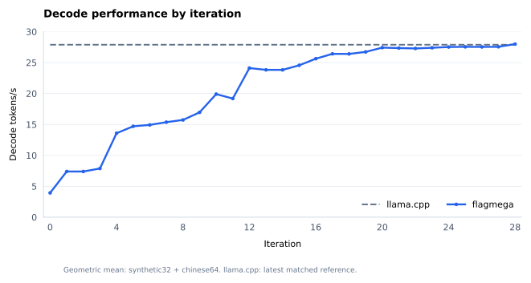
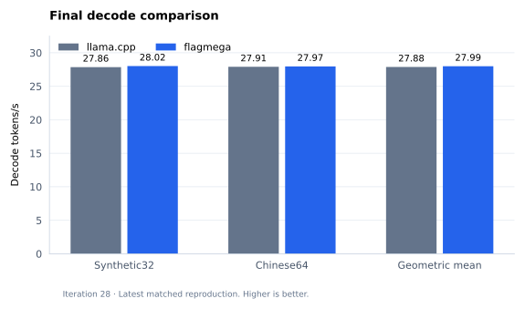

# Qwen3.8-27B IQ4：RTX 5060 Ti C++ / CUDA decode

最终性能图只保留 `llama.cpp` 和 `flagmega`。迭代图采用 synthetic32/chinese64 吞吐量的几何平均；llama.cpp 水平线为最新完整配对参考，历史迭代点不表示逐次同时配对。当前迭代28的原GGUF重建与配对性能已通过，完整微剖析仍在完成。





结果与历史导出位于 `.local/results/`，过程图位于 `.local/figures/`；`figures/` 仅保留这两张最终图的 SVG。已有 SVG 的图不再保留重复 PNG，见[格式整理记录](.local/results/svg-only-migration-r1/README.md)。重画需要本地数据：[统计口径与逐点来源](.local/results/final-performance/README.md)、[绘图数据](.local/results/final-performance/series.json)。

```sh
python render_results.py --data .local/results/e0052/summary.json
```

[查看进度 Dashboard](dashboard.html)：当前优化、已完成、正在做、下一步，以及负责人、等待原因、耗时和泳道图入口。页面标注最近更新时间。

[t27 当前候选完整泳道图库](.local/results/reset49-swimlanes-svg-r1/index.html)已安装：两侧共 550 调用、211,200 个物理 warp、13,750 个分页视图，只提供 SVG。数据、阶段交集、同调用硬件采样和分页绘图已独立核验；去除 PNG 后复用全部 SVG 原字节，并通过选择、失败恢复和导出检查。硬件活动为 3.008 µs GPU 聚合采样，软件区间含插桩开销。[呈现核验](.local/results/svg-only-migration-r1/t27-scientific-presentation-review.json)及[SVG 格式检查](.local/results/svg-only-migration-r1/t27-format-review.json)保留证据边界；范围汇总与历史剩余分析继续完成。

[原卷积基线全 48 调用泳道](.local/results/convolution-baseline-all48-swimlanes-svg-r1/index.html)也已安装 SVG 版，包含 18,432 个物理 warp 和 1,200 个分页视图，保留每个活跃 warp 的 80 轮重复事件。[格式差异检查](.local/results/svg-only-migration-r1/all48-format-review.json)复用原独立数据和呈现审核；候选卷积的采集另行进行。

[t26 输出归一化泳道图](.local/results/output-norm-swimlanes-r1/index.html)已通过独立呈现审核并发布：两侧各64调用，共49,152个物理warp、3,072个明细页。每页最多16个warp，单张SVG最大约218KB，按需加载并支持SVG导出；本机安装后浏览器首次打开82ms。[阶段与overlap分析](.local/results/output-norm-swimlanes-r1/analysis/overlap-summary.html)保留owner与nonowner的软件阶段、等待和交集，硬件为同调用3.008µs GPU聚合采样，包含插桩扰动。[独立核验](.local/results/output-norm-swimlanes-r1/independent-review/qualification.json)与[证据及复现说明](.local/results/output-norm-swimlanes-r1/README.md)可直接访问。 [当前范围汇总](.local/results/output-norm-swimlanes-r1/scope-qualification.json)确认t26声明范围microprofile全部通过；图库内待审字样保留作者冻结时状态，完整候选验收仍开放。


[t24 Common Q8完整泳道图库](.local/results/common-q8-swimlanes-r1/index.html)已通过独立呈现与离线复现审核：父版128 / 候选112调用、全部59,904个物理warp、3,744个细节页。每页最多16个warp，一次只加载一个SVG；提供480组静态SVG，也可导出任意细节页。[独立核验](.local/results/common-q8-swimlanes-r1/independent-review/qualification.json)与[复现/证据说明](.local/results/common-q8-swimlanes-r1/README.md)保留3.008µs GPU聚合硬件采样分辨率、软件插桩扰动和W字节证据边界；不表示逐WG硬件归属或精确引擎起止。图库内“待审核”是作者冻结时的状态；[当前范围汇总](.local/results/common-q8-swimlanes-r1/scope-qualification.json)已确认声明范围内微剖析完成，完整候选验收仍开放。

保留的 [t23 GDN全96调用泳道](.local/results/gdn-fullhead48-swimlanes-r1/index.html)已通过独立数据/轴/扰动/呈现审核：36,864物理warp、2,400分页SVG；可直接file://打开。硬件为同调用3.008µs中位间隔的GPU聚合采样，软件含记录器/未分类等待；无逐WG硬件归属、精确引擎区间或低开销结论。[阶段与overlap](.local/results/gdn-fullhead48-swimlanes-r1/analysis/stage-summary.md)、[当前资格](.local/results/t23-gdn-microprofile-r1/summary.json)。旧SVG误下载缺陷经Root修复与K212真实浏览器14项正负例通过，首次渲染348.48ms。


[SVG下载](.local/results/gdn-fullhead48-swimlanes-r1/figures/candidate-e05-i0005-cta-000.svg)及[全部角色统计](.local/results/gdn-fullhead48-swimlanes-r1/analysis/role-stage-summary.json)保留实际观察与分辨率。

保留 [t19完整泳道索引](.local/results/e0042/norm-q8-swimlanes/index.html)覆盖父128/候64 action和全部45,056个物理warp，提供3,008个有界SVG及CTA阶段交集矩阵。一次只加载选中分页；[K190独立审核](.local/results/e0042/proofs/profile-current/K190-presentation.json)已通过。硬件为3.008微秒GPU aggregate采样，软件包含global-store插桩影响；不声称逐WG硬件归属、精确引擎起止或低扰动。


[父版示例](.local/figures/kernel-swimlane-norm-q8-parent.svg)与[全部层/CTA和便携重画](.local/results/e0042/readme.md)保留真实事件和分辨率说明。图内presentation-pending是生成快照，顶层补充后续通过receipt，原图字节未改。

最新评估 **t27/r0001，尝试35 / 迭代28：两次原始GGUF公开独立重建与原8进程复现通过**。Synthetic32 **35.6919901460 vs35.8951393229 ms/token（−0.5659517716%）**，Chinese64 **35.7558040729 vs35.8314655547（−0.2111593277%）**。完整NUM、33实际资源、原53参考、隔离/轮转及1152样本均独立通过；reproduction_accepted=true。当前诊断NUM、W、扰动、时间轴与WG/硬件泳道分别通过；范围汇总和历史剩余范围仍待，full_microprofile/performance_accepted=false、accepted_best=null。


最新算子图为 **t27 / 迭代28**：[完整869调用/33程序组SVG](.local/results/operator-t27-r1/figures/operator-latency-m0535-m0536.svg)、[逐调用数据与重画](.local/results/operator-t27-r1/README.md)及[独立核验](.local/results/operator-t27-r1/independent-review.json)。m535/m536的CUDA-event总和为 **39.4476158703→39.7073279188 ms（+0.658372%）**；每个调用一次观察，排除scratch reset、反馈复制和host准备，不能直接用于归因reset49收益，也不等于host ms/token。1738个时长、66个分组及便携SVG逐字节重画已独立通过。图内待审字样是作者冻结时快照。此前[t26算子图](.local/figures/operator-latency-candidate.svg)及[t25拒绝结果](.local/results/e0048/index.html)保留。

[最新结果入口](.local/results/e0052/index.html)、[全部506条记录/72组](.local/results/e0052/summary.json)、[当前公开matched](.local/results/matched-t27-public-r1/summary.json)、[全部1152样本](.local/results/matched-t27-public-r1/all-samples.csv)及[重画说明](.local/results/e0052/readme.md)冻结1509行；e51全部493条不变，新增8formal/4组及5诊断执行，另3项未启动单独保留。旧私有t27 matched、b0003 P1与历史matched各自独立。[待办](.local/results/e0052/pending-gates.json)、[Dashboard](dashboard.html)。

```sh
python .local/results/e0052/rebuild.py --only-current --output-dir .local/results/e0052/rebuilt
```

最新原条件完整配对已核验 **t27两次公开重建，两个场景严格胜出**：Synthetic32候选−参考 **−0.2031491769 ms（−0.5659517716%）**，Chinese64 **−0.0756614818 ms（−0.2111593277%）**。双方双场景各2独立进程×3轮；各候选进程先完整NUM，goldens不计性能。进程均值/标准差/范围与全部样本见[当前公开复现](.local/results/matched-t27-public-r1/README.md)。token不是独立重复实验，无新margin或显著性条件。原GGUF复现通过，完整微剖析仍开放；[旧私有t27](.local/results/matched-t27-r1/summary.json)、[旧t24](.local/results/matched-t24-r1/summary.json)及[旧t19](.local/results/matched-t19-r1/summary.json)保留。

t19全部192 action及t23 GDN全部96 action的逐warp数据、固定轴、描述性扰动与分页呈现已独立通过；硬件为同次GPU聚合采样。t20–t25普通NCU均已通过。t24声明范围的完整WG/同次硬件/扰动/W/呈现及汇总已独立通过；t26声明范围也已全部通过；当前t27严格matched及两次原始GGUF公开重建复现已通过；当前与历史剩余scope的完整微剖析义务继续保留。[当前待办](.local/results/e0052/pending-gates.json)。

保留 t18 的 [GDN 完整诊断图库](.local/results/e0039/index.html)及保留 t16 candidate/parent 共三个 cohort，各48/48 action、147 SVG和144事件页已完成独立展示审核与便携包装。K172明确继承K164父级诊断，非fresh matched parent；384 body warp/action、CTA0–7细节和约3.008µs GPU聚合采样限制见[说明](.local/results/e0039/readme.md)。本导出无新普通样本或迭代；全候选/全微剖析、strict matched及原GGUF重建仍开放。

t12已声明的限定诊断呈现现为 **13/13**：[最后head-i1-j2泳道图](.local/results/kernel-t12-head-i1-j2-r1/index.html)已通过独立呈现审核并安装，含8SVG、全部994,208warp包络总览及固定CTA0–7的128warp/920事件细节。硬件为同action3.008µs GPU聚合采样；[等待交集](.local/results/kernel-t12-head-i1-j2-r1/analysis/selected-wait-overlap.json)、[独立资格](.local/results/kernel-t12-head-i1-j2-r1/presentation-qualification.json)与[13/13范围汇总](.local/results/kernel-t12-head-i1-j2-r1/scope-completion.json)保留插桩和证据限制。t12仍rejected，没有新增普通样本或完整候选验收。[旧e0038图库](.local/results/e0038/index.html)及其当时12/13快照原样保留；e0053是本次scoped回执，普通历史仍为e0052。

保留的 [t13 layer0 泳道图](.local/results/kernel-t13-layer0-r1/index.html)已通过独立呈现审核并安装：15个action、30SVG，179,488个物理warp的包络总览，以及固定CTA0–7的480warp/11,840事件细节。[256条等待/其他warp工作交集](.local/results/kernel-t13-layer0-r1/analysis/selected-wait-work-overlap.json)可复算；硬件为同action3.008µs GPU聚合采样。[独立资格](.local/results/kernel-t13-layer0-r1/presentation-qualification.json)和[当前范围](.local/results/kernel-t13-layer0-r1/scope-completion.json)仅放行layer0呈现，TMA专用证据未提供，其余t13范围与完整验收继续待办。原图待审字样保留作者快照；e0054是本次scoped回执，没有新增普通样本或迭代。

保留的 [t14 layer0 泳道图](.local/results/kernel-t14-layer0-r1/index.html)已通过独立呈现审核并安装：15个action、30SVG，127,264个物理warp包络总览和固定CTA0–7的480warp/15,376事件细节。只有entry11使用row4，各warp负责独立输出行；[A103 r4解释](.local/results/kernel-t14-layer0-r1/analysis/marker-interpretation.json)保留部分lookup、lookup尾部PRMT与DP4A/记录器窗口的区别。[224条等待相交](.local/results/kernel-t14-layer0-r1/analysis/selected-wait-work-overlap.json)、[独立资格](.local/results/kernel-t14-layer0-r1/presentation-qualification.json)和[当前范围](.local/results/kernel-t14-layer0-r1/scope-completion.json)保留同action3.008µs GPU聚合采样与TMA未测限制。entry11属于layer0，不把旧e0033与本包相加成2/13；公开计数仍1/13，其余scope和完整验收待办。e0055仅为本次scoped回执，没有新增普通样本或迭代。

当前两个 D 诊断库的双场景完整 NUM 已独立通过：[e0056 诊断补充](.local/results/e0056/index.html)公开四个 job 的原55/21检查、全部33个资源条目、1,152次 forward、960份 owned graph 观察与55,646,355,456B arena留存资格。规定8-token独立前缀通过，synthetic32后续独立序列分歧及原误差统计完整保留。D只有header、流水records为0，NUM timing不作为普通性能样本，也不放行WG/hardware overlap；[历史失败与修复](.local/results/e0056/failure-recovery.json)及原8+新2同库clock均保留。e52普通性能数据/曲线、e53/e54/e55图库和e33的1/13计数不变；本次仅为p0065诊断补充，无新迭代或普通性能重发布。

保留的 t14 诊断 **t14 / e0033 / entry11-layer0 / 1-of-13** 已通过完整限定审核与独立便携重画。[CTA0泳道](.local/results/e0033/portable/index.html)含4warp/636记录及12×681真实PM值，全部17408warp包络与2767872原记录另经K122审核。K113 A113-F1已由精确A103/r4解释侧车和[K114](.local/results/e0033/proofs/K114-source-native-interpretation-handoff.json)关闭，A100源/库不变；V26完整诊断NUM/all36、K117clock、K119controls、K122joint/after与V27呈现分别通过限定门槛。104→105仍不能称完整lookup完成，105→106含lookup tail、DP4A issue及记录/控制。


```sh
python .local/results/e0032/rebuild.py --output-dir .local/results/e0032/rebuilt
```

普通[e32/iteration15](.local/results/e0032/readme.md)的225条记录、288普通样本和原数据曲线保持不变；新增[e33十四条诊断](.local/results/e0033/incremental-diagnostics.json)合计239个measurement ID，普通样本/曲线点/iteration新增0。V27快照截止ledger751，m235 ENOSPC失败、m236独立重试及当时m239/240 pending状态均保留。[单独当前进度](.local/results/e0033/current-progress.json)说明K123现已通过旧t12 head-i1-j0数据/轴/扰动但图未审，当前t14 layer0 m241–243控制已由K124核验，joint/after已准备，仍不纳入这14条补充。当前t14仅1/13，旧t12/e31的9/13独立保持；t13全部原义务、t14其他12scope及完整画廊、原双方双场景各2独立进程×3轮strict matched llama、原GGUF公开重建仍开放，accepted_best=null。[完整待办](.local/results/e0033/pending-gates.json)。

当前 rows2 head-i0-j3 的[四action图库](.local/results/e0031/index.html)提供8 SVG；[限定范围](.local/results/e0031/scope-completion.json)为9/13，仍属t0012/r0001 attempt17/iteration13。


[总览SVG](.local/figures/kernel-swimlane-rows2-head-i0-j3-entry34-overview.svg)、[细节SVG](.local/figures/kernel-swimlane-rows2-head-i0-j3-entry34-detail.svg)、[九条诊断](.local/results/e0031/incremental-diagnostics.json)、[独立呈现资格](.local/results/e0031/presentation-qualification.json)及[便携重画](.local/results/e0031/readme.md)绑定全部994208warp投影和128warp/1088记录细节。硬件为各action独立3.008µs聚合采样，端点±3.008µs/时长6.016µs，不逐warp归因或推导精确engine时长；专用TMA未测。

**m213 F/before为同一观察；中间m214–216，before→P 2377.023184185秒。** Entry34 F/O=4.262831×；before/P/after 软件包络 6.801664/7.989376/6.800736 ms。P 外层 CUDA event 237.49612427 ms，NCU workload bracket 7.990112 ms，边界不同。 [全部action漂移](.local/results/e0031/portable/analysis/control-observations.json)保留实测差异，非低扰动、不声明不间断bracketing、纯NCU成本或普通性能收益。

m210为t13固定clock单位证据；m214旧D scope绑定失败保留，m219修复D已由K108核验，m215/M与m216/F继续有效、joint已准备。[当前修复资格](.local/results/e0032/proofs/t13-repaired-D-review.json)。上述t12图不补t13/t14强制微剖析；当前row4普通NUM/O/NCU进展与未完成门槛见[e0032](.local/results/e0032/readme.md)。

历史 rows2 head-i0-j2 的[全部四action图库](.local/results/e0030/index.html)提供8 SVG；[限定完成范围](.local/results/e0030/scope-completion.json)为8/13，保持t0012/r0001、attempt17/iteration13身份。


[总览SVG](.local/figures/kernel-swimlane-rows2-head-i0-j2-entry34-overview.svg)、[细节SVG](.local/figures/kernel-swimlane-rows2-head-i0-j2-entry34-detail.svg)、[九条诊断](.local/results/e0030/incremental-diagnostics.json)、[图源/审查](.local/results/e0030/figure-source-review-manifest.json)和[便携重画](.local/results/e0030/readme.md)公开保留994208物理warp总览、128warp/1088记录细节。Entry34实际word2的100–106事件描述Activation load、Header/scale、Word/lookup、DP4A软件区域，包含记录与等待。

**m205为F baseline与before同一观察；中间有m206/m207 ordinary NCU，before→P间隔1375.026528秒。** [A37复用声明](.local/results/e0030/proofs/A37-before-reuse-decision.json)与[K98资格](.local/results/e0030/proofs/K98-final-handoff.json)保留原门槛，不声明不间断bracketing、平稳clock/cache/temperature或纯profiler成本。Entry34 F/O=**4.262831×**，before/P/after软件包络6.801984/7.990912/6.800640ms；P外层CUDA event236.20300293ms与NCU bracket7.991648ms边界不同。各action固定独立轴，3.008µs采样、±3.008µs端点/6.016µs时长预算，不提供逐warp硬件归因或普通流水结论。

当前t13的m201/m202完整诊断NUM与[288诊断样本](.local/results/e0030/diagnostic-NUM/samples.csv)独立保留；m206/m207的[ordinary NCU表](.local/results/e0030/ordinary-NCU/current-action-counter-table.csv)只支持受分辨率限制的GPU聚合计数。Entry10/27仅0–1点、entry26仅3点，旧parent entry11未新鲜配对；不从t12图转移t13微剖析资格。

历史 rows2 head-i0-j1 的[全部四action图库](.local/results/e0029/index.html)提供8 SVG；[限定完成范围](.local/results/e0029/scope-completion.json)为7/13，保持已拒绝的t0012/r0001、attempt17/iteration13身份。


[总览SVG](.local/figures/kernel-swimlane-rows2-head-i0-j1-entry34-overview.svg)、[细节SVG](.local/figures/kernel-swimlane-rows2-head-i0-j1-entry34-detail.svg)、[六次诊断](.local/results/e0029/incremental-diagnostics.json)、[图源/审查](.local/results/e0029/figure-source-review-manifest.json)和[重画命令](.local/results/e0029/readme.md)可公开使用。Entry34实际word1的100–106事件展开Activation load、Header/scale、Word/lookup与DP4A；所有action合计994208物理warp，细节128warp/1088记录。软件区域含recording/load/wait，不是精确硬件指令时间或普通kernel瓶颈。

entry34 F/O为**4.262791×**；before/joint/after软件包络6.800480/7.991648/6.805344ms。Joint外层CUDA-event232.867065ms与NCU workload bracket7.992384ms边界不同，base-clock/cache-all及插桩影响不支持纯profiler成本或普通流水还原。[控制CSV](.local/results/e0029/analysis/per-action-controls.csv)保留全部action对照。各action独立固定轴，3.008µs采样、±3.008µs端点和6.016µs时长预算；硬件GPU聚合值不归因到warp。专用TMA活动未测，[K93/K83静态模块非使用谱系](.local/results/e0029/proofs/K93-module-lineage-review.json)与PM零值分离。

历史 rows2 head-i0-j0 的[SVG 图库](.local/results/e0027/index.html)包含四action矩阵细节；[e0027范围快照](.local/results/e0027/scope-completion.json)当时为6/13 scope；e0029导出时为7/13；e0030导出时为8/13；当前e0031为9/13。


[总览SVG](.local/figures/kernel-swimlane-rows2-head-i0-j0-entry34-overview.svg)、[细节SVG](.local/figures/kernel-swimlane-rows2-head-i0-j0-entry34-detail.svg)、[图源/审查](.local/results/e0027/figure-source-review-manifest.json)和[复现说明](.local/results/e0027/readme.md)提供994208warp总览与128warp/1088记录细节。每warp事件4/8/18/4，entry34保留i0/j0的100..106矩阵事件。软件区域含记录与等待，不等于精确指令或engine-busy；硬件为GPU聚合采样，强扰动不支持普通流水或逐warp硬件归因。[当前source/library谱系](.local/results/e0027/proofs/K87-module-lineage-review.json)复用静态模块not_used证明，区别于PM零值和专用TMA未测。

当前 rows2 head-coarse 的[SVG 图库](.local/results/e0026/index.html)覆盖entry32–35共4个action；[e0026范围快照](.local/results/e0026/scope-completion.json)当时为5/13 scope；e0027导出时为6/13 scope；e0029导出时为7/13；e0030导出时为8/13；当前e0031为9/13 scope。


[总览SVG](.local/figures/kernel-swimlane-rows2-head-coarse-entry34-overview.svg)、[细节SVG](.local/figures/kernel-swimlane-rows2-head-coarse-entry34-detail.svg)、[图源与审查清单](.local/results/e0026/figure-source-review-manifest.json)及[证据与复现](.local/results/e0026/readme.md)已提供。总览聚合覆盖994208物理warp，细节128warp / 864记录。硬件为3.008μs GPU聚合模块采样；软件阶段及在途包络含等待/记录，粗粒度trace不能提供精确cp.async边界，TMA活动未测。[静态source/PTX审查](.local/results/e0026/proofs/K83-head-module-usage-review.json)另证四head函数TMA/cp.async/Tensor Core未使用，并非根据采样零值推断。显著扰动不支持普通流水、精确hardware busy或逐warp硬件归因。

当前 rows2 layer63 的[SVG 图库](.local/results/e0025/index.html)覆盖entry15–31共17 action的总览/细节与便携数据。[e0025完成快照](.local/results/e0025/scope-completion.json)在当时确认4/13 scope；e0026导出时为5/13 scope；e0027导出时为6/13 scope；e0029导出时为7/13；e0030导出时为8/13；当前e0031为9/13 scope。


[总览 SVG](.local/figures/kernel-swimlane-rows2-layer63-entry28-overview.svg)、[细节 SVG](.local/figures/kernel-swimlane-rows2-layer63-entry28-detail.svg)、[全部17 action数据与重画](.local/results/e0025/readme.md)及[独立终验](.local/results/e0025/proofs/K78-handoff.json)已提供。总览保留136640物理warp，细节共544warp / 13008记录。硬件为3008 ns周期/对齐预算的GPU聚合采样；软件含记录与等待，扰动显著，不能解释为普通流水、精确hardware busy或逐warp硬件归因。

当前 rows2 layer3 的[SVG 图库](.local/results/e0024/index.html)覆盖entry15–31共17action的总览/细节与便携数据。e0024导出时为3/13scope快照；e0025加入layer63后为4/13scope快照；e0026导出时为5/13scope；e0027导出时为6/13scope；e0029导出时为7/13；e0030导出时为8/13；当前e0031为9/13scope。


[轻量SVG](.local/figures/kernel-swimlane-rows2-layer3-entry28-overview.svg)、[全部17action数据和重画](.local/results/e0024/readme.md)、[独立终验](.local/results/e0024/proofs/K70-handoff.json)与[完成回执](.local/results/e0024/scope-completion.json)已提供。总览保留136640物理warp，细节覆盖各action前8CTA共544warp /13008记录。3008ns周期/对齐预算，软件包含记录和等待；无精确硬件busy、逐warp硬件归因、低扰动或普通流水结论。

当前 rows2 layer0 的[SVG 图库](.local/results/e0023/index.html)覆盖15action的总览/细节图与便携复现源。e0023导出时为2/13scope快照；e0024导出时增至3/13scope；e0025导出时为4/13scope；e0026导出时为5/13scope；e0027导出时为6/13scope；e0029导出时为7/13；e0030导出时为8/13；当前e0031为9/13scope。


[轻量SVG](.local/figures/kernel-swimlane-rows2-layer0-entry11-overview.svg)、[全部15action紧凑数据与重画](.local/results/e0023/readme.md)、[独立终验](.local/results/e0023/proofs/K63-handoff.json)已提供。总览保留144672物理warp，细节覆盖各action前8CTA共480warp /12960记录；3008ns采样/对齐预算，软件含记录和等待，不构成精确硬件busy或普通流水。e0023导出时layer3图/join尚待完成；现已由[e0024完成回执](.local/results/e0024/scope-completion.json)补全。

已完成首 entry11 scope 的[联合微剖析入口](.local/results/e0021/index.html)已发布：[总览 SVG](.local/figures/kernel-swimlane-rows2-layer0-glu-overview.svg)和 [CTA 0–7 细节 SVG](.local/figures/kernel-swimlane-rows2-layer0-glu-cta00-07.svg)。这两张图与便携复现属于已完成的首 entry11/layer0/ordinal11 scope；与layer0合计的2/13scope是e0023导出时快照；e0024时加上layer3为3/13scope；e0025时加上layer63为4/13scope；e0026导出时为5/13scope；e0027导出时为6/13scope；e0029导出时为7/13；e0030导出时为8/13；当前e0031为9/13scope。


完整 raw 审查覆盖 8704 CTA / 34816 物理 warp / 2907136 条记录；公开包包含全部 warp 包络聚合、12×744 硬件采样以及首 8 CTA 的 32 warp / 2672 条细节。硬件为 GPU 聚合采样，主周期及对齐预算约 3.008µs，不提供精确硬件 busy 或逐 warp 硬件归因；专用 TMA 未测量。软件区间包含记录与等待，工作量和 marker 数共同变化，不能推断普通 kernel 瓶颈。

F/O 约 5.35449×，U/P/U 软件包络为 1.344896/1.587168/1.342176ms；P 使用 base clock/cache-all。P 的外层 CUDA-event 为 1034.9888916ms，NCU workload bracket 为 1.588128ms，边界不可互换。单次控制不提供重复分布、纯 profiler 开销或普通流水还原。[完整范围、精度、扰动和独立重画](.local/results/e0021/readme.md)保留全部限制；普通性能曲线没有新增点。

历史父版 U4 的 [kernel 泳道轻量入口](.local/results/e0017/index.html)已发布：[总览 SVG](.local/figures/kernel-swimlane-u4-layer0-glu-overview.svg)（296570 B）、[CTA 0–7 细节 SVG](.local/figures/kernel-swimlane-u4-layer0-glu-cta00-07.svg)（171286 B）。两张图均已实际渲染、视觉检查，并在隔离文件访问的独立进程中复现。


范围仅为 layer0 / entry11 / ordinal11：完整原始 trace 保留全部69632个物理warp，公开包包含它们的边界聚合、12×924个硬件采样值，以及CTA0–7的32warp/1552条事件细节。硬件为GPU聚合活动，采样周期与对齐不确定性约3.008µs；软件阶段包含记录器和等待开销，不是逐warp硬件模块精确起止时间。[数据、对照和独立重画](.local/results/e0017/README.md)可脱离私有目录使用；其他CTA细节须从保留的原始trace按需提取。

本次插桩扰动较大：单次F/O约6.20×；U/P/U软件包络为1.481216/1.748448/1.481184ms，P包含NCU及其配置影响。图只支持当前插桩调用的诊断，不能还原普通流水、纯profiler开销或重复分布；普通性能曲线未新增点。

现有公开模型实现仍对应迭代9；U4 的原始GGUF公开重建尚未完成。

从仓库根目录使用已安装 FlagTree/PyTorch 的解释器：

```sh
export PYTHONPATH="$PWD/python${PYTHONPATH:+:$PYTHONPATH}"
export TUTORIAL="$PWD/python/tutorials/flagmega/03-qwen3.8-27b-iq4/nvidia-rtx5060ti-cuda"
python -m pip install -r "$TUTORIAL/requirements.txt"
python "$TUTORIAL/download_checkpoint.py" --output "$TUTORIAL/.local/checkpoint"
python "$TUTORIAL/compile.py" \
  --checkpoint "$TUTORIAL/.local/checkpoint/qwen3.8-27b-IQ4_XS-pure.gguf" \
  --trial "$TUTORIAL/.local/reproduce-baseline"
```

构建拒绝覆盖既有 trial，保存 Python IR、阶段 dumps、source 哈希、完整 artifact 和命令日志。可用 `--layer 0` 做后端支持探测；性能验收始终使用默认完整模型。

重建已验证的MMVQ实现，在compile命令增加 `--recipe "$TUTORIAL/local_optimizations/recipes/dual_glu.json"` 并使用新的trial目录。`dual_glu_head_gates.json` 已通过两场景完整数值检查；迭代4还需 `--placement yx=4x24/bb`，并从原始输入重新生成分布。当前均为合格筛选，尚未超过llama.cpp。

迭代5使用 `dual_glu_head_gates_interleaved_dual.json` 和 `--placement yx=4x24/bb`，从原始GGUF构建新的trial。本版全部32/64 token与golden一致；正式资格仍按既定首8合同判定。

迭代6使用 `dual_glu_interleaved_dual_head_chunk256.json` 和相同4×24布局。该版本保持GDN投影累加顺序，完整数值资格已通过；其算子图来自单独cap168插桩库，不能作为普通库性能计时。

当前 t9 的 [GDN head 轻量泳道索引](.local/results/e0014/swimlanes/index.html)已发布：[CTA 0–7 预览](.local/figures/kernel-swimlane-t9-layer0-head-cta00-07.svg)，共 12 页，每页约 396 KiB，按需打开。覆盖 96 CTA、384 个物理 warp 和 192 个 warp0 内线程观测流；每页保留同次执行的 12 条硬件采样泳道，采样间隔约 3.008 µs。范围仅为 layer 0 GDN head 区间，硬件为 GPU 聚合采样；完整扰动验收仍未完成。[公开数据、精度说明和独立重画](.local/results/e0014/README.md)可脱离私有目录使用。

Kernel 微观联合图已发布：[t6/t7 全部 CTA 索引](.local/results/kernel-joint-m0047-m0048-v1/index.html)、[t6 GDN](.local/figures/kernel-swimlane-t6-layer0-cta00-gdn.svg)、[t7 GDN](.local/figures/kernel-swimlane-t7-layer0-cta00-gdn.svg)、[t7 copy/compute](.local/figures/kernel-swimlane-t7-layer0-cta00-async.svg)。130张SVG均已独立核验并实际渲染，单张≤2.16 MB；硬件与WG来自同一调用，采样约3.008 µs。原95MB文件保留作历史记录；[早期m43软件图](.local/results/wg-m0043-preview-v1/index.html)仍可查看。[精度、证据类型和重画说明](.local/results/kernel-joint-m0047-m0048-v1/readme.md)明确设备聚合采样、软件阶段和在途包络的区别。

[t6硬件采样图](.local/figures/kernel-hardware-sampled-t6.svg)和[t7硬件采样图](.local/figures/kernel-hardware-sampled-t7.svg)已独立核验。它们覆盖首次eager reset decode的64层，12项指标处于同一实际PM组，采样间隔3008/3040 ns，反映GPU聚合活动。这两份普通库硬件采样与新的插桩联合图属于不同执行，仅作背景对照，不拼接时间轴。完整模型性能验收仍未通过。

轻量WG图可只用公开数据重画：

```sh
python "$TUTORIAL/.local/results/wg-m0043-preview-v1/render.py" \
  --data "$TUTORIAL/.local/results/wg-m0043-preview-v1/data.json" \
  --output /tmp/flagmega-wg-preview
```

硬件图的自包含数据和独立审查位于 `.local/results/kernel-pm-m0038-m0039-v1/`；例如：

```sh
python "$TUTORIAL/.local/results/kernel-pm-m0038-m0039-v1/render_from_compact.py" \
  --export "$TUTORIAL/.local/results/kernel-pm-m0038-m0039-v1/t6" \
  --title "t6 row16 async: first eager decode, all 64 layers"
```

当前迭代9使用 `dual_glu_interleaved_dual_gdn_warp_state_async128_r8_all.json` 和 `--placement yx=4x24/bb`，已从普通编译路径完整构建，独立通过两场景数值合同。全部32/64 token也与golden一致；普通库实际为REG149、shared30748B、local16B、3CTA/SM，可容纳96CTA。累计图数据覆盖m1–m79共79条记录、24条有绘图资格的测量、22个曲线分组（普通曲线未新增点）；诊断记录不计入普通性能曲线。

[t8普通库硬件活动采样图](.local/figures/kernel-hardware-sampled-t8.svg)及[完整公开数据/重画说明](.local/results/kernel-pm-m0056-v1/readme.md)已发布。m56为同一PM组的12指标，原始间隔3.008–3.040µs；此图没有WG trace，不能与其他调用拼接。m58的[微架构计数器](.local/results/e0008/ncu-m0058.json)和[分析](.local/results/e0008/ncu-m0058-analysis.md)经独立核验，但一次CPU采样跨度1.220849846s超过1s上限，因此保留隔离覆盖不足的限制。计数器仅支持后续定位假设。

t6/t7的[联合泳道](.local/results/kernel-joint-m0047-m0048-v1/index.html)和[开销控制实验](.local/results/kernel-overhead-m0049-m0050-v1/readme.md)已独立核验；开启记录增加约27.3ms，不能用于还原普通执行时间线。t8新插桩版已通过四scope的逐WG数值/时钟核验及同次WG/硬件采样的全部八项检查；新SVG与selected overlap分析已独立核验并公开，匹配的插桩开销对照仍待完成。双方双场景各2进程×3轮严格胜出及原始GGUF最终公开重建仍待完成。

已公开的 t8 旧插桩版联合泳道：[m69 scope0 代表图与完整重画入口](.local/results/kernel-joint-m0069-v1/index.html)、[CTA0 async](.local/results/kernel-joint-m0069-v1/preview/cta00-site8-tile0-001.svg)、[CTA95 GDN](.local/results/kernel-joint-m0069-v1/preview/cta95-site11-gdn-001.svg)。紧凑公开数据覆盖96 CTA / 576观察流与完整硬件样本，能独立重画全部2,417张分页SVG；这些图已实际渲染并独立审查，最大单图约764KB。硬件仅表示约3.008µs分辨率的GPU聚合采样，异步在途包络单列。

m70的入口标记3296ns超过原3008ns容差，原失败记录保留。新记录器将完整时间戳读取提前到实际SASS的0x60/0x70，m71资源及m72–75 NUM/clock独立通过；m76–79四scope联合采集也全部通过原八项检查，入口时间差分别为800/704/672/704ns，没有额外时间偏移。[新四scope采集审核](.local/results/e0010/fresh-four-scope-joint.json)与[数值/时钟审核](.local/results/e0010/fresh-four-scope-NUM-clock.json)已提供。上面的m69图仍只对应旧native/scope0；新图和selected overlap分析已完成独立审核，匹配插桩开销及最终模型胜出尚未验收。

新记录器的[四scope轻量泳道入口](.local/results/kernel-joint-a022-v2/index.html)已发布：[当前scope0 CTA0 async](.local/figures/kernel-swimlane-t8-layer0-cta00-async.svg)、[当前scope0 CTA95 GDN producer/consumer](.local/figures/kernel-swimlane-t8-layer0-cta95-gdn.svg)。共8,228张分页SVG完成XML/索引/覆盖检查，37张代表、最密及边界预览已实际栅格化审查，最大单图836,923B。公开选定数据覆盖每scope全部96CTA/576观察流，能独立重画全部页面；[范围、精度及分析重算](.local/results/kernel-joint-a022-v2/readme.md)列明细节选择和采样证据边界。四次采集分别绘图，未跨执行拼轴。
