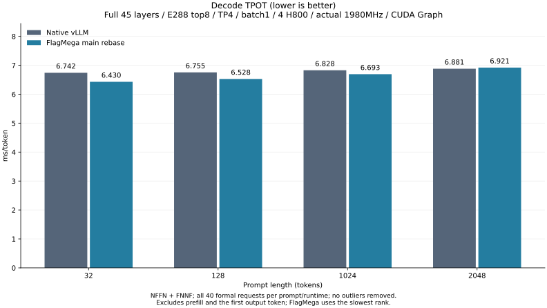
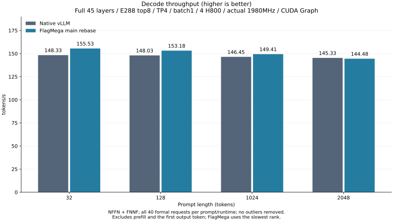
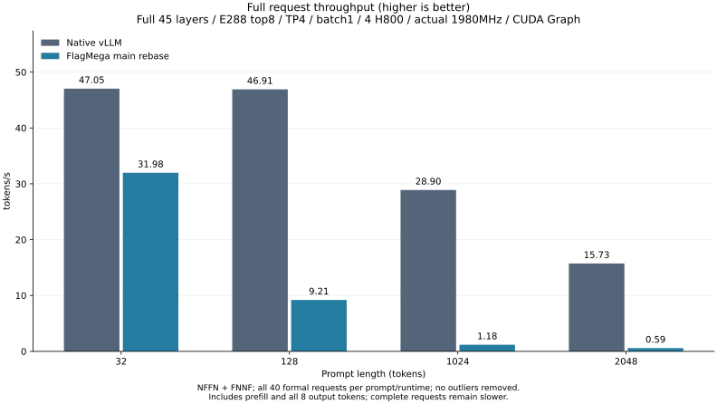

# 最新 main 65df 的 H800 重新验收（2026-11-02）

**完整模型数值和硬件验收通过，性能门槛失败。** main 基底 `65df098bf02848308f9890ec2500da7ee026893b`；实际受验源码 `1e3d0d4ba46f28408ec62163e9a0383d26477468`。历史 7f/v18 及 rebase 前样本另行保留，没有把旧结果当作本轮通过。

分支全部 82 个既有提交在独立工作树重放。重放完成时，相对上一版源码的差异恰为 main 新增的 20 个文件；后续仅同步下文三个旧测试。保留 cp.async 流水线缓冲生命周期、PTX 缓存策略和 WGMMA warp 选择，以及此前 pipe/分布式 ABI、严格浮点、FP8 N8、scan 和 other 位模式因果修复。未禁用优化或修改模型来规避触发；公开与历史 Core 未覆盖。

## 完整八段结果

完整 45 层/E288/top8/H4096/cache4096/TP4/b1/out8，原 GPU1–4 独占、实际 1980 MHz、无热降频。CUDA Graph 在两端开启，Flag 保持双 stream 和严格浮点。NFFN/FNNF 八段全部完成；384 原始请求、64 预定 warmup、320 正式请求全部保留，不删除异常值。每端每上下文有 40 个正式请求，Flag 取每请求最慢 rank 的 TPOT。

| 上下文 | FlagMega TPOT (ms) | vLLM TPOT (ms) | Flag 相对变化 | 相比上轮 v18 的 Flag 变化 (ms) |
| --- | ---: | ---: | ---: | ---: |
| 32 | 6.429679 | 6.741582 | -4.63% | +0.008334 |
| 128 | 6.528329 | 6.755415 | -3.36% | +0.013418 |
| 1024 | 6.693214 | 6.828211 | -1.98% | +0.003999 |
| 2048 | 6.921326 | 6.880710 | +0.59% | +0.010949 |

相对变化为正表示 Flag 更慢。表中合并中位数不能替代逐段门槛；具体严格门槛如下。

| 上下文 | NFFN 每个 Flag 段都快于每个 Native 段 | FNNF 同一条件 | 四 Flag 对四 Native | 四对四最小余量 (µs) |
| --- | --- | --- | --- | ---: |
| 32 | 通过 | 通过 | 通过 | 296.903 |
| 128 | 通过 | 通过 | 通过 | 208.775 |
| 1024 | 通过 | 通过 | 通过 | 117.131 |
| 2048 | 失败 | 失败 | 失败 | -68.555 |

TPOT 排除 prefill 与首个生成 token，包含后续七个 token 的状态和交接。2048 完整请求中位数为 Flag 13.6581 s、Native 0.5084 s，TTFT 为 13.6097/0.4607 s；完整请求结果不能用解码指标替代。正式对照和独立审计实际顶层 OS wait/退出码均为 0，用时 2357.29 s（39.29 分钟）/1.54 s。

## 构建、正确性和回归

正常 CMake 构建 v19 独立 Core 317.99 s，公开和历史 Core 不变。3349 个源码/测试文本冻结证明保留；构建后仅同步下文三个测试，实际编译器构建输入不变。当前源码正常生成 126.52 s，独立 fresh 原始输入重建 142.41 s，完整 bufferized_tir 六项覆盖合同保持；fresh 输出未用作正式性能候选。正常冷预编译 97.36 s，26 个独立入口、228 次调用全部零 spill，GPU key 与 CPU key 一致；60 次为 8 warps、168 次为 4 warps。

完整 Gold 实际顶层退出 0，521.36 s；独立审计退出 0，1.90 s。四 rank 各 100 请求，每 rank 792 次后续状态比较；rank0 的 1216 次 decode 和 4864 次 ctx32 prefill Gold 比较均通过，原卡组的独占/实际时钟/无热降频检查通过。

本轮重新执行：CPU 130 passed/51 skipped（跳过不计通过），GPU 153 passed（含 main 新增 40 项 WGMMA 和 48 项位模式填充回归），TLE MLIR 159 passed，main 流水线邻接 2 passed；额外自动 pipeline 的 FP16 ±0、1/3 stage 原始位模式及恒等 dot 四案例通过。均有实际 OS wait/退出码。

## 三项旧测试与新主干契约

首次 TLE MLIR 为 156 passed/3 failed。只修改 TLE-owned 回归预期，编译器实现保持；调整后 159 passed，原失败文件文本和实际输出单独保留。

| 根因位置与触发条件 | 因果契约及保留断言 |
| --- | --- |
| third_party/tle/dialect/include/Transforms/TleUtility.h::getNvidiaMmaV3WarpsPerCTA：forward slice 的 DotOpInterface 包括 C accumulator 边 | chain-dot 的 C producer 要求 [8,1]，终端为 [4,2]；增加准确 C layout 转换捕获，A/B 链断言保持 |
| 同一 warp helper：终端 64×64、8 warps 的新选择规则 | legacy accumulator 回归同步到 [4,2]，旧 MMA2→Hopper 转换、wait 与转换回 MMA2 的断言保持 |
| third_party/nvidia/lib/TritonNVIDIAGPUToLLVM/LoadStoreOpToLLVM.cpp::emitCpAsync：PTX 版本与窄缓存策略 | 明确 PTX 8.1/9.4 两套 RUN，窄 4-byte cg 使用 ca；8.1 不生成 L2 cache hint，9.4 正向检查 createpolicy/hint；零值不产生额外 st.shared 的断言保持 |

新主干及此前异步 fill 修复同时保留，未修改 native GPU 测试来规避数值失败。所有 26 个 program 的 PTX 全部指令/声明与 v18 相同（仅排除调试路径/DWARF），没有单凭主干提交或 cp.async 数量宣称整模提速。

## 实际剖析与未完成范围

Gold 内第一次采样条件写成 request2，但该阶段实际只有 request0，未生成 report；Gold 正确性仍通过。随后独立完整模型诊断真实退出 0（253.21 s），官方 SQLite 导出退出 0（0.086 s），四 rank 各七步，每步 228 调用。kernel 生命周期重叠占忙碌窗口 15.21%–16.13%，主要窗口为 attention prefix；它包含等待，不能解释为通信隐藏比例。详见[完整模型剖析](main-rebase-65df-profile-20261102-zh.md)。剖析不作为正式性能样本。

原生 SM100 TCGen5 邻接 membar 回归仍为三项通过、一项额外 CTA barrier 失败，未删断言或禁用 pass。本轮 H800 不执行该路径，没有 SM100、Iluvatar 或其他未运行后端的硬件结论；全仓历史失败仍见[工作区总结](workspace-summary-zh.md)。更快的合法历史 Native 数据原样保留，跨轮变化原因仍未定位。

完整正式样本、逐 rank 数据、逐段门槛及全部回执：[最新完整结果](figures/summary-main-rebase-v19-65df-20261102.json)。[前轮 v18](main-rebase-acceptance-20261102-zh.md) 保留。中文每轮优化及性能变化：[iteration-log-zh.md](.local/iteration-log-zh.md)。`reports/flagmega` 不存在，`third_party/triton_shared` gitlink 不纳入本次提交。

