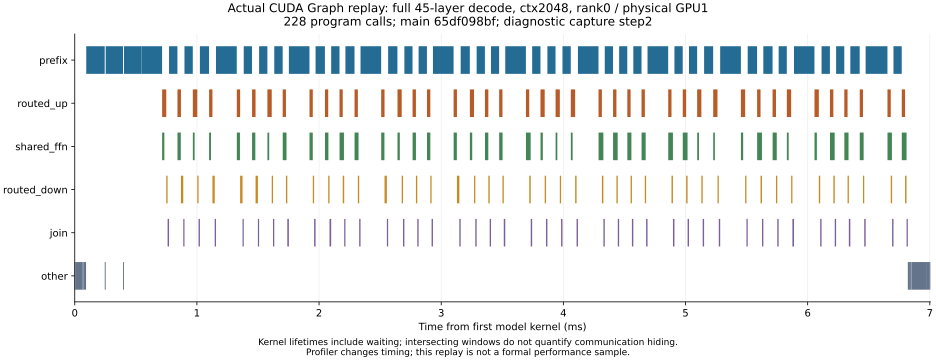

# 最新 main 的完整模型 decode 剖析（2026-11-02）

基底 main `65df098bf02848308f9890ec2500da7ee026893b`，受验源码 `1e3d0d4ba46f28408ec62163e9a0383d26477468`。完整 45 层/E288/top8/H4096/cache4096/TP4/b1/out8，原 GPU1–4；正常 SourceLoader 载入模型，双 stream/CUDA Graph 保持。仅诊断 ctx2048 的第三次完整请求，采集第 1–7 个后续 decode 步。四 rank 数值及 token 校验全部通过；本次剖析没有正式性能样本。

Gold 同轮采样的首次计划未触发：该阶段只执行 request0，采样条件写成 request2，没有生成 report，数值检查仍通过。随后独立诊断实际退出 0，用时 253.21 秒；官方 SQLite 导出退出 0，用时 0.086 秒。此处使用随后实际捕获的轨迹。

每 rank 捕获 1596 个模型 kernel，合计 6384。按 CUDA graph launch correlationId 分组，逐次核对 26 个 program 的调用次数，四 rank 七步均为 228 调用。物理 UUID 通过 PROCESS/CUDA_DEVICE/GPU 表关联，未把重排后的 CUDA deviceId 当作物理卡号。

| 物理 GPU | 七步 kernel 窗口跨度 (ms) | 忙碌窗口并集 (ms) | 多 kernel 重叠窗口 (ms) | 占忙碌窗口 | 最大并发窗口 |
| --- | ---: | ---: | ---: | ---: | ---: |
| 1 | 52.325 | 51.471 | 7.828 | 15.21% | 3 |
| 2 | 51.402 | 48.691 | 7.855 | 16.13% | 3 |
| 3 | 52.276 | 51.235 | 7.872 | 15.36% | 3 |
| 4 | 52.076 | 50.856 | 7.928 | 15.59% | 3 |

窗口统计包含等待，表示 kernel 生命周期交叠，不等于有用算术重叠或通信隐藏。profiler 的 graph 节点 streamId 不等同于应用创建的 stream 数；应用双流由实际 worker 验证。kernel 内 producer/consumer、peer traffic 和 grid barrier 的耗时尚未分解。首个采集步受 profiler 启动扰动，本次墙钟 TPOT 不作为正式性能。

| 程序角色 | 每步 kernel 持续时间之和，四 rank 范围 (ms) |
| --- | ---: |
| prefix | 4.453–4.721 |
| routed_up | 1.246–1.253 |
| shared_ffn | 1.115–1.130 |
| routed_down | 0.508–0.510 |
| join | 0.468–0.487 |
| other | 0.263–0.402 |

持续时间相加重复计入交叠并包含等待，不能直接当作每步延迟。主要持续窗口为 program_017 的 linear attention prefix（31 调用/步）和 program_011 的 MLA prefix（11 调用/步）。下一步需区分 prefix 内投影、attention、同步和通信，不把局部收益直接记作整模收益。

v19 相对 v18 的 26 个 program 全部 PTX 指令/声明一致（仅排除调试路径/DWARF），尚无此次上游更新使整模提速的证据。正式无 profiler 的八段 NFFN/FNNF 对照独立执行，由正式审计决定性能结论。

证据：`.local/rebase-latest-main-65df098bf-reaccept-20261102-v19/profile-current-full-model` 下的 scope-proof、四 rank 结果、官方 SQLite 与 decode-profile-analysis。Gold 未采集回执单独保留。

## 角色之间的窗口重叠

按角色计算各自忙碌窗口的并集，再统计与其他角色同时存在的比例（包含等待）：

| 角色 | 与其他角色窗口重叠的比例，四 rank 范围 |
| --- | ---: |
| prefix | 0.04%–0.04% |
| routed_up | 77.36%–77.78% |
| shared_ffn | 99.79%–99.85% |
| routed_down | 28.69%–30.80% |
| join | 0.66%–0.73% |

shared FFN 几乎全程与 routed up/down 的 kernel 生命周期交叠，attention prefix 与其他角色窗口交叠很少。因此继续增大 MoE 分支间的重叠未必能明显减少主要的 prefix 窗口。该结论限于外部 kernel 窗口，仍不能判断 prefix 内部 producer/consumer 或 peer 通信的实际隐藏程度。

源码阶段映射显示 MLA prefix 的 consumer 外层有 11 处分布式 barrier，linear prefix 有 6 处；helper 内部同步另计，源码数量不能作为 barrier 耗时或删除同步的依据。阶段调用顺序保存于 prefix-stage-source-map.json。

