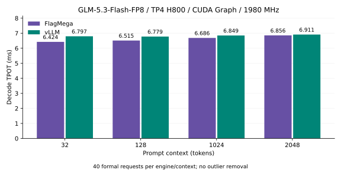
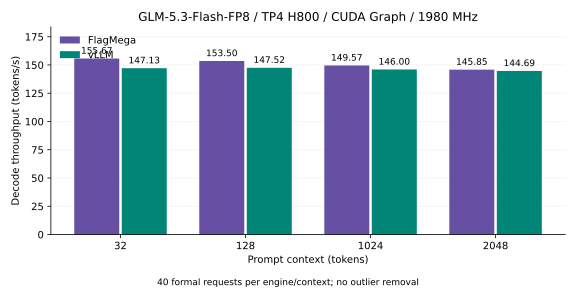
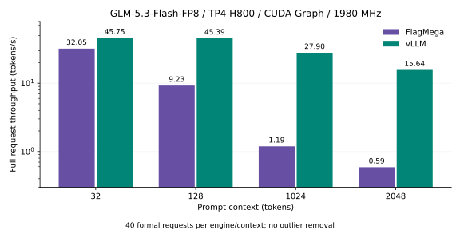

# N8 / join4 完整 TP4 验收（2026-11-02）

本页是 rebase 前的历史结果。最新 main 基底的首次八段对照性能失败；最终异步填充修复的完整验收仍待完成，见[main rebase 验收](main-rebase-acceptance-20261102-zh.md)。当时的原始输入 fresh 失败现已因果修复并完成全量重建，历史样本和限制原样保留。

**本轮解码性能门槛通过。** 原四张 H800、实际 1980 MHz，完整 45 层/E288/top8/H4096/cache4096/TP4/batch1，生成 8 token；strict、双 stream 和 CUDA Graph 保持。NFFN/FNNF 八段共 384 原始请求，预先规定 64 warmup，全部 320 正式请求保留。逐上下文，四个 Flag 段的中位数全部低于四个 Native 段的中位数。

模型测量完成于 2026-11-01 UTC；2026-11-02 完成跨会话恢复后的独立审计与仓库接入检查。

| 上下文 | Flag TPOT | vLLM TPOT | 降低 | 四 Flag 对四 Native 最小余量 |
| --- | ---: | ---: | ---: | ---: |
| 32 | 6.423726 ms | 6.796566 ms | 5.486% | 328.393 µs |
| 128 | 6.514721 ms | 6.778769 ms | 3.895% | 231.287 µs |
| 1024 | 6.685659 ms | 6.849325 ms | 2.390% | 121.664 µs |
| 2048 | 6.856429 ms | 6.911176 ms | 0.792% | 18.962 µs |

表中 TPOT 为每端每上下文 40 个正式请求的合并中位数；严格门槛另用各段 10 样本中位数判断。Flag 每请求取四 rank 最慢的完整 decode wall TPOT，包含状态与 token 交接；Native 使用原版 vLLM 的首个到最后一个生成 token TPOT。均排除 prefill 和首个生成 token。原版环境为 vLLM 0.31.0、Torch 2.13.0+cu130，Graph FULL_AND_PIECEWISE、capture sizes 1/2、max_num_seqs=1、max_num_batched_tokens=512、prefix caching 关闭。

| 段 | 32 | 128 | 1024 | 2048 |
| --- | ---: | ---: | ---: | ---: |
| A_N0 | 6.763288 | 6.756373 | 6.811251 | 6.876623 |
| A_F0 | 6.434895 | 6.525086 | 6.689587 | 6.857661 |
| A_F1 | 6.417242 | 6.511617 | 6.683025 | 6.849672 |
| A_N1 | 6.771753 | 6.788926 | 6.858058 | 6.931417 |
| B_F0 | 6.424203 | 6.512268 | 6.687201 | 6.857012 |
| B_N0 | 6.846040 | 6.770737 | 6.833304 | 6.905694 |
| B_N1 | 6.838436 | 6.840203 | 6.874252 | 6.922026 |
| B_F1 | 6.421974 | 6.511423 | 6.683892 | 6.854797 |

单位 ms。完整正式对照耗时 2403.38 秒，约 40.1 分钟。八个模型子进程都由控制器实际 wait，退出 0；跨会话后顶层工具进程的退出码不可恢复，记录为 null，没有补造 0。恢复审计核对最后一条控制器日志与完整 receipt 相等，并保留原有全部 source、编译 key、数值、硬件及性能检查；该独立审计本轮实际退出 0。

## 正确性与仓库接入

Source `ebc471b31f7df9adab032f6e759578ac44b1ad7bb7701f4eb2037ea7efd52c00`，语义 `7aac2d727a46b5d89c85b0f30d2680e63f1dd76da379075f3a30e65d6950be22`。整模 Gold 控制器实际退出 0，515.34 秒；四 rank 各 Gold100、792 次后续状态比较、ctx32 prefill 及四上下文通过。26 个 GPU 编译 key 与对应 CPU 编译一致，228 调用全部零 spill，8 warps 60 次、4 warps 168 次。所有请求测量窗口确认原四卡独占、实际 1980 MHz、无 SW/HW thermal。

仓库中的 `emit_verified_candidate.py` 从显式提供的完整 final IR 经正常 artifact/runtime API 重新生成候选，实际退出 0，118.60 秒。完整 manifest 和 26 个 program 文件与八段验收候选逐字节相等；26 个入口正常 CPU 重编译的原 Core key 也与正式绑定完全相等。readonly cache key 和全部 80,876,114,688 字节数据布局保持。

该入口明确接受已有完整 final IR；它没有声称完成原始输入 fresh 重建。原始 `compile_model.py` 的物理替换 7 项/合同 6 项失败和旧 `optimize.py` 交付合同仍属已知未完成项，未通过修改计数、绕过断言或自动 fallback 来宣称成功。复现当前已验收 artifact 时使用显式 final IR 入口：

```sh
python emit_verified_candidate.py \
  --final-ir /path/to/verified-complete-final.py \
  --checkpoint /path/to/checkpoint \
  --integrity-report /path/to/checkpoint-digests.json \
  --rdata-cache /path/to/offline-layout-cache \
  --output /path/to/fresh-output
```

使用正常构建、含本次 N8 修复的 NVIDIA/TLE 编译器与对应 SDK。完整本地命令及证据路径见[中文迭代日志](.local/iteration-log-zh.md)。

## 因果修复与优化

- `lib/Analysis/Utility.cpp::supportMMA` 原 MMA v3 判定排除 N8，使合法 FP8 dot 经 `getMMAVersionSafe` 降为 FP16 MMA K16，改变原生 FP8 K32 的累加顺序。`__TLE__` 内补充合法 FP8/F32/N8/K32 能力判定，保持精确累加、非 FP8、短 K 及既有资源限制。8 项 MLIR 及 GPU 最小复现有 fail-before/pass-after；12 个 GPU 回归覆盖 E4/E5、4/8 warps、K32/128/256。
- FFN up 使用 N8/stage8，down 使用原量化流程 N8；保持全部输出与原数学。down 的 512 MiB 活动权重轮转局部快 2.79%。up stage8 对 stage5 局部快约 4.9%；N8 未比 N16/stage8 再提高轮转性能，但整模 up shared memory 从 83740 降为 75548 字节。
- join 改为 4 warps，保留 grid128、全部 owner/epoch/release、远端 acquire、8448 字节通道和原数学。完整四卡数值与 2048 个延迟扰动 epoch 通过，局部快 3.71%。typed requests 与 package plan 同时调整；正常资源验证保留。DSA 的整数可见性改为原唯一 writer 发布，保留原有三个 grid 同步。
- `lib/Conversion/TritonToTritonGPU/TritonToTritonGPUPass.cpp::TritonScanPattern` 未为 explicit consumer 保留 scan 结果 layout，动态 gather 触发未解析的 materialization。修复在 scan 后逐结果插入真实 layout conversion，保留 scan 输入 encoding；包括多结果、反向与普通 scan 的 3 项 MLIR 控制，以及 8 个 GPU 回归，观察 fail-before/pass-after。两项修复合并的 20 个 GPU 回归、6 个相关 lit 测试均通过。

scan 修复另经正常 CMake 构建；52 个入口的正常编译证明两份 Core 生成的 26 个 PTX 可执行区（声明、launch directive、函数与全部指令）逐字节相等，签名、constants、attributes 和资源也相等。完整 PTX 文本因缓存/冷编译的源码路径和 DWARF debug 区不同而不相等；没有规范化或删改指令。正式八段计时使用 N8 Core，新增 scan 修复未另作整模计时，不将它记作额外整模性能收益。

## 性能边界与历史失败

本轮只证明上述八段通过。前一轮 strict 基线完整八段的性能门槛失败；合法 B_N0 的 32/128/1024/2048 中位数为约 6.4058/6.3760/6.4412/6.4953 ms，仍比当前 Flag 更快。该轮和全部样本继续保留，Native 跨轮差异原因未定位。本轮 2048 仅有 18.962 µs 最小余量，不能推断在其他运行状态下都有稳定优势。

完整请求含 prefill 仍显著慢于 vLLM：2048 上下文的请求中位数为 Flag 13575.19 ms、Native 511.63 ms。对应 TTFT 为 13527.24/463.16 ms。当前 Flag 使用编译后的逐 token prefill，解码胜出不能解释为端到端胜出。

新增 DSA read-only prefix 实验保持 9 组全部 8192 BF16 输出、所有 scratch 字节与输入一致，局部 1024/2048 快 3.30%/2.53%；尚未整模验收，未接入已验收候选。KDA K128/K512、own-epoch volatile load 等退化实验也未采用。

全部本轮原始样本、分段中位数、历史失败摘要和 Core 身份保存在[summary-20261102.json](figures/summary-20261102.json)。






