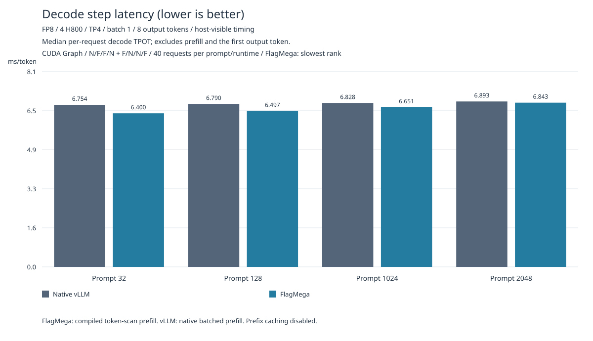
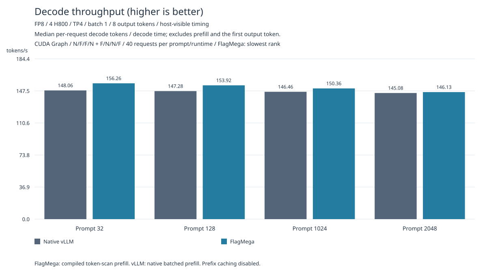
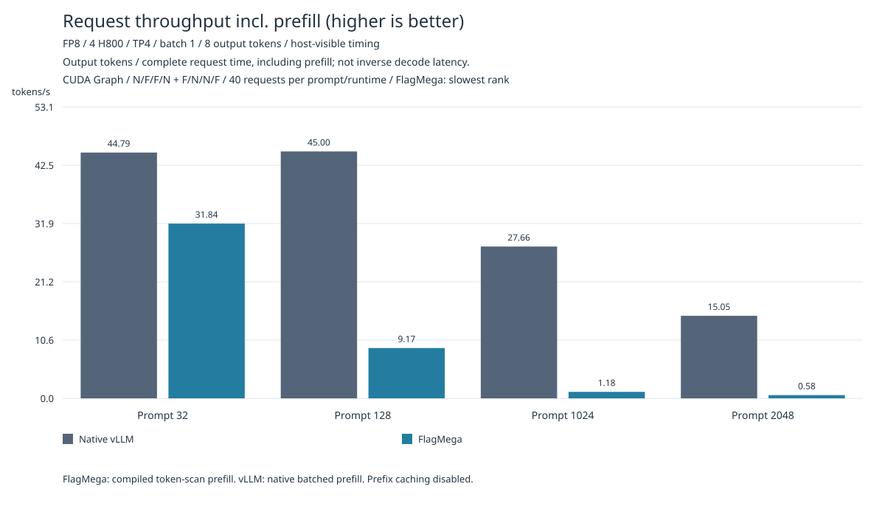
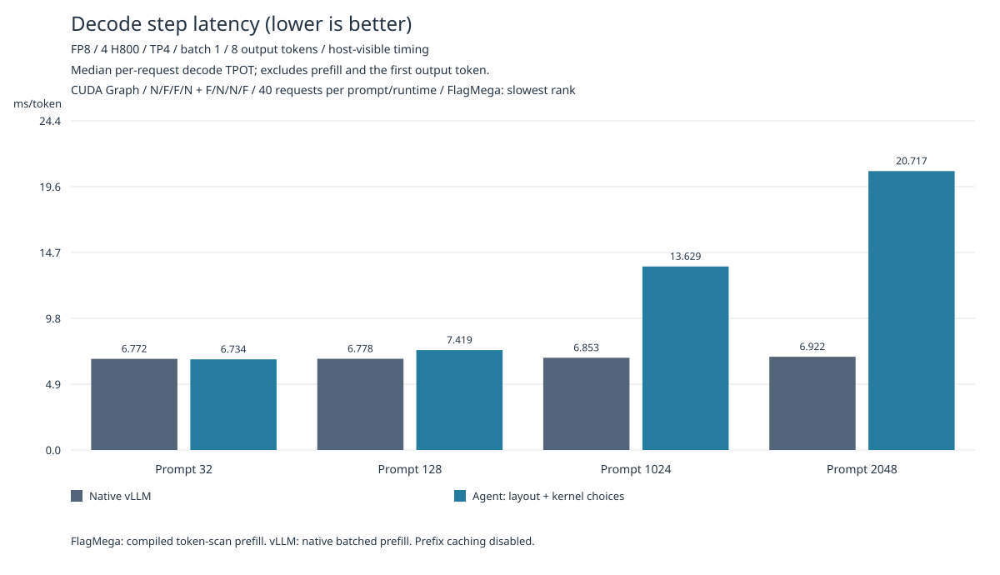
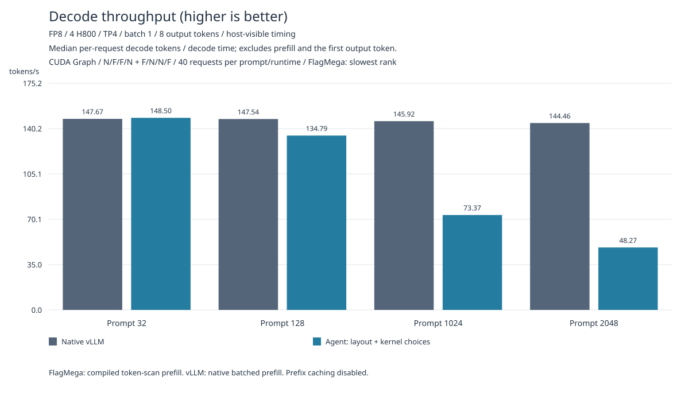
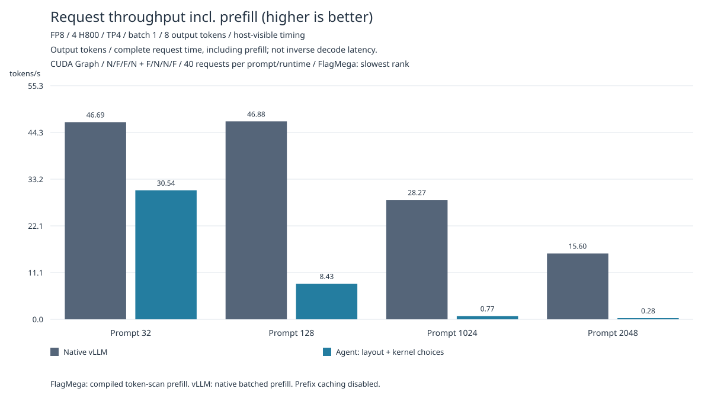

# GLM-5.3-Flash-FP8 / H800

累计改动、验证结果及未完成项见[工作区总结](workspace-summary-zh.md)。

完整45层、E288/top8、H4096、cache4096、TP4，batch1，独立生成8token。
2026-11-01在同一四张H800/1980MHz上完成N/F/F/N和F/N/N/F，保留全部320正式请求。
32、128、1024、2048四种prompt长度的decode TPOT均通过原严格性能门槛，完整数值和硬件检查通过。
TPOT排除prefill和首个生成token；完整请求吞吐另行保留，包含prefill，仍低于vLLM。

## 最新完整八段结果（2026-11-01）

| 上下文 | FlagMega TPOT | vLLM TPOT | 降低 | 四Flag对四Native最小余量 |
| --- | ---: | ---: | ---: | ---: |
| 32 | 6.399618ms | 6.753940ms | 5.246% | 341.511µs |
| 128 | 6.496676ms | 6.789592ms | 4.314% | 230.886µs |
| 1024 | 6.650775ms | 6.827689ms | 2.591% | 150.657µs |
| 2048 | 6.843258ms | 6.892736ms | 0.718% | 21.512µs |

各长度每个运行端40正式请求，FlagMega逐请求取四rank最慢wall TPOT。
每个Flag段均快于本顺序两个Native段，全部四Flag段也均快于全部四Native段。
完整100请求及全状态Gold、实际26编译key/228调用零spill、双CUDA Graph、独占1980MHz/无thermal验收通过。







结果与全部正式样本：[summary-20261101.json](figures/summary-20261101.json)。
完整原始请求和两个独立审计保存在[中文迭代日志](.local/iteration-log-zh.md)链接的本地证据目录。
当前接受的是正常API载入并完整验收的已生成artifact，Source6881d6c8…、语义7a073b51…；
正常生成/预编译只更新011，其余25入口源码和key保持。

原始IR fresh重建入口另有未解决限制：直接脚本运行的三个包导入已因果修正，23项回归通过；
历史物理选型按固定kernel名字排除特例的合同在新命名下仍失败，fresh全量重建尚未验收。
下文构建流程及2026-10-22实测保留为历史说明，不能据此宣称当前已生成artifact的公开fresh复现通过。

## 目录与入口

目录组织与 `01-qwen3-1.7b-bf16/nvidia-h800` 一致：入口脚本位于本目录根部，
实现集中在一个可导入的 `local_optimizations/` 包，图表位于 `figures/`。

```text
nvidia-h800/
├── optimize.py              # 原始输入正常编译并发布完整artifact
├── accuracy.py              # 独立JIT与完整TP4数值验证
├── benchmark_gpu.py         # FlagMega完整请求CUDA Graph测量
├── benchmark_vllm.py        # 原生vLLM完整请求测量
├── reproduce.py             # 同卡两种顺序的完整性能复现
├── render_results.py        # 根据全部正式样本生成SVG
├── generated_kernels.py     # 已验证配置的正常生成源码
├── local_optimizations/     # 分布、内核、运行辅助与原始输入合同
├── patches/                 # 固定FlagCX版本所需patch
├── figures/
│   ├── decode_latency.svg
│   ├── decode_throughput.svg
│   └── request_throughput.svg
├── readme.md
└── .local/                  # 忽略提交的实验、原始记录及构建产物
```

`local_optimizations/__init__.py`提供完整实现注册入口，`kernel_recipe.py`安装内核选择，
`target.py`与`tp4_distribution.py`提供目标和TP4分布合同，`compile_model.py`通过正常编译器
重新生成分配、bufferization及同步计划。原始IR、参考状态摘要和SDK revision与实现放在一起。
公开复现不依赖 `.local/` 的代码；`.local/` 中的路径均为用户选择的输出或不可变readonly cache。

## 构建和验证

需要本仓库已安装NVIDIA/TLE后端的flagtree环境、完整原始checkpoint、四张空闲H800，
以及约324GB readonly产物空间。每卡权重约80.45GB，另需状态和运行时空间。
使用checkpoint revision `eb9eb208eb0d988989d07a6a12d0fdeb5f52574a`；
下列命令直接使用完整checkpoint目录。

从仓库根目录执行，所有构建与结果目录使用新路径：

```sh
conda activate flagtree
export GLM_TUTORIAL="$PWD/python/tutorials/flagmega/04-glm5.3-flash-fp8/nvidia-h800"
export GLM_CHECKPOINT=/path/to/original-checkpoint
export GLM_OUTPUT="$GLM_TUTORIAL/.local/reproduce"
python "$GLM_TUTORIAL/local_optimizations/sdk.py" --output "$GLM_OUTPUT-sdk"
export FLAGCX_MODULE_PATH="$GLM_OUTPUT-sdk/runtime"
python "$GLM_TUTORIAL/optimize.py" --output "$GLM_OUTPUT" \
  --checkpoint "$GLM_CHECKPOINT" --readonly-cache /path/to/readonly-cache
python "$GLM_TUTORIAL/accuracy.py" --trial "$GLM_OUTPUT" \
  --output "$GLM_OUTPUT-validation" --sdk "$FLAGCX_MODULE_PATH" --jit-device 1
```

SDK构建使用 `local_optimizations/source-revision.json` 的固定commit及 `patches/` 中的两个patch。
已有相同协议SDK时可直接设置 `FLAGCX_MODULE_PATH`。`--jit-device`选择空闲卡；完整数值验证
再独立选择四张空闲卡。原始IR从 `local_optimizations/original-input.py.gz`读取并校验摘要，
起始阶段是 `selected_tir_variants`，没有buffer plan或execution functions。

正常候选选择、分配、bufferization、同步计划、代码生成与资源检查全部启用。
`optimize.py`发布final IR、manifest、readonly data及executable source，核对生成源码与
[generated_kernels.py](generated_kernels.py)逐字节相等。源码快照不含权重，运行需要完整artifact。
readonly cache仅复用源身份及变换recipe相同的不可变内容。

`accuracy.py`检查四rank×两独立请求的官方8token
`[3847, 284, 1373, 8282, 4218, 3755, 947, 906]`；每步68项KDA与8项其他字段、
8步合计608项状态字节摘要，以及完整guard和缓存尾部。26编译入口、228调用必须全部零spill。
所有子进程真实wait、退出码和输入文件身份保存到结果目录。

## 性能复现

完成单 token 完整状态字节验证后，`reproduce.py`默认对32、128、1024、2048四种prompt长度
先各执行两次独立数值验证，再在相同四张H800上顺序执行N/F/F/N与F/N/N/F。
每段、每种长度2次热身和10次正式请求，各长度保留双方全部40个正式请求。
提示文本与01一致：重复并截取“Explain why the sky is blue, and how sunlight interacts with air. ”
的本模型token序列，固定生成8token；完整checkpoint目录需包含同一revision的tokenizer文件。

```sh
python "$GLM_TUTORIAL/reproduce.py" \
  --trial "$GLM_OUTPUT" --validation "$GLM_OUTPUT-validation/numerics" \
  --output "$GLM_OUTPUT-two-orders" --checkpoint "$GLM_CHECKPOINT" \
  --sdk "$FLAGCX_MODULE_PATH" --native-python /path/to/vllm-0.31-env/bin/python \
  --native-triton-cache /path/to/native-triton-cache \
  --native-inductor-cache /path/to/native-inductor-cache \
  --prompt-lengths 32 128 1024 2048
python "$GLM_TUTORIAL/render_results.py" \
  --results "$GLM_OUTPUT-two-orders"
```

与01相同，生成 `decode_latency.svg`、`decode_throughput.svg` 和 `request_throughput.svg`，
采用相同尺寸、配色和从零起始的分组柱状图，横轴为上述四种prompt长度。`summary.json`保留全部正式请求及源文件摘要，
默认与三张图一起放在结果目录；`--output /path/to/figures`可指定图表目录。
decode延迟取后续7个生成token的每请求TPOT中位数，decode吞吐取每请求 `1000 / TPOT` 的中位数，
均排除prefill和首个生成token。完整请求吞吐取每请求 `8 × 1000 / wall_request_ms` 的中位数，
包含prefill及首token时间，仅为与01对齐的补充图，不参与decode性能验收。

两端decode CUDA Graph均开启。长prompt的FlagMega prefill逐token执行完整编译产物，
每个prompt token显式选择KDA chunk数值分支，生成阶段选择recurrent分支。
vLLM使用原生批量prefill，scheduler每chunk最多512token；完整2048token输入均被处理，
cache容量仍为4096。该配置将prefill激活内存限制在四卡完整权重的剩余显存内。
长prompt验证检查各rank×两次独立请求的原生8token序列、完整活跃状态有限性及缓存尾部；
该验证未比较长prompt状态的原生字节相等性。单token的608项状态字节验证单独保留。
TPOT包括state carry、GPU greedy sampling及token交接，
FlagMega取四rank最慢值；请求初始化、JIT、诊断拷贝、写盘单独计时。
vLLM使用正常 `LLM.generate`，关闭prefix caching、tokenization、detokenization，
保留原生编译和graph配置。完整状态字节验证在单独进程中完成；长prompt状态检查位于请求计时结束之后。
计时不含参考写入或状态观察拷贝。

decode性能的事前固定标准要求两轮使用相同四卡UUID和同一已验证源码，两轮TPOT点估计均更快，
每个FlagMega段中位数均小于每个native段中位数，合并P50也更快。
完整样本与硬件遥测保留；数值通过与性能通过分别记录。

## 四种prompt长度的实测结果（2026-10-22）

下表和三张图均来自两种完整顺序的全部正式请求。每请求decode TPOT和吞吐分别取中位数，
FlagMega以四rank最慢值作为完整TP4请求样本。

| Prompt token数 | FlagMega TPOT（ms/token） | vLLM TPOT（ms/token） | FlagMega decode吞吐（tokens/s） | vLLM decode吞吐（tokens/s） |
| ---: | ---: | ---: | ---: | ---: |
| 32 | 6.73379 | 6.77204 | 148.50 | 147.67 |
| 128 | 7.41922 | 6.77782 | 134.79 | 147.54 |
| 1024 | 13.62939 | 6.85293 | 73.37 | 145.92 |
| 2048 | 20.71731 | 6.92237 | 48.27 | 144.46 |

以下完整请求数据仅用于与01对齐，不参与decode性能比较。

| Prompt token数 | FlagMega完整请求吞吐（tokens/s，含prefill） | vLLM完整请求吞吐（tokens/s，含prefill） | 每运行端正式请求数 |
| ---: | ---: | ---: | ---: |
| 32 | 30.540 | 46.687 | 40 |
| 128 | 8.428 | 46.876 | 40 |
| 1024 | 0.767 | 28.271 | 40 |
| 2048 | 0.285 | 15.604 | 40 |







prompt32的decode在两种顺序中均略快；128、1024、2048的decode较慢。
所有组和所有正式样本完整保留，decode性能加速验收未通过。
FlagMega逐token执行编译产物完成prefill；vLLM采用原生批量prefill，chunk上限512。

两轮8个引擎段、32个prompt测量组的硬件检查通过：相同四卡UUID、1980MHz、
无温度降频或外部GPU计算。
原始请求、遥测、真实退出码及输入摘要位于`.local/multi-prompt-20261022/results-v1/`；
`summary.json`保留每组两端各40个正式请求及来源文件SHA256。

## 历史单token结果

| 指标 | FlagMega | vLLM 0.31.0 |
| --- | ---: | ---: |
| Decode TPOT P50 | 6.55776 ms/token | 6.62785 ms/token |
| Decode TPOT P95 | 6.59820 ms/token | 6.82803 ms/token |
| Decode吞吐中位数 | 152.49 tokens/s | 150.88 tokens/s |
| 完整请求吞吐中位数（含prefill） | 151.22 tokens/s | 120.95 tokens/s |

| 运行顺序 | vLLM P50 | FlagMega P50 | vLLM段间漂移 |
| --- | ---: | ---: | ---: |
| N0/F0/F1/N1 | 6.63322 | 6.56397 | +0.0570% |
| F0/N0/N1/F1 | 6.62411 | 6.55176 | +0.2190% |

运行栈分别为FlagMega/PyTorch2.10/CUDA12.8和vLLM/PyTorch2.13/CUDA13.0。
正式区间四卡均为1980MHz，无温度降频或外部GPU计算。结果范围为上述短上下文单请求。
2026-10-21公开输入fresh编译与发布207.38秒，独立GPU JIT42.37秒，完整状态检查367.34秒。
编译时间复用了已验证checkpoint摘要和readonly cache，不包括import、首次cache构建、JIT及推理。

## 本地优化

| 优化 | 实现要点 |
| --- | --- |
| TP4分布与CTA分工 | 按投影、专家及状态合同选择输出分片，独立CTA负责不同结果 |
| WGMMA与流水 | 调整N/K tile、warp数量、共享内存及算子内部TMA stage；尚未实现跨算子权重预取 |
| QA norm与mHC融合 | 保留原累加顺序与BF16舍入，减少中间读写 |
| KDA、QKV、KV并行 | 将独立工作分配给CTA/warp owner并重叠计算 |
| DSA并行与发布 | 独立列、head owner计算并保留消费前的必要发布 |
| Router量化与投影重叠 | 在完整物理合同内交错独立工作 |
| Join及O-proj发布 | O-proj在同一CTA内按tile发布、等待peer、归约并执行mHC；FFN join等待routed FFN与shared FFN两路计算完成 |
| 共享FFN组合 | 42组up/down复用两种设备函数，调用数270降至228 |
| 共享GLU的N lane | 每owner4个有效输出采用4个N lane及32个K partial，128线程全部参与 |
| CUDA Graph与offset | 完整请求使用graph，状态和指针offset保留int64语义 |
| Readonly cache | 复用已校验的不可变权重布局，缩短重复编译与发布 |

这里的pipeline producer指负责预取activation和weights的执行角色，compute consumer负责MMA。
当前O-proj将计算与阻塞通信顺序放在同一CTA内，没有独立的预取producer和通信角色；
不同CTA可交错执行，但这不代表通信已被计算或下一算子的权重预取充分覆盖。
跨算子流水还需要明确的分块就绪信号、权重缓冲和角色分工；下一算子的全hidden归约依赖
约束activation消费，权重预取本身可以提前。上述流水尚未实现，不计入已验证的优化收益。

共享FFN内部仍执行原数学函数，保持FP8部分积、FP32 K128部分量的32步原序FMA，
以及投影、clamp、SiLU、乘法的BF16舍入。共享GLU只覆盖已检查完整合同的两种shared_up定义。
同核心S/M/M/S因果对照中，GLU lane调整将6.608931142降至6.555999787 ms/token，改善0.800906434%；
native性能结论来自上面的两轮完整同卡测量。

核心同步修复在 `python/triton/flagmega/passes/tir/bufferize/synchronization.py` 的
`_plan_memory_synchronization`：callee完整device屏障先于late peer访问的incoming覆盖
需要传回caller，并与outgoing新写入分开；early peer、局部屏障和可能零次循环保留必要约束。
32项最小回归修复前11失败、修复后全通过，邻域131项通过。上述GLU局部对照两端均包含该修复。

已测源码SHA256：`7a2f8f759182f0578bee96aa88869833ecb68a82bea862fd5a2125b8f9cd58b5`。
最终IR身份：`4a5961d26f917983eb8759460a55a83bb7339518d49eb8827dc1375075e2d045`。
原始IR身份见 `local_optimizations/original-input.json`；构建时pending字段仅表示GPU验收尚未执行，
实际验收结论由新输出目录中的验证和性能报告给出。历史原始记录保存在 `.local/`。

2026-10-22按01整理目录后，从原始IR正常重编译与发布205.60秒，最终IR身份及生成源码
与上述已测配置一致。相关已有测试246项通过；88项GPU测试在目录整理时跳过。
2026-10-22多prompt入口从原始IR正常重编译与发布202.31秒，IR和源码身份不变；
独立GPU JIT进程42.90秒通过，26入口、228调用与joint resource约束均通过且零spill。

新构建完整TP4单token状态验证在330.40秒的GPU子进程中通过，四rank×两独立请求，
8步608项完整状态字节摘要一致；四组长prompt的四rank×两独立请求也已通过原生greedy序列、
活跃状态有限性与缓存尾部检查。两种顺序正式测量均已完成，原始报告位于
`.local/multi-prompt-20261022/results-v1/`；`render_results.py`核对全部样本后生成当前三张图。
